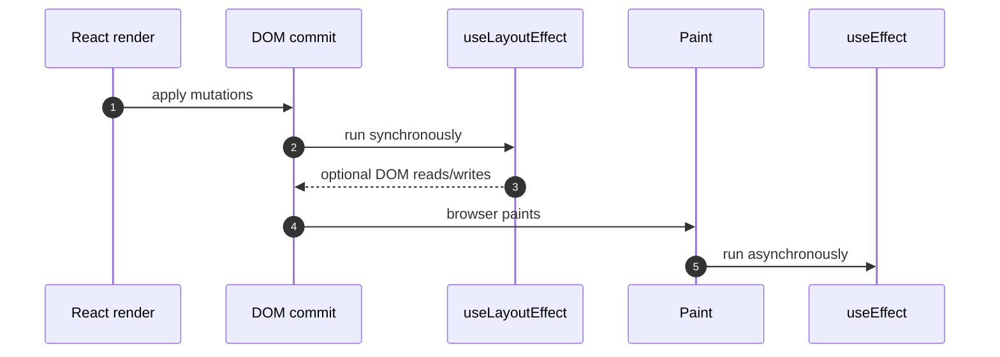
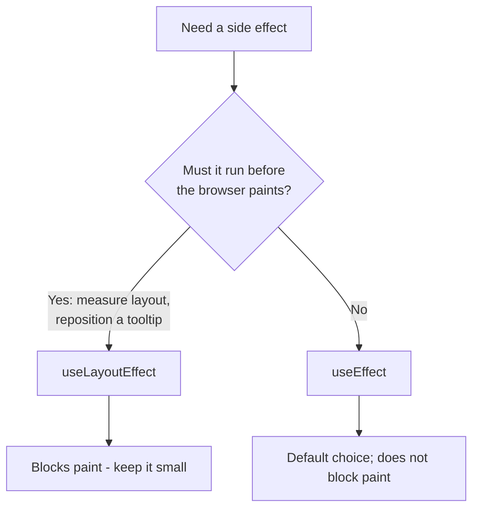

# 10. What is the difference between useEffect and useLayoutEffect?


##  Answer

Both useEffect and useLayoutEffect are React hooks used to perform **side effects** in functional components (like fetching data, manipulating the DOM, or setting up subscriptions).  
However, they differ in timing and impact on rendering.


##  Key Difference

| Hook               | Runs after paint (asynchronously)       | Runs before paint (synchronously)    |
|--------------------|----------------------------------------------|------------------------------------------|
| useEffect        | After the DOM updates are painted to screen  | Doesn't block the browser paint        |
| useLayoutEffect  | Immediately after DOM mutation, before paint |  Blocks paint until effect completes |


##  When to Use Each

| Use Case                            | Recommended Hook     |
|-------------------------------------|----------------------|
| Data fetching                       | useEffect          |
| Event listeners / subscriptions     | useEffect          |
| DOM measurement or manipulation     | useLayoutEffect    |
| Animations based on layout          | useLayoutEffect    |


## Example: useEffect (non-blocking)

```jsx
useEffect(() => {
  console.log('Runs after render and paint');
}, []);
```

## Example: useLayoutEffect (blocking)

```jsx
useLayoutEffect(() => {
  console.log('Runs after render but before paint');
}, []);
```

## Timing, Step by Step



`useLayoutEffect` sits **between** DOM mutation and paint. That is why it can prevent a visible flicker: the user
never sees the intermediate frame.

## Which One?




This hook blocks the paint until its logic runs — useful for reading layout or preventing flickers.

## Warning

Overusing useLayoutEffect can lead to janky UI or performance issues, as it blocks painting.
Use it only when needed, such as when measuring DOM nodes or handling layout-sensitive logic.

> **SSR note:** `useLayoutEffect` does not run on the server and React warns when you use it during server
> rendering. If a component may be server-rendered, prefer `useEffect`, or use an isomorphic hook that falls back
> to `useEffect` on the server.


## Summary

- useEffect: Asynchronous, after paint, for most side effects. ✅

- useLayoutEffect: Synchronous, before paint, for DOM reads/writes. ⚠️

Use useEffect by default. Use useLayoutEffect only when you need precise control over layout timing.

---

**Next:** [11. useCallback vs useMemo](11.%20What%20is%20the%20difference%20between%20useCallback%20and%20useMemo.md)
