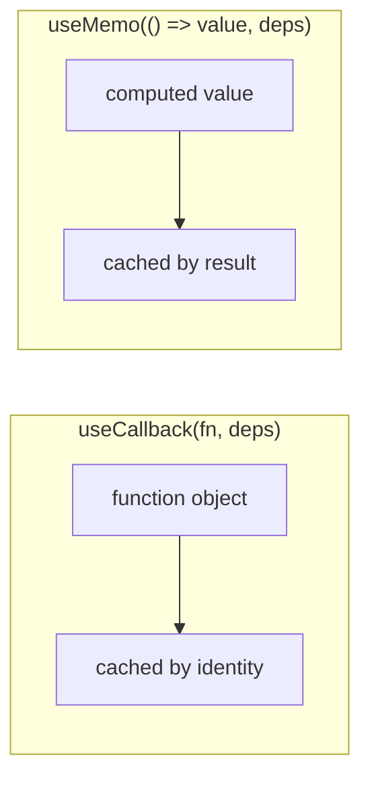
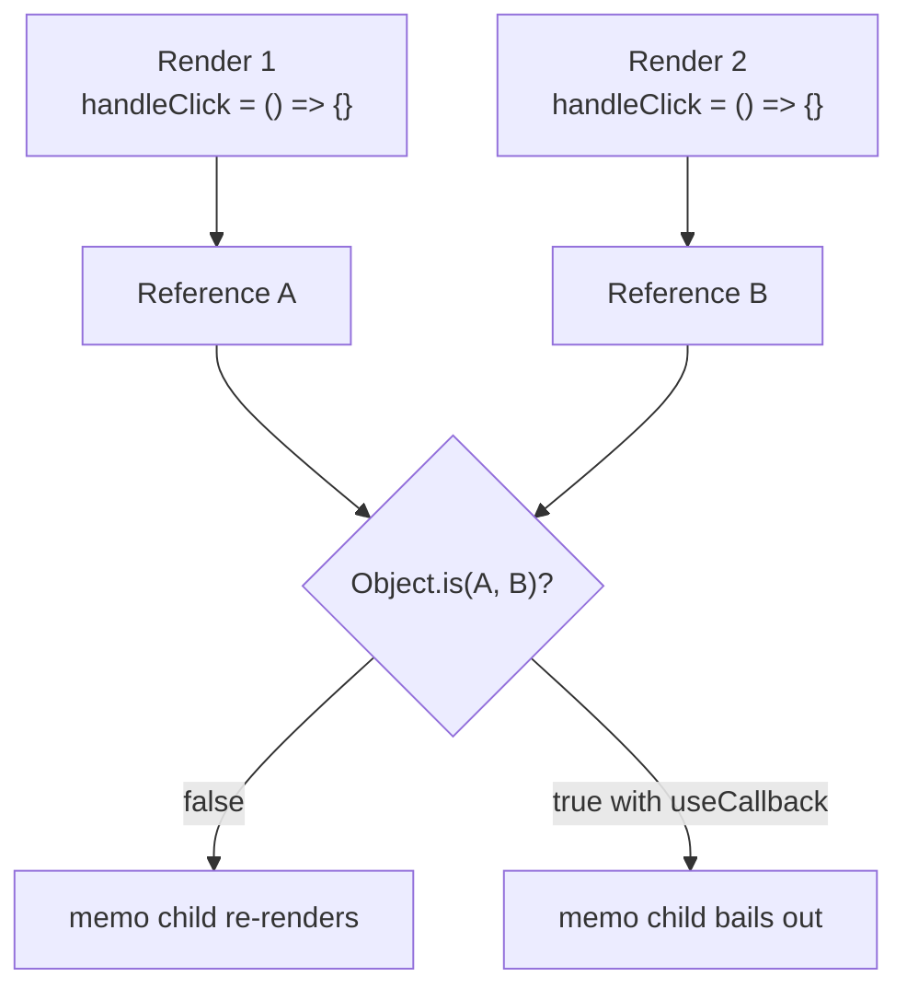
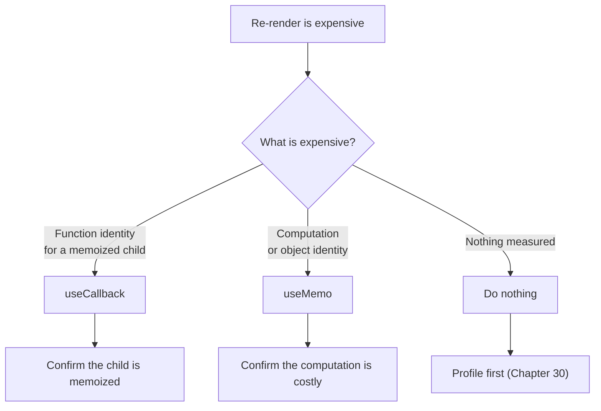

# 11. What is the difference between `useCallback` and `useMemo`?

> **Level:** Intermediate · **Prerequisites:** Chapters 7, 8, 13 · **Reading time:** ~20 min

Both hooks memoize, but they memoize **different things**:

| Hook | Memoizes | Returns | Use when |
|------|----------|---------|----------|
| `useCallback` | A function definition | The same function until deps change | Passing callbacks to memoized children or effect deps |
| `useMemo` | A computed value | The cached result until deps change | Expensive calculation or stable object/array identity |



---

## The mental model: referential equality

React compares props with `Object.is`. A function or object created during render is a **new reference** every
time, even if its contents are identical.



`useCallback` keeps the reference stable; `useMemo` does the same for values.

---

## `useCallback` — keep a function stable

```jsx
import { memo, useCallback, useState } from "react";

const Row = memo(function Row({ item, onSelect }) {
  return <button onClick={() => onSelect(item.id)}>{item.name}</button>;
});

function List({ items }) {
  const [selectedId, setSelectedId] = useState(null);

  // Stable across renders unless dependencies change
  const handleSelect = useCallback(id => setSelectedId(id), []);

  return items.map(item => (
    <Row key={item.id} item={item} onSelect={handleSelect} />
  ));
}
```

Without `useCallback`, `handleSelect` is a new function on every `List` render, so every `Row` re-renders even
though `memo` is applied.

> `useCallback(fn, deps)` is equivalent to `useMemo(() => fn, deps)`. The dedicated hook exists for readability.

---

## `useMemo` — keep a value

```jsx
function ProductTable({ products, query }) {
  const visible = useMemo(() => {
    return products
      .filter(product => product.name.toLowerCase().includes(query.toLowerCase()))
      .sort((a, b) => a.price - b.price); // copy first: [...products].sort(...)
  }, [products, query]);

  return <Table rows={visible} />;
}
```

Here the benefit is avoiding a filter + sort on every unrelated render. If the calculation is cheap (sorting 20
items), `useMemo` adds more overhead than it saves.

```jsx
// ❌ Mutates props and defeats the purpose
const sorted = useMemo(() => products.sort(compare), [products]);

// ✅ Copy, then sort
const sorted = useMemo(() => [...products].sort(compare), [products]);
```

`useMemo` also stabilizes object/array identities:

```jsx
const columns = useMemo(
  () => [{ key: "name", label: "Name" }, { key: "price", label: "Price" }],
  []
);
```

---

## Which one do you need?



---

## Common mistakes

| Mistake | Consequence | Fix |
|---------|-------------|-----|
| Memoizing everything | More code, no measured gain | Profile first |
| `useCallback` on a non-memoized child | No benefit | Add `memo` or remove the hook |
| Empty dependency array with used values | Stale closure | List every dependency |
| Using `useMemo` for side effects | Side effects belong in effects/handlers | `useEffect` |
| Mutating the input inside `useMemo` | Props change under you | Copy first |
| `useMemo` for a cheap calculation | Overhead exceeds savings | Compute directly |
| Using memoization for correctness | React may discard caches | Derive/guard explicitly |

---

## Summary

- `useCallback` memoizes a **function**; `useMemo` memoizes a **value**.
- Both are performance tools, not semantic guarantees.
- They only pay off when identity matters (memoized children, effect dependencies) or the computation is expensive.
- React Compiler can automate most of this for code that follows the Rules of React (Chapter 38).

---

**Next:** [12. How do you create a React app?](12.%20How%20do%20you%20create%20React%20app.md)
