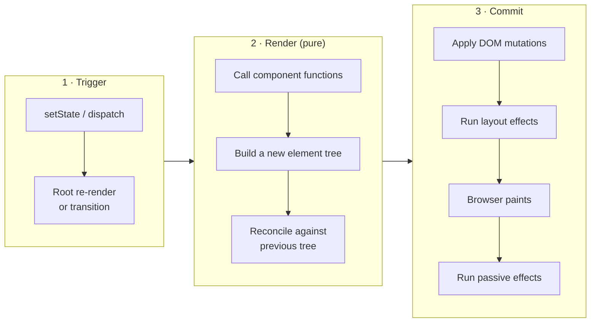
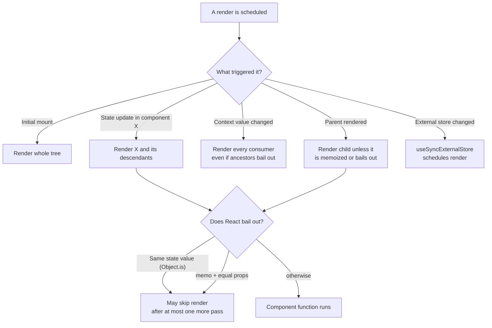
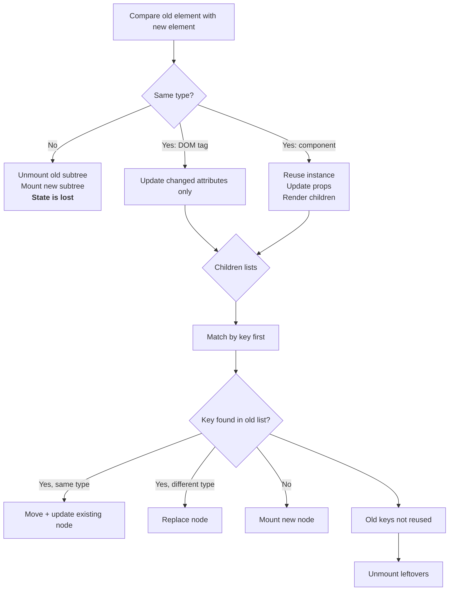
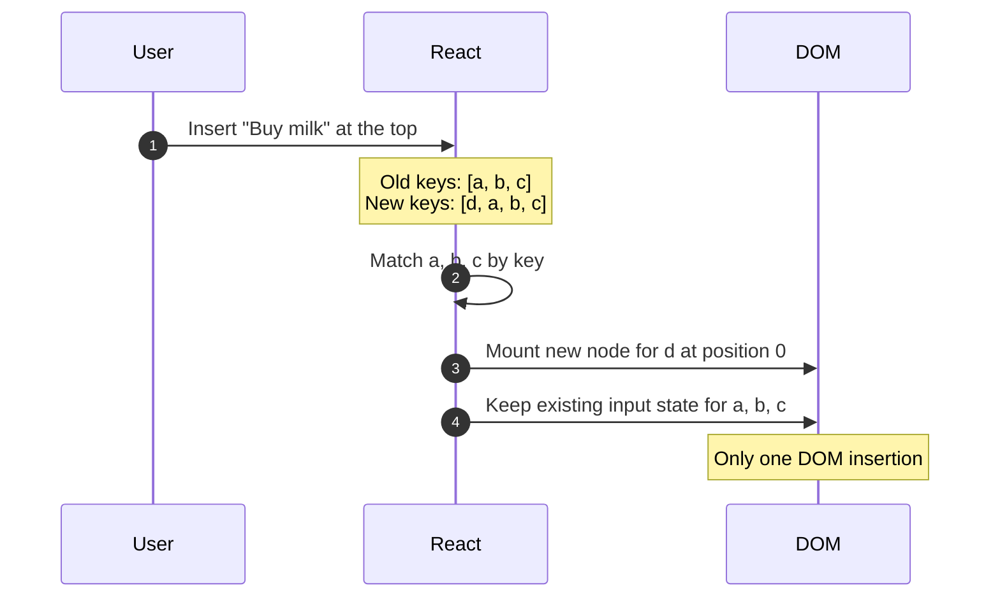
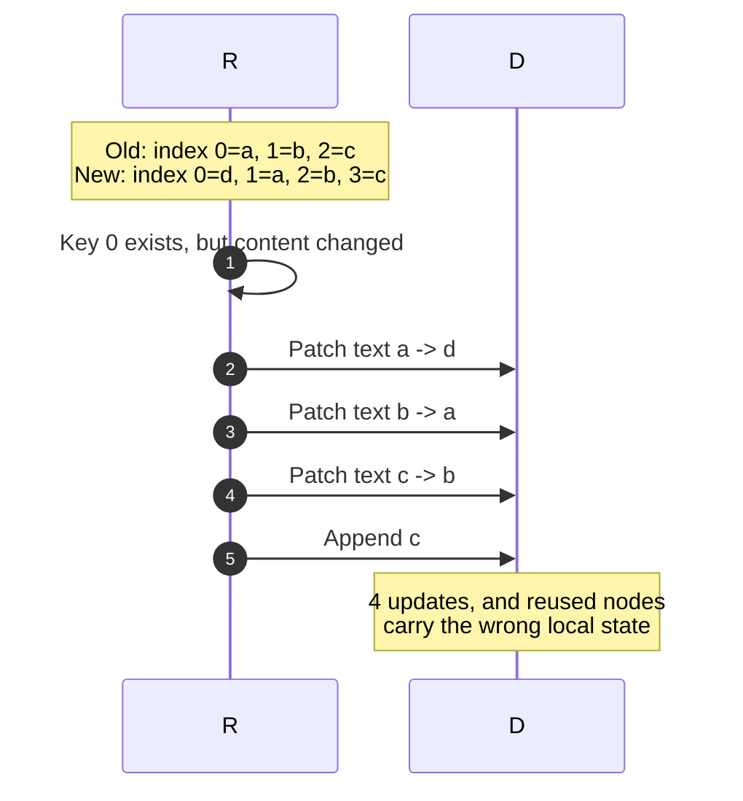
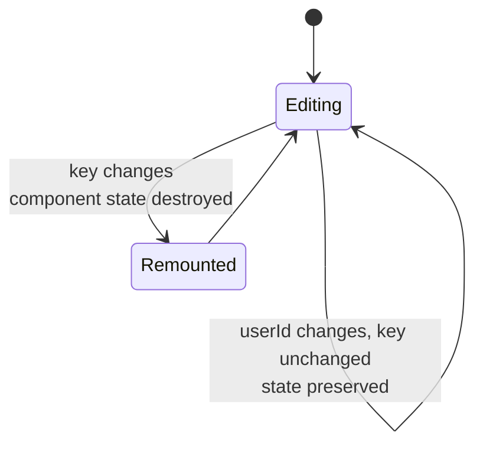
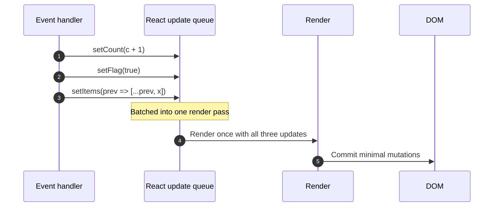

# 13. Rendering, Reconciliation and Keys

> **Level:** Intermediate · **Prerequisites:** Chapters 3, 4, 5, 7 · **Reading time:** ~35 min

Most React bugs that look like "React is being weird" are actually misunderstandings of one of three things:
*when* React renders, *what* React compares, and *how* React decides whether a DOM node should be reused or
recreated. This chapter builds an accurate mental model of all three.

---

## 1. Render is not the same as DOM update

A React update happens in three phases. Only the last one touches the browser.



| Phase | What happens | Must be |
|-------|--------------|---------|
| **Render** | React calls your components, evaluates JSX, diffs the result | Pure — no side effects, no mutation |
| **Commit** | React mutates the DOM, then runs `useLayoutEffect`, then paints | Fast — it blocks the browser |
| **Passive effects** | `useEffect` callbacks run after paint | Non-blocking, may be async |

Two consequences that interviewers love:

1. **"Rendering" is just calling functions.** It is usually cheap. The expensive part is DOM mutation and layout.
2. **A component can render and not commit.** In concurrent React, a render can be interrupted or thrown away.

---

## 2. When does a render start?



Important nuances:

- **State updates are batched.** Multiple `setState` calls in one event handler produce one render.
- **Setting the same value** (`Object.is(prev, next)`) usually bails out, but React may still call your component
  one extra time before it does. Don't rely on "zero renders".
- **Context bypasses memoization.** `React.memo` does not stop a consumer from re-rendering when the context value
  changes.
- **`StrictMode` in development intentionally renders twice** to surface impure components. Production does not.

---

## 3. Reconciliation: how React matches old and new trees

React does not run a general-purpose tree-diffing algorithm (that would be O(n³)). It uses heuristics that are
O(n) and correct for almost every real UI.



The rules, in plain English:

| Change | React behavior | Component state |
|--------|----------------|-----------------|
| Text/attribute changes | Patch the DOM property | Preserved |
| Same component, different props | Re-render with new props | Preserved |
| Different element type at the same position | Replace the subtree | **Lost** |
| Same type but different `key` | Replace the node | **Lost** |
| Sibling order changes | Move nodes by key | Preserved |

> **The type is part of identity.** `{isEditing ? <input /> : <span />}` destroys the input's DOM node and any
> state it holds, because `<input>` and `<span>` are different types.

### The classic bug: conditional component definitions

```jsx
// Anti-pattern: a new component type on every render
function Panel({ children }) {
  function Body() {
    return <div>{children}</div>;
  }
  return <Body />;
}
```

`Body` is a brand-new function object each render, so React sees a different type and remounts the subtree every
time. Define components at module scope, or accept `children` directly.

---

## 4. Keys: identity for list children

A `key` tells React *which* child is *which* between renders. It is not passed to the component as a prop.

```jsx
<ul>
  {tasks.map(task => (
    <TaskRow key={task.id} task={task} />
  ))}
</ul>
```



With **index keys**, the same insertion produces this:



### When index keys are actually safe

Index keys are acceptable only when **all** of the following hold:

- The list is never reordered, filtered or prepended to (append-only is fine).
- Items have no local state (or state does not depend on identity).
- Items are not focusable inputs whose value the user is editing.

That is rarely true for real lists. Use a stable ID from your data. If the data has no ID, generate one when the
item is created (`crypto.randomUUID()`), not during render.

### Key scope and intentional remounts

Keys only need to be unique among siblings — not globally.

Keys are also a **feature**: changing a key deliberately resets a subtree.

```jsx
// Reset the form whenever the selected user changes
<ProfileForm key={userId} userId={userId} />
```



---

## 5. Batching, flushing and ordering



Rules that follow from batching:

- Never read state immediately after setting it — the variable is a **snapshot** from this render.
- Use updater functions when the next value depends on the previous one.
- `flushSync` exists for rare integrations with third-party DOM code; it opts out of batching and hurts
  performance. Don't use it to "fix" ordering bugs.

```jsx
// Wrong: both calls see the same `count`
setCount(count + 1);
setCount(count + 1); // still +1

// Right: +2
setCount(c => c + 1);
setCount(c => c + 1);
```

---

## 6. Anti-patterns and fixes

| Symptom | Likely cause | Fix |
|---------|--------------|-----|
| Input loses focus/typed text on every keystroke | Component defined inside render, or key changes | Move component out; stabilize key |
| List rows show the wrong local state after delete | Index key | Use stable ID |
| Everything re-renders on one keystroke | State placed too high | Colocate state; split components |
| `useEffect` fires twice in development | StrictMode double-invocation | Write cleanup properly; don't disable StrictMode |
| "Too many re-renders" | `setState` called unconditionally in render | Move into handler/effect, or guard |
| Expensive subtree re-renders during typing | No memo boundary | `memo` + stable props, or move state down |
| Scroll position jumps after state change | Subtree remounted due to key/type change | Preserve identity or lift the scroll container |

---

## 7. Checklist

- [ ] I can explain render vs commit without saying "React updates the DOM".
- [ ] Every dynamic list has a stable key from data.
- [ ] No component definitions inside other components.
- [ ] I use keys intentionally to reset state when identity changes.
- [ ] I know why `StrictMode` renders twice and did not remove it to hide a bug.
- [ ] State lives in the lowest common ancestor that actually needs it.

---

## 8. Exercises

1. Build a list of counters (each row has its own `useState`). Delete the first row with index keys, then with ID
   keys. Explain the difference in state.
2. Add a "sort descending" button to that list. Observe input values with both key strategies.
3. Force a full reset of a form by changing its key, then implement the same reset without a key. Compare the
   amount of code and the behavior of uncontrolled inputs.
4. Put a `console.log` in a child component. Toggle a parent's unrelated state and explain which logs appear.

---

## 9. Interview focus

| Question | Where it is answered |
|----------|----------------------|
| What is the virtual DOM? (#5) | Sections 1–3 |
| Why are keys important? (#18) | Section 4 |
| How is re-rendering handled? (#24) | Sections 2, 5 |
| How does reconciliation work? (#96, #111) | Section 3 |
| Reconciliation and key diffing in lists (#125) | Section 4 |

**Follow-up traps**

- *"Is the virtual DOM faster than the real DOM?"* — No. It is fast *enough* and enables declarative updates;
  hand-written DOM mutations can be faster, but not maintainable at scale.
- *"Does `React.memo` stop context updates?"* — No.
- *"Can a render be canceled?"* — Yes, in concurrent rendering; that is why the render phase must be pure.

---

**Next:** [14. Events, Lists and Conditional Rendering](14.%20Events%2C%20Lists%20and%20Conditional%20Rendering.md)
