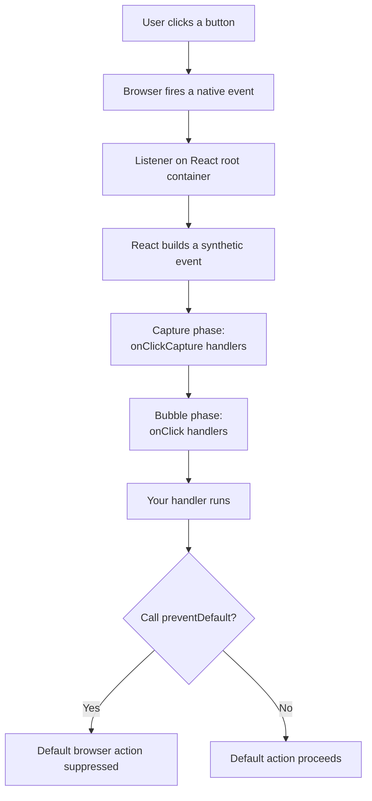
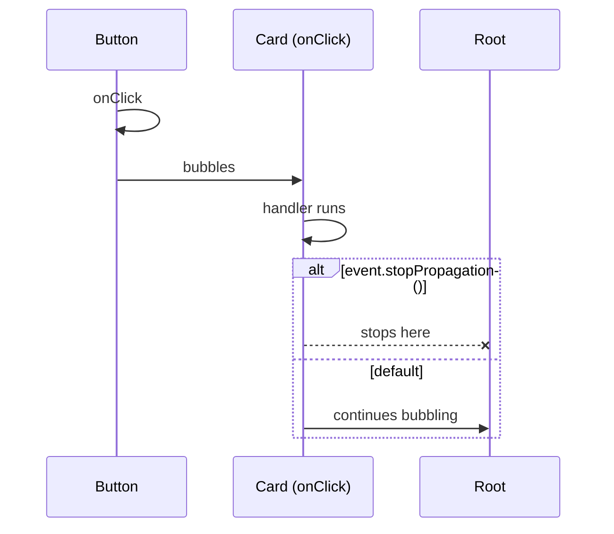
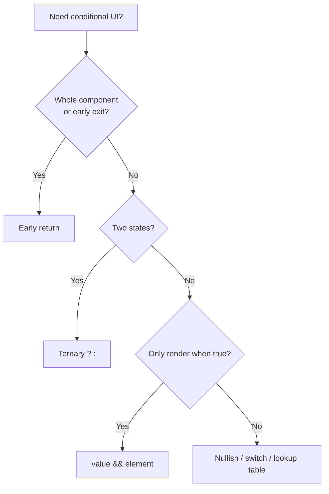

# 14. Events, Lists and Conditional Rendering

> **Level:** Beginner → Intermediate · **Prerequisites:** Chapters 4, 6, 7, 13 · **Reading time:** ~30 min

JSX looks like HTML, which tricks people into assuming the browser works the same way inside React. It does not.
Events are synthetic, conditionals are plain JavaScript, and lists are `.map()` calls with an identity contract.

---

## 1. React events are not DOM events

React attaches a single listener per event type to the **root container** and dispatches a `SyntheticEvent` to
your handler. This is event delegation, implemented by React.



| Concept | DOM | React |
|---------|-----|-------|
| Listener location | Element | Root container (delegated) |
| Event object | `MouseEvent` | `SyntheticEvent` wrapper |
| Naming | `onclick` | `onClick` (camelCase) |
| Handler value | String or function | Function |
| Prevent default | `return false` (old HTML) | `event.preventDefault()` |
| Pooling | N/A | Removed since React 17 — safe to read async |

### Handler references vs calls

```jsx
<button onClick={handleSave}>Save</button>       // ✅ pass the function
<button onClick={handleSave()}>Save</button>     // ❌ calls during render
<button onClick={() => handleSave(id)}>Save</button> // ✅ closure per render
```

The second form runs `handleSave` while rendering and passes its **return value** as the handler — usually
`undefined`, so clicks do nothing (or it fires immediately and causes a render loop).

### Passing arguments without extra wrappers

```jsx
function Row({ id, onSelect }) {
  const select = useCallback(() => onSelect(id), [id, onSelect]);
  return <button onClick={select}>Select</button>;
}
```

An inline arrow is fine for cheap components. For memoized children, an unstable inline function defeats
`React.memo`, which is exactly what `useCallback` exists for (see [Chapter 11](11.%20What%20is%20the%20difference%20between%20useCallback%20and%20useMemo.md)).

### Propagation



- `stopPropagation()` stops React's synthetic bubbling.
- `preventDefault()` cancels the browser's default action (form submit, link navigation).
- Stopping propagation to "fix" a nested-click bug usually hides a structural problem. Prefer restructuring or
  checking `event.target === event.currentTarget`.

---

## 2. Conditional rendering

JSX has no `if`. You use JavaScript expressions.

```jsx
function Inbox({ messages }) {
  if (messages.length === 0) return <EmptyState />;       // early return
  return (
    <ul>
      {messages.map(m => <Message key={m.id} message={m} />)}
    </ul>
  );
}
```



### The `&&` trap

```jsx
{count && <Badge count={count} />}   // renders "0" when count is 0
{count > 0 && <Badge count={count} />} // ✅ explicit boolean
```

`0`, `NaN` and `""` are falsy but still **renderable**. They leak into the DOM as text. Convert explicitly:

```jsx
{Boolean(count) && <Badge count={count} />}
```

### Returning `null` vs unmounting

Returning `null` still keeps the component mounted (state preserved, effects still run). If you want to reset
state or stop work, conditionally render the component at the parent level — or use `key` (Chapter 13).

---

## 3. Lists

```jsx
function TaskList({ tasks }) {
  return (
    <ul>
      {tasks.map(task => (
        <li key={task.id}>
          <TaskRow task={task} />
        </li>
      ))}
    </ul>
  );
}
```

Rules:

1. **Return one element per item.** Fragments count as one element if you need multiple nodes.
2. **Keys go on the outermost element returned by the map callback**, not on the component inside it.
3. **Don't filter by rendering `null`** if the filtered items still affect layout/animation; filter the array
   before mapping so keys and indices stay coherent.

```jsx
// Filter first
{tasks.filter(t => !t.done).map(t => <TaskRow key={t.id} task={t} />)}
```

### Nested lists

```jsx
<ul>
  {groups.map(group => (
    <li key={group.id}>
      <h3>{group.name}</h3>
      <ul>
        {group.items.map(item => (
          <li key={item.id}>{item.label}</li>
        ))}
      </ul>
    </li>
  ))}
</ul>
```

Keys must be unique **within each list**, not across nested lists.

### Lists and accessibility

- Use semantic `ul` / `ol` / `li`. A pile of `div`s loses screen-reader list semantics.
- If the list is interactive, give the list a label (`aria-labelledby`) and keep the tab order logical.
- Announce dynamic changes with a polite live region when items are added or removed asynchronously.

```jsx
<p aria-live="polite">{tasks.length} tasks</p>
```

---

## 4. Clickable elements: don't

```jsx
// ❌ Not keyboard accessible, no role, no focus
<div onClick={open}>Open</div>

// ✅ Semantic, focusable, keyboard-operable
<button type="button" onClick={open}>Open</button>

// ✅ If it navigates, use a link
<a href="/settings">Settings</a>
```

If you must use a non-button element, you own the full contract: `role`, `tabIndex={0}`, `onKeyDown` for Enter
and Space, focus styles and disabled semantics. Using `<button>` is almost always less code.

---

## 5. Forms and events: the minimum you need here

```jsx
function SearchForm({ onSearch }) {
  const [query, setQuery] = useState("");

  function handleSubmit(event) {
    event.preventDefault();       // stop full page reload
    const trimmed = query.trim();
    if (trimmed) onSearch(trimmed);
  }

  return (
    <form onSubmit={handleSubmit} role="search">
      <label htmlFor="q">Search</label>
      <input
        id="q"
        value={query}
        onChange={e => setQuery(e.target.value)}
        autoComplete="off"
      />
      <button type="submit">Search</button>
    </form>
  );
}
```

- Always set `type="button"` on non-submit buttons inside a form.
- Don't debounce the input's `onChange` in a controlled component; debounce the **effect** or the request instead
  (Chapter 18), otherwise typing feels laggy.
- `event.target.value` is a string, even for numeric-looking inputs.

---

## 6. Anti-patterns

| Anti-pattern | Why it hurts | Instead |
|--------------|--------------|---------|
| `onClick={handle()}` | Runs during render | `onClick={handle}` |
| `key={index}` on reorderable lists | Wrong state reuse | Stable ID |
| `{items.length && ...}` | Renders `0` | `items.length > 0 && ...` |
| `<div onClick>` | Not accessible | `<button>` |
| `stopPropagation` everywhere | Hides layout bugs | Restructure, check `currentTarget` |
| `document.addEventListener` in render | Leaks listeners | `useEffect` with cleanup |
| Mutating state arrays in place | React misses the change | Return new arrays |

---

## 7. Checklist

- [ ] Every handler is passed as a function, not invoked.
- [ ] Every list has stable keys and semantic list markup.
- [ ] No falsy numeric values rendered by `&&`.
- [ ] Interactive elements are `<button>` or `<a>`.
- [ ] Form submit calls `preventDefault` and has labeled inputs.
- [ ] I know the difference between `preventDefault` and `stopPropagation`.

---

## 8. Exercises

1. Build a filterable list with a search field and a "hide completed" toggle. Keep the input controlled and the
   filtering derived (no duplicate state).
2. Add row selection. Verify with a screen reader or the accessibility tree that rows are operable by keyboard.
3. Create a bug intentionally with `key={index}`, then fix it with IDs. Write down the observed state corruption.
4. Add a `button` inside a clickable card. Make the card keyboard accessible **without** stopping propagation.

---

## 9. Interview focus

| Question | Where it is answered |
|----------|----------------------|
| How does conditional rendering work? (#19) | Section 2 |
| How do you handle events in React? (#20) | Section 1 |
| How do you bind handlers in class components? (#21) | Section 1 (historical) |
| What is the purpose of `key`? (#18) | Section 3, Chapter 13 |

**Follow-up traps**

- *"Why is `key` not available in `props`?"* — It is consumed by the reconciler as identity metadata.
- *"Why does `onClick={fn()}` break?"* — It executes during render and passes the return value.
- *"Are React events async?"* — Since React 17 the synthetic event is no longer pooled, so reading it later works.

---

**Next:** [15. Forms and Controlled Inputs](15.%20Forms%20and%20Controlled%20Inputs.md)
