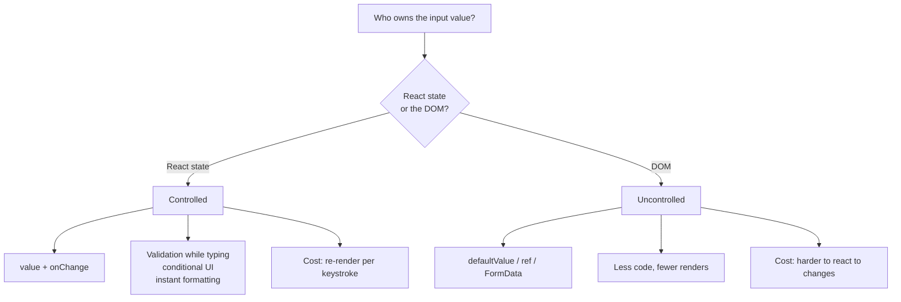
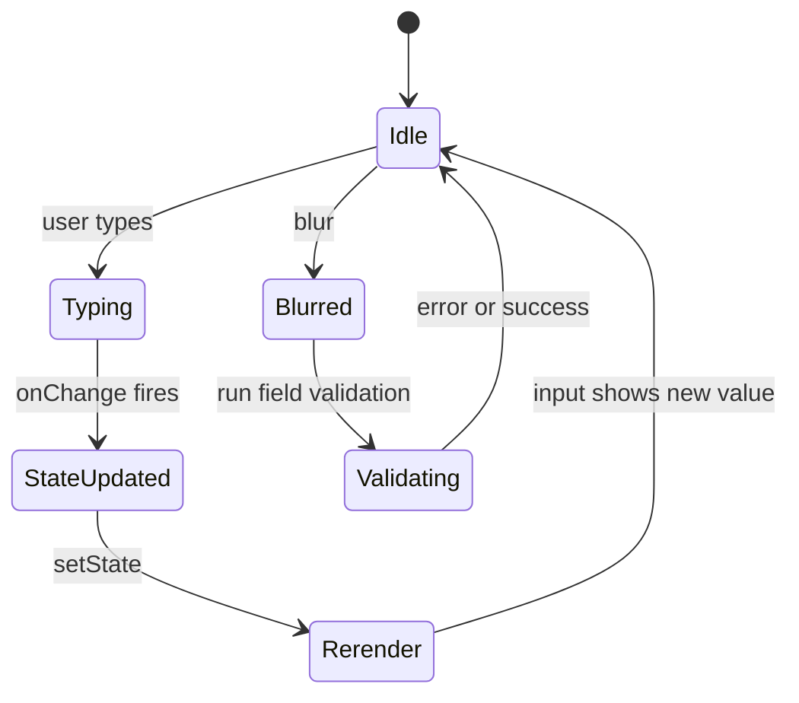
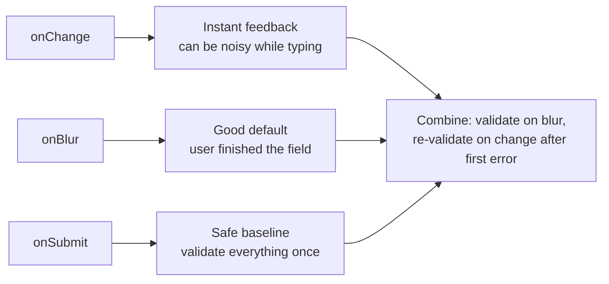
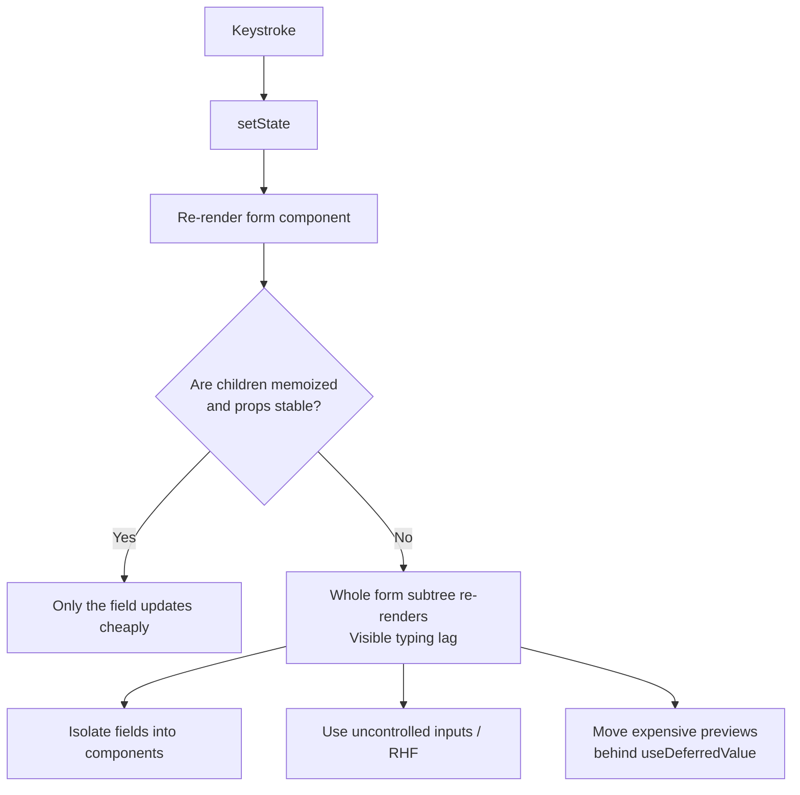

# 15. Forms and Controlled Inputs

> **Level:** Beginner → Intermediate · **Prerequisites:** Chapters 7, 9, 14 · **Reading time:** ~35 min

Forms are where React's "UI is a function of state" promise meets the messiest part of the browser. Getting the
input model right early prevents a whole class of bugs: lost keystrokes, stale values, duplicated state, and
forms that cannot be validated or tested.

---

## 1. Two models, one decision



| | Controlled | Uncontrolled |
|---|---|---|
| Source of truth | React state | DOM node |
| Read value | From state | `ref.current.value` or `FormData` |
| Validation | On every change / blur | On submit (or via events) |
| Re-render per keystroke | Yes | No |
| Best for | Interactive, validated, conditional forms | Simple forms, file inputs, large forms with a form library |

The professional answer is not "always controlled". It is: **controlled for behavior you need to react to,
uncontrolled for values you only need on submit.**

---

## 2. The anatomy of a controlled field

```jsx
function EmailField({ value, onChange, error }) {
  const id = useId();
  const errorId = `${id}-error`;

  return (
    <div>
      <label htmlFor={id}>Email</label>
      <input
        id={id}
        type="email"
        value={value}
        onChange={e => onChange(e.target.value)}
        aria-invalid={error ? true : undefined}
        aria-describedby={error ? errorId : undefined}
        autoComplete="email"
      />
      {error && <p id={errorId} role="alert">{error}</p>}
    </div>
  );
}
```

The loop is always the same:



If the loop is broken anywhere — value not updated, handler not wired, state initialized to `undefined` — the
input appears "read-only" or React logs *"A component is changing an uncontrolled input to be controlled"*.

---

## 3. Managing many fields without chaos

### Option A: separate state (best for 1–4 fields)

```jsx
const [email, setEmail] = useState("");
const [password, setPassword] = useState("");
```

### Option B: one object + one handler

```jsx
const [form, setForm] = useState({ email: "", password: "" });

function handleChange(event) {
  const { name, value } = event.target;
  setForm(prev => ({ ...prev, [name]: value }));
}

<input name="email" value={form.email} onChange={handleChange} />
```

### Option C: `useReducer` (best when fields interact)

Use it when validation, derived fields, or step transitions depend on each other. See
[Chapter 19](19.%20useReducer%20and%20Complex%20State.md).

```jsx
function reducer(state, action) {
  switch (action.type) {
    case "change":
      return { ...state, values: { ...state.values, [action.name]: action.value } };
    case "reset":
      return initialState;
    default:
      return state;
  }
}
```

> **Never** keep both `form.email` and `email` in state. Duplicated state drifts. Derive what you can.

---

## 4. Validation timing



Pattern that feels good to users:

1. Validate on **blur**.
2. Mark the field as "touched".
3. After the first error, re-validate on **change** so the error clears as soon as the input becomes valid.
4. Always validate again on **submit** and focus the first invalid field.

```jsx
const [touched, setTouched] = useState({});
const errors = validate(form);
const showError = name => touched[name] && errors[name];
```

Accessibility requirements:

- `aria-invalid` on invalid fields.
- `aria-describedby` pointing to the error text.
- `role="alert"` or a live region so screen readers announce the error.
- Never rely on color alone.

---

## 5. Input types are not interchangeable

| Input | Controlled props | Notes |
|-------|------------------|-------|
| text / email / password | `value` | `autoComplete` matters for UX and password managers |
| checkbox | `checked` + `onChange` with `e.target.checked` | Multiple checkboxes → array state |
| radio | `checked={value === option}` + `onChange` | Same `name` groups them |
| select (single) | `value` | `<option value="">` for placeholder |
| select (multiple) | `value={array}` | `e.target.selectedOptions` |
| textarea | `value` | Use `value`, not children |
| number | `value` as string | Keep as string; convert on submit. `type="number"` allows `e`, empty and partial values |
| file | Uncontrolled only | `e.target.files`; cannot set `value` programmatically for security |

### Checkbox group

```jsx
function CheckboxGroup({ options, value, onChange }) {
  function toggle(option) {
    onChange(
      value.includes(option)
        ? value.filter(v => v !== option)
        : [...value, option]
    );
  }

  return options.map(option => (
    <label key={option}>
      <input
        type="checkbox"
        checked={value.includes(option)}
        onChange={() => toggle(option)}
      />
      {option}
    </label>
  ));
}
```

### File input

```jsx
function AvatarUpload() {
  const [fileName, setFileName] = useState("");

  return (
    <label>
      Avatar
      <input
        type="file"
        accept="image/*"
        onChange={e => setFileName(e.target.files?.[0]?.name ?? "")}
      />
      {fileName && <span>Selected: {fileName}</span>}
    </label>
  );
}
```

---

## 6. Dynamic fields

Use a stable generated ID per row — index state breaks when rows are removed.

```jsx
const [rows, setRows] = useState([{ id: crypto.randomUUID(), value: "" }]);

function updateRow(id, value) {
  setRows(prev => prev.map(row => (row.id === id ? { ...row, value } : row)));
}

function addRow() {
  setRows(prev => [...prev, { id: crypto.randomUUID(), value: "" }]);
}

function removeRow(id) {
  setRows(prev => prev.filter(row => row.id !== id));
}
```

Render with `key={row.id}`. If you use `key={index}`, deleting row 1 shifts every value and the browser focus
lands on the wrong input (Chapter 13).

---

## 7. Uncontrolled forms with `FormData`

```jsx
function ContactForm({ onSubmit }) {
  function handleSubmit(event) {
    event.preventDefault();
    const data = Object.fromEntries(new FormData(event.currentTarget));
    onSubmit(data); // { name: "...", email: "..." }
  }

  return (
    <form onSubmit={handleSubmit}>
      <label>Name <input name="name" defaultValue="" required /></label>
      <label>Email <input name="email" type="email" required /></label>
      <button type="submit">Send</button>
    </form>
  );
}
```

This is the natural bridge to React 19 **Actions**: `<form action={serverAction}>` gives you progressive
enhancement, `useFormStatus` for pending UI and `useActionState` for server-returned errors — with no controlled
state at all. See [Chapter 38](38.%20React%2019%20-%20Actions%2C%20use%20and%20the%20Compiler.md).

---

## 8. Performance and the IME problem

A controlled input re-renders its component on every keystroke. That is fine for a small form and painful for a
form with 200 fields or expensive siblings.



Also: for CJK input methods, validating or transforming on every `onChange` can interrupt composition. Use
`onCompositionStart` / `onCompositionEnd` (or `event.nativeEvent.isComposing`) before filtering input.

---

## 9. Anti-patterns

| Anti-pattern | Consequence | Fix |
|--------------|-------------|-----|
| `value={undefined}` then later a string | Controlled/uncontrolled warning | Always initialize to `""` |
| Missing `onChange` with `value` | Read-only field | Add handler or use `defaultValue` |
| `<textarea>{value}</textarea>` | React warning | `value` prop |
| Validating only on submit | Late, frustrating errors | Blur + submit, re-validate on change |
| Storing derived values in state | Drift | Compute during render |
| `key={index}` for dynamic rows | Values jump | Stable IDs |
| `type="number"` for phone/card numbers | Precision and formatting bugs | `type="text" inputMode="numeric"` |
| Hiding errors in tooltips only | Inaccessible | Inline text linked by `aria-describedby` |

---

## 10. Checklist

- [ ] Every field has a visible, programmatically associated label.
- [ ] Initial values are never `undefined`.
- [ ] Validation errors are announced and linked with `aria-describedby`.
- [ ] Dynamic rows use stable IDs.
- [ ] The submit handler calls `preventDefault` (unless using an Action).
- [ ] Non-submit buttons have `type="button"`.
- [ ] I chose controlled vs uncontrolled deliberately.

---

## 11. Exercises

1. Build a signup form with email, password and confirm password. Validate on blur, re-validate on change after
   the first error, and focus the first invalid field on submit.
2. Add a dynamic list of invite emails with add/remove. Verify focus and values stay correct after removing the
   first row.
3. Convert the same form to uncontrolled + `FormData` and compare the amount of code.
4. Add a live password-strength meter. Profile it — does it re-render the whole form?
5. Make the form work with keyboard only and verify it with a screen reader.

---

## 12. Interview focus

| Question | Where it is answered |
|----------|----------------------|
| Controlled vs uncontrolled inputs (#46) | Sections 1–2 |
| How do you handle large forms? (#146) | Sections 3, 8 |
| How do you test form input and submission? (#131) | Chapter 34 |
| How do you manage focus in forms? (#112) | Section 4 |

**Follow-up traps**

- *"When would you choose uncontrolled?"* — Large forms, file inputs, integration with non-React widgets, and
  server Actions.
- *"Why does my input lose a character when typing fast?"* — Usually a derived-state or async state update that
  writes a stale value back. Keep the input fully controlled by one source.
- *"How do you validate without a library?"* — Pure `validate(values) -> errors` function, called at the right
  moments; the function is trivially unit-testable.

---

**Next:** [16. Composition and Component Design](16.%20Composition%20and%20Component%20Design.md)
