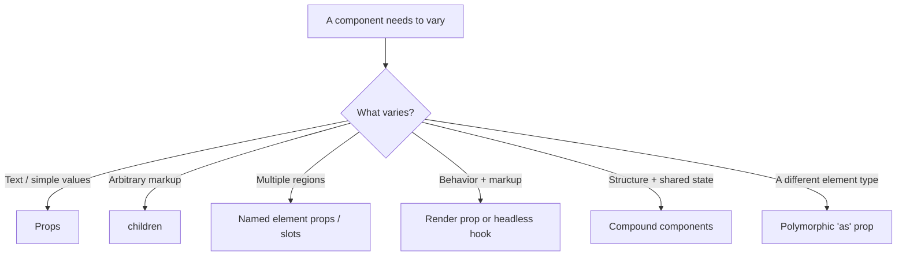
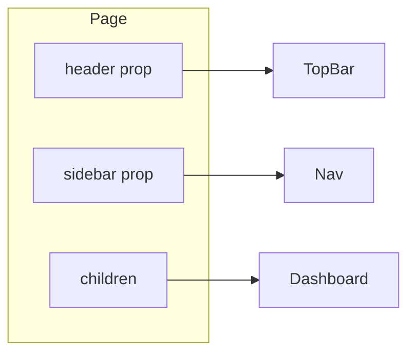
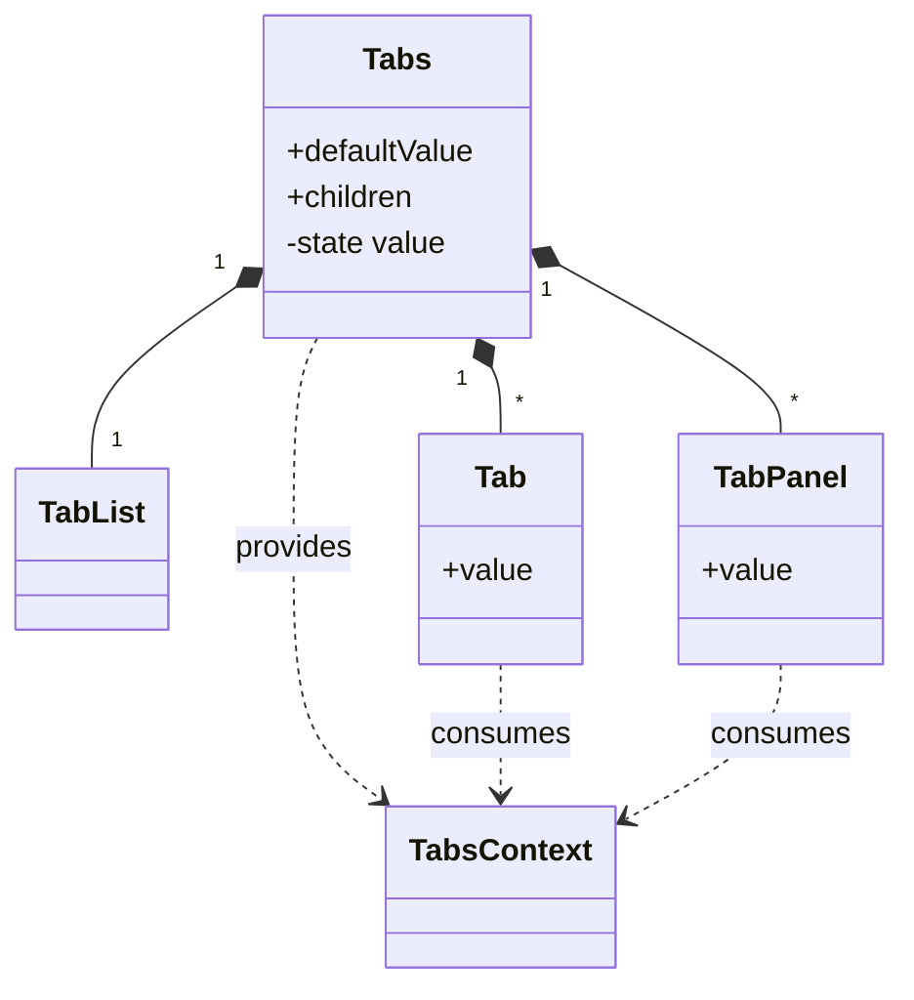
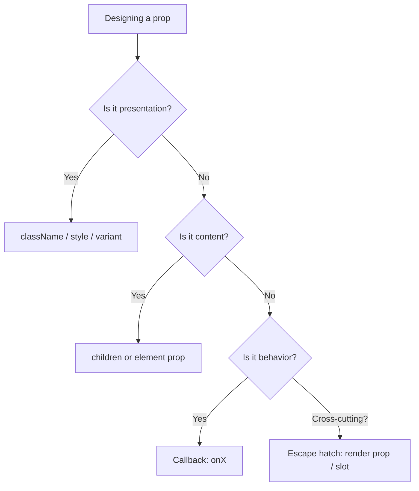
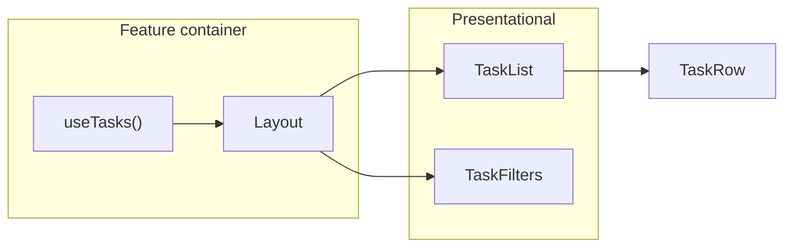

# 16. Composition and Component Design

> **Level:** Intermediate · **Prerequisites:** Chapters 3, 6, 7, 14 · **Reading time:** ~35 min

React has no inheritance model worth using. Everything reusable is built by **composition**: passing elements,
functions and components as props, then letting the caller decide the structure. This chapter is about designing
component APIs that are flexible without becoming configuration monsters.

---

## 1. Composition vs configuration



A component with 14 boolean props is not flexible — it is a configuration file pretending to be an API.

```jsx
// ❌ Boolean explosion: 2^4 visual states, most invalid
<Card bordered rounded compact hoverable header="Title" />

// ✅ Composition: the caller assembles what it needs
<Card>
  <Card.Header>Title</Card.Header>
  <Card.Body>...</Card.Body>
</Card>
```

---

## 2. `children`: the default slot

```jsx
function Panel({ title, children }) {
  return (
    <section className="panel">
      <h2>{title}</h2>
      <div className="panel__body">{children}</div>
    </section>
  );
}

<Panel title="Billing">
  <InvoiceTable />
</Panel>
```

`children` is just a prop. It can be:
- a node (`<p>`),
- a string,
- an array of nodes,
- a function (render prop — see below),
- `undefined`.

### Named slots

When a component has more than one region, use explicit element props instead of children gymnastics.

```jsx
function Page({ header, sidebar, children }) {
  return (
    <div className="page">
      <header>{header}</header>
      <aside>{sidebar}</aside>
      <main>{children}</main>
    </div>
  );
}

<Page header={<TopBar />} sidebar={<Nav />}>
  <Dashboard />
</Page>
```



### Children as a function

```jsx
function MouseTracker({ children }) {
  const [position, setPosition] = useState({ x: 0, y: 0 });

  return (
    <div
      style={{ height: 200 }}
      onMouseMove={e => setPosition({ x: e.clientX, y: e.clientY })}
    >
      {children(position)}
    </div>
  );
}

<MouseTracker>
  {({ x, y }) => <p>Mouse at {x}, {y}</p>}
</MouseTracker>
```

This is a **render prop**. It shares behavior while the caller owns the markup. Chapter 29 compares it with
hooks and HOCs.

---

## 3. Compound components

Compound components share implicit state through context while exposing a declarative, HTML-like API.

```jsx
const TabsContext = createContext(null);

function useTabsContext() {
  const context = useContext(TabsContext);
  if (!context) throw new Error("Tabs.* must be used inside <Tabs>");
  return context;
}

function Tabs({ defaultValue, children }) {
  const [value, setValue] = useState(defaultValue);
  return (
    <TabsContext.Provider value={{ value, setValue }}>
      <div className="tabs">{children}</div>
    </TabsContext.Provider>
  );
}

function TabList({ children }) {
  return <div role="tablist">{children}</div>;
}

function Tab({ value, children }) {
  const { value: selected, setValue } = useTabsContext();
  const isSelected = selected === value;

  return (
    <button
      type="button"
      role="tab"
      aria-selected={isSelected}
      tabIndex={isSelected ? 0 : -1}
      onClick={() => setValue(value)}
    >
      {children}
    </button>
  );
}

function TabPanel({ value, children }) {
  const { value: selected } = useTabsContext();
  if (selected !== value) return null;
  return <div role="tabpanel">{children}</div>;
}

Tabs.List = TabList;
Tabs.Tab = Tab;
Tabs.Panel = TabPanel;
```

Usage:

```jsx
<Tabs defaultValue="overview">
  <Tabs.List>
    <Tabs.Tab value="overview">Overview</Tabs.Tab>
    <Tabs.Tab value="billing">Billing</Tabs.Tab>
  </Tabs.List>
  <Tabs.Panel value="overview">...</Tabs.Panel>
  <Tabs.Panel value="billing">...</Tabs.Panel>
</Tabs>
```



Why this works well:

- The caller controls order and markup.
- State stays local to the family of components.
- Adding a `Tabs.Tab` requires no changes to `Tabs`.

Tradeoffs:

- More moving parts than a `tabs` array prop.
- Context means the parts must live inside the parent.
- Accessibility (roving tabindex, arrow keys) is your responsibility — see [Chapter 35](35.%20Accessibility%20and%20Internationalization.md).

---

## 4. Designing a component's own controlled/uncontrolled API

Library-quality components accept both modes, mirroring how `<input>` works.

```jsx
function Toggle({ value, defaultValue = false, onChange, children }) {
  const [internal, setInternal] = useState(defaultValue);
  const isControlled = value !== undefined;
  const isOn = isControlled ? value : internal;

  function toggle() {
    const next = !isOn;
    if (!isControlled) setInternal(next);
    onChange?.(next);
  }

  return (
    <button type="button" aria-pressed={isOn} onClick={toggle}>
      {children}
    </button>
  );
}
```

| Prop | Meaning |
|------|---------|
| `value` | Controlled value; presence switches the component to controlled mode |
| `defaultValue` | Initial value in uncontrolled mode |
| `onChange` | Notification — called in both modes |

Rule: **never switch a component from uncontrolled to controlled silently**. Warn in development if `value`
changes from `undefined` to defined.

---

## 5. Prop API design rules



1. **Name callbacks `onX`, handlers `handleX`.** `onSave` for the prop, `handleSave` for the implementation.
2. **Prefer a `variant` union over booleans.** `variant="danger"` beats `danger outlined small`.
3. **Forward unknown props to the DOM element** (carefully) so `id`, `aria-*` and `data-*` work.
4. **Accept `className`** rather than inventing `customClass`.
5. **Don't leak internal state shapes.** Expose `onChange(value)`, not `onChange(internalReducerState)`.
6. **Make required props actually required.** In TypeScript, required > runtime `throw`.

### Polymorphic `as` prop

```jsx
function Text({ as: Component = "p", ...props }) {
  return <Component {...props} />;
}

<Text as="h1">Title</Text>
<Text as="a" href="/docs">Docs</Text>
```

In TypeScript this needs generics to keep `href` valid only for anchors — see
[Chapter 33](33.%20TypeScript%20with%20React.md). In JavaScript, document the constraint.

### Avoid spreading blindly onto DOM nodes

```jsx
function Button({ isLoading, variant, ...rest }) {
  return <button {...rest} disabled={rest.disabled || isLoading} />;
}
```

`isLoading` and `variant` must be removed, or React will warn about unknown DOM attributes.

---

## 6. Component boundaries

A component should have **one reason to change**. Practical splits:

| Smell | Split into |
|-------|------------|
| 300+ line component | Container (data) + presentational sections |
| Props drilling 6 levels | Provider/context or composition |
| Many `useState` that change together | Reducer or a single object |
| Conditional rendering of 5 modes | Mode components + a lookup map |
| Data fetching + layout + formatting | Hook for data, component for layout, util for formatting |



Container/presentational is not dogma — it is a tool for separating **data concerns** from **rendering concerns**
when a component becomes hard to test.

---

## 7. Anti-patterns

| Anti-pattern | Problem | Better |
|--------------|---------|--------|
| Inheritance via `extends` | Fragile, no multiple inheritance | Composition |
| 15 boolean props | Invalid states, unreadable call sites | `variant` + slots |
| Cloning children (`cloneElement`) to inject props | Implicit, breaks with wrappers and memo | Context or explicit props |
| Components defined inside components | Remount every render | Module scope |
| Context for everything | Hidden dependencies, re-render cost | Props first, context when depth hurts |
| `children` as `any` in TS | Loses type safety | `React.ReactNode` |
| God component | Untestable, merge conflicts | Feature slices (Chapter 32) |

---

## 8. Checklist

- [ ] The component has one job and a name that says it.
- [ ] Content enters through `children` or element props, not through a dozen config props.
- [ ] Controlled and uncontrolled usage both work, or only one is supported explicitly.
- [ ] Unknown props are forwarded intentionally, not accidentally.
- [ ] Compound components fail loudly when used outside their parent.
- [ ] API is documented by at least one usage example.

---

## 9. Exercises

1. Refactor a `Modal` with props `title`, `footer`, `showClose`, `showIcon`, `size` into a compound component
   with `Modal.Header`, `Modal.Body`, `Modal.Footer`.
2. Build a `Disclosure` component that supports both `open` and `defaultOpen`.
3. Replace a three-level prop-drilling chain with composition (pass the element down as a prop) and compare with
   a context solution.
4. Add keyboard support to the `Tabs` example: arrow keys move focus, Home/End jump to the ends.

---

## 10. Interview focus

| Question | Where it is answered |
|----------|----------------------|
| What is the `children` prop? (#25) | Section 2 |
| What are render props? (#102, #107) | Section 2, Chapter 29 |
| How do you handle code reuse? (#145) | Sections 2–4 |
| How do you structure reusable components? (#144) | Sections 5–6 |

**Follow-up traps**

- *"Composition vs inheritance?"* — React has no useful inheritance; composition keeps APIs open and avoids the
  fragile base class problem.
- *"When is `cloneElement` acceptable?"* — Only for tightly coupled primitives (e.g., a `RadioGroup` injecting
  `name`/`checked` into `Radio`), and never as a general extension mechanism.
- *"Why did you split that component?"* — State it as testability, reuse or change frequency — not line count.

---

**Next:** [17. Styling React Applications](17.%20Styling%20React%20Applications.md)
