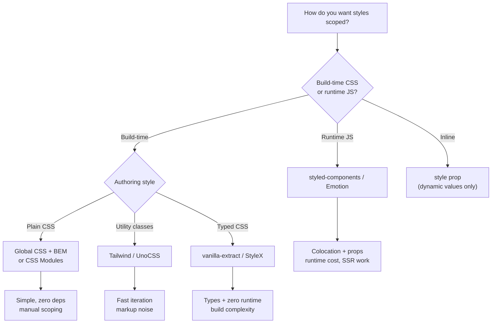
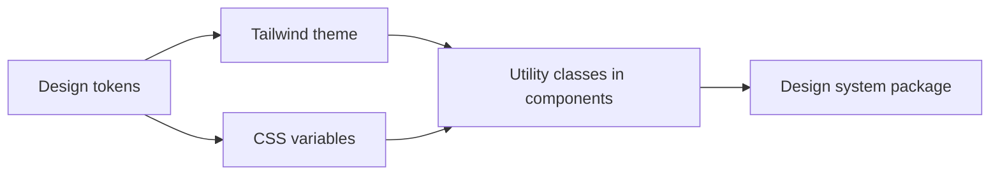
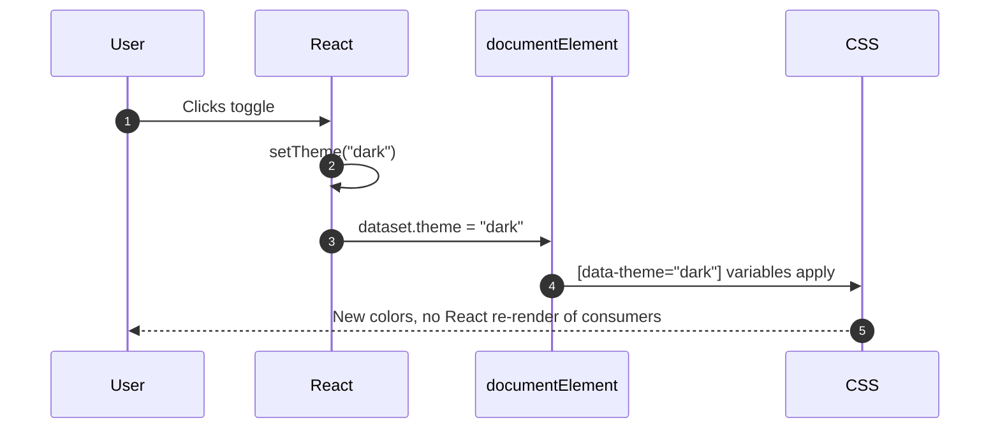
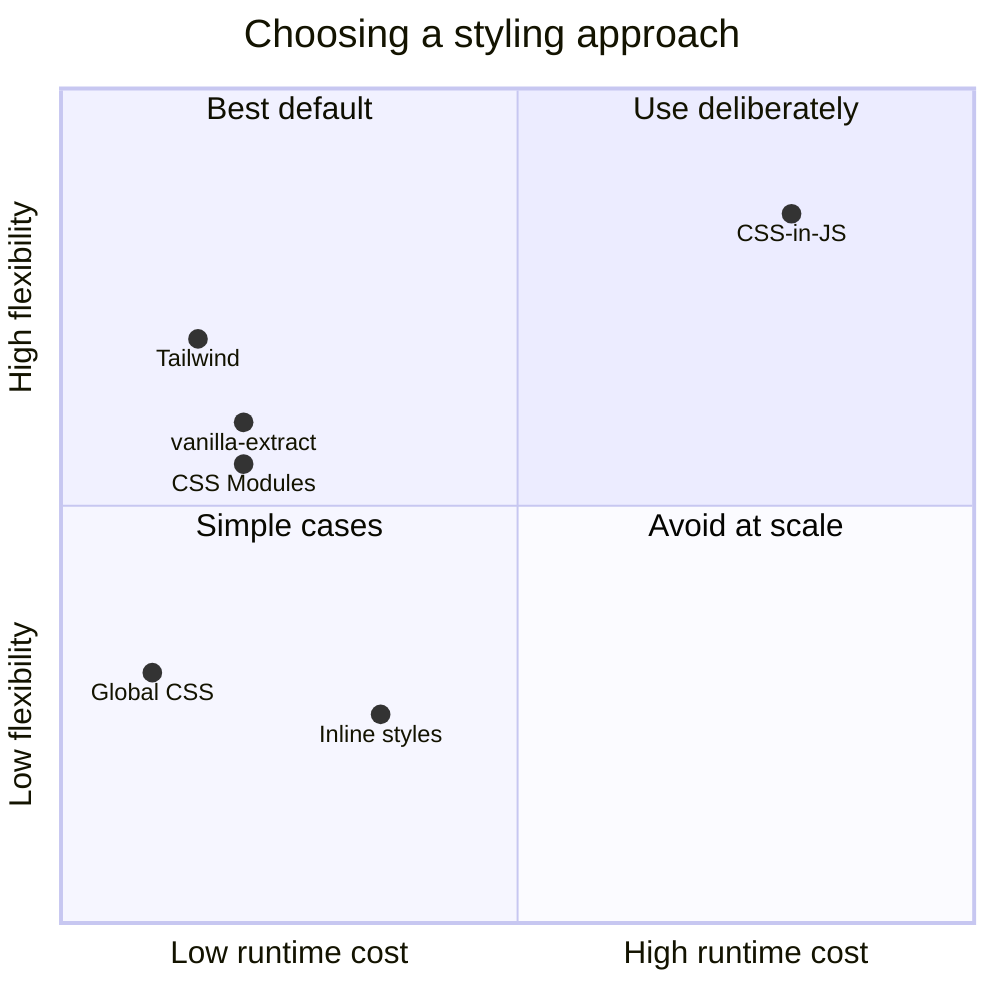

# 17. Styling React Applications

> **Level:** Intermediate · **Prerequisites:** Chapters 4, 16 · **Reading time:** ~30 min

React has no opinion about styling, which is both a strength and a source of architecture debt. The goal is not
to pick the "best" styling library — it is to pick a strategy with **predictable scope, theming, and zero runtime
surprises** for your team.

---

## 1. The landscape



| Strategy | Scoping | Runtime cost | Theming | SSR / RSC | Best fit |
|----------|---------|--------------|---------|-----------|----------|
| Global CSS + BEM | Convention | None | CSS variables | Perfect | Small apps, marketing pages |
| CSS Modules | Build-time hash | None | CSS variables | Perfect | Most React apps |
| Tailwind | Utility classes | None | CSS variables / config | Perfect | Product teams, design systems |
| CSS-in-JS (runtime) | Generated class | Style serialization | ThemeProvider | Needs setup; client components | Heavy dynamic styling |
| vanilla-extract / StyleX | Build-time | None | Theme contracts | Perfect | Large typed design systems |
| Inline `style` | Element | Object diffing | Manual | Perfect | Dynamic geometry/colors from data |

---

## 2. Global CSS done safely

```css
/* styles/global.css */
:root {
  --color-bg: #ffffff;
  --color-text: #16181d;
  --color-brand: #4f46e5;
  --space-2: 0.5rem;
  --radius-md: 8px;
}

*,
*::before,
*::after {
  box-sizing: border-box;
}

body {
  margin: 0;
  background: var(--color-bg);
  color: var(--color-text);
  font-family: system-ui, sans-serif;
}
```

Use global CSS for **reset, tokens, typography and base elements** only. Everything else should be scoped.

BEM keeps global CSS predictable:

```css
.card { /* block */ }
.card__title { /* element */ }
.card--highlighted { /* modifier */ }
```

---

## 3. CSS Modules (the safe default)

```css
/* Button.module.css */
.button {
  display: inline-flex;
  gap: var(--space-2);
  border-radius: var(--radius-md);
  padding: 0.5rem 1rem;
}

.primary {
  background: var(--color-brand);
  color: white;
}

.button:focus-visible {
  outline: 2px solid var(--color-brand);
  outline-offset: 2px;
}
```

```jsx
import styles from "./Button.module.css";

export function Button({ variant = "primary", className = "", ...props }) {
  return (
    <button
      className={`${styles.button} ${styles[variant]} ${className}`}
      {...props}
    />
  );
}
```

Benefits: real CSS, automatic local scoping, no runtime, works with SSR and RSC, plays well with `:hover`,
media queries and animations.

Use `clsx` (or `clsx` + `tailwind-merge`) instead of string concatenation when classes are conditional:

```jsx
import clsx from "clsx";

<div className={clsx(styles.row, isActive && styles.active, className)} />
```

---

## 4. Tailwind CSS

```jsx
function Alert({ tone = "info", children }) {
  const tones = {
    info: "bg-blue-50 text-blue-900 border-blue-200",
    error: "bg-red-50 text-red-900 border-red-200",
  };

  return (
    <div role="alert" className={`rounded-lg border p-4 ${tones[tone]}`}>
      {children}
    </div>
  );
}
```

Guidance for professional use:

- **Extract components, not `@apply` blobs.** A `Button` component with variants beats a CSS abstraction layer.
- **Use a `cn` helper** to merge conditional classes and resolve conflicts.
- **Keep dynamic values as CSS variables** (`style={{ "--progress": `${pct}%` }}`) rather than building class
  names dynamically, which breaks static extraction.
- **Configure tokens** (colors, spacing, fonts) in the theme so utilities and design agree.



---

## 5. CSS-in-JS

```jsx
import styled from "styled-components";

const Button = styled.button`
  background: ${props => (props.$primary ? "#4f46e5" : "#e5e7eb")};
  color: ${props => (props.$primary ? "white" : "#16181d")};
  border-radius: 8px;
  padding: 0.5rem 1rem;
`;

<Button $primary>Save</Button>
```

Strengths: colocated styles, props-driven variants, no class-name collisions.

Costs:

- **Runtime style generation** on every mount and prop change.
- **SSR** needs style extraction; otherwise you get a flash of unstyled content.
- **React Server Components**: runtime CSS-in-JS generally requires `'use client'`.
- **Bundle size** and a second rendering pipeline to debug.

Modern default: prefer build-time CSS (Modules/Tailwind/vanilla-extract) unless you specifically need
props-driven styling at runtime.

---

## 6. Theming with CSS variables

```css
/* theme.css */
:root,
[data-theme="light"] {
  --surface: #ffffff;
  --surface-raised: #f6f7f9;
  --text: #16181d;
  --border: #e3e6ea;
}

[data-theme="dark"] {
  --surface: #0f1115;
  --surface-raised: #171a21;
  --text: #f2f4f8;
  --border: #2a2f3a;
}

body {
  background: var(--surface);
  color: var(--text);
}
```

```jsx
function ThemeToggle() {
  const [theme, setTheme] = useState("light");

  useEffect(() => {
    const stored = localStorage.getItem("theme");
    if (stored) setTheme(stored);
  }, []);

  useEffect(() => {
    document.documentElement.dataset.theme = theme;
    localStorage.setItem("theme", theme);
  }, [theme]);

  return (
    <button
      type="button"
      onClick={() => setTheme(t => (t === "light" ? "dark" : "light"))}
      aria-pressed={theme === "dark"}
    >
      Toggle theme
    </button>
  );
}
```



Because CSS variables cascade, **theme changes do not re-render every consumer** — unlike a React context theme.
Avoid the classic flash by setting the attribute from a tiny inline script in `index.html` before React loads.

If you do need the theme value in JavaScript (e.g., to pick chart colors), expose it through a small context or
`useSyncExternalStore`, not by duplicating every color in JS.

---

## 7. Dynamic and conditional styles

```jsx
// Data-driven geometry belongs in style
<div style={{ width: `${progress}%` }} className={styles.bar} />

// State-driven appearance belongs in a class
<div className={clsx(styles.bar, isComplete && styles.complete)} />
```

Inline styles cannot express `:hover`, media queries, keyframes or pseudo-elements. Use them for values that are
genuinely computed at runtime (progress, coordinates, user-chosen color), and put everything else in CSS.



---

## 8. Animation

| Need | Tool |
|------|------|
| Hover, focus, simple enter/exit | CSS transitions |
| Keyframes on mount | CSS `@keyframes` + class |
| Layout animations, gestures, orchestration | Motion (Framer Motion) |
| Page/view transitions | View Transitions API (with progressive enhancement) |
| Reduced motion | `@media (prefers-reduced-motion: reduce)` |

```css
@media (prefers-reduced-motion: reduce) {
  *,
  *::before,
  *::after {
    animation-duration: 0.01ms !important;
    transition-duration: 0.01ms !important;
  }
}
```

Animating React state directly (changing `height` on every render) is a performance trap. Animate CSS properties
and let the browser's compositor do the work; prefer `transform` and `opacity`.

---

## 9. Anti-patterns

| Anti-pattern | Problem | Fix |
|--------------|---------|-----|
| Styling by DOM structure (`.card div span`) | Breaks on markup change | Class names / modules |
| `!important` to win specificity | Escalating CSS war | Fix specificity, use layers |
| Inline styles for everything | No pseudo-classes, no media queries, noisy DOM | Classes + CSS variables |
| One global stylesheet for a large app | Accidental collisions | Modules / scoped strategy |
| Deeply nested SCSS | Unmaintainable output | Flat BEM or utilities |
| Hard-coded colors | Theming impossible | Tokens / variables |
| Animating layout properties | Jank | `transform` / `opacity` |
| Runtime CSS-in-JS in every leaf | Slow mounts, SSR flash | Build-time CSS |

---

## 10. Checklist

- [ ] A single styling strategy is documented and enforced.
- [ ] Colors, spacing, radii and typography come from tokens.
- [ ] Component variants are explicit (`variant="danger"`), not ad-hoc class strings.
- [ ] Dark mode uses CSS variables and avoids a flash on first paint.
- [ ] Focus states are visible and not removed.
- [ ] Motion respects `prefers-reduced-motion`.
- [ ] No global styles leak into components.

---

## 11. Exercises

1. Convert a global-CSS button to a CSS Module with `variant` and `size` props.
2. Implement dark mode with CSS variables, persistence and no flash of the wrong theme on reload.
3. Build the same `Alert` component with Tailwind and with CSS Modules. Compare readability and bundle impact.
4. Add a progress bar whose width comes from state. Profile a rapid update and note whether it re-renders the
   rest of the page.

---

## 12. Interview focus

| Question | Where it is answered |
|----------|----------------------|
| What are inline styles in React? (#22) | Sections 7, 9 |
| How do you theme a React app? | Sections 5–6 |
| How do you prevent style collisions? | Sections 3–5 |

**Follow-up traps**

- *"Why not put all styles in `style={{}}`?"* — No pseudo-classes, media queries or keyframes; harder to cache;
  verbose DOM.
- *"Does CSS-in-JS hurt SSR?"* — Yes, without extraction: styles generated after HTML means FOUC and hydration
  mismatch risk.
- *"How do you handle design changes across 200 components?"* — Tokens plus a single primitive layer, not
  find-and-replace across features.

---

**Next:** [18. useEffect in Depth](18.%20useEffect%20in%20Depth.md)
