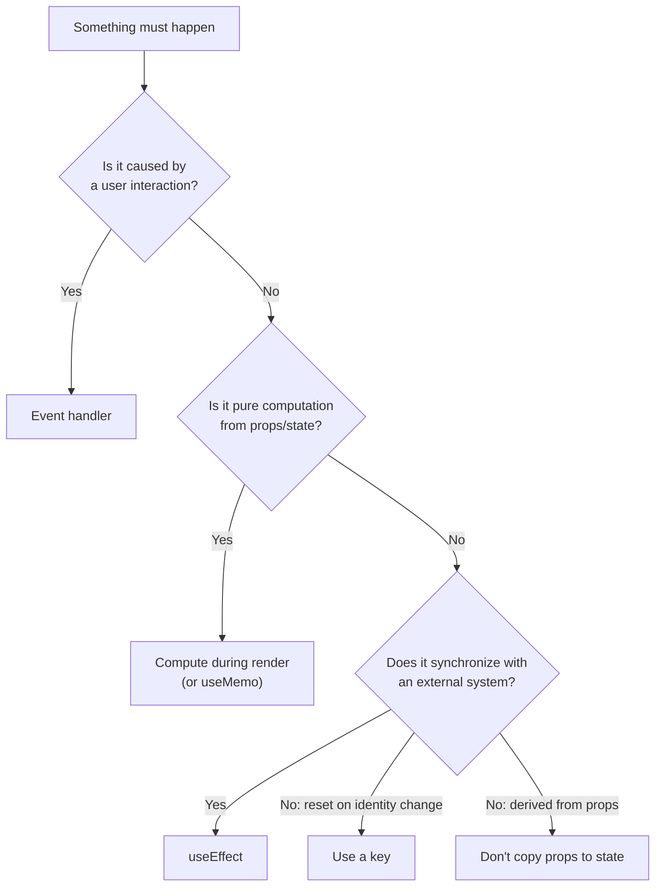
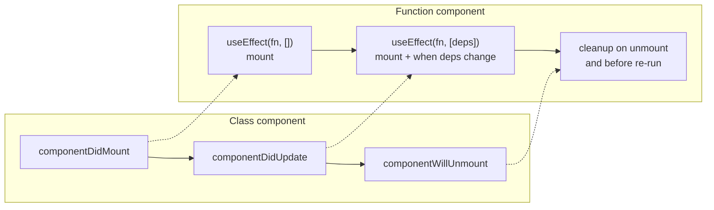
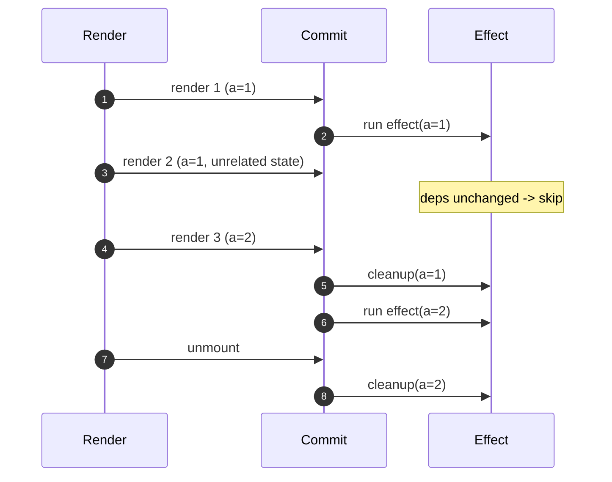
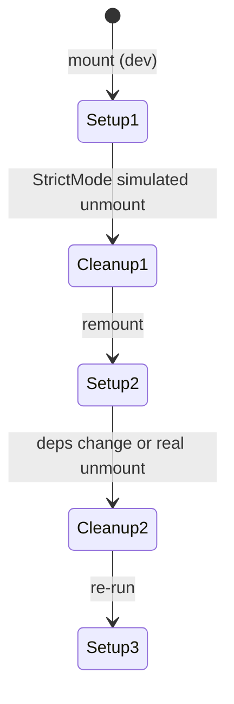
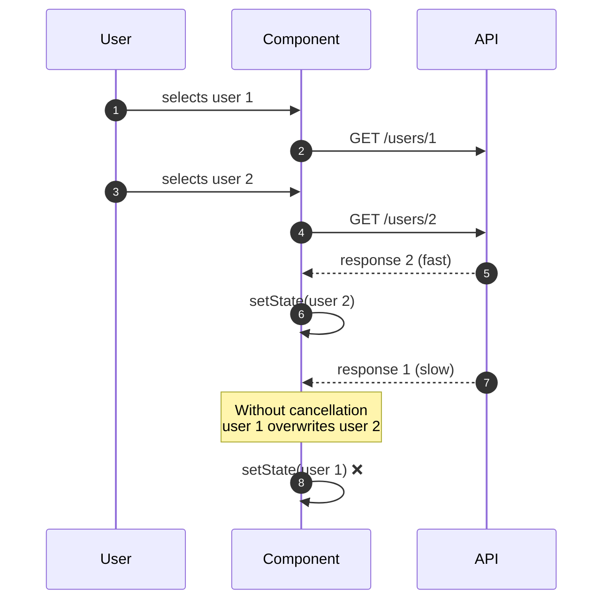
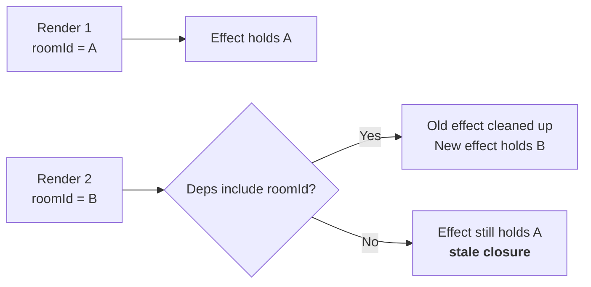

# 18. useEffect in Depth

> **Level:** Intermediate → Advanced · **Prerequisites:** Chapters 8, 10, 13 · **Reading time:** ~45 min

`useEffect` is the most overused and most misunderstood hook in React. The fix is not memorizing dependency
arrays — it is learning **what an effect is for**: synchronizing a component with something *outside* React.

---

## 1. What effects are (and are not) for



Valid effect responsibilities:

- Subscriptions (WebSocket, store, event emitter).
- Browser APIs that are not render-safe (timers, `IntersectionObserver`, `ResizeObserver`, media queries).
- Network requests that must happen on mount/param change (though a data library is usually better).
- Imperative third-party widgets (maps, editors) via refs.
- Analytics on route change.

Invalid responsibilities:

- Transforming data for rendering. Compute it.
- Responding to a click. Put it in the handler.
- Resetting state when a prop changes. Use `key`.
- Notifying a parent about state changes. Call the callback where the change happens.
- Fetching on every render without dependency control.

---

## 2. Lifecycle mapping (for people coming from classes)



The mapping is approximate on purpose. Effects are **synchronization**, not lifecycle events. One effect can
represent setup + teardown for a single concern, and you should split unrelated concerns into separate effects.

---

## 3. The dependency array, precisely

| Dependency array | When the effect runs |
|------------------|----------------------|
| omitted | After **every** commit |
| `[]` | After the first commit only (plus StrictMode dev re-run) |
| `[a, b]` | After a commit where `a` or `b` changed (`Object.is`) |
| `[obj]` | Every render if `obj` is a new object literal |



### The rules that prevent 90% of bugs

1. **Every reactive value used inside the effect belongs in the array** — props, state, functions from the
   component scope.
2. **Functions defined in the component are reactive.** Either move them inside the effect, define them outside
   the component, or wrap them in `useEffectEvent`/`useCallback`.
3. **Objects and arrays are new identities every render.** Depend on primitives, or memoize deliberately.
4. **Do not lie to the array** to "run only once". That creates stale closures reading old values forever.

```jsx
// Bug: `roomId` changes but the connection stays on the old room
useEffect(() => {
  const connection = createConnection(roomId);
  connection.connect();
  return () => connection.disconnect();
}, []); // ❌ missing roomId
```

---

## 4. Cleanup and StrictMode

```jsx
useEffect(() => {
  const id = setInterval(() => setTick(t => t + 1), 1000);
  return () => clearInterval(id);
}, []);
```

Every effect that acquires a resource must release it. In development, `StrictMode` runs setup → cleanup → setup
on mount to prove your cleanup is correct.



If double-invocation breaks your app, the bug is almost always a missing cleanup or a non-idempotent side effect
— not StrictMode.

---

## 5. Data fetching: races, cancellation and loading states

```jsx
function UserProfile({ userId }) {
  const [state, setState] = useState({ status: "idle", user: null, error: null });

  useEffect(() => {
    const controller = new AbortController();
    setState({ status: "loading", user: null, error: null });

    fetch(`/api/users/${userId}`, { signal: controller.signal })
      .then(res => {
        if (!res.ok) throw new Error(`HTTP ${res.status}`);
        return res.json();
      })
      .then(user => setState({ status: "success", user, error: null }))
      .catch(error => {
        if (error.name === "AbortError") return;
        setState({ status: "error", user: null, error });
      });

    return () => controller.abort();
  }, [userId]);

  if (state.status === "loading") return <Skeleton />;
  if (state.status === "error") return <ErrorState error={state.error} />;
  return <Profile user={state.user} />;
}
```

Why this shape:

- `AbortController` cancels the in-flight request **and** prevents a stale response from overwriting a newer one.
- The status is a single discriminated object, so impossible combinations (`loading && user`) cannot happen.
- Cleanup runs when `userId` changes, not only on unmount.

### The race condition, visualized



### Alternatives to manual fetching

| Approach | When |
|----------|------|
| `use()` + `<Suspense>` | React 19 with a cache-backed promise |
| TanStack Query / SWR | Most client-side server state (Chapter 25) |
| Framework loader (Next.js, React Router) | Data before render, SSR-friendly |
| Manual `useEffect` | Small apps, one-off integrations, teaching |

Manual fetching means reimplementing caching, deduplication, retries, focus refetching and cache invalidation.
That is what a server-state library is for.

---

## 6. Subscriptions and external stores

```jsx
function useOnlineStatus() {
  const [online, setOnline] = useState(() => navigator.onLine);

  useEffect(() => {
    const update = () => setOnline(navigator.onLine);
    window.addEventListener("online", update);
    window.addEventListener("offline", update);
    return () => {
      window.removeEventListener("online", update);
      window.removeEventListener("offline", update);
    };
  }, []);

  return online;
}
```

Read the **initial value lazily** (`useState(() => ...)`) so the first render is already correct. If the value
lives in an external store, prefer `useSyncExternalStore` — it handles tearing and concurrent rendering correctly
(Chapter 23).

---

## 7. Stale closures

```jsx
function Chat({ roomId }) {
  useEffect(() => {
    const id = setInterval(() => {
      console.log(`Polling ${roomId}`); // closes over the roomId of THIS render
    }, 2000);
    return () => clearInterval(id);
  }, [roomId]); // ✅ re-creates the interval when roomId changes
}
```

A closure captures the values of the render that created it. "Stale closure" bugs happen when the effect keeps
running but the dependency array pretends it does not need to update.



For "latest value without re-subscribing", React 19.2 provides `useEffectEvent`:

```jsx
const onConnected = useEffectEvent(() => {
  showToast(`Connected to ${roomId}`); // always the latest roomId
});

useEffect(() => {
  const connection = createConnection(roomId);
  connection.on("connected", onConnected);
  connection.connect();
  return () => connection.disconnect();
}, [roomId]); // onConnected is not a dependency
```

Effect events are for **non-reactive logic inside effects** (analytics, toasts, logging). They are not a license
to hide real dependencies.

---

## 8. Useful effect patterns

### Debounced search

```jsx
useEffect(() => {
  const timeout = setTimeout(() => {
    setDebouncedQuery(query);
  }, 300);
  return () => clearTimeout(timeout);
}, [query]);
```

### Intersection observer

```jsx
useEffect(() => {
  const element = ref.current;
  if (!element) return;

  const observer = new IntersectionObserver(
    ([entry]) => setVisible(entry.isIntersecting),
    { rootMargin: "200px" }
  );
  observer.observe(element);
  return () => observer.disconnect();
}, []);
```

### Document title

```jsx
useEffect(() => {
  const previous = document.title;
  document.title = `${count} unread — Inbox`;
  return () => { document.title = previous; };
}, [count]);
```

(In a framework with metadata support, prefer the framework's API.)

---

## 9. Anti-patterns and their fixes

| Anti-pattern | Symptom | Fix |
|--------------|---------|-----|
| `useEffect` to derive state | Extra render, stale copy | Compute during render |
| `useEffect(() => setX(prop), [prop])` | One render behind | Derive or reset with `key` |
| Fetch without deps/cancel | Races, memory leaks | Deps + `AbortController` |
| Missing cleanup | Double subscriptions, timers | Return teardown |
| `[]` with reactive values | Stale closures | Complete dependency array |
| Effect for user events | Runs on mount too, weird timing | Event handler |
| `useEffect` to focus an input | Flicker after paint | `useLayoutEffect` or autoFocus |
| Chained effects updating each other | Render waterfalls | Single effect / reducer / derive |

---

## 10. Checklist

- [ ] Each effect has a single responsibility.
- [ ] Every reactive value used inside is listed in the dependency array.
- [ ] Every subscription, timer and request has cleanup.
- [ ] Fetching handles loading, error, empty and cancellation.
- [ ] No effect exists solely to derive state or react to a click.
- [ ] `exhaustive-deps` lint rule is enabled and warnings are treated seriously.
- [ ] StrictMode double-invocation does not break the feature.

---

## 11. Exercises

1. Build a search box that fetches results and cancels the previous request. Throttle the network in DevTools
   and confirm no stale results appear.
2. Write a `useOnlineStatus` hook and test it by toggling offline mode.
3. Convert an effect-based data fetch to TanStack Query and list what you deleted.
4. Create a stale-closure bug deliberately, then fix it three ways: dependency array, `useEffectEvent`, and a ref.
5. Add an `IntersectionObserver` that pauses a video when it scrolls out of view.

---

## 12. Interview focus

| Question | Where it is answered |
|----------|----------------------|
| What is `useEffect`? (#29) | Sections 1–3 |
| With vs without a dependency array (#30) | Section 3 |
| When does `useEffect` run? (#39) | Sections 2–3 |
| How do you clean up? (#40) | Section 4 |
| `useEffect` vs `useLayoutEffect` (#45) | Chapter 10 |
| Why do effects run twice in development? (#39) | Section 4 |

**Follow-up traps**

- *"Why not fetch in `useEffect` in production apps?"* — No deduplication, caching, retries, background refresh
  or SSR support; server-state libraries exist for this.
- *"How do you avoid a stale closure?"* — Include the value in dependencies, or use `useEffectEvent` for
  non-reactive reads. A ref is a last resort, not the default.
- *"Does the cleanup run before every re-run?"* — Yes, and on unmount.

---

**Next:** [19. useReducer and Complex State](19.%20useReducer%20and%20Complex%20State.md)
