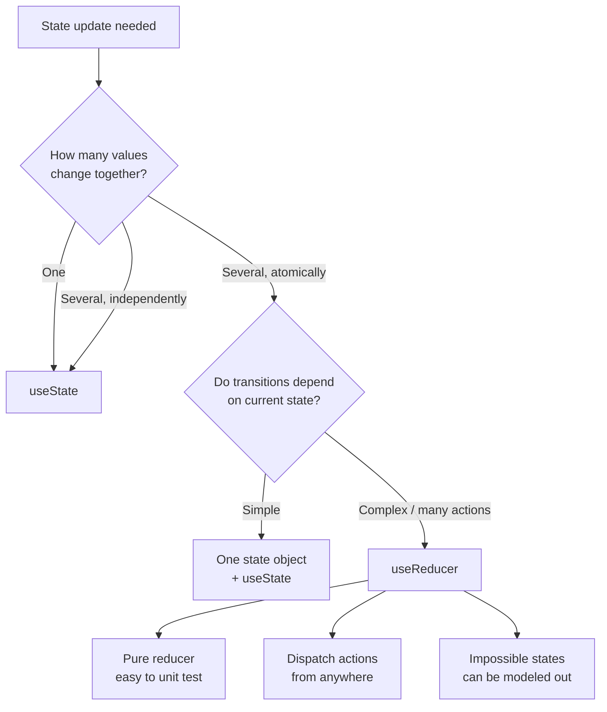
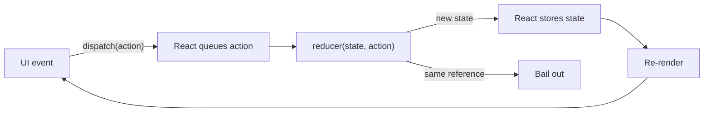
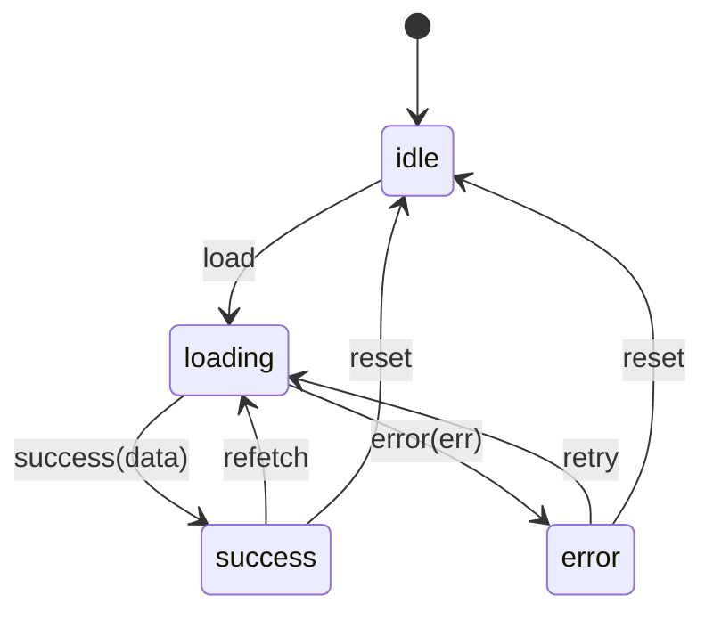
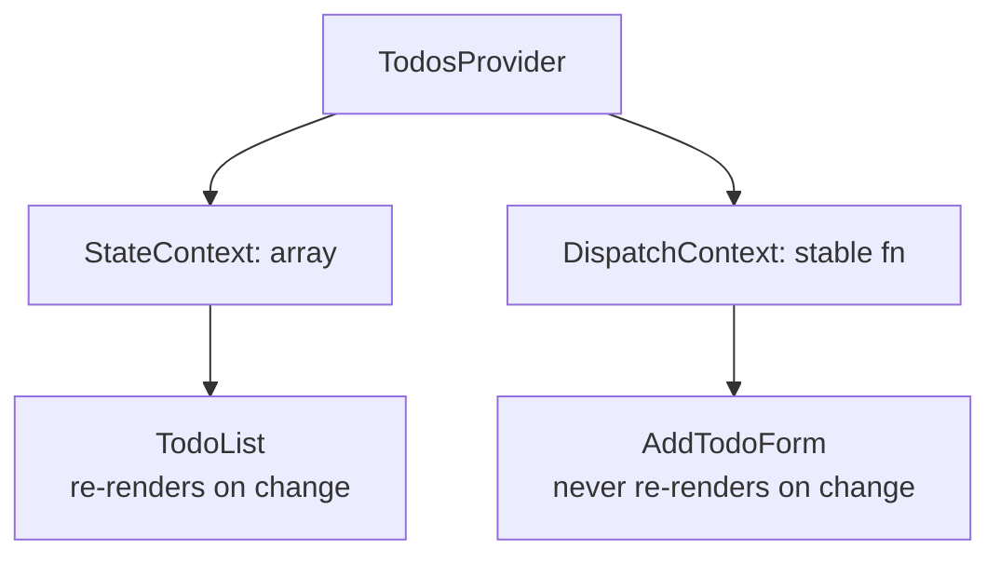

# 19. useReducer and Complex State

> **Level:** Intermediate · **Prerequisites:** Chapters 7, 18 · **Reading time:** ~35 min

`useState` is a scalpel: perfect for one independent value. When several values must change together, when the
next state depends on the previous one in non-trivial ways, or when you need an audit trail of transitions,
`useReducer` gives you a single, testable state transition function.

---

## 1. When state stops being simple



Signals that you want a reducer:

- Five `useState` calls that are always updated together.
- A boolean matrix (`isLoading`, `isError`, `isSuccess`, `data`) where invalid combinations are possible.
- The same update is triggered from multiple places with slightly different logic.
- You need to log or replay transitions (undo/redo, analytics, debugging).
- A field's next value depends on several other fields.

---

## 2. The reducer contract

```js
function reducer(state, action) {
  switch (action.type) {
    case "increment":
      return { ...state, count: state.count + 1 };
    case "decrement":
      return { ...state, count: state.count - 1 };
    case "reset":
      return initialState;
    default:
      return state;
  }
}

const [state, dispatch] = useReducer(reducer, initialState);
```



Rules:

1. **Pure.** No fetching, no `localStorage`, no `Date.now()` inside the reducer.
2. **Immutable.** Return new objects/arrays; never mutate `state`.
3. **Exhaustive.** Always return a state for unknown actions (`default: return state`).
4. **Serializable actions.** `{ type, payload }` — no functions or class instances.
5. **One reducer, one concern.** Split and combine reducers as the domain grows.

---

## 3. Modeling impossible states out

A classic fetch with four booleans allows 16 combinations, most of them nonsense. A discriminated union allows
exactly four.

```jsx
const initialState = { status: "idle" };

function reducer(state, action) {
  switch (action.type) {
    case "load":
      return { status: "loading" };
    case "success":
      return { status: "success", data: action.data };
    case "error":
      return { status: "error", error: action.error };
    case "reset":
      return initialState;
    default:
      return state;
  }
}
```



Usage:

```jsx
function UserPanel({ userId }) {
  const [state, dispatch] = useReducer(reducer, initialState);

  useEffect(() => {
    const controller = new AbortController();
    dispatch({ type: "load" });

    fetch(`/api/users/${userId}`, { signal: controller.signal })
      .then(res => res.json())
      .then(data => dispatch({ type: "success", data }))
      .catch(error => {
        if (error.name !== "AbortError") dispatch({ type: "error", error });
      });

    return () => controller.abort();
  }, [userId]);

  switch (state.status) {
    case "idle": return null;
    case "loading": return <Skeleton />;
    case "error": return <ErrorState error={state.error} />;
    case "success": return <Profile user={state.data} />;
  }
}
```

Because `status` is the discriminant, the `success` branch is the only one where `state.data` exists. TypeScript
enforces this for free (Chapter 33).

---

## 4. Lazy initialization

```jsx
function init(initialCount) {
  return { count: initialCount, history: [] };
}

const [state, dispatch] = useReducer(reducer, initialCount, init);
```

The third argument runs once, on mount. Use it to read `localStorage`, parse a URL or build an expensive initial
structure. (Same idea as `useState(() => ...)`.)

---

## 5. Reducers + context: a store without a library

```jsx
const TodosStateContext = createContext(null);
const TodosDispatchContext = createContext(null);

function todosReducer(state, action) {
  switch (action.type) {
    case "added":
      return [...state, { id: action.id, text: action.text, done: false }];
    case "toggled":
      return state.map(t => (t.id === action.id ? { ...t, done: !t.done } : t));
    case "removed":
      return state.filter(t => t.id !== action.id);
    default:
      return state;
  }
}

export function TodosProvider({ children }) {
  const [todos, dispatch] = useReducer(todosReducer, []);

  return (
    <TodosStateContext.Provider value={todos}>
      <TodosDispatchContext.Provider value={dispatch}>
        {children}
      </TodosDispatchContext.Provider>
    </TodosStateContext.Provider>
  );
}

export function useTodos() {
  const context = useContext(TodosStateContext);
  if (context === null) throw new Error("useTodos must be used inside TodosProvider");
  return context;
}

export function useTodosDispatch() {
  const context = useContext(TodosDispatchContext);
  if (context === null) throw new Error("useTodosDispatch must be used inside TodosProvider");
  return context;
}
```

Why split the contexts:

- `dispatch` is stable across renders, so components that only dispatch never re-render when todos change.
- State consumers re-render only when the state array changes.
- This is the maximum you get from context without selectors. Once every keystroke updates a global store, reach
  for an external store (Chapter 24).



---

## 6. Testing a reducer

Reducers are the easiest thing in a React app to test: no rendering, no mocking, no async.

```js
import { describe, it, expect } from "vitest";

describe("todosReducer", () => {
  it("toggles only the matching todo", () => {
    const before = [
      { id: "1", text: "a", done: false },
      { id: "2", text: "b", done: false },
    ];
    const after = todosReducer(before, { type: "toggled", id: "2" });
    expect(after[0].done).toBe(false);
    expect(after[1].done).toBe(true);
    expect(after).not.toBe(before); // immutability
  });
});
```

Test the transition table, not the component: every action × every state shape that matters.

---

## 7. Anti-patterns

| Anti-pattern | Problem | Fix |
|--------------|---------|-----|
| Mutating `state` in the reducer | React does not see the change | Spread / new arrays |
| Side effects inside reducer | Double runs, unpredictable | Do them in the caller/effect |
| `dispatch` during render | Render loop | Handler or effect |
| One global reducer for the app | Unmaintainable switch | Feature reducers, combine |
| Reducer for a boolean toggle | Ceremony | `useState` |
| Action types as free strings everywhere | Typos, no autocomplete | Constants or TypeScript unions |
| Storing derived data in state | Diverges | Compute in render/selector |
| Reducer reading props | Stale state | Pass what you need in the action |

---

## 8. Checklist

- [ ] The reducer is a pure, exported function.
- [ ] State transitions are modeled as a small state machine where useful.
- [ ] Every action is handled, with a safe default.
- [ ] State and dispatch are provided through separate contexts (if context is used).
- [ ] Reducer transitions have unit tests.
- [ ] The initial state can be created lazily when it is expensive.

---

## 9. Exercises

1. Implement an undo/redo history around a reducer.
2. Model a multi-step checkout (cart → address → payment → review → done) as a state machine. Which transitions
   should be impossible?
3. Split the todos reducer into `todosReducer` and `filterReducer`, then combine them.
4. Add a `useTodosDispatch` consumer and prove with the Profiler that it does not re-render when todos change.

---

## 10. Interview focus

| Question | Where it is answered |
|----------|----------------------|
| What is `useReducer`? (#36) | Sections 2–3 |
| What happens if you update state during render? (#42) | Sections 2, 7 |
| What are common performance mistakes with hooks? (#50) | Sections 5, 7 |

**Follow-up traps**

- *"`useReducer` vs `useState`?"* — Use a reducer when the *transition* is complex and testable, not merely when
  there is more than one value.
- *"Can a reducer be async?"* — No. Dispatch after the async work completes; the reducer stays synchronous.
- *"Does `dispatch` cause a re-render if the reducer returns the same object?"* — React can bail out, but do not
  rely on it for correctness.

---

**Next:** [20. Context API and Prop Drilling](20.%20Context%20API%20and%20Prop%20Drilling.md)
