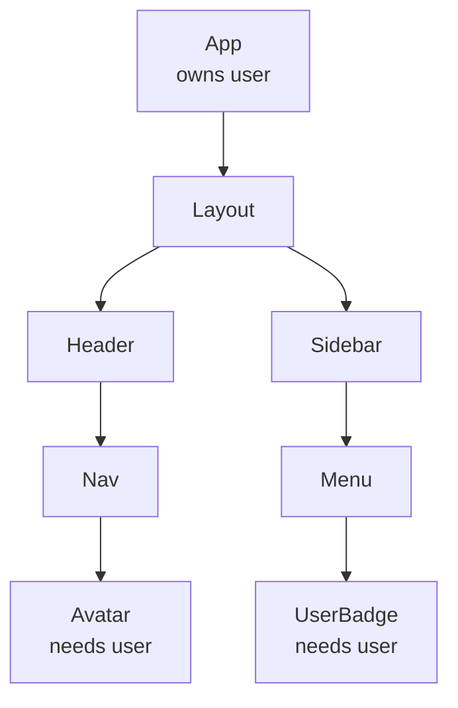
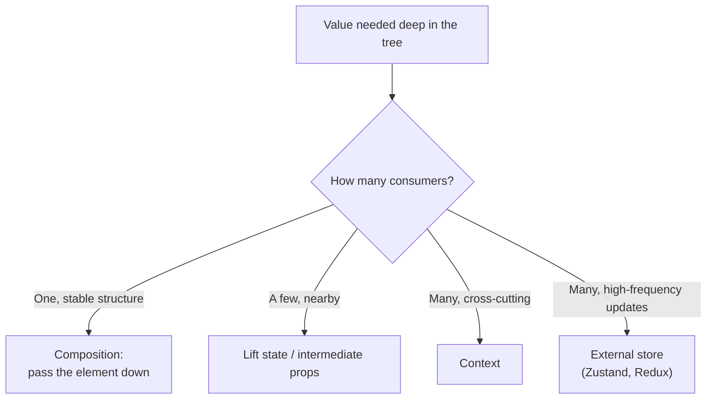
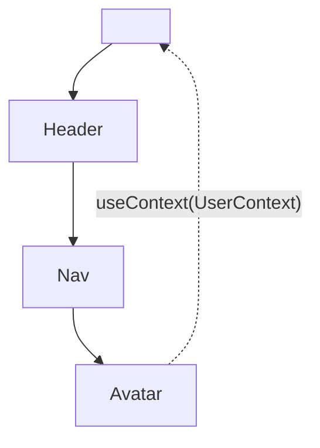
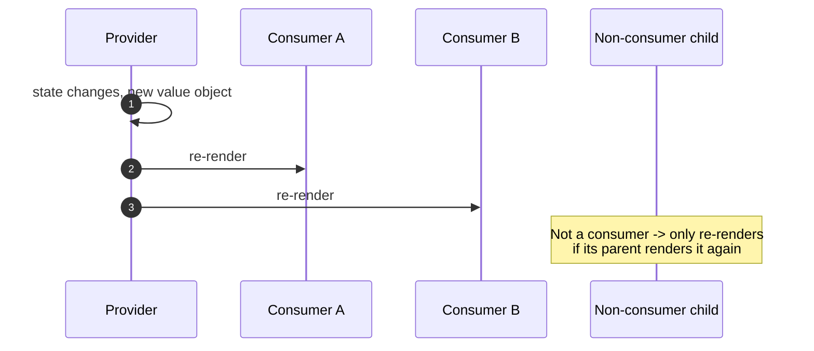
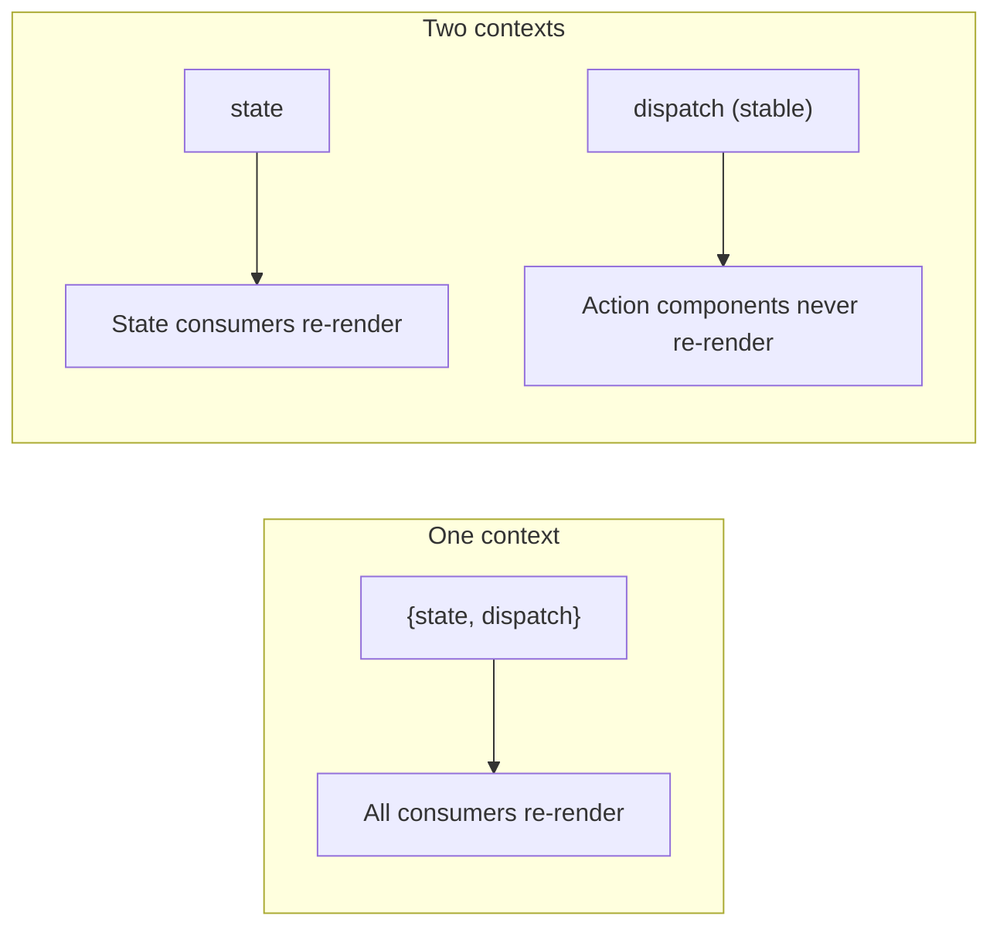
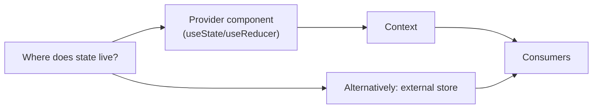

# 20. Context API and Prop Drilling

> **Level:** Intermediate · **Prerequisites:** Chapters 6, 16, 13 · **Reading time:** ~40 min

Context is not a state manager. It is **dependency injection for the component tree**: a way to make a value
available to any descendant without threading it through every intermediate component.

---

## 1. The problem: prop drilling



`Layout`, `Header`, `Nav`, `Sidebar` and `Menu` do not care about `user`; they only pass it along. Their props
become a function of their children's needs, which makes refactoring painful.

```jsx
<Layout user={user}>
  <Header user={user}>
    <Nav user={user}>
      <Avatar user={user} />
```

Three ways out:



Composition often beats context for layout-only props:

```jsx
// Layout does not need to know what a user is
<Layout header={<Header><Nav><Avatar user={user} /></Nav></Header>} />
```

---

## 2. Creating and consuming context

```jsx
// user-context.js
import { createContext, useContext } from "react";

const UserContext = createContext(undefined);

export function UserProvider({ user, children }) {
  // `null` is a valid value (logged out); `undefined` means "no provider".
  return <UserContext.Provider value={user}>{children}</UserContext.Provider>;
}

export function useUser() {
  const context = useContext(UserContext);
  if (context === undefined) {
    throw new Error("useUser must be used within <UserProvider>");
  }
  return context;
}
```

```jsx
function Avatar() {
  const user = useUser();
  return ;
}
```



The custom hook wrapper gives you:

- A runtime error instead of a mysterious `undefined` when the provider is missing.
- One place to change the implementation later.
- A typed return value in TypeScript.

### React 19 shorthand

In React 19 you can render `<UserContext value={user}>` instead of `<UserContext.Provider value={user}>`.
`<Context.Provider>` still works and is required for React 18.

---

## 3. Re-render semantics (the part that bites)

**When the provider's `value` changes identity, every component that calls `useContext` for that context
re-renders.** There is no selector and no bailout.



Two independent problems:

### Problem 1 — unstable value objects

```jsx
// ❌ New object every render -> every consumer re-renders every time
<UserContext.Provider value={{ user, logout }}>

// ✅ Stable unless user changes
const value = useMemo(() => ({ user, logout }), [user, logout]);
<UserContext.Provider value={value}>
```

### Problem 2 — one context for unrelated values

```jsx
// ❌ Any theme or user change re-renders every consumer
<AppContext.Provider value={{ user, theme, locale, cart }}>
```

Split by change frequency:

```jsx
<AuthProvider>
  <ThemeProvider>
    <LocaleProvider>
      <CartProvider>
        {children}
```

### Problem 3 — state and dispatch in one context

Split them as in [Chapter 19](19.%20useReducer%20and%20Complex%20State.md). Dispatch-only consumers stay stable.



### When context re-renders become the bottleneck

Context re-renders are fine at low frequency (theme, auth, locale). They are the wrong tool for high-frequency
updates (typing, mouse position, live prices) consumed by many components. Use:

- a store with selectors (Zustand, Redux Toolkit, Jotai),
- `useSyncExternalStore` with a selector,
- or **move the state down** so fewer components are inside the provider.

---

## 4. Context is a transport, not a store



The provider still owns the state and its lifetime. Context only saves you from passing it as props.

Corollary: **don't put state in context that only one branch needs.** Colocate it in that branch and use props.
Context is justified when:

- The value is genuinely cross-cutting (auth, theme, i18n, feature flags).
- Many components at different depths consume it.
- The provider sits near the root and changes infrequently.

---

## 5. Patterns that scale

### 5.1 Provider composition

```jsx
function AppProviders({ children }) {
  return (
    <QueryClientProvider client={queryClient}>
      <AuthProvider>
        <ThemeProvider>
          <ToastProvider>{children}</ToastProvider>
        </ThemeProvider>
      </AuthProvider>
    </QueryClientProvider>
  );
}
```

Keep provider nesting in one file instead of scattering it through the app.

### 5.2 Derived context

```jsx
const CartContext = createContext(null);

export function CartProvider({ children }) {
  const [items, setItems] = useState([]);
  const total = items.reduce((sum, item) => sum + item.price * item.qty, 0);

  const value = useMemo(
    () => ({ items, total, add: item => setItems(prev => [...prev, item]) }),
    [items, total]
  );

  return <CartContext.Provider value={value}>{children}</CartContext.Provider>;
}
```

### 5.3 Scoped provider instances

The same provider can be mounted multiple times with independent state — useful for reusable widgets.

```jsx
<FormProvider>
  <ContactFields />
</FormProvider>

<FormProvider>
  <BillingFields />
</FormProvider>
```

Each `FormProvider` has its own state. This is a feature of context, not a bug: context follows the tree, not a
global singleton.

### 5.4 Default values

```jsx
const ThemeContext = createContext("light"); // usable without a provider
```

A default is fine for a true default (theme). For required dependencies, use `null` + a throwing hook so misuse
fails loudly.

---

## 6. Anti-patterns

| Anti-pattern | Problem | Better |
|--------------|---------|--------|
| Context for everything | Hidden dependencies, unnecessary re-renders | Props first; context for cross-cutting |
| One giant app context | Any change re-renders everything | Split by domain and frequency |
| New object literal as value | Consumers re-render every parent render | `useMemo` |
| No provider guard | `undefined` deep in the tree | Throwing custom hook |
| Context for form state | Every keystroke re-renders consumers | Local state / form library |
| Using context to avoid designing props | Implicit coupling | Explicit composition |
| Storing server data in context | Manual caching/invalidations | TanStack Query (Chapter 25) |
| Nesting 10 providers by hand | Unreadable app root | `AppProviders` composition |

---

## 7. Checklist

- [ ] The context represents one concern.
- [ ] The provider value is memoized or structurally stable.
- [ ] State and dispatch are separate where it matters.
- [ ] Consumers access it through a custom hook that validates the provider.
- [ ] I considered composition before context.
- [ ] High-frequency updates do not flow through context.
- [ ] Provider nesting lives in a single `AppProviders` component.

---

## 8. Exercises

1. Refactor a three-level prop-drilling chain to context. Measure with the Profiler how many components re-render
   on a single value change.
2. Split a monolithic `AppContext` into auth, theme and notifications contexts. Compare render counts.
3. Replace a context-held counter with a scoped provider mounted twice. Verify the counters are independent.
4. Implement the same feature with an external store and list the concrete differences (boilerplate, selectors,
   devtools, testability).

---

## 9. Interview focus

| Question | Where it is answered |
|----------|----------------------|
| What is prop drilling? (#15) | Section 1 |
| How do you avoid prop drilling? (#16) | Sections 1, 3 |
| What is `useContext`? (#32) | Section 2 |
| What is the Context API? (#55) | Sections 2–4 |
| What is the cost of context re-renders? (#104) | Section 3 |

**Follow-up traps**

- *"Does context replace Redux?"* — Only for low-frequency, tree-scoped values. Redux adds devtools, middleware,
  time travel and selector-based subscriptions.
- *"Why did my consumer re-render when unrelated state changed?"* — The provider value was a new object, or the
  same context held unrelated values.
- *"Can I use context outside React?"* — No; it is bound to the render tree. Use an external store for that.

---

**Next:** [21. Custom Hooks](21.%20Custom%20Hooks.md)
