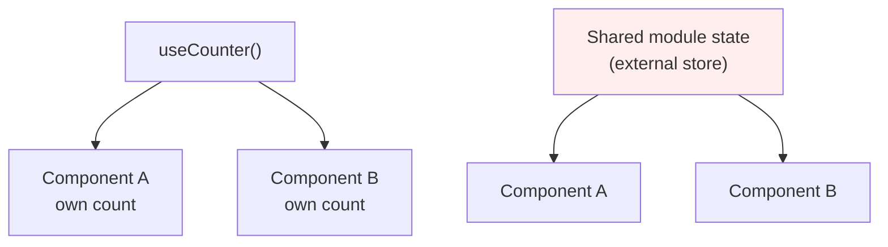
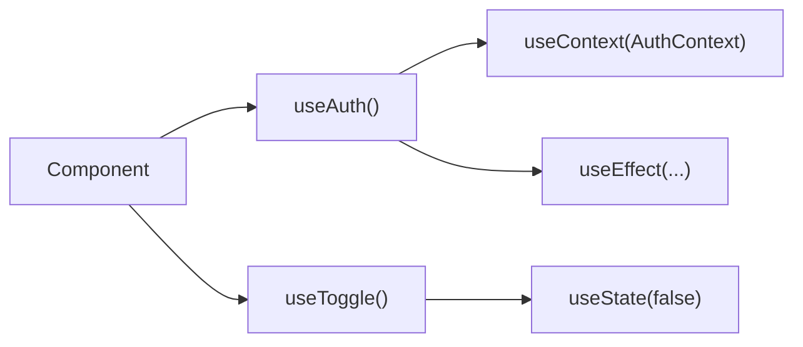
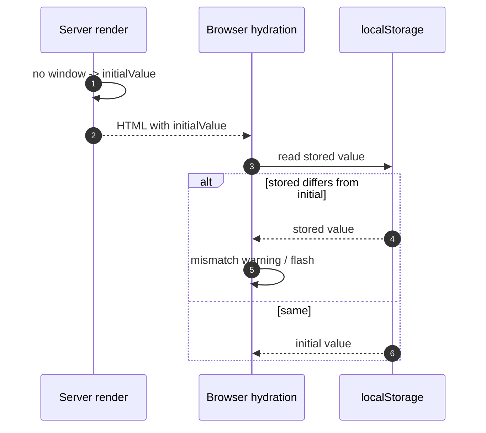
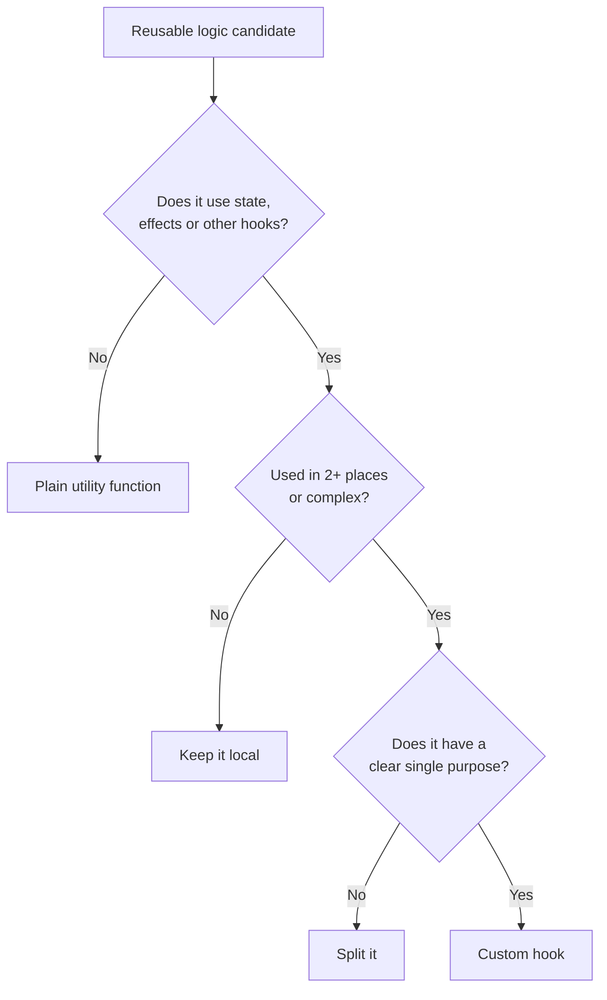

# 21. Custom Hooks

> **Level:** Intermediate · **Prerequisites:** Chapters 8, 18 · **Reading time:** ~40 min

A custom hook is just a function that calls other hooks. Its purpose is to extract **stateful logic** — not
markup, and not state itself. Every call to a custom hook gets its own independent state.

---

## 1. Logic reuse, not state reuse



```jsx
function useCounter(initial = 0) {
  const [count, setCount] = useState(initial);
  const increment = useCallback(() => setCount(c => c + 1), []);
  const decrement = useCallback(() => setCount(c => c - 1), []);
  const reset = useCallback(() => setCount(initial), [initial]);
  return { count, increment, decrement, reset };
}
```

Two components calling `useCounter()` do **not** share `count`. If they need to, the state must live in a common
ancestor, a context, or an external store.

---

## 2. Naming and rules

- Must start with `use` — the linter and React rely on this convention to enforce the rules of hooks.
- Must be called at the top level of a component or another hook.
- Must not be called conditionally, in loops, or after an early return.
- May call other hooks, including other custom hooks.



A function that calls no hooks is a **utility**, not a hook. Naming it `useFormatDate` only misleads the linter
and readers.

---

## 3. Designing the return value

```jsx
// Tuple: small, positional, renameable by the caller
const [value, setValue] = useState("");
const [isOpen, toggle] = useToggle(false);

// Object: discoverable, order-independent, easy to extend
const { data, error, isLoading, refetch } = useFetch(url);
```

| Shape | Use when |
|-------|----------|
| Tuple `[value, actions]` | Two values, mirrors a built-in hook |
| Object | Three or more values, or future extension |
| Single value | The hook is a selector or derived state |

Rules:

- **Return stable functions.** If a consumer puts `refetch` in a dependency array, a new function every render
  causes loops.
- **Don't return a new object without memoizing** if consumers depend on identity. Or document that identity is
  not stable.
- **Return only what consumers need.** Internal setters and implementation details leak API surface.

```jsx
function useToggle(initial = false) {
  const [value, setValue] = useState(initial);

  const toggle = useCallback(() => setValue(v => !v), []);
  const on = useCallback(() => setValue(true), []);
  const off = useCallback(() => setValue(false), []);

  return { value, toggle, on, off };
}
```

---

## 4. Composing hooks

Small hooks compose into larger ones. This is the real power of the model.

```jsx
function useMediaQuery(query) {
  const [matches, setMatches] = useState(() => window.matchMedia(query).matches);

  useEffect(() => {
    const mql = window.matchMedia(query);
    const onChange = event => setMatches(event.matches);

    mql.addEventListener("change", onChange);
    setMatches(mql.matches); // sync in case it changed between render and effect
    return () => mql.removeEventListener("change", onChange);
  }, [query]);

  return matches;
}

function useIsDesktop() {
  return useMediaQuery("(min-width: 1024px)");
}
```

```jsx
function useDebouncedValue(value, delay = 300) {
  const [debounced, setDebounced] = useState(value);

  useEffect(() => {
    const id = setTimeout(() => setDebounced(value), delay);
    return () => clearTimeout(id);
  }, [value, delay]);

  return debounced;
}

function useProductSearch(query) {
  const debouncedQuery = useDebouncedValue(query, 300);
  const { data, isLoading } = useQuery({
    queryKey: ["products", debouncedQuery],
    queryFn: () => searchProducts(debouncedQuery),
    enabled: debouncedQuery.length > 1,
  });
  return { results: data ?? [], isLoading };
}
```

`useProductSearch` reads like a feature, not like plumbing. That is the target.

---

## 5. Hooks that touch browser APIs

These are the highest-risk custom hooks because they are not SSR-safe by default.

```jsx
function useLocalStorage(key, initialValue) {
  const [value, setValue] = useState(() => {
    if (typeof window === "undefined") return initialValue;
    try {
      const stored = window.localStorage.getItem(key);
      return stored === null ? initialValue : JSON.parse(stored);
    } catch {
      return initialValue;
    }
  });

  useEffect(() => {
    try {
      window.localStorage.setItem(key, JSON.stringify(value));
    } catch {
      // quota or private mode — fail silently
    }
  }, [key, value]);

  return [value, setValue];
}
```



For SSR, either accept the initial value and update after mount, or read the value in a blocking script / cookie
so the server and client agree. `useSyncExternalStore` supports a server snapshot for exactly this reason.

---

## 6. Testing custom hooks

Use `renderHook` from React Testing Library; assert on the returned values and on re-renders.

```jsx
import { renderHook, act } from "@testing-library/react";
import { describe, it, expect } from "vitest";

describe("useToggle", () => {
  it("toggles the value", () => {
    const { result } = renderHook(() => useToggle(false));

    expect(result.current.value).toBe(false);
    act(() => result.current.toggle());
    expect(result.current.value).toBe(true);
  });
});
```

For hooks with timers, use fake timers. For hooks with network, mock the boundary (MSW), not the hook internals.
See [Chapter 34](34.%20Testing%20Strategy.md).

---

## 7. When *not* to write a hook



Avoid:

- **Hooks that wrap a single `useState`** and add no semantics. `useCounter` is justified; `useName` is not.
- **Hooks that hide layout.** Returning JSX from a hook mixes concerns; use a component.
- **Hooks with 12 parameters** and a configuration object. That is a framework, not a hook.
- **Hooks that swallow errors.** Return an error state or throw; don't silently return `[]`.

---

## 8. Anti-patterns

| Anti-pattern | Problem | Fix |
|--------------|---------|-----|
| `useData()` that fetches in an effect without cancel | Races, leaks | Abort + status state, or a query library |
| Returning new object every render | Consumer effects loop | `useMemo` the return |
| Unstable functions in return | Dependency churn | `useCallback` |
| Calling a hook conditionally inside the custom hook | Breaks hook order | Always call all hooks |
| Naming a pure function `useX` | Linter noise, false expectations | Drop the prefix |
| Cross-component state in a hook | Values do not actually share | Lift state/context/store |
| Browser API access during render | SSR crash | Guard or effect |
| One hook doing fetch + format + analytics | Untestable | Compose smaller hooks |

---

## 9. Checklist

- [ ] The hook has one responsibility and a name that describes it.
- [ ] It starts with `use` and obeys the rules of hooks.
- [ ] Returned functions are stable.
- [ ] Returned object identity is stable if consumers depend on it.
- [ ] Browser APIs are SSR-safe.
- [ ] It has a `renderHook` test for its core behavior.
- [ ] It does not hide markup or a whole feature.

---

## 10. Exercises

1. Write `useDebouncedValue` and use it to search an API. Verify only one request fires per pause.
2. Write `useLocalStorage` and test it with a mocked `Storage`.
3. Compose `useMediaQuery` + `useLocalStorage` into `usePreferredTheme`.
4. Refactor a 120-line component into three custom hooks. Which one did not deserve to exist?
5. Add tests with `renderHook` for each hook.

---

## 11. Interview focus

| Question | Where it is answered |
|----------|----------------------|
| How do you create a custom hook? (#37) | Sections 1–4 |
| How can you share logic between components? (#38) | Sections 1, 4 |
| How do you persist data between renders? (#47) | Section 5 |

**Follow-up traps**

- *"Do custom hooks share state?"* — No. Each call is an independent instance.
- *"Can a custom hook render UI?"* — It can return elements, but that is a component's job; returning JSX from a
  hook hides structure and harms readability.
- *"How do you test them?"* — `renderHook` for logic; integration tests for behavior in a component.

---

**Next:** [22. Refs and Imperative APIs](22.%20Refs%20and%20Imperative%20APIs.md)
