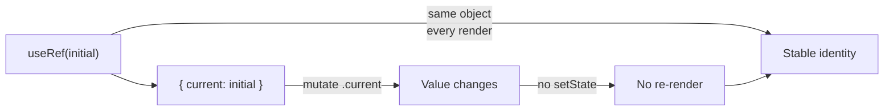
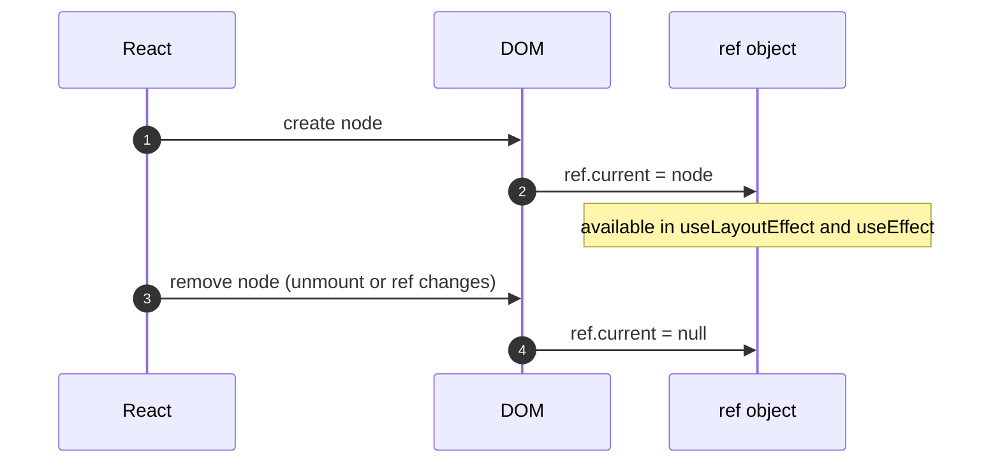
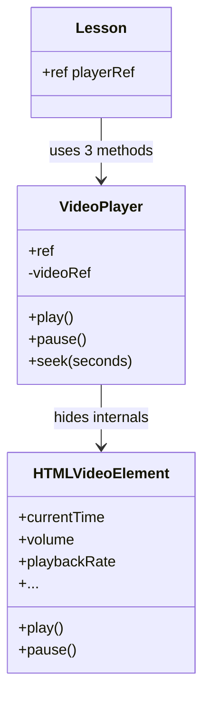
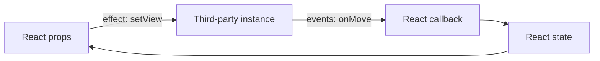

# 22. Refs and Imperative APIs

> **Level:** Intermediate → Advanced · **Prerequisites:** Chapters 7, 13, 18 · **Reading time:** ~35 min

React is declarative, but the browser is imperative. Refs are the controlled escape hatch: a mutable box that
survives renders **without causing them**, and the only sanctioned way to reach a DOM node or a third-party
imperative API.

---

## 1. `useRef` in one diagram



```jsx
const inputRef = useRef(null);

<input ref={inputRef} />
<button onClick={() => inputRef.current?.focus()}>Focus</button>
```

| | `useRef` | `useState` |
|---|----------|------------|
| Triggers re-render | No | Yes |
| Persists across renders | Yes | Yes |
| Read during render | Only for initialization/measurement | Yes |
| Updated by | You | Setter |
| Use for | DOM nodes, timers, previous values | UI state |

```jsx
// Common: store a timer ID
const timerRef = useRef(null);

useEffect(() => {
  timerRef.current = setInterval(tick, 1000);
  return () => clearInterval(timerRef.current);
}, []);
```

---

## 2. Ref lifecycle



Consequences:

- `ref.current` is `null` during the first render — the DOM does not exist yet.
- It is safe to read in `useLayoutEffect`/`useEffect` and in event handlers.
- When a ref callback or object changes, React detaches the old node (`null`) then attaches the new one.

### Don't read or write refs during render

```jsx
// ❌ Render must be pure; this breaks concurrent rendering and StrictMode
function Bad() {
  const ref = useRef(0);
  ref.current += 1;
  return <p>{ref.current}</p>;
}
```

The one accepted exception is lazy initialization:

```jsx
const ref = useRef(null);
if (ref.current === null) ref.current = expensiveInit();
```

Even then, prefer `useState(() => expensiveInit())` when the value affects rendering.

---

## 3. Referencing DOM nodes

```jsx
function SearchBox({ onSearch }) {
  const inputRef = useRef(null);

  function handleSubmit(event) {
    event.preventDefault();
    const value = inputRef.current?.value.trim();
    if (value) {
      onSearch(value);
      inputRef.current?.select();
    }
  }

  return (
    <form onSubmit={handleSubmit}>
      <input ref={inputRef} aria-label="Search" />
      <button type="submit">Search</button>
    </form>
  );
}
```

Use refs for DOM access when the operation is genuinely imperative:

- Focus, selection, `scrollIntoView`, measuring `getBoundingClientRect`.
- Playing/pausing media.
- Integrating a non-React library (maps, charts, editors, drag-and-drop).
- Triggering a file picker or clipboard API.

Do **not** use refs to read form values you control, to toggle CSS classes, or to bypass state that drives UI.

---

## 4. `ref` as a prop (React 19) and `forwardRef` (React 18)

React 19 makes `ref` a normal prop for function components:

```jsx
function TextInput({ label, ref, ...props }) {
  return (
    <label>
      {label}
      <input ref={ref} {...props} />
    </label>
  );
}

<TextInput label="Email" ref={emailRef} />
```

Before React 19 you had to wrap the component:

```jsx
import { forwardRef } from "react";

const TextInput = forwardRef(function TextInput({ label, ...props }, ref) {
  return (
    <label>
      {label}
      <input ref={ref} {...props} />
    </label>
  );
});
```

`forwardRef` still works in React 19 but is no longer necessary for function components. Class components use
`createRef` or a ref callback; `createRef` is not for function components because it creates a new object on
every render.

---

## 5. `useImperativeHandle`: a small, intentional API

Exposing the raw DOM node leaks every property of the element. `useImperativeHandle` lets a component expose a
narrow imperative API instead.

```jsx
import { useRef, useImperativeHandle } from "react";

function VideoPlayer({ src, ref }) {
  const videoRef = useRef(null);

  useImperativeHandle(ref, () => ({
    play: () => videoRef.current?.play(),
    pause: () => videoRef.current?.pause(),
    seek: seconds => {
      if (videoRef.current) videoRef.current.currentTime = seconds;
    },
  }), []);

  return <video ref={videoRef} src={src} controls />;
}
```

```jsx
function Lesson() {
  const playerRef = useRef(null);

  return (
    <>
      <VideoPlayer ref={playerRef} src="/lesson.mp4" />
      <button onClick={() => playerRef.current?.seek(120)}>Skip intro</button>
    </>
  );
}
```



Rules:

- Keep the handle minimal and semantic (`play`, `focus`, `scrollTo`), not a DOM mirror.
- The dependency array works like `useMemo`: list values used by the handle factory.
- Ask first whether props/state can express the same thing. Imperative handles are for cases where the operation
  is not a state transition (focus, scroll, media).

---

## 6. Callback refs and cleanup (React 19)

A callback ref runs when the node attaches and detaches. In React 19 it may return a cleanup function.

```jsx
function MeasuredBox({ onResize }) {
  return (
    <div
      ref={node => {
        if (!node) return;
        const observer = new ResizeObserver(entries => {
          onResize(entries[0].contentRect);
        });
        observer.observe(node);
        return () => observer.disconnect();
      }}
    />
  );
}
```

This keeps setup and teardown next to each other and avoids an extra `useEffect` just to observe a node. For
React 18, do the same work in `useEffect` with a ref.

---

## 7. Measuring layout safely

```jsx
function Tooltip({ targetRef, children }) {
  const [position, setPosition] = useState({ top: 0, left: 0 });
  const tooltipRef = useRef(null);

  useLayoutEffect(() => {
    const target = targetRef.current;
    const tooltip = tooltipRef.current;
    if (!target || !tooltip) return;

    const rect = target.getBoundingClientRect();
    const tipRect = tooltip.getBoundingClientRect();

    setPosition({
      top: rect.top - tipRect.height - 8,
      left: rect.left + rect.width / 2 - tipRect.width / 2,
    });
  }, [targetRef, children]);

  return (
    <div ref={tooltipRef} style={{ position: "fixed", ...position }}>
      {children}
    </div>
  );
}
```

`useLayoutEffect` runs **before paint**, so the user never sees the tooltip at the wrong position. Using
`useEffect` here produces a visible jump. `useLayoutEffect` is also the only safe place to measure synchronously;
expensive work there blocks paint.

---

## 8. Integrating a third-party imperative library

```jsx
function MapView({ center, zoom }) {
  const containerRef = useRef(null);
  const mapRef = useRef(null);

  useEffect(() => {
    const map = new MapLibrary(containerRef.current, { center, zoom });
    mapRef.current = map;
    return () => map.destroy();
  }, []); // create once

  useEffect(() => {
    mapRef.current?.setView(center, zoom);
  }, [center, zoom]); // sync props -> imperative API

  return <div ref={containerRef} style={{ height: "100%" }} />;
}
```



Split **creation** (once) from **synchronization** (on prop change) from **teardown** (on unmount). This is the
same pattern used for charts, editors and payment widgets.

---

## 9. Anti-patterns

| Anti-pattern | Problem | Fix |
|--------------|---------|-----|
| Ref instead of state for visible values | UI does not update | `useState` |
| Reading `ref.current` during render | Impure render | Effect or event |
| Exposing the whole DOM node | Leaky API, breaks encapsulation | `useImperativeHandle` |
| `createRef` in a function component | New ref every render | `useRef` |
| Ref to bypass controlled inputs | Two sources of truth | Controlled state |
| Refs for cross-component data | Invisible coupling | Props/context/store |
| Layout reads in `useEffect` | Flicker | `useLayoutEffect` |
| Forgetting cleanup for observers | Leaks | Return cleanup |

---

## 10. Checklist

- [ ] Refs are used only for imperative needs, not as hidden state.
- [ ] No ref reads/writes during render (except lazy init).
- [ ] DOM measurements run in `useLayoutEffect`.
- [ ] Public imperative APIs are narrow and documented.
- [ ] Observers, media and third-party instances are destroyed on unmount.
- [ ] Components forward `ref` correctly for the React version in use.

---

## 11. Exercises

1. Build a "focus first invalid field on submit" helper using refs.
2. Expose a `reset()` and `focus()` handle on a custom form component.
3. Integrate a third-party date picker and sync its value both ways without duplicated state.
4. Measure a container with `ResizeObserver` and render its dimensions. Compare `useEffect` vs `useLayoutEffect`
   for a tooltip position.
5. Use a callback ref with cleanup to subscribe and unsubscribe from scroll events.

---

## 12. Interview focus

| Question | Where it is answered |
|----------|----------------------|
| What is `useRef` and how is it used? (#33) | Sections 1–3 |
| `useRef` vs `createRef` (#44) | Section 4 |
| What is `useImperativeHandle`? (#48) | Section 5 |
| What is `forwardRef`? (#110) | Section 4 |

**Follow-up traps**

- *"Does changing a ref re-render?"* — No, and that is exactly why it must not hold UI state.
- *"When is `useLayoutEffect` correct?"* — Measuring or mutating layout before paint; otherwise `useEffect`.
- *"Why not expose the DOM node?"* — Consumers couple to implementation details; the component cannot change its
  internals safely.

---

**Next:** [23. Concurrent React and Advanced Hooks](23.%20Concurrent%20React%20and%20Advanced%20Hooks.md)
