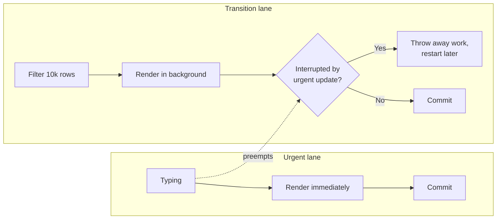
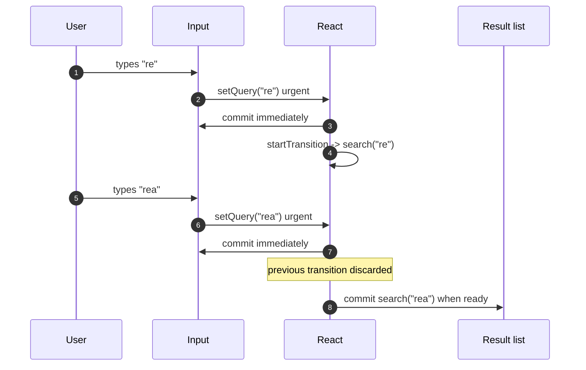
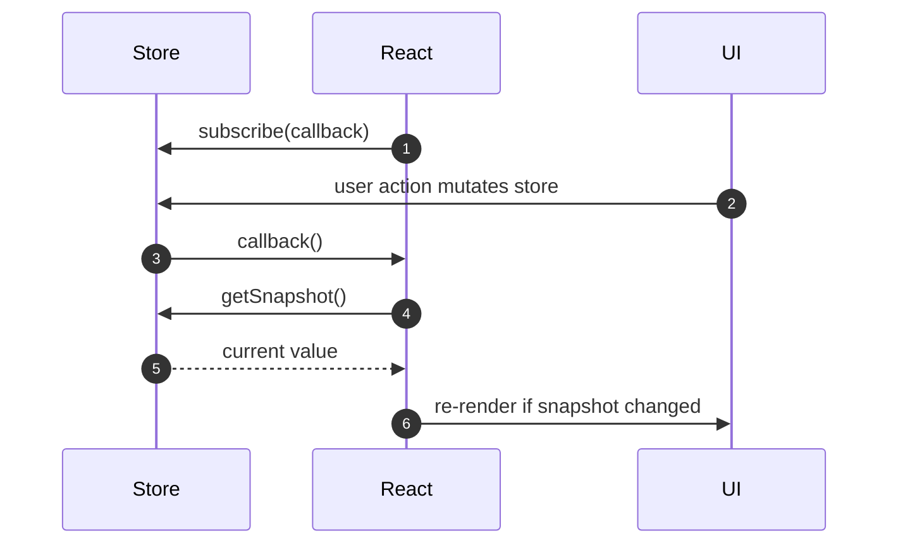
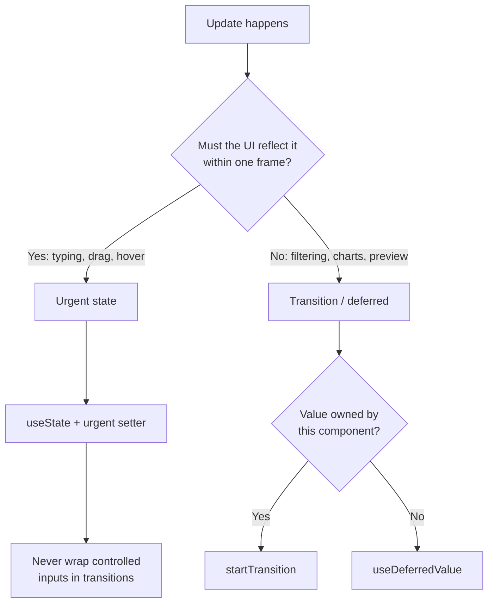

# 23. Concurrent React and Advanced Hooks

> **Level:** Advanced · **Prerequisites:** Chapters 13, 18, 21 · **Reading time:** ~45 min

Concurrent React is not a feature you opt into with an API flag. It is the rendering architecture React has used
since 18: renders can be **interrupted**, **prioritized** and **discarded** before they reach the DOM. The hooks in
this chapter let you tell React which updates are urgent and which can wait.

---

## 1. The mental model



| Concept | Meaning |
|---------|---------|
| **Interruptible render** | A render pass can be paused and resumed or abandoned |
| **Priority / lanes** | Updates are assigned different priorities |
| **Tearing** | UI reading inconsistent values from an external store mid-render |
| **Transition** | A non-urgent update that may be interrupted |

Concurrency does **not** make rendering faster. It makes the app **stay responsive** while expensive work happens.

---

## 2. `useTransition`

```jsx
function SearchPage() {
  const [query, setQuery] = useState("");
  const [results, setResults] = useState([]);
  const [isPending, startTransition] = useTransition();

  function handleChange(event) {
    const next = event.target.value;
    setQuery(next); // urgent: keep the input responsive

    startTransition(() => {
      setResults(search(next)); // non-urgent: can be interrupted
    });
  }

  return (
    <>
      <input value={query} onChange={handleChange} />
      {isPending && <Spinner />}
      <Results items={results} />
    </>
  );
}
```



Rules and limits:

- `startTransition` must wrap **state updates**, not async work. The callback must be synchronous.
- Updates inside the transition still re-render the component; they are just deprioritized.
- You cannot use a transition to control an input's `value` — the input must update urgently.
- `isPending` tells you a transition is in flight; it is not a promise.
- For routers and external callbacks, use the global `startTransition` imported from `react`.

---

## 3. `useDeferredValue`

When you cannot wrap the update (the value comes from props or a library), defer the **consumption** instead.

```jsx
function ProductList({ query }) {
  const deferredQuery = useDeferredValue(query);
  const isStale = query !== deferredQuery;

  const results = useMemo(() => search(query), [deferredQuery]);

  return (
    <div style={{ opacity: isStale ? 0.6 : 1 }}>
      {results.map(item => <ProductCard key={item.id} item={item} />)}
    </div>
  );
}
```



```mermaid
flowchart LR
    Q["query: urgent"] --> I["<input value={query}>"]
    Q --> D["deferredQuery<br/>(lags behind)"]
    D --> M["useMemo(expensive)"]
    M --> L["List"]
```

| | `useTransition` | `useDeferredValue` |
|---|---|---|
| Wraps | State updates | A value |
| Control | You own the setter | Value comes from outside |
| Re-render | Can skip intermediate states | Renders with stale value first |
| Indicator | `isPending` | Compare `value !== deferredValue` |
| Typical use | Filtering, tab switch | Expensive child fed by props |

React 19 adds an optional `initialValue` to `useDeferredValue`, useful for rendering a cheap placeholder on the
first render.

---

## 4. `<Activity>`: hide without unmounting (React 19.2+)

```jsx
<Activity mode={isOpen ? "visible" : "hidden"}>
  <ExpensiveEditor documentId={id} />
</Activity>
```

- `hidden` keeps state and DOM, but unmounts effects and deprioritizes updates.
- `visible` restores effects and re-renders.
- Use it for tabs, side panels and pre-rendering routes the user is likely to open.

It replaces the hack of `display: none` plus manual effect pausing, and it is safer than unmounting when you want
to preserve scroll, form state or expensive data.

---

## 5. `useId`

```jsx
function Field({ label }) {
  const id = useId();
  return (
    <>
      <label htmlFor={id}>{label}</label>
      <input id={id} aria-describedby={`${id}-hint`} />
      <p id={`${id}-hint`}>Must be at least 8 characters</p>
    </>
  );
}
```

- Generates a stable, unique ID that matches between server and client.
- Do **not** use it for list keys — keys must come from data.
- Do not use `Math.random()` or `Date.now()` for IDs in SSR: they cause hydration mismatches.

---

## 6. `useSyncExternalStore`

For values that live outside React (browser APIs, stores, caches), this hook subscribes correctly and avoids
tearing.

```jsx
function useOnlineStatus() {
  return useSyncExternalStore(
    callback => {
      window.addEventListener("online", callback);
      window.addEventListener("offline", callback);
      return () => {
        window.removeEventListener("online", callback);
        window.removeEventListener("offline", callback);
      };
    },
    () => navigator.onLine,
    () => true // server snapshot
  );
}
```



Requirements:

- `getSnapshot` must return a **cached** value. Returning a new object every call causes an infinite render loop.
- `getServerSnapshot` is required for SSR and must match the initial client render.
- The subscribe function must be stable (defined outside the component) or the subscription re-runs constantly.

### A minimal external store with selectors

```js
function createStore(initialState) {
  let state = initialState;
  const listeners = new Set();

  return {
    getState: () => state,
    setState: next => {
      state = typeof next === "function" ? next(state) : next;
      listeners.forEach(listener => listener());
    },
    subscribe: listener => {
      listeners.add(listener);
      return () => listeners.delete(listener);
    },
  };
}
```

```jsx
function useSelector(store, selector) {
  return useSyncExternalStore(
    store.subscribe,
    () => selector(store.getState()),
    () => selector(store.getState())
  );
}
```

This is the core of Zustand/Redux's React binding. Selectors are what give you **per-component subscriptions**
instead of context's "re-render every consumer" behavior.

---

## 7. Suspense interactions

```jsx
function ProfilePage({ userId }) {
  return (
    <Suspense fallback={<ProfileSkeleton />}>
      <Profile userId={userId} />
    </Suspense>
  );
}

function Profile({ userId }) {
  const user = use(fetchUser(userId)); // React 19
  return <ProfileCard user={user} />;
}
```

- Suspense boundaries should be placed where a fallback is meaningful, not around the whole app.
- During a transition, React keeps the previous UI visible instead of flashing the fallback.
- Avoid a fallback that changes layout height; use skeletons matching the final dimensions.

---

## 8. Priority design in practice



---

## 9. Anti-patterns

| Anti-pattern | Problem | Fix |
|--------------|---------|-----|
| Transition around `await fetch(...)` | Callback must be sync | Update state after the await |
| Transition for controlled input state | Input lags | Keep input urgent, defer results |
| `useDeferredValue` without memoized work | Deferred value does nothing | Memoize the expensive computation |
| New object from `getSnapshot` | Infinite loop | Cache the snapshot |
| `getServerSnapshot` mismatch | Hydration errors | Return deterministic server value |
| `useId` for list keys | Unstable identity semantics | Use data IDs |
| Suspense around the entire app | Full-page flash | Granular boundaries |

---

## 10. Checklist

- [ ] Expensive list/chart updates are transitions or deferred.
- [ ] Controlled inputs update urgently.
- [ ] `startTransition` callbacks contain only state updates.
- [ ] External stores use `useSyncExternalStore` with cached snapshots.
- [ ] Suspense fallbacks match final layout dimensions.
- [ ] I did not expect concurrency to reduce total render cost.

---

## 11. Exercises

1. Build a 10,000-item filter. Add `useTransition` and compare typing latency with and without it.
2. Replace `useTransition` with `useDeferredValue` where the query comes from a parent.
3. Implement a `useOnlineStatus` hook with `useSyncExternalStore` and a server snapshot.
4. Build a tiny store with selectors and prove that a component selecting `count` does not re-render when `name`
   changes.
5. Use `<Activity>` for a tabbed editor and verify that state survives switching tabs.

---

## 12. Interview focus

| Question | Where it is answered |
|----------|----------------------|
| What is React Fiber? (#113) | Section 1, Chapter 39 |
| How is concurrent mode different? (#114) | Sections 1–3 |
| Suspense for data fetching (#115) | Section 7, Chapter 37 |
| How do you prevent unnecessary re-renders? (#43) | Sections 2–6 |

**Follow-up traps**

- *"Does `startTransition` make rendering faster?"* — No; it makes the app responsive by yielding and discarding
  work.
- *"Why can't I defer a controlled input?"* — The DOM value must match state on the next frame, or characters are
  lost/reordered.
- *"What is tearing?"* — Different components reading different versions of the same external state in one
  render; `useSyncExternalStore` prevents it.

---

**Next:** [24. State Management Landscape](24.%20State%20Management%20Landscape.md)
