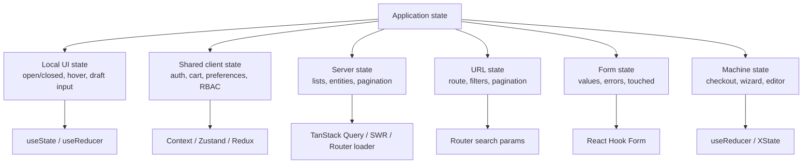
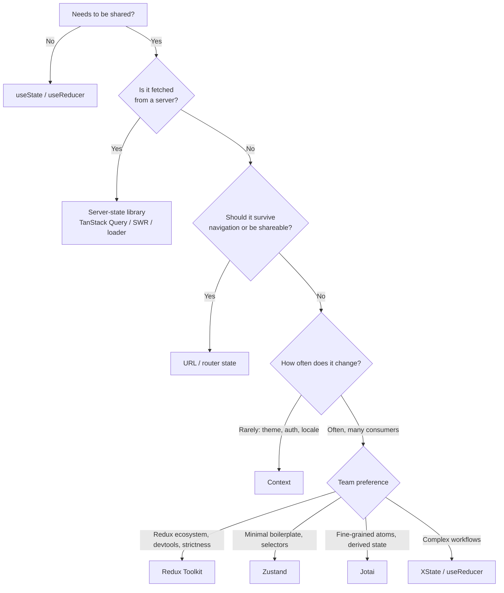
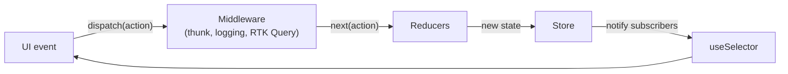
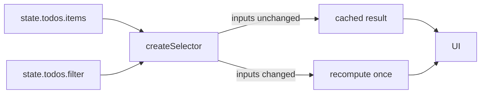
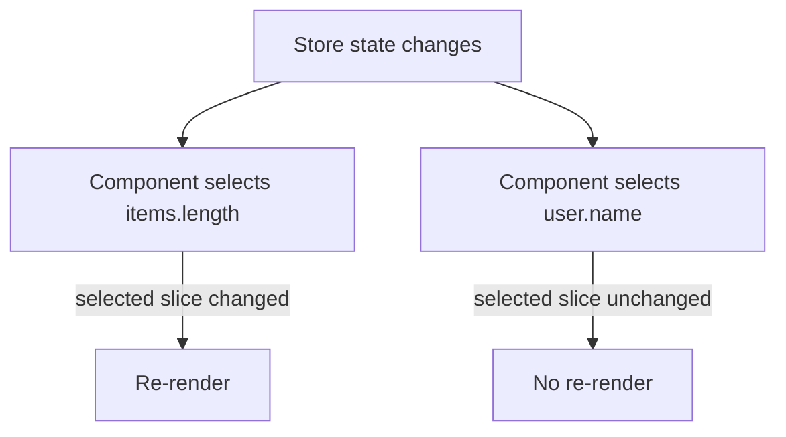
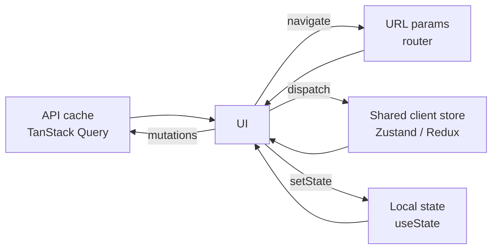

# 24. State Management Landscape

> **Level:** Intermediate → Advanced · **Prerequisites:** Chapters 7, 19, 20, 23 · **Reading time:** ~50 min

"Which state manager should we use?" is the wrong first question. The right one is **"what kind of state is
this?"** Most applications need three or four categories, and each category has a different correct tool.

---

## 1. Classify the state first



| Category | Lifetime | Owner | Classic mistake |
|----------|----------|-------|-----------------|
| Local UI | Component | Component | Putting modals in a global store |
| Shared client | Session | Store/context | Rebuilding Redux for a theme toggle |
| Server state | Cache | Query library | Copying fetched data into Redux and syncing manually |
| URL state | Navigation | Router | Storing filters in a store so links cannot be shared |
| Form state | Interaction | Form library/local | Validating through global state |
| Machine state | Workflow | Reducer/XState | Boolean flags that allow invalid transitions |

---

## 2. The decision tree



---

## 3. Redux Toolkit (RTK)

Redux is a predictable container: a single store, pure reducers, actions as events, and middleware for side
effects. RTK removes the historical boilerplate.



### Store and slice

```js
// features/counter/counterSlice.js
import { createSlice } from "@reduxjs/toolkit";

const counterSlice = createSlice({
  name: "counter",
  initialState: { value: 0 },
  reducers: {
    increment(state) {
      state.value += 1; // Immer makes this immutable safely
    },
    decrement(state) {
      state.value -= 1;
    },
    incrementByAmount(state, action) {
      state.value += action.payload;
    },
  },
});

export const { increment, decrement, incrementByAmount } = counterSlice.actions;
export default counterSlice.reducer;
```

```js
// app/store.js
import { configureStore } from "@reduxjs/toolkit";
import counterReducer from "../features/counter/counterSlice";

export const store = configureStore({
  reducer: { counter: counterReducer },
  devTools: process.env.NODE_ENV !== "production",
});
```

```jsx
// main.jsx
import { Provider } from "react-redux";
import { store } from "./app/store";

<Provider store={store}>
  <App />
</Provider>
```

```jsx
// feature component
import { useSelector, useDispatch } from "react-redux";
import { increment, incrementByAmount } from "./counterSlice";

function Counter() {
  const value = useSelector(state => state.counter.value);
  const dispatch = useDispatch();

  return (
    <button onClick={() => dispatch(increment())}>{value}</button>
  );
}
```

### Middleware

Middleware sits between `dispatch` and the reducer and can log, delay, transform or short-circuit actions.

```js
const logger = store => next => action => {
  console.log("dispatching", action);
  const result = next(action);
  console.log("next state", store.getState());
  return result;
};
```

### Async logic: thunks

```js
// features/users/usersSlice.js
import { createAsyncThunk, createSlice } from "@reduxjs/toolkit";
import { api } from "../../api";

export const fetchUser = createAsyncThunk("users/fetch", async (id, { signal }) => {
  const response = await api.getUser(id, { signal });
  return response.data;
});

const usersSlice = createSlice({
  name: "users",
  initialState: { entity: null, status: "idle", error: null },
  reducers: {},
  extraReducers: builder => {
    builder
      .addCase(fetchUser.pending, state => {
        state.status = "loading";
        state.error = null;
      })
      .addCase(fetchUser.fulfilled, (state, action) => {
        state.status = "succeeded";
        state.entity = action.payload;
      })
      .addCase(fetchUser.rejected, (state, action) => {
        state.status = "failed";
        state.error = action.error.message;
      });
  },
});
```

A thunk is simply a function returned from an action creator: `dispatch(fetchUser(1))` hands the function to
`redux-thunk`, which calls it with `dispatch` and `getState`.

### Selectors and memoization

```js
import { createSelector } from "@reduxjs/toolkit";

const selectTodos = state => state.todos.items;
const selectFilter = state => state.todos.filter;

export const selectVisibleTodos = createSelector(
  [selectTodos, selectFilter],
  (todos, filter) => {
    switch (filter) {
      case "done": return todos.filter(t => t.done);
      case "open": return todos.filter(t => !t.done);
      default: return todos;
    }
  }
);
```

`createSelector` (Reselect) caches the result and recomputes only when inputs change. Without it, every
`useSelector` call returning a new array causes a re-render.



### RTK Query

RTK Query is Redux's built-in data-fetching layer — caching, invalidation and generated hooks. If you adopt RTK
for a data-heavy app, use it instead of writing thunks for every endpoint. It plays the same role as TanStack
Query (Chapter 25).

---

## 4. Zustand

A small store with selectors and no provider.

```js
// store/cart.js
import { create } from "zustand";
import { persist } from "zustand/middleware";

export const useCartStore = create(
  persist(
    (set, get) => ({
      items: [],
      add: item =>
        set(state =>
          state.items.some(i => i.id === item.id)
            ? {
                items: state.items.map(i =>
                  i.id === item.id ? { ...i, qty: i.qty + 1 } : i
                ),
              }
            : { items: [...state.items, { ...item, qty: 1 }] }
        ),
      remove: id => set(state => ({ items: state.items.filter(i => i.id !== id) })),
      clear: () => set({ items: [] }),
      count: () => get().items.reduce((n, i) => n + i.qty, 0),
    }),
    { name: "cart" }
  )
);
```

```jsx
function CartBadge() {
  const count = useCartStore(state => state.items.reduce((n, i) => n + i.qty, 0));
  return <span>{count}</span>;
}
```

Why it re-renders less than context:



Use selectors that return primitives or stable references. Returning `{ items, add }` creates a new object each
time; use `useShallow` from `zustand/react/shallow` or select fields individually.

Zustand is a good fit for shared client state, but it does not replace a server-state library: caching,
deduplication and invalidation are still TanStack Query's job.

---

## 5. Jotai and atomic state

```jsx
import { atom, useAtom, useAtomValue } from "jotai";

const countAtom = atom(0);
const doubledAtom = atom(get => get(countAtom) * 2);

function Counter() {
  const [count, setCount] = useAtom(countAtom);
  const doubled = useAtomValue(doubledAtom);

  return (
    <button onClick={() => setCount(c => c + 1)}>
      {count} × 2 = {doubled}
    </button>
  );
}
```

Atoms are independent units of state. Components subscribe only to the atoms they read; derived atoms are
computed lazily. This model shines for editors, dashboards and any UI with many independent pieces of state.

---

## 6. MobX, Recoil and XState in one paragraph each

- **MobX** uses observables and `observer()` components; state is mutable and reactions track dependencies
  automatically. Great for teams comfortable with OOP and fine-grained reactivity; less explicit than Redux.
- **Recoil** popularized the atom/selector model in React, but its maintenance has stalled. New projects should
  choose Jotai (similar model, actively maintained) unless they are already invested.
- **XState** models explicit finite states and transitions. It is the right tool when "is this allowed?" is the
  core question (checkout, media player, onboarding), not for simple counters.

---

## 7. Comparison

| | Context | Redux Toolkit | Zustand | Jotai | TanStack Query |
|---|---|---|---|---|---|
| Purpose | Transport | Predictable global store | Minimal global store | Atomic state | Server state |
| Boilerplate | Low | Medium | Low | Low | Low |
| DevTools | React DevTools | Excellent | Good | Good | Excellent |
| Re-render granularity | Whole consumer | Selector | Selector | Atom | Query |
| Async built in | No | Thunks/RTK Query | No | No | Yes |
| Provider required | Yes | Yes | No | Optional | Yes |
| Best for | Rarely changing values | Large teams, strict flows | App state, fast setup | Fine-grained graphs | Any fetched data |

---

## 8. Patterns that matter more than the library

1. **Normalize entities** — store `byId` + `allIds`, not nested duplicates.
2. **Derive, don't store** — totals, filtered lists and flags are computed.
3. **Keep server cache and client state separate** — do not mirror query results into a global store.
4. **URL is state** — filters, tabs, pagination and search belong in search params when shareable.
5. **One direction** — UI dispatches intents; state changes in one place; UI derives from state.
6. **Colocate** — the cheapest state management is local state.



---

## 9. Anti-patterns

| Anti-pattern | Problem | Fix |
|--------------|---------|-----|
| Redux for modal toggles | Ceremony, indirection | Local state |
| Context for fast-changing data | Re-renders all consumers | Store with selectors |
| Copying server data into Redux | Stale duplicates, sync bugs | Query cache as source of truth |
| One giant Zustand store | Re-renders, ownership confusion | Slice by feature |
| Deriving state in `useEffect` | Extra renders, drift | Compute in selector/render |
| Filters only in a store | Links not shareable, back button broken | URL state |
| Global state for form drafts | Every keystroke hits the store | Local/form library |
| Choosing a library before classifying state | Over-engineering | Use the decision tree |

---

## 10. Checklist

- [ ] Every piece of state has a named category and owner.
- [ ] Server data lives in a server-state cache, not a global store.
- [ ] URL reflects shareable navigation state.
- [ ] Selectors return stable values.
- [ ] Global store is split by feature.
- [ ] Derived values are computed, not stored.
- [ ] The team can explain why the chosen library is justified.

---

## 11. Exercises

1. Take a small app and classify every piece of state into the six categories. Count how many actually need a
   global store.
2. Build a cart with Zustand + persistence, then with Redux Toolkit. Compare lines of code and devtools
   experience.
3. Add a memoized selector that filters and sorts 5,000 items. Verify with the Profiler that it recomputes only
   when inputs change.
4. Move a filter from Redux into URL search params. What breaks? What improves?
5. Model a checkout as an XState machine or a reducer with a discriminated union.

---

## 12. Interview focus

| Question | Where it is answered |
|----------|----------------------|
| State vs props (#51) | Section 1 |
| Lifting state up (#53) | Chapter 16 |
| Global state options (#54) | Sections 2–7 |
| Redux pros/cons vs Context (#57) | Sections 3, 7 |
| Actions, reducers, store (#59) | Section 3 |
| Provider (#60), middleware (#61), async (#62) | Section 3 |
| `useSelector` / `useDispatch` (#63) | Section 3 |
| Thunks (#64), Reselect (#65) | Section 3 |
| Redux + Context together (#66) | Section 8 |
| Zustand vs Redux (#67) | Sections 4, 7 |
| Atoms in Recoil (#69) | Section 5 |

**Follow-up traps**

- *"Is TanStack Query a state manager?"* — It manages **server** state/cache; it is not a replacement for client
  state.
- *"Why do selectors matter?"* — They control subscription granularity and memoization; returning new objects
  defeats both.
- *"Context vs Redux?"* — Context is transport with no selectors; Redux is a store with devtools, middleware and
  selector subscriptions.

---

**Next:** [25. Server State and Data Fetching](25.%20Server%20State%20and%20Data%20Fetching.md)
