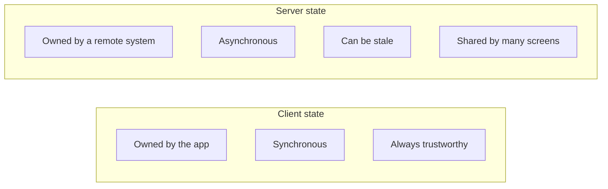
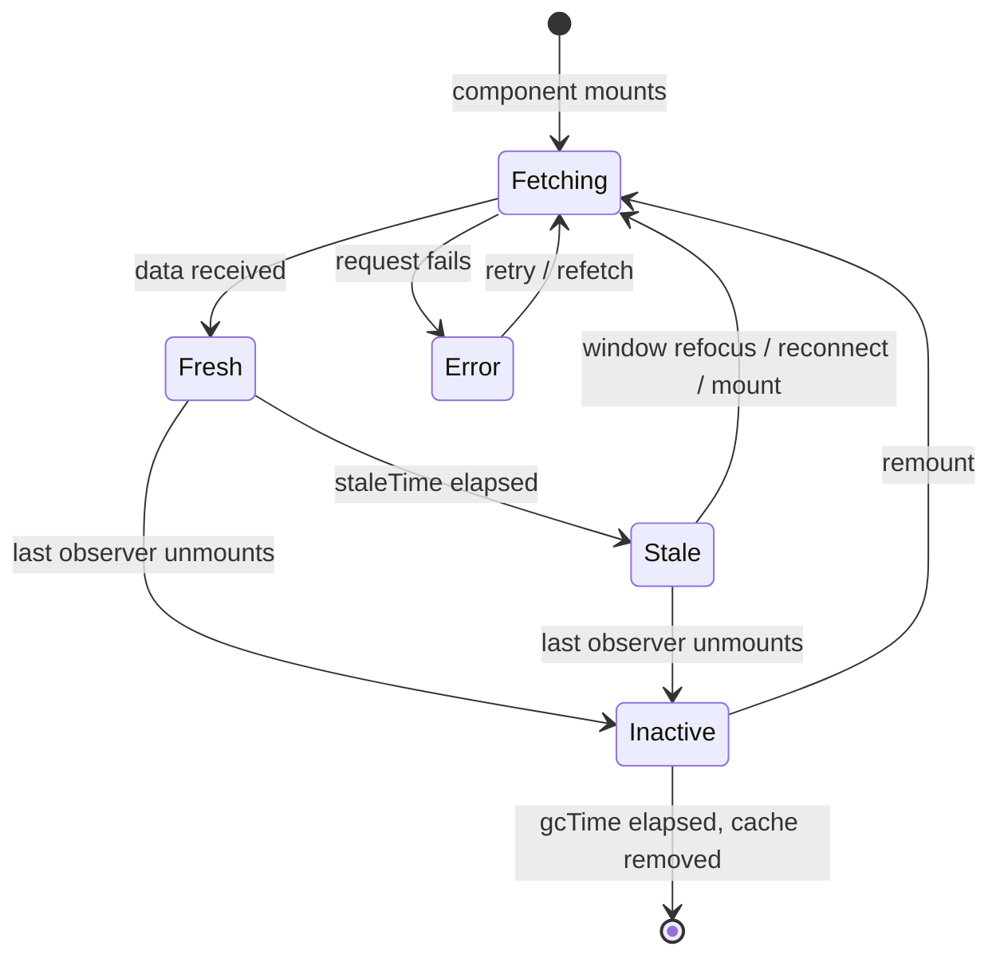
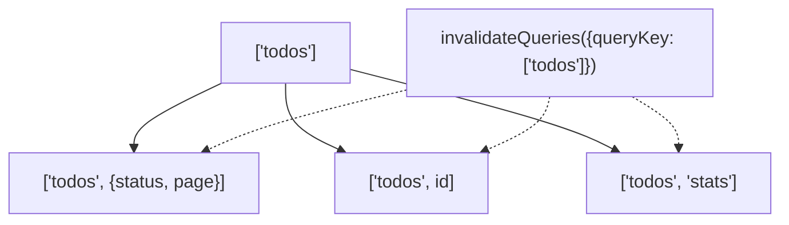
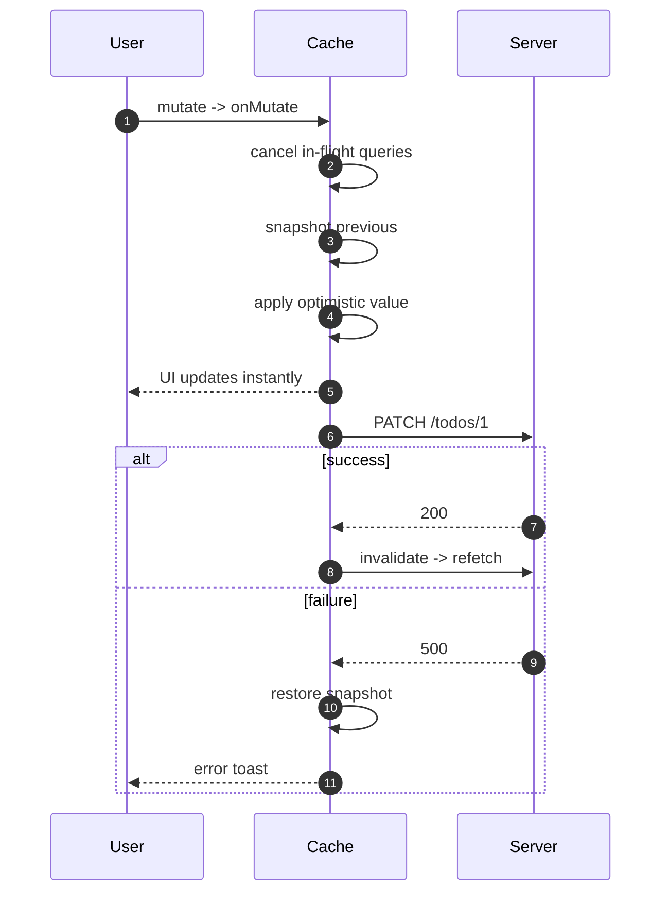
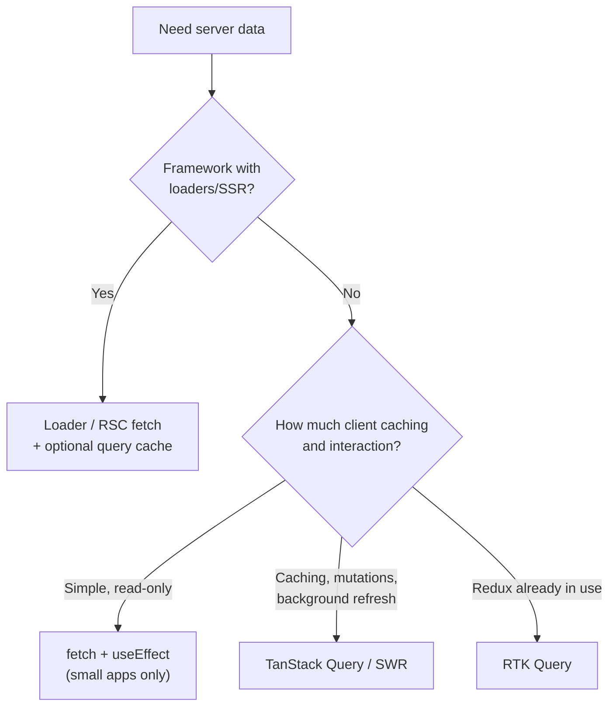

# 25. Server State and Data Fetching

> **Level:** Intermediate → Advanced · **Prerequisites:** Chapters 18, 23, 24 · **Reading time:** ~50 min

Server state is not application state with an API attached. It is a **cache of someone else's data**: it can be
stale, shared across components, refetched in the background, and invalidated by mutations. Treating it with
`useState` + `useEffect` means rebuilding caching, deduplication, retries and race handling by hand.

---

## 1. Why server state is a different problem



| Concern | Client state | Server state |
|---------|--------------|--------------|
| Source of truth | Your app | Remote database |
| Update | Immediate | Request + response |
| Freshness | Always current | Needs `staleTime` policy |
| Sharing | Optional | Automatic deduplication |
| Failure modes | Logic bugs | Latency, partial failure, rate limits |
| Cache invalidation | Rarely needed | Central to correctness |

---

## 2. Query lifecycle



Key defaults in TanStack Query v5:

- `staleTime: 0` — data is immediately stale and can refetch on mount/focus.
- `gcTime: 5 min` — unused cache entries are removed after this.
- Retries: 3 in the browser with exponential backoff.

Tuning matters more than the library:

| Data | `staleTime` | Reason |
|------|-------------|--------|
| User profile | 5–30 min | Rarely changes |
| Product catalog | 1–5 min | Changes on deploy/import |
| Notifications | 10–30 s | Needs freshness |
| Live prices | 0 + polling/WebSocket | Real-time |
| Static reference data | `Infinity` | Never invalidated by time |

---

## 3. Setup

```jsx
// main.jsx
import { QueryClient, QueryClientProvider } from "@tanstack/react-query";

const queryClient = new QueryClient({
  defaultOptions: {
    queries: {
      staleTime: 30_000,
      retry: 2,
      refetchOnWindowFocus: false,
    },
  },
});

<QueryClientProvider client={queryClient}>
  <App />
</QueryClientProvider>
```

Optionally add `ReactQueryDevtools` in development.

---

## 4. Query keys are the cache contract

```jsx
useQuery({
  queryKey: ["todos", { status, page }],
  queryFn: ({ signal }) => fetchTodos({ status, page, signal }),
});
```

Rules:

- Keys must be **serializable** and **deterministic**. Objects are hashed structurally, so property order does
  not matter, but `undefined` values should be normalized.
- Include every variable the response depends on: filters, pagination, locale, user id.
- Prefix keys for invalidation: `["todos"]` invalidates `["todos", {...}]` and `["todos", id]`.
- Put more general segments first.



### `queryOptions` for reuse

```js
// api/todos.js
import { queryOptions } from "@tanstack/react-query";

export const todosQuery = (status, page) =>
  queryOptions({
    queryKey: ["todos", { status, page }],
    queryFn: ({ signal }) => fetchTodos({ status, page, signal }),
    staleTime: 60_000,
  });

// component
const { data } = useQuery(todosQuery(status, page));
```

This keeps keys and fetchers together and gives you typed helpers in TypeScript.

---

## 5. Queries

```jsx
function TodoList({ status }) {
  const {
    data,
    error,
    isPending,
    isError,
    isFetching,
    refetch,
  } = useQuery({
    queryKey: ["todos", status],
    queryFn: ({ signal }) => fetchTodos(status, signal),
    placeholderData: keepPreviousData, // smooth pagination/filter changes
  });

  if (isPending) return <Skeleton rows={5} />;
  if (isError) return <ErrorState error={error} onRetry={refetch} />;
  if (data.length === 0) return <EmptyState />;

  return (
    <>
      {isFetching && <TopProgressBar />}
      <ul>{data.map(todo => <TodoRow key={todo.id} todo={todo} />)}</ul>
    </>
  );
}
```

- `isPending` means "no data yet". `isFetching` means "a request is in flight", including background refetches.
- `placeholderData` avoids a loading flash when the key changes.
- Errors are typed as `unknown` — narrow before rendering.

### Dependent queries

```jsx
const { data: user } = useQuery(userQuery(userId));
const { data: orders } = useQuery({
  ...ordersQuery(user.id),
  enabled: Boolean(user), // don't run until the id exists
});
```

### Parallel queries

```jsx
const results = useQueries({
  queries: ids.map(id => productQuery(id)),
});
```

Use `useQueries` for a dynamic list of queries; do not call `useQuery` in a loop.

---

## 6. Mutations

```jsx
function AddTodo() {
  const queryClient = useQueryClient();
  const [text, setText] = useState("");

  const mutation = useMutation({
    mutationFn: newTodo => api.createTodo(newTodo),
    onSuccess: () => {
      queryClient.invalidateQueries({ queryKey: ["todos"] });
    },
  });

  function handleSubmit(event) {
    event.preventDefault();
    mutation.mutate(
      { text },
      { onSuccess: () => setText("") }
    );
  }

  return (
    <form onSubmit={handleSubmit}>
      <input value={text} onChange={e => setText(e.target.value)} />
      <button disabled={mutation.isPending}>
        {mutation.isPending ? "Saving…" : "Add"}
      </button>
      {mutation.isError && <p role="alert">{mutation.error.message}</p>}
    </form>
  );
}
```

### Optimistic update

```jsx
const mutation = useMutation({
  mutationFn: updateTodo,
  onMutate: async newTodo => {
    await queryClient.cancelQueries({ queryKey: ["todos"] });
    const previous = queryClient.getQueryData(["todos"]);

    queryClient.setQueryData(["todos"], old =>
      old.map(todo => (todo.id === newTodo.id ? newTodo : todo))
    );

    return { previous };
  },
  onError: (error, newTodo, context) => {
    queryClient.setQueryData(["todos"], context.previous);
    toast.error("Could not save. Changes reverted.");
  },
  onSettled: () => {
    queryClient.invalidateQueries({ queryKey: ["todos"] });
  },
});
```



Optimistic UI is only appropriate when failures are rare **and** rollback is meaningful to the user.

---

## 7. Pagination and infinite lists

```jsx
const {
  data,
  fetchNextPage,
  hasNextPage,
  isFetchingNextPage,
} = useInfiniteQuery({
  queryKey: ["todos", "infinite", status],
  queryFn: ({ pageParam }) => fetchTodos({ cursor: pageParam, status }),
  initialPageParam: null,
  getNextPageParam: lastPage => lastPage.nextCursor ?? undefined,
});

const todos = data?.pages.flatMap(page => page.items) ?? [];
```

For "load more", trigger `fetchNextPage` from a button or an intersection observer (Chapter 21). For large lists,
combine with virtualization (Chapter 30).

---

## 8. SSR and hydration

```jsx
// server
const queryClient = new QueryClient();
await queryClient.prefetchQuery(todosQuery());
const dehydratedState = dehydrate(queryClient);

// client
<HydrationBoundary state={dehydratedState}>
  <App />
</HydrationBoundary>
```

The server fills the cache; the client hydrates it without refetching immediately. This is how Next.js App Router
and React Router loaders integrate with query libraries.

---

## 9. Choosing a data layer



| Solution | Strength | Weakness |
|----------|----------|----------|
| `useEffect` + `fetch` | No dependency | Reimplements everything |
| SWR | Tiny, good defaults | Fewer mutation/pagination primitives |
| TanStack Query | Powerful cache, mutations, infinite queries | Learning curve, config surface |
| RTK Query | Integrated with Redux | Requires Redux |
| Framework loader | Data before render, SSR-native | Framework coupling |
| React 19 `use()` | Suspense-native, simple | Needs a cache-backed promise source |

---

## 10. Anti-patterns

| Anti-pattern | Problem | Fix |
|--------------|---------|-----|
| Copying query data into `useState` | Stale duplicate | Use `data` directly |
| `staleTime: Infinity` everywhere | Users never see updates | Tune per resource |
| Query key missing a variable | Wrong cache hits | Include every dependency |
| Fetch in `useEffect` for production data | Races, no cache | Query library |
| `invalidateQueries()` on every mutation | Refetch storms | Invalidate only affected prefixes |
| Treating cache as global state | Implicit coupling | Separate client store |
| `useQuery` inside a loop | Hook order violations | `useQueries` |
| Optimistic update without rollback | Corrupt UI on error | Snapshot + `onError` |
| Ignoring `AbortSignal` in `queryFn` | Wasted requests | Pass `signal` to `fetch` |

---

## 11. Checklist

- [ ] Server data is never mirrored into client state.
- [ ] Query keys include every variable that affects the response.
- [ ] `staleTime` is chosen deliberately per resource.
- [ ] Loading, error and empty states are all designed.
- [ ] Mutations invalidate the affected query prefixes.
- [ ] Optimistic updates snapshot and roll back.
- [ ] Infinite lists handle the end-of-list state.
- [ ] SSR prefetch/hydration is configured where needed.

---

## 12. Exercises

1. Replace a `useEffect` fetch with TanStack Query. List everything the library handled for you.
2. Add optimistic "toggle todo" with rollback on failure. Throttle the network to see the rollback.
3. Implement cursor pagination with `useInfiniteQuery` and an intersection observer.
4. Create a dependent query chain (user → orders → invoice) without waterfalls where possible.
5. Prefetch a detail page on row hover and verify it renders without a loading state.

---

## 13. Interview focus

| Question | Where it is answered |
|----------|----------------------|
| Suspense for data fetching (#115) | Sections 8–9, Chapter 37 |
| SSR (#119), hydration (#120) | Section 8 |
| How do you mock API calls? (#130) | Chapter 34 |

**Follow-up traps**

- *"Why not just `useEffect`?"* — You will reimplement deduplication, caching, retries, cancellation and
  background refresh — usually incorrectly.
- *"What is `staleTime` vs `gcTime`?"* — Staleness controls refetching; garbage collection controls how long
  unused data stays in memory.
- *"How do you keep lists fresh after a mutation?"* — Invalidate the prefix, or update the cache surgically with
  `setQueryData` and then invalidate.

---

**Next:** [26. Routing and Navigation](26.%20Routing%20and%20Navigation.md)
