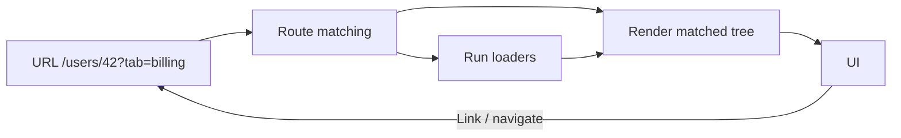
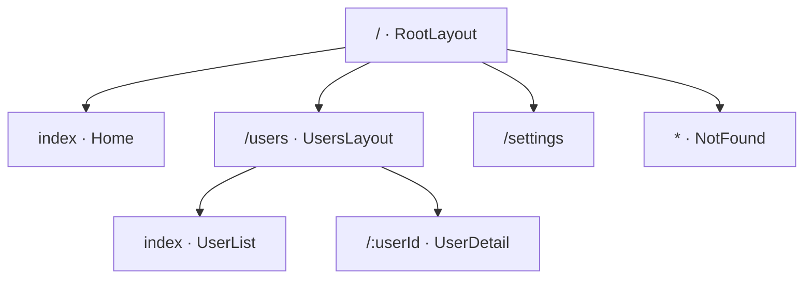
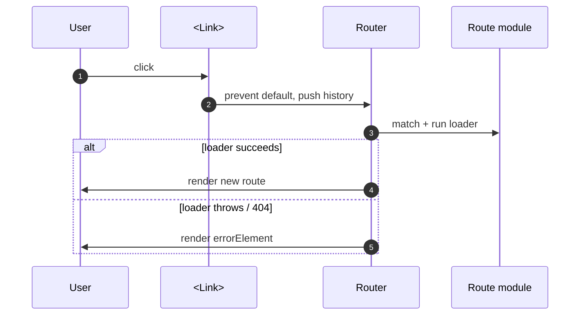
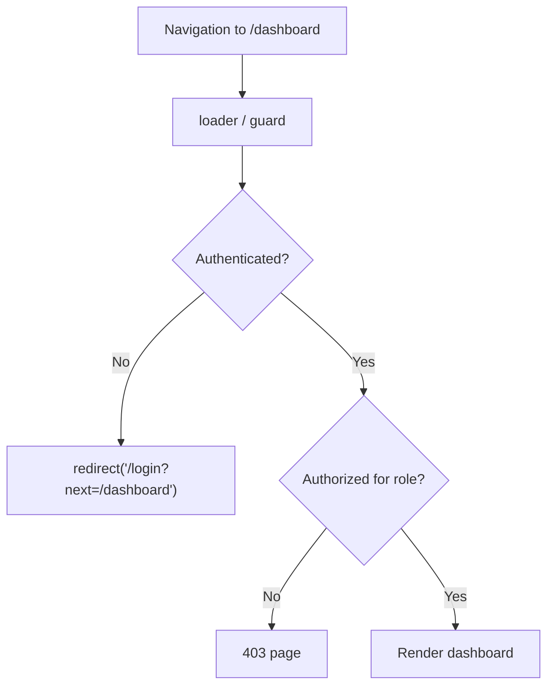
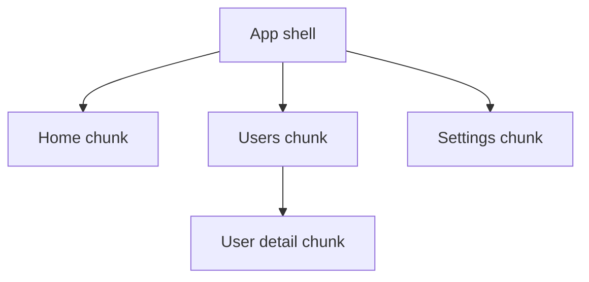

# 26. Routing and Navigation

> **Level:** Intermediate · **Prerequisites:** Chapters 13, 16, 18 · **Reading time:** ~45 min

A single-page app still has URLs. Routing is about mapping **URL → component tree + data**, keeping the back
button, deep links, refresh and accessibility working. This chapter uses React Router (v6.4+ and v7 share the
data-router API).

---

## 1. What a router actually does



| Concept | Responsibility |
|---------|----------------|
| Route table | URL pattern → element + data + error boundary |
| Layout route | Shared chrome (nav, sidebar) with an `Outlet` |
| Params | Path variables (`/users/:id`) |
| Search params | Shareable filters, tabs, pagination |
| Loader | Fetch data **before** rendering the route |
| Action | Handle mutations for a route |
| Guard | Redirect unauthenticated users |

---

## 2. Router selection

| Router | URL | Needs server rewrite | Use |
|--------|-----|----------------------|-----|
| `BrowserRouter` | `/users/42` | Yes (`/* → index.html`) | Standard web apps |
| `HashRouter` | `/#/users/42` | No | Static hosting with no rewrite support, file:// |
| `MemoryRouter` | none | No | Tests, React Native, embedded widgets |
| Data router (`createBrowserRouter`) | Clean | Yes | Loaders, actions, error elements |

`BrowserRouter` vs `HashRouter` in one line: **BrowserRouter for production, HashRouter only when you cannot
configure the server.**

---

## 3. Route configuration

```jsx
import { createBrowserRouter, RouterProvider } from "react-router-dom";

const router = createBrowserRouter([
  {
    path: "/",
    element: <RootLayout />,
    errorElement: <RootError />,
    children: [
      { index: true, element: <Home /> },
      {
        path: "users",
        element: <UsersLayout />,
        children: [
          { index: true, element: <UserList /> },
          {
            path: ":userId",
            loader: ({ params }) => fetchUser(params.userId),
            element: <UserDetail />,
            errorElement: <UserDetailError />,
          },
        ],
      },
      { path: "settings", element: <Settings /> },
      { path: "*", element: <NotFound /> },
    ],
  },
]);

createRoot(document.getElementById("root")).render(
  <RouterProvider router={router} />
);
```



`RootLayout` renders shared chrome plus `<Outlet />`:

```jsx
import { Outlet, NavLink } from "react-router-dom";

export function RootLayout() {
  return (
    <>
      <header>
        <nav>
          <NavLink to="/" end>Home</NavLink>
          <NavLink to="/users">Users</NavLink>
        </nav>
      </header>
      <main>
        <Outlet />
      </main>
    </>
  );
}
```

`NavLink` adds `aria-current="page"` automatically when active — free accessibility.

---

## 4. Navigation APIs

```jsx
import { Link, NavLink, Navigate, useNavigate, useParams, useSearchParams } from "react-router-dom";

// Declarative link: renders <a href>, supports cmd-click, middle-click, SEO
<Link to="/users/42">Profile</Link>

// Programmatic: after a successful async action
const navigate = useNavigate();
await save();
navigate(`/users/${id}`, { replace: true });

// Redirect during render (guards in component form)
if (!user) return <Navigate to="/login" replace state={{ from: location }} />;

// Path params
const { userId } = useParams();

// Query params are state
const [searchParams, setSearchParams] = useSearchParams();
const page = Number(searchParams.get("page") ?? 1);
setSearchParams({ page: String(page + 1), sort: "name" });
```



### `<Link>` vs `<a>`

| | `<Link>` | `<a href>` |
|---|---|---|
| Full page reload | No | Yes |
| Client state preserved | Yes | No |
| Modifier-click opens new tab | Yes | Yes |
| Correct for external URLs | No | Yes |
| Accessible by default | Yes | Yes |

Use `<a>` for external sites and downloads; `<Link>` for in-app navigation. A `div onClick={() => navigate(...)}`
loses middle-click, open-in-new-tab and keyboard behavior.

---

## 5. Loaders: data before render

```jsx
export async function userLoader({ params, request }) {
  const url = new URL(request.url);
  const tab = url.searchParams.get("tab") ?? "profile";

  const user = await fetchUser(params.userId);
  if (!user) throw new Response("Not Found", { status: 404 });

  return { user, tab };
}

export function UserDetail() {
  const { user, tab } = useLoaderData();
  return <UserProfile user={user} tab={tab} />;
}
```

Benefits:

- No render → effect → fetch waterfall for the initial route.
- The route's error boundary catches loader failures.
- Data and URL are validated together.
- Pending navigation states are first-class (`useNavigation()`).

```jsx
const navigation = useNavigation();
if (navigation.state === "loading") return <TopProgressBar />;
```

---

## 6. Protected routes

Two layers: UI guard and data guard. **Never rely on the UI guard alone** — server APIs must authorize too.

```jsx
// Component guard
function RequireAuth({ children }) {
  const { user } = useAuth();
  const location = useLocation();

  if (!user) {
    return <Navigate to="/login" replace state={{ from: location }} />;
  }
  return children;
}

// Route-level guard
<Route element={<RequireAuth><Outlet /></RequireAuth>}>
  <Route path="dashboard" element={<Dashboard />} />
</Route>
```



Loader form:

```js
export async function requireUser() {
  const user = await getCurrentUser();
  if (!user) throw redirect("/login");
  return user;
}
```

---

## 7. 404s and error boundaries

- A `path: "*"` route handles unknown URLs **inside** a layout.
- `errorElement` handles thrown responses and render errors for the route subtree.
- Use `useRouteError()` and `isRouteErrorResponse()` to distinguish a 404 from a crash.

```jsx
import { useRouteError, isRouteErrorResponse } from "react-router-dom";

export function RootError() {
  const error = useRouteError();

  if (isRouteErrorResponse(error) && error.status === 404) {
    return <NotFound />;
  }

  return (
    <div role="alert">
      <h1>Something went wrong</h1>
      <p>Try reloading the page.</p>
    </div>
  );
}
```

---

## 8. Code splitting by route



Route-level splitting is the highest-leverage split: users download only the screen they visit. Implementations
are covered in [Chapter 31](31.%20Code%20Splitting%20and%20Loading%20Strategy.md). With the data router you can
also use the route-level `lazy` property to load a route module (element, loader, action) on demand.

```jsx
{
  path: "settings",
  lazy: async () => {
    const { Component } = await import("./pages/Settings");
    return { Component };
  },
}
```

---

## 9. Scroll, focus and navigation UX

- **Scroll restoration**: restore to top on `pathname` change; preserve on `search`-only changes.
- **Focus management**: move focus to the `<h1>` or main region after navigation so screen-reader users hear the
  new page.
- **Announce route changes** with a polite live region.
- **Pending UI**: show a progress bar or `useNavigation().state`, not a full-page spinner.
- **Unsaved changes**: block navigation or confirm before leaving a dirty form.

```jsx
function ScrollToTop() {
  const { pathname } = useLocation();

  useEffect(() => {
    window.scrollTo({ top: 0, behavior: "instant" });
  }, [pathname]);

  return null;
}
```

---

## 10. Anti-patterns

| Anti-pattern | Problem | Fix |
|--------------|---------|-----|
| `<a href="/users">` for internal links | Full reload, lost state | `<Link>` |
| `div` with `onClick` navigation | Not keyboard/new-tab accessible | `Link` |
| All filters in component state | Links not shareable, back broken | `useSearchParams` |
| Guard only in the UI | Data leak | Server authorization |
| Route definitions scattered | Duplicate layouts/guards | Central route table |
| Fetching everything in the root loader | Slow first paint | Per-route loaders |
| 404 handled as a generic crash | Poor UX, no status | `path: "*"` + error element |
| No scroll/focus handling | Disorienting navigation | Scroll restoration + focus |

---

## 11. Checklist

- [ ] Server rewrites all unknown paths to `index.html`.
- [ ] Layout routes own chrome; pages own content via `Outlet`.
- [ ] Internal navigation uses `Link`/`NavLink`.
- [ ] Shareable UI state lives in the URL.
- [ ] Route loaders fetch data and validate params.
- [ ] Auth guard exists in both UI and API.
- [ ] 404 and route-level error boundaries are implemented.
- [ ] Scroll and focus behavior after navigation is defined.
- [ ] Heavy routes are lazy-loaded.

---

## 12. Exercises

1. Build a three-level nested route tree with a shared layout and an index route.
2. Move a filter + pagination from local state into search params. Verify that copying the URL restores the view.
3. Add a loader that throws a 404 response and render a custom error element.
4. Implement `RequireAuth` with redirect-back-after-login behavior.
5. Lazy-load one route and confirm a separate network chunk is created.

---

## 13. Interview focus

| Question | Where it is answered |
|----------|----------------------|
| What is React Router? (#71) | Sections 1–3 |
| BrowserRouter vs HashRouter (#72) | Section 2 |
| Link vs `a` (#73) | Section 4 |
| Routes in v6 (#74), nested routing (#79) | Section 3 |
| Dynamic routes (#75), params (#80, #81) | Sections 3–4 |
| Programmatic navigation (#76, #77) | Section 4 |
| 404 handling (#78) | Section 7 |
| Layout route (#82), Outlet (#83) | Section 3 |
| Protected routes (#84) | Section 6 |
| Route-based code splitting (#85) | Section 8 |

**Follow-up traps**

- *"Why does refreshing `/users/42` return 404 in production?"* — The static server has no file at that path;
  configure a history fallback.
- *"Where should auth checks live?"* — UI for UX, API for security. Both.
- *"Loader vs `useEffect`?"* — Loaders run before rendering and integrate with the router's error/pending states;
  effects run after paint and cause waterfalls.

---

**Next:** [27. Forms at Scale](27.%20Forms%20at%20Scale.md)
