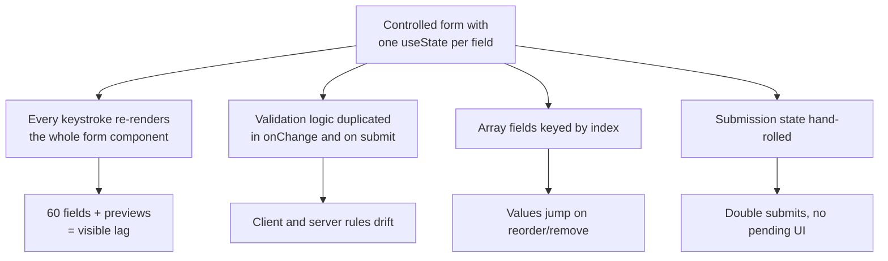
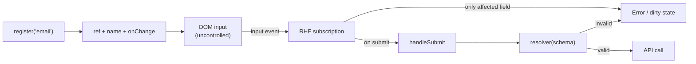
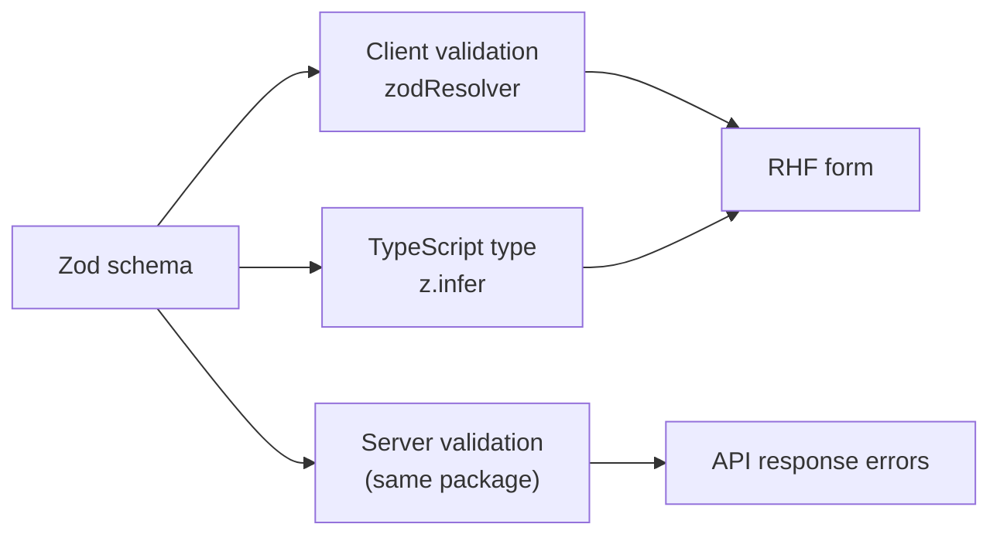
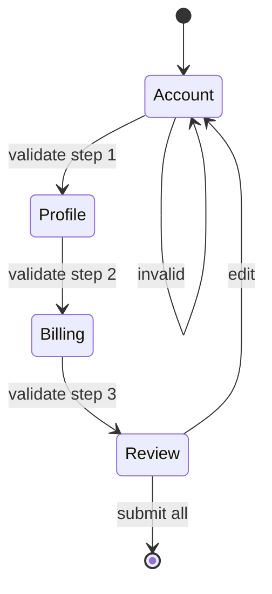
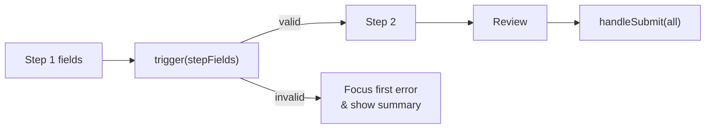
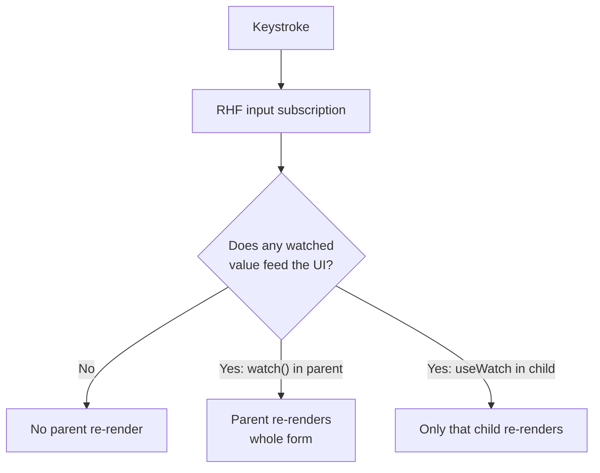

# 27. Forms at Scale

> **Level:** Advanced · **Prerequisites:** Chapters 15, 19, 25 · **Reading time:** ~45 min

A 5-field form is a `useState` problem. A 60-field, multi-step, server-validated form is a **systems** problem:
schema ownership, render performance, error mapping, draft persistence and accessibility. This chapter builds a
production-grade form architecture.

---

## 1. Why naive form state collapses



Signals you need a form library:

- More than ~10 fields, or fields that depend on each other.
- Dynamic arrays (line items, invitees, addresses).
- Schema shared with the server (Zod/Valibot/Yup).
- Multi-step flows with per-step validation.
- Server-returned field errors.
- A requirement to minimize re-renders during typing.

---

## 2. React Hook Form's model

RHF keeps input values in the DOM and subscribes to them via refs (`register`). Only fields that need to display
errors or derived values re-render.



Benefits:

- Fewer renders than controlled-per-keystroke forms.
- Validation lives in one schema.
- Built-in dirty/touched/submitting state.
- Field arrays and dynamic fields are first-class.

---

## 3. Schema-first forms

```js
// features/signup/schema.js
import { z } from "zod";

export const signupSchema = z
  .object({
    name: z.string().trim().min(2, "Name must be at least 2 characters"),
    email: z.string().trim().email("Enter a valid email"),
    password: z
      .string()
      .min(10, "Use at least 10 characters")
      .regex(/[A-Z]/, "Add an uppercase letter")
      .regex(/[0-9]/, "Add a number"),
    confirm: z.string(),
    role: z.enum(["developer", "designer", "manager"]),
    age: z.coerce.number().int().min(18, "You must be 18 or older"),
    acceptTerms: z.literal(true, {
      errorMap: () => ({ message: "You must accept the terms" }),
    }),
  })
  .refine(values => values.password === values.confirm, {
    path: ["confirm"],
    message: "Passwords do not match",
  });

export const signupDefaults = {
  name: "",
  email: "",
  password: "",
  confirm: "",
  role: "developer",
  age: 18,
  acceptTerms: false,
};
```



One schema, three consumers. That is how client and server rules stop drifting.

---

## 4. The form component

```jsx
import { useForm } from "react-hook-form";
import { zodResolver } from "@hookform/resolvers/zod";
import { signupSchema, signupDefaults } from "./schema";

export function SignupForm({ onSubmit }) {
  const {
    register,
    handleSubmit,
    setError,
    formState: { errors, isSubmitting, isDirty },
  } = useForm({
    resolver: zodResolver(signupSchema),
    defaultValues: signupDefaults,
    mode: "onTouched",
  });

  async function submit(values) {
    try {
      await onSubmit(values);
    } catch (error) {
      if (error.fieldErrors) {
        for (const [field, message] of Object.entries(error.fieldErrors)) {
          setError(field, { type: "server", message });
        }
      } else {
        setError("root.server", { message: "Could not create your account." });
      }
    }
  }

  return (
    <form onSubmit={handleSubmit(submit)} noValidate>
      {errors.root?.server && (
        <p role="alert">{errors.root.server.message}</p>
      )}

      <Field label="Name" error={errors.name?.message}>
        {fieldProps => <input {...fieldProps} {...register("name")} autoComplete="name" />}
      </Field>

      <Field label="Email" error={errors.email?.message}>
        {fieldProps => (
          <input {...fieldProps} {...register("email")} type="email" autoComplete="email" />
        )}
      </Field>

      <Field label="Password" error={errors.password?.message}>
        {fieldProps => (
          <input {...fieldProps} {...register("password")} type="password" autoComplete="new-password" />
        )}
      </Field>

      <Field label="Confirm password" error={errors.confirm?.message}>
        {fieldProps => (
          <input {...fieldProps} {...register("confirm")} type="password" autoComplete="new-password" />
        )}
      </Field>

      <button type="submit" disabled={isSubmitting || !isDirty}>
        {isSubmitting ? "Creating…" : "Create account"}
      </button>
    </form>
  );
}
```

`mode: "onTouched"` validates a field after it is blurred, then on every change — the same UX rule from Chapter 15
without hand-written logic.

---

## 5. Accessible field wrapper

```jsx
import { useId } from "react";

export function Field({ label, error, hint, children }) {
  const id = useId();
  const errorId = `${id}-error`;
  const hintId = `${id}-hint`;

  return (
    <div>
      <label htmlFor={id}>{label}</label>
      {children({
        id,
        "aria-invalid": error ? true : undefined,
        "aria-describedby": error ? errorId : hint ? hintId : undefined,
      })}
      {hint && <p id={hintId}>{hint}</p>}
      {error && (
        <p id={errorId} role="alert">
          {error}
        </p>
      )}
    </div>
  );
}
```

Usage with React Hook Form:

```jsx
<Field label="Email" error={errors.email?.message}>
  {fieldProps => <input {...fieldProps} {...register("email")} />}
</Field>
```

The render prop keeps the label, hint, error and input wired together without `cloneElement` magic. The important
part is that **the label, hint and error are programmatically associated**, and invalid fields set
`aria-invalid`.

---

## 6. Dynamic field arrays

```jsx
import { useFieldArray, useForm } from "react-hook-form";

function InvoiceForm() {
  const { register, control, handleSubmit } = useForm({
    defaultValues: {
      customer: "",
      items: [{ description: "Consulting", quantity: 1, price: 100 }],
    },
  });

  const { fields, append, remove } = useFieldArray({
    control,
    name: "items",
  });

  return (
    <form onSubmit={handleSubmit(save)}>
      <input {...register("customer")} placeholder="Customer" />

      {fields.map((field, index) => (
        <fieldset key={field.id}>
          <legend>Item {index + 1}</legend>
          <input {...register(`items.${index}.description`)} />
          <input
            type="number"
            {...register(`items.${index}.quantity`, { valueAsNumber: true })}
          />
          <input
            type="number"
            step="0.01"
            {...register(`items.${index}.price`, { valueAsNumber: true })}
          />
          <button type="button" onClick={() => remove(index)}>
            Remove
          </button>
        </fieldset>
      ))}

      <button
        type="button"
        onClick={() => append({ description: "", quantity: 1, price: 0 })}
      >
        Add item
      </button>

      <button type="submit">Save invoice</button>
    </form>
  );
}
```

`field.id` is generated by RHF and is stable across reorder/remove — never use the array index as the React key
for the rows (Chapter 13).

---

## 7. Multi-step wizards



Architecture:

1. **One form, one schema, per-step field groups** — not one independent form per step (otherwise values and
   errors are lost).
2. Validate only the current step with `trigger(["fieldA", "fieldB"])`.
3. Persist a draft (session storage or server) keyed by user + flow id.
4. Derive progress from the schema, not from a hard-coded number.
5. Confirm before leaving a dirty flow.

```jsx
const STEP_FIELDS = {
  account: ["email", "password", "confirm"],
  profile: ["name", "role", "age"],
  billing: ["plan", "cardNumber"],
};

async function nextStep() {
  const valid = await trigger(STEP_FIELDS[step], { shouldFocus: true });
  if (valid) setStep(s => s + 1);
}
```



---

## 8. Server errors and network failures

```js
// API returns 422 with a field map
{
  "fieldErrors": {
    "email": "This email is already registered"
  }
}
```

Map them into the form with `setError`. For non-field errors (rate limit, outage), use a root error and an alert
region. Never lose the user's input because the request failed.

| Failure | UI response |
|---------|-------------|
| Validation error (422) | Inline field errors + focus first |
| Conflict (409) | Specific field or global message |
| Rate limit (429) | Disable submit, show retry-after |
| Network/offline | Keep draft, offer retry |
| 5xx | Global alert, preserve values, log to monitoring |
| Timeout | Idempotency key + retry |

Submission should be **idempotent** where possible (client-generated request id), otherwise double-clicks can
create duplicate records even with `isSubmitting` guards.

---

## 9. Performance



- Prefer `useWatch({ control, name })` in a **small child** over `watch()` in the form root.
- Avoid `watch()` for the whole form.
- Use `mode: "onTouched"` instead of `onChange` for large forms.
- Use `shouldUnregister: true` only if you truly need removed fields gone from values.
- Memoize expensive previews and defer them with `useDeferredValue` (Chapter 23).
- For very large forms, split into sections with their own `useFormContext` consumers.

---

## 10. Anti-patterns

| Anti-pattern | Problem | Fix |
|--------------|---------|-----|
| Duplicating Zod rules manually | Drift | One schema |
| `watch()` at form root | Full-form re-render per key | `useWatch` in children |
| Index keys for field arrays | Values jump | `field.id` |
| One independent form per wizard step | Lost values/errors | One form + step validation |
| Swallowing server errors | Silent failure | `setError` + alert |
| Disabling submit without reason | User confusion | Pending label + error explanation |
| Resetting the form on error | Data loss | Preserve values |
| Only client validation | Security and integrity risk | Validate on server too |

---

## 11. Checklist

- [ ] A single schema drives validation, types and server rules.
- [ ] Default values are complete (no `undefined` inputs).
- [ ] Errors are linked with `aria-describedby` and announced.
- [ ] Array fields use generated stable IDs.
- [ ] Wizard validation is per-step, data is shared.
- [ ] Server errors map to fields.
- [ ] Submission is guarded and idempotent.
- [ ] Draft persistence is defined for long forms.

---

## 12. Exercises

1. Build a signup form with Zod, RHF and accessible errors. Add an async "email available" check on blur.
2. Build an invoice form with `useFieldArray`, totals and remove/reorder. Verify state stays attached to the
   right row.
3. Build a 3-step wizard with per-step validation and draft persistence.
4. Simulate server field errors and map them into the form.
5. Profile the form with `watch()` vs `useWatch`. Count renders per keystroke.

---

## 13. Interview focus

| Question | Where it is answered |
|----------|----------------------|
| How do you manage large forms? (#146) | Sections 1–8 |
| How do you test form input and submission? (#131) | Chapter 34 |
| How do you manage focus in forms? (#112) | Sections 5, 7 |

**Follow-up traps**

- *"Controlled or uncontrolled?"* — RHF is uncontrolled-first for performance but supports controlled widgets via
  `Controller`.
- *"How do you validate on the server and show errors in the UI?"* — Return a field-keyed error map and call
  `setError`; keep the same schema on both sides where possible.
- *"Why not validate on every keystroke?"* — Noise for the user and unnecessary renders; validate on blur, then
  re-validate on change after the first error.

---

**Next:** [28. Error Boundaries and Resilience](28.%20Error%20Boundaries%20and%20Resilience.md)
