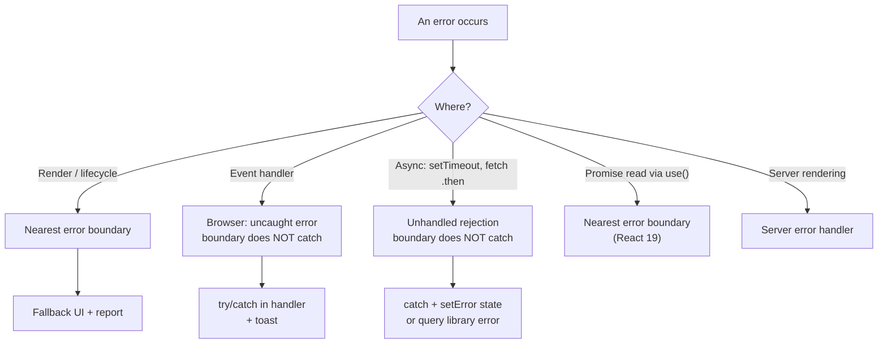
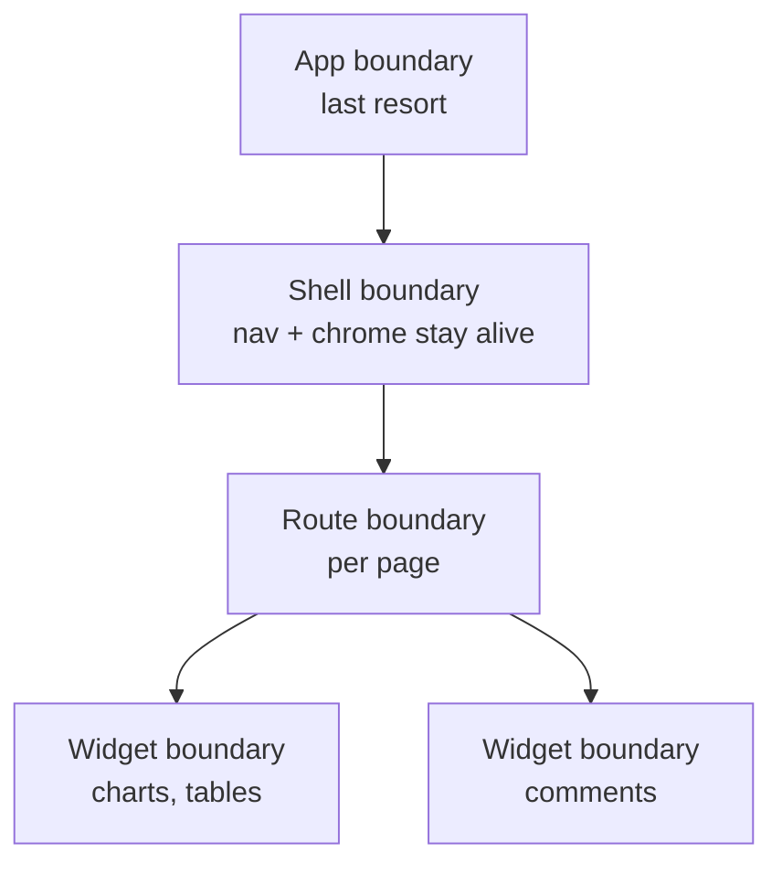
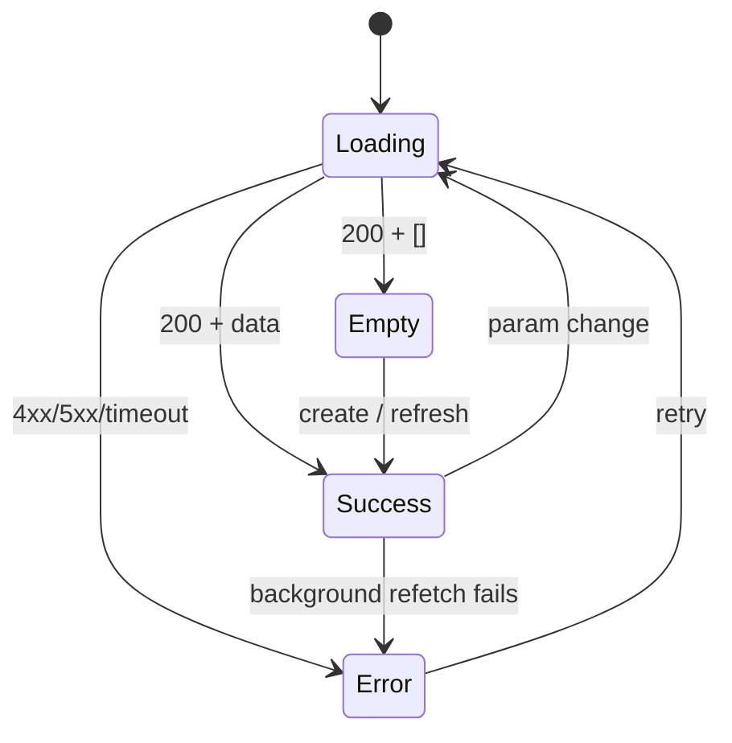
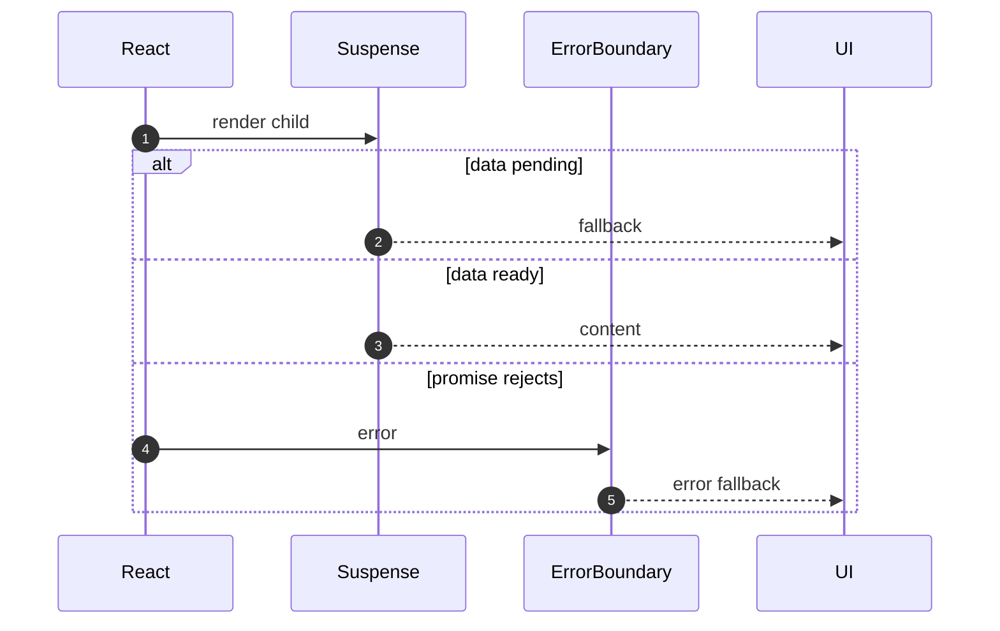
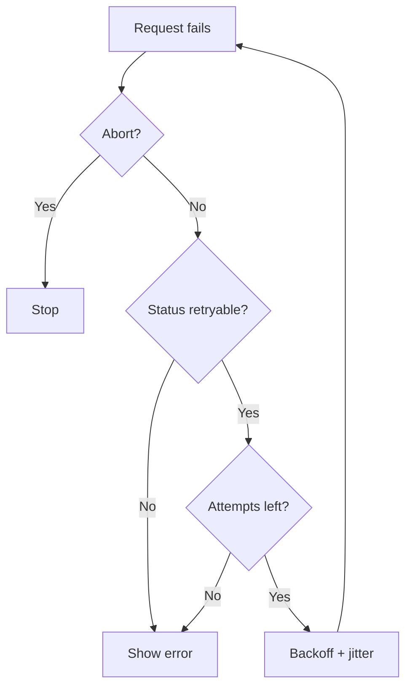
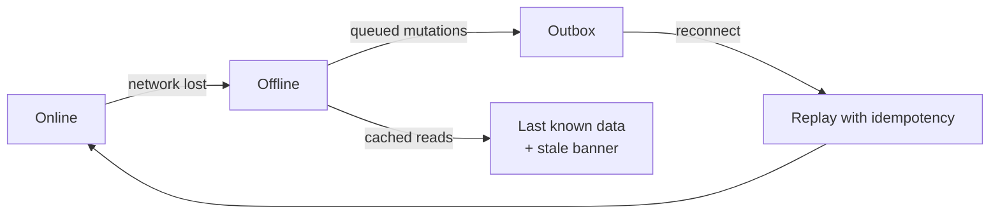

# 28. Error Boundaries and Resilience

> **Level:** Advanced · **Prerequisites:** Chapters 13, 18, 25 · **Reading time:** ~40 min

Production UI fails in three places: **rendering**, **event handling** and **asynchronous work**. React only
catches the first. Resilience means designing for all three — with boundaries, fallbacks, retries and telemetry —
instead of letting one widget take down the page.

---

## 1. Where errors are caught (and where they are not)



This is the single most misunderstood rule: **error boundaries only catch errors thrown during rendering,
in lifecycle methods, and in constructors of the tree below them.**

---

## 2. A minimal error boundary

```jsx
import { Component } from "react";

export class ErrorBoundary extends Component {
  state = { error: null };

  static getDerivedStateFromError(error) {
    return { error };
  }

  componentDidCatch(error, info) {
    reportError(error, { componentStack: info.componentStack });
  }

  reset = () => this.setState({ error: null });

  render() {
    if (this.state.error) {
      return this.props.fallback({
        error: this.state.error,
        reset: this.reset,
      });
    }
    return this.props.children;
  }
}
```

There is still no hook equivalent in React 19 — a boundary needs a class component (or the `react-error-boundary`
package, which wraps one for you).

```jsx
import { ErrorBoundary } from "react-error-boundary";

<ErrorBoundary
  FallbackComponent={ErrorFallback}
  onError={(error, info) => reportError(error, info)}
  onReset={() => queryClient.resetQueries()}
  resetKeys={[userId]}
>
  <Profile userId={userId} />
</ErrorBoundary>
```

`resetKeys` is valuable: navigating from user 42 to user 43 resets the boundary automatically instead of leaving
the user stuck on an error screen.

---

## 3. Placement strategy



Rules:

- **Root boundary**: prevents a blank white screen; shows "reload".
- **Route boundary**: one broken page does not kill navigation.
- **Widget boundary**: independent features fail independently (dashboard tiles are the classic case).
- **Form boundary**: keep surrounding data visible.

Do not wrap every `<div>` — boundaries add UI and cognitive cost. Place them at **failure domains**.

---

## 4. Loading, empty, error, success

Every asynchronous surface has four states, not two.



- **Loading**: skeletons that match final layout (avoid CLS).
- **Empty**: explain what would appear and the primary action.
- **Error**: what happened, what to do, retry, support id.
- **Partial**: some widgets succeed, some fail — do not blank the page.

```jsx
function Widget({ query }) {
  if (query.isPending) return <WidgetSkeleton />;
  if (query.isError) {
    return <WidgetError error={query.error} onRetry={query.refetch} />;
  }
  if (query.data.length === 0) return <WidgetEmpty />;
  return <Chart data={query.data} />;
}
```

---

## 5. Suspense + boundaries

```jsx
<ErrorBoundary FallbackComponent={ProfileError} resetKeys={[userId]}>
  <Suspense fallback={<ProfileSkeleton />}>
    <Profile userId={userId} />
  </Suspense>
</ErrorBoundary>
```



Order matters: the error boundary must be **outside** the Suspense boundary to catch a failed read. If the
boundary is inside, the error escapes to the next ancestor.

---

## 6. Retries that do not make things worse

```jsx
async function fetchWithRetry(url, { attempts = 3, baseDelay = 300, signal } = {}) {
  let lastError;

  for (let attempt = 0; attempt < attempts; attempt++) {
    try {
      const response = await fetch(url, { signal });
      if (response.status === 429 || response.status >= 500) {
        throw new Error(`Retryable HTTP ${response.status}`);
      }
      if (!response.ok) throw new Error(`HTTP ${response.status}`);
      return response;
    } catch (error) {
      if (error.name === "AbortError" || signal?.aborted) throw error;
      lastError = error;
      const delay = baseDelay * 2 ** attempt + Math.random() * 100;
      await new Promise(resolve => setTimeout(resolve, delay));
    }
  }

  throw lastError;
}
```

Rules:

- Retry **idempotent** requests only. Never retry a `POST` that may have already succeeded without an idempotency
  key.
- Do not retry `4xx` other than `408`/`429`.
- Add jitter to avoid thundering herds.
- Respect `Retry-After`.
- Cap attempts and total time.
- Show progress after the first retry instead of a frozen button.



---

## 7. Reporting errors like an engineer

Boundaries are also the best place to attach context:

```js
reportError(error, {
  componentStack: info.componentStack,
  route: window.location.pathname,
  userId: getCurrentUser()?.id,
  release: import.meta.env.VITE_RELEASE,
  requestId: lastRequestId,
});
```

- Integrate with Sentry/Datadog/OpenTelemetry.
- Upload source maps in CI, not to the public bundle.
- Scrub PII (emails, tokens) before sending.
- Group by fingerprint to avoid alert fatigue.
- Track **error-free sessions**, not just error counts.

React 19 root options give you global hooks:

```js
createRoot(container, {
  onUncaughtError: (error, info) => reportError(error, info),
  onCaughtError: (error, info) => reportError(error, info),
  onRecoverableError: (error, info) => reportError(error, info),
});
```

---

## 8. Offline, stale and degraded modes



- Show a persistent offline banner.
- Serve cached data with an explicit "last updated" timestamp.
- Queue mutations with stable ids; replay on reconnect.
- Disable actions that cannot be queued.
- Never show a success toast for a mutation that was only queued.

---

## 9. Anti-patterns

| Anti-pattern | Problem | Fix |
|--------------|---------|-----|
| No boundary at all | White screen on one bug | Root + route boundaries |
| One boundary around the app | Whole app falls | Granular failure domains |
| Boundary inside Suspense | Rejections escape | Boundary outside |
| Expecting boundaries to catch handlers | Unhandled errors | `try/catch` in handler |
| Retrying non-idempotent POSTs | Duplicate records | Idempotency keys |
| Generic "Something went wrong" | No recovery path | Explain + retry + support id |
| Logging errors without context | Impossible to reproduce | Route, user, release, request id |
| Blank page on partial failure | Worse than degraded | Per-widget fallbacks |

---

## 10. Checklist

- [ ] Root, route and widget-level boundaries exist.
- [ ] Every async surface has loading, empty, error and success states.
- [ ] Boundaries reset on navigation/identity change.
- [ ] Event-handler errors are handled explicitly.
- [ ] Retries are bounded, jittered and idempotent.
- [ ] Errors are reported with route, release and request context.
- [ ] Source maps are uploaded privately.
- [ ] Offline behavior is defined.

---

## 11. Exercises

1. Add a root boundary and a route boundary. Force a render error and verify navigation still works.
2. Throw inside an event handler and inside `setTimeout`. Confirm the boundary does not catch either, then handle
   both correctly.
3. Build a dashboard where one widget fails; keep the others interactive.
4. Implement `fetchWithRetry` with `Retry-After` support and test it with MSW.
5. Make a boundary reset when the route param changes.

---

## 12. Interview focus

| Question | Where it is answered |
|----------|----------------------|
| What is an error boundary? (#108) | Sections 1–3 |
| How do you create one? (#109) | Section 2 |
| Suspense for data fetching (#115) | Section 5 |
| How do you debug a React app in production? (#140) | Section 7 |

**Follow-up traps**

- *"Do boundaries catch async errors?"* — Not by default. They catch render-time errors, including a rejected
  promise read by `use()`.
- *"Why not just `window.onerror`?"* — It reports, but does not provide a fallback UI or isolate the failing
  subtree.
- *"How do you avoid alert storms?"* — Fingerprinting, sampling, and tracking error-free session rate.

---

**Next:** [29. Reusable Logic Patterns](29.%20Reusable%20Logic%20Patterns.md)
