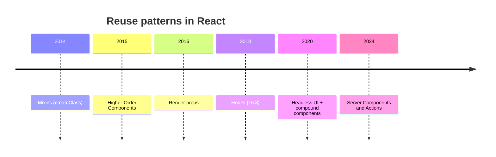
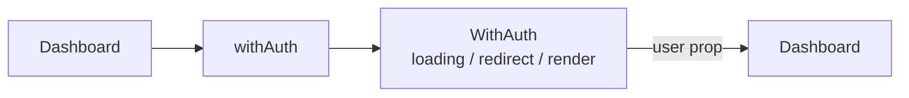
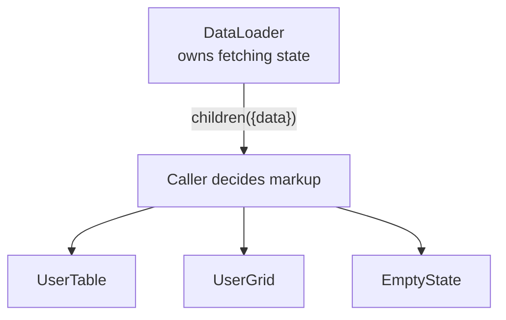
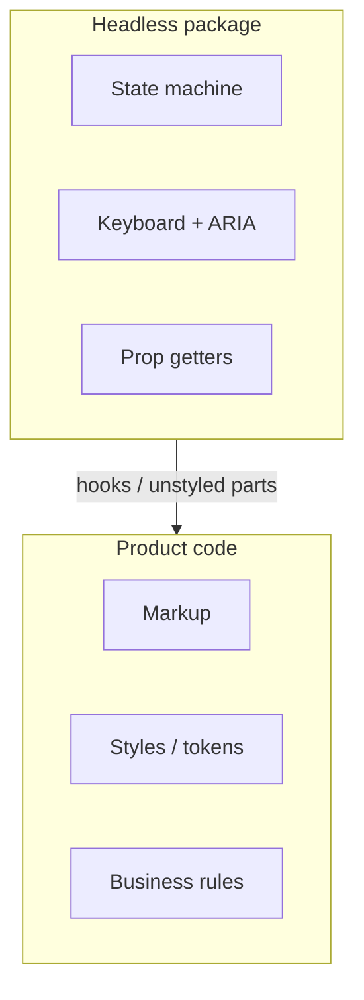
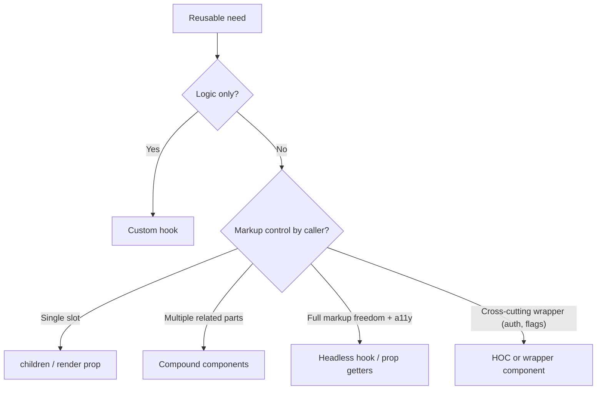

# 29. Reusable Logic Patterns

> **Level:** Advanced · **Prerequisites:** Chapters 16, 21, 22 · **Reading time:** ~40 min

React has produced four generations of reuse patterns. Each solved the previous generation's problems and
introduced new ones. Knowing **when** to use each is the difference between a clean library and an abstraction
layer nobody can debug.

---

## 1. The evolution



| Pattern | Shares | Cost | Still relevant? |
|---------|--------|------|-----------------|
| Mixins | Lifecycle + methods | Name collisions, implicit | No |
| HOC | Behavior + injected props | Wrapper hell, prop collisions, refs | Occasionally (routing, auth) |
| Render props | Behavior + render control | Nesting, verbose | Sometimes |
| Hooks | Stateful logic | Cannot share markup | Default |
| Compound components | State + structure | More files, context | Yes |
| Headless components | Behavior + a11y + API | Learning curve | Yes, for libraries |

---

## 2. Higher-Order Components

An HOC is a function that takes a component and returns a new component.

```jsx
function withAuth(Component) {
  function WithAuth(props) {
    const { user, isLoading } = useAuth();

    if (isLoading) return <FullPageSpinner />;
    if (!user) return <Navigate to="/login" replace />;

    return <Component {...props} user={user} />;
  }

  WithAuth.displayName = `withAuth(${Component.displayName ?? Component.name})`;
  return WithAuth;
}

const ProtectedDashboard = withAuth(Dashboard);
```



Problems to manage:

- **Prop collisions**: the injected `user` can overwrite an existing prop. Choose namespaced names.
- **Refs don't pass through** — forward them explicitly (React 19 allows `ref` as a prop, but the HOC still has
  to forward it).
- **Wrapper hell**: `withAuth(withTheme(withRouter(withI18n(Page))))`.
- **Static hoisting**: statics on the wrapped component are lost unless copied.
- **Opaque data flow**: reading a component does not reveal where `user` came from.

Modern use: route-level wrappers (`RequireAuth`), instrumentation, feature flags. For logic, use a hook.

---

## 3. Render props

A component (or prop) whose value is a function that receives state and returns UI.

```jsx
function DataLoader({ url, children }) {
  const { data, error, isLoading } = useFetch(url);

  if (isLoading) return <Skeleton />;
  if (error) return <ErrorState error={error} />;
  return children({ data });
}

<DataLoader url="/api/users">
  {({ data }) => <UserTable users={data} />}
</DataLoader>
```



Strengths: the caller keeps full control of markup; works without hooks (class-era libraries).

Costs:

- Nesting: `MouseTracker → DataLoader → Form → ...` becomes a pyramid.
- Inline function props create new identities on every render — memoized children re-render.
- Harder to test than a hook.

Hooks replaced most render props, but the pattern survives as **slots** (`children` as a function) and in
libraries that support both.

---

## 4. Hooks: the default

```jsx
function useUsers() {
  return useQuery({
    queryKey: ["users"],
    queryFn: fetchUsers,
  });
}

function UserTable() {
  const { data = [], isPending } = useUsers();
  if (isPending) return <Skeleton />;
  return <Table rows={data} />;
}
```

Hooks share **logic**, not markup. That is the right default: markup composition belongs to components, behavior
belongs to hooks.

Limits:

- A hook cannot decide layout.
- Every call is independent state.
- Hooks cannot be conditional.
- Sharing a hook between a server component and a client component requires a `'use client'` boundary.

---

## 5. Compound components

Covered in [Chapter 16](16.%20Composition%20and%20Component%20Design.md). They share **implicit state and
structure**:

```jsx
<Select value={value} onChange={setValue}>
  <Select.Trigger>Choose…</Select.Trigger>
  <Select.Options>
    <Select.Option value="a">A</Select.Option>
  </Select.Options>
</Select>
```

Use when the component family has a natural grammar and the caller needs layout control. Don't use it for a
single button with two props.

---

## 6. Headless components

A headless component provides **behavior and accessibility**, while the consumer provides **all markup**.

```jsx
function useCombobox({ items }) {
  const [query, setQuery] = useState("");
  const [activeIndex, setActiveIndex] = useState(-1);

  const filtered = useMemo(
    () => items.filter(item => item.label.toLowerCase().includes(query.toLowerCase())),
    [items, query]
  );

  function onKeyDown(event) {
    if (event.key === "ArrowDown") {
      event.preventDefault();
      setActiveIndex(i => Math.min(i + 1, filtered.length - 1));
    }
    if (event.key === "ArrowUp") {
      event.preventDefault();
      setActiveIndex(i => Math.max(i - 1, 0));
    }
    if (event.key === "Enter" && activeIndex >= 0) {
      event.preventDefault();
      onSelect(filtered[activeIndex]);
    }
  }

  return {
    query,
    setQuery,
    filtered,
    activeIndex,
    onKeyDown,
    getInputProps: () => ({
      role: "combobox",
      "aria-expanded": true,
      "aria-controls": "listbox",
      "aria-activedescendant": `option-${activeIndex}`,
      value: query,
      onChange: event => setQuery(event.target.value),
      onKeyDown,
    }),
    getOptionProps: (item, index) => ({
      id: `option-${index}`,
      role: "option",
      "aria-selected": index === activeIndex,
      onClick: () => onSelect(item),
    }),
  };
}
```

The library ships behavior; the product ships design. Examples: TanStack Table, Radix primitives, Headless UI,
Downshift, React Aria.



This is the highest-leverage pattern for design systems: one accessible behavior, many visual implementations.

---

## 7. Choosing a pattern



Mental shortcut:

- **Hook** for data/behavior.
- **Compound** for a family of related elements.
- **Headless** when you are publishing behavior to other teams.
- **HOC** only when you need to wrap a component you do not control (routes, instrumentation).

---

## 8. Anti-patterns

| Anti-pattern | Problem | Better |
|--------------|---------|--------|
| HOC chains 4 deep | Unreadable tree, prop collisions | Hooks / composition |
| Reusable "God hook" with 15 options | Untestable, unclear | Split by concern |
| Render prop returning JSX from a hook | Hidden structure | Component |
| Sharing markup through hooks | Layout coupling | Compound/slots |
| Clone-element injection everywhere | Implicit contracts | Context/props |
| Abstraction before the third use | Premature generalization | Duplicate twice, then extract |
| Headless component without a11y tests | False sense of safety | Test keyboard/ARIA |

> **Rule of three:** the first time, write it inline. The second time, copy it. The third time, extract the
> pattern you actually observed — not the one you imagined.

---

## 9. Checklist

- [ ] Logic is in hooks; layout is in components.
- [ ] A pattern was chosen for a concrete second/third use case.
- [ ] HOCs forward refs and avoid prop collisions.
- [ ] Compound components fail loudly outside their parent.
- [ ] Headless APIs expose prop getters, not raw DOM assumptions.
- [ ] Keyboard and screen-reader behavior are tested.

---

## 10. Exercises

1. Convert an `withData` HOC + render-prop pair into a hook and measure the lines removed.
2. Build a compound `Accordion` with `Accordion.Item`, `Accordion.Trigger`, `Accordion.Panel`.
3. Build a headless `useTabs` that returns `getTabProps`/`getPanelProps`, then style it two different ways.
4. Write an HOC `withErrorBoundary` and explain why a wrapper component might be better.

---

## 11. Interview focus

| Question | Where it is answered |
|----------|----------------------|
| What are HOCs? (#106) | Section 2 |
| What are render props? (#107) | Section 3 |
| Render props and performance (#102) | Section 3 |
| How do you handle code reuse? (#145) | Sections 4–7 |

**Follow-up traps**

- *"HOC vs hooks?"* — HOCs wrap components and can inject props/guards; hooks share stateful logic without
  changing the tree. Prefer hooks unless you need to wrap an existing component.
- *"Why did render props fall out of favor?"* — Nesting and unstable function identities; hooks express the same
  logic with less indirection.
- *"What makes a good library API?"* — Composition, escape hatches, accessible defaults and no required global
  state.

---

**Next:** [30. Performance Engineering and Profiling](30.%20Performance%20Engineering%20and%20Profiling.md)
