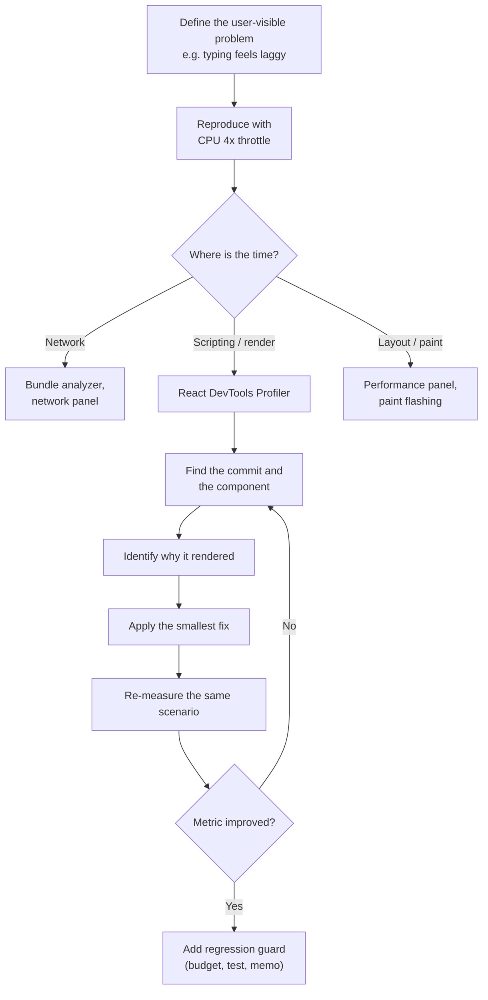
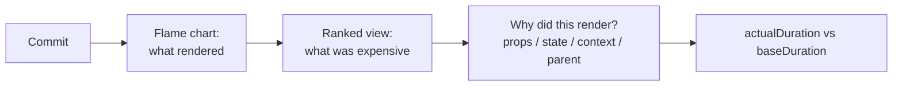
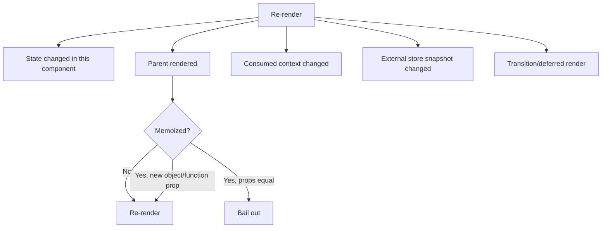
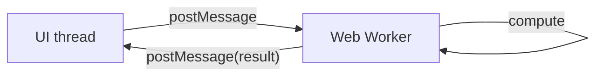
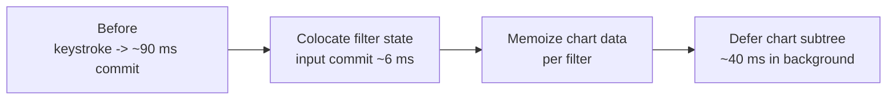

# 30. Performance Engineering and Profiling

> **Level:** Advanced · **Prerequisites:** Chapters 13, 20, 23, 25 · **Reading time:** ~60 min

React performance work is mostly **measurement discipline**. Most "optimizations" add complexity without moving a
metric. This chapter gives you a workflow: define the metric, find the bottleneck, apply the smallest fix,
verify, and guard against regression.

---

## 1. The four cost centers


| Cost | Dominated by | Lever |
|------|--------------|-------|
| Network | Bundle size, images, fonts | Code splitting, compression, caching (Ch. 31) |
| Parse/eval | JS shipped to the client | Smaller deps, tree shaking, RSC |
| Render | Component functions, reconciliation | Colocation, memo, virtualization |
| Commit/paint | DOM mutations, layout thrash | Smaller trees, transform/opacity, CSS containment |

If the problem is a 2 MB chart library, `React.memo` will not save you.

---

## 2. Metrics that matter

| Metric | Good | Needs work | What it reflects |
|--------|------|------------|------------------|
| LCP | ≤ 2.5 s | > 4 s | Loading performance |
| INP | ≤ 200 ms | > 500 ms | Responsiveness to interaction |
| CLS | ≤ 0.1 | > 0.25 | Visual stability |
| TBT (lab) | < 200 ms | > 600 ms | Main-thread blocking |
| Render duration (Profiler) | < 16 ms per commit | > 50 ms | React work |

Measure in the field (RUM) **and** in the lab (Lighthouse/Performance panel). Lab numbers explain; field numbers
decide.

---

## 3. The profiling workflow



Golden rules:

1. **Profile production builds.** Development is 2–10× slower and includes StrictMode double renders.
2. **Throttle CPU** to a mid-range device.
3. **One change at a time**, re-measure the same interaction.
4. **Never optimize by intuition** — "this looks expensive" is not evidence.

---

## 4. Reading the React Profiler



- **Flame chart**: every component that rendered in that commit. Grey = did not render.
- **Ranked**: components sorted by self time.
- **Why did this render**: the most useful panel in React DevTools.
- **`actualDuration`**: time spent rendering this commit.
- **`baseDuration`**: estimated cost if nothing were memoized.

Programmatic profiling:

```jsx
import { Profiler } from "react";

<Profiler
  id="ProductGrid"
  onRender={(id, phase, actualDuration, baseDuration) => {
    if (actualDuration > 16) {
      console.warn(`${id} ${phase} took ${actualDuration.toFixed(1)}ms`);
    }
  }}
>
  <ProductGrid />
</Profiler>
```

---

## 5. Why components re-render



| Cause | Fix |
|-------|-----|
| State too high in the tree | Colocate state; move it down |
| Parent re-renders with stable children | Pass `children` as props, or memo the child |
| New object/array/function props | `useMemo` / `useCallback`, or define outside |
| Context value identity changes | Split contexts, memoize the value |
| Context holds unrelated values | One context per concern |
| Large list renders all rows | Virtualize |
| Expensive computation in render | `useMemo`, move to a worker, cache |
| Keystroke drives expensive subtree | `useDeferredValue` / transition |

---

## 6. `React.memo`, `useMemo`, `useCallback` — precisely

```jsx
const Row = memo(function Row({ item, onSelect }) {
  return <button onClick={() => onSelect(item.id)}>{item.name}</button>;
});
```

- `memo` does a **shallow** comparison of props.
- It does not stop context updates or internal state updates.
- It is only worth it when the component is expensive **and** props are stable.

```jsx
// Parent: stable callback
const handleSelect = useCallback(id => setSelectedId(id), []);

// Or pass the setter itself when the signature allows it
<Row item={item} onSelect={setSelectedId} />
```

`useMemo` for expensive work and for referential stability:

```jsx
const sorted = useMemo(
  () => [...rows].sort((a, b) => a.name.localeCompare(b.name)),
  [rows]
);
```

> React may discard memoized values in the future (the docs call it a performance hint, not a semantic
> guarantee). Never rely on `useMemo` for correctness — only for performance.

### When not to use `memo`

- The component is cheap (a `<div>` with text).
- Props are inherently unstable and stabilizing them costs more than the render.
- The component almost always receives changing props.
- It would hide a structural problem (state too high).

---

## 7. React Compiler

The compiler performs automatic memoization at build time, based on the Rules of React.

```js
// babel.config.js (or the Vite/SWC equivalent)
module.exports = {
  plugins: [["babel-plugin-react-compiler", { target: "19" }]],
};
```

What it does:

- Memoizes component output and intermediate values.
- Removes most hand-written `useMemo`/`useCallback`/`memo` needs.
- Skips components that violate the Rules of React (impure render, mutation).

What it does **not** do:

- Fix a state architecture that re-renders everything.
- Make a 5,000-row non-virtualized list fast.
- Make network waterfalls disappear.
- Replace profiling.

Adoption advice: enable it, keep the existing memoization (it is harmless), profile again, then remove
hand-written memoization only where the profiler proves it is unnecessary. The compiler can be adopted
incrementally per file with the `"use memo"` directive.

---

## 8. Virtualization

Rendering 10,000 rows creates 10,000 DOM nodes, even if only 20 are visible.

```jsx
import { useVirtualizer } from "@tanstack/react-virtual";

function VirtualList({ items }) {
  const parentRef = useRef(null);

  const virtualizer = useVirtualizer({
    count: items.length,
    getScrollElement: () => parentRef.current,
    estimateSize: () => 48,
    overscan: 8,
  });

  return (
    <div ref={parentRef} style={{ height: 480, overflow: "auto" }}>
      <div style={{ height: virtualizer.getTotalSize(), position: "relative" }}>
        {virtualizer.getVirtualItems().map(row => {
          const item = items[row.index];
          return (
            <div
              key={item.id}
              style={{
                position: "absolute",
                top: 0,
                left: 0,
                width: "100%",
                height: row.size,
                transform: `translateY(${row.start}px)`,
              }}
            >
              <Row item={item} />
            </div>
          );
        })}
      </div>
    </div>
  );
}
```

Requirements: fixed or measurable row heights, a scroll container, stable keys, and accessible focus management
for keyboard users.

Alternatives for non-list content: `content-visibility: auto` and CSS containment. For huge tables, combine
virtualization with column virtualization or pagination.

---

## 9. Expensive work off the main thread



- Move parsing, diffing, encryption, image processing and large aggregations to a worker.
- Use `startTransition` while waiting so the UI stays interactive.
- For charts, use canvas/WebGL rather than thousands of SVG nodes.
- Debounce/throttle scroll and resize handlers; prefer `IntersectionObserver`/`ResizeObserver`.

---

## 10. Structural optimizations (highest leverage)

| Technique | Effect |
|-----------|--------|
| Colocate state | Fewer components re-render |
| Split context by concern | Fewer consumers update |
| Pass `children` instead of render-prop functions | Stable element identity |
| Keep lists keyed by stable IDs | Correct reuse, fewer remounts |
| Paginate/virtualize | Fewer nodes, less reconciliation |
| Defer expensive subtrees | Input stays responsive |
| Split routes | Less JS parsed on startup |
| Cache server data | Fewer requests, instant back-navigation |
| Avoid layout thrash | No forced synchronous layout |
| Use CSS `transform`/`opacity` | Compositor-only animation |

---

## 11. Case study (illustrative)

A dashboard with a filter input re-rendered 400 chart components per keystroke, taking ~90 ms.



Fixes applied in order:

1. Moved filter state into the input component (removed parent re-render).
2. Memoized chart data per filter with `useMemo`.
3. Deferred the chart subtree with `useDeferredValue`.
4. Split the route so charts loaded after the shell.

Note that step 1 alone removed most of the cost; memoization was the smallest lever.

---

## 12. Anti-patterns

| Anti-pattern | Why it hurts | Fix |
|--------------|--------------|-----|
| `useMemo` everywhere | Complexity, no measured gain | Profile first |
| `memo` with inline object props | Never bails out | Stabilize props |
| Context for a live value | All consumers re-render | Store with selectors |
| Index keys in a changing list | Remounts, wrong state | Stable IDs |
| Measuring in dev mode | Misleading numbers | Production build |
| Optimizing initial render only | INP still bad | Profile interactions |
| Giant single component | Any state change re-renders all | Split by state ownership |
| Ignoring bundle size | Slow LCP/TBT | Chapter 31 |
| `flushSync` to fix ordering | Kills batching | Restructure updates |

---

## 13. Checklist

- [ ] A user-visible metric is defined before optimizing.
- [ ] Profiling uses a production build with CPU throttling.
- [ ] The cause of each re-render is known ("why did this render").
- [ ] Structural fixes were tried before memoization.
- [ ] Long lists are virtualized.
- [ ] Expensive computations are memoized or moved to a worker.
- [ ] Context is split and values are stable.
- [ ] A performance budget or regression test exists.

---

## 14. Exercises

1. Profile a list with 1,000 items. Add virtualization and measure the commit time before/after.
2. Create an unnecessary `memo` and prove with the Profiler that it does not help.
3. Find a context re-render problem and fix it by splitting state and dispatch.
4. Move a JSON parsing function to a Web Worker and measure INP.
5. Enable React Compiler on a branch, profile, and remove three hand-written memoizations that are no longer
   needed.

---

## 15. Interview focus

| Question | Where it is answered |
|----------|----------------------|
| What is `React.memo`? (#86) | Section 6 |
| `PureComponent` (#87) | Section 6 (historical equivalent) |
| Avoid unnecessary re-renders (#43, #88) | Sections 5–6 |
| Optimize large lists (#89) | Section 8 |
| `useCallback` vs `useMemo` (#93) | Section 6, Chapter 11 |
| React Profiler (#94) | Section 4 |
| Common pitfalls (#95) | Sections 10, 12 |
| Shallow vs deep comparison (#98) | Section 6 |
| DevTools for performance (#99) | Section 4 |
| When not to use `memo` (#101) | Section 6 |

**Follow-up traps**

- *"Is `useMemo` guaranteed to keep the value?"* — No; it is a performance hint, not a semantic guarantee.
- *"Why did `memo` not help?"* — Props were unstable, or the component consumes context, or the parent still
  renders the subtree.
- *"How do you improve INP?"* — Break up long tasks, defer non-urgent work, reduce JS, avoid layout thrash,
  virtualize, and use transitions.

---

**Next:** [31. Code Splitting and Loading Strategy](31.%20Code%20Splitting%20and%20Loading%20Strategy.md)
