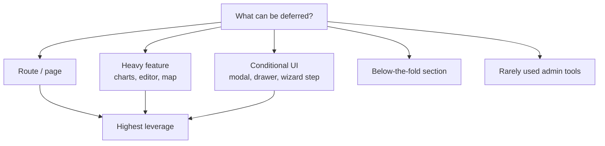
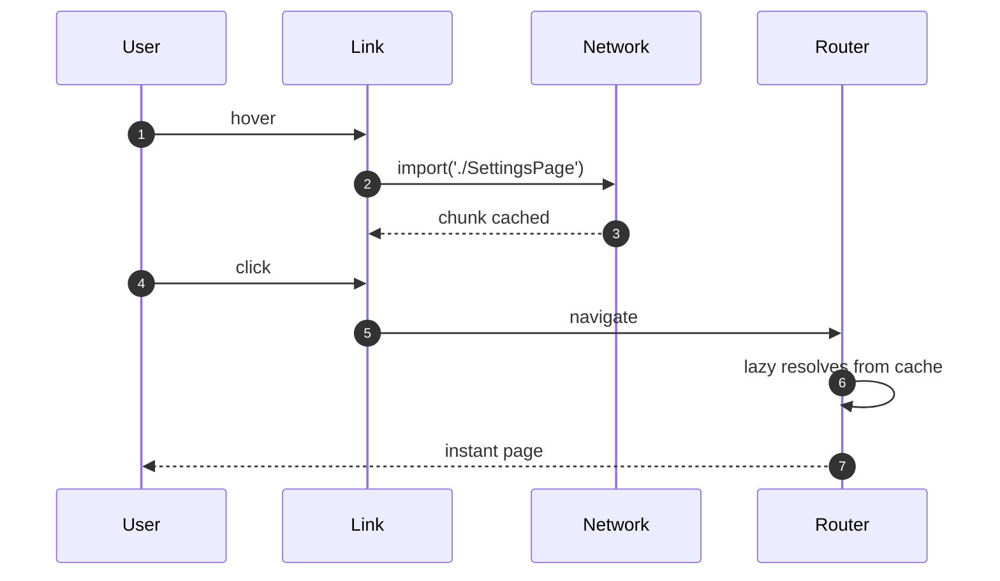
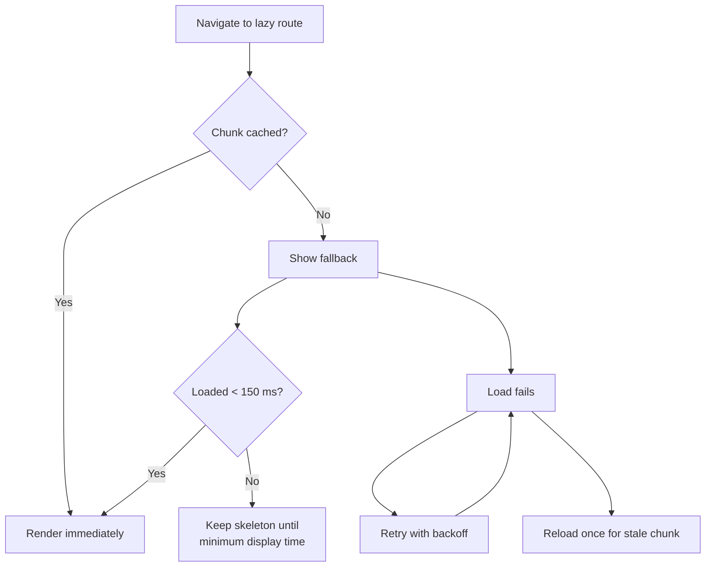

# 31. Code Splitting and Loading Strategy

> **Level:** Advanced · **Prerequisites:** Chapters 26, 30 · **Reading time:** ~40 min

Shipping less JavaScript is usually the highest-leverage performance change available. Code splitting is not
"wrap everything in `lazy`" — it is designing **what the user needs now** versus **what can arrive later**, and
making the later arrival invisible.

---

## 1. What the browser pays


A 1 MB bundle is not "1 MB of network" — it is main-thread work that delays INP and hydration. Splitting moves
work off the critical path.

---

## 2. Split boundaries



| Boundary | Example | Typical saving |
|----------|---------|----------------|
| Route | `/settings`, `/reports` | Large — each page is its own chunk |
| Feature | Rich text editor, charting | Large — heavy dependencies |
| Conditional | Checkout modal, command palette | Medium — often never opened |
| Third-party | PDF export, maps, analytics | Medium |
| Below the fold | Comments, recommendations | Medium |

Do **not** split: the app shell, the current route's critical UI, small components, or anything needed for the
first interaction.

---

## 3. `React.lazy` + `Suspense`

```jsx
import { lazy, Suspense } from "react";

const ReportsPage = lazy(() => import("./pages/ReportsPage"));

export function ReportsRoute() {
  return (
    <Suspense fallback={<PageSkeleton />}>
      <ReportsPage />
    </Suspense>
  );
}
```

`lazy` requires a module with a **default export**:

```js
// pages/ReportsPage.jsx
export default function ReportsPage() { /* ... */ }
```

For named exports:

```js
const ReportsPage = lazy(() =>
  import("./pages/ReportsPage").then(module => ({ default: module.ReportsPage }))
);
```

With a data router, prefer route-level lazy loading so the loader, action and element arrive together:

```jsx
{
  path: "reports",
  lazy: async () => {
    const { Component, loader } = await import("./pages/ReportsPage");
    return { Component, loader };
  },
}
```

---

## 4. Prefetching on intent

```jsx
const loadSettings = () => import("./pages/SettingsPage");
const SettingsPage = lazy(loadSettings);

<Link
  to="/settings"
  onMouseEnter={loadSettings}
  onFocus={loadSettings}
>
  Settings
</Link>
```

The `import()` promise is cached by the bundler, so the `lazy` component resolves instantly on navigation.

Prefetch strategies:

| Signal | When | Risk |
|--------|------|------|
| Hover/focus | Desktop, predictable intent | Wasted bytes for explorers |
| Viewport | Links below the fold | Competes with critical requests |
| Idle (`requestIdleCallback`) | After LCP | Still consumes bandwidth |
| Route prediction | ML/history-based | Complexity |
| Service worker | Repeat visits | Cache invalidation |



---

## 5. Bundle configuration

```js
// vite.config.js
import { defineConfig } from "vite";
import react from "@vitejs/plugin-react";

export default defineConfig({
  plugins: [react()],
  build: {
    rollupOptions: {
      output: {
        manualChunks: {
          react: ["react", "react-dom"],
          charts: ["recharts"],
          editor: ["@tiptap/react", "@tiptap/starter-kit"],
        },
      },
    },
  },
});
```

- **Vendor chunks** improve long-term caching: app code changes, vendor hash stays stable.
- **Don't over-chunk.** 40 tiny chunks create a request waterfall; HTTP/2 helps but parsing still costs.
- **Preload critical chunks** with `<link rel="modulepreload">` (Vite injects these automatically for entry
  chunks).
- **Analyze** with `rollup-plugin-visualizer`:

```bash
npm run build -- --mode production
npx vite-bundle-visualizer
```

### Tree shaking and barrel files

```js
// ❌ Barrel that re-exports a huge module graph
export * from "./charts";
export * from "./editor";
```

```js
// ✅ Import from the specific module
import { LineChart } from "./charts/LineChart";
```

Set `"sideEffects": false` in `package.json` only when your modules are truly side-effect free. Barrel files can
defeat tree shaking and pull heavy dependencies into the initial chunk.

---

## 6. Loading UX



Rules:

- **Do not flash a spinner** for a 20 ms load. Either prefetch or delay the fallback ~150 ms.
- **Match skeleton dimensions** to the final layout to avoid CLS.
- **Handle chunk load failures**: after a deploy, old chunk hashes disappear and `import()` rejects.

```js
// Vite: emitted when a dynamic import fails to preload
window.addEventListener("vite:preloadError", event => {
  event.preventDefault();
  const key = "chunk-reload-at";
  const last = Number(sessionStorage.getItem(key) ?? 0);

  if (Date.now() - last > 10_000) {
    sessionStorage.setItem(key, String(Date.now()));
    window.location.reload();
  }
});
```

Use a one-time reload guard to avoid reload loops. For webpack, detect `ChunkLoadError` similarly.

---

## 7. Budgets

| Asset | Budget (gzip) | Rationale |
|-------|---------------|-----------|
| Initial JS (app + framework) | < 170 KB | Fast LCP on mid-range mobile |
| Route chunk | < 50 KB | Fast navigation |
| Heavy feature chunk | < 150 KB | Loaded on demand |
| Fonts | < 100 KB | Blocking text render |
| LCP image | < 200 KB | LCP ≤ 2.5 s |

Enforce in CI:

```json
{
  "scripts": {
    "build": "vite build",
    "size": "size-limit"
  },
  "size-limit": [
    { "path": "dist/assets/index-*.js", "limit": "170 KB" }
  ]
}
```

A budget that is not enforced is a wish.

---

## 8. Anti-patterns

| Anti-pattern | Problem | Fix |
|--------------|---------|-----|
| Splitting every component | Request waterfall, worse UX | Split at routes/features |
| `lazy` inside a render body | New component type each render | Module scope |
| No Suspense boundary | Crash or blank screen | Nearest meaningful boundary |
| Spinner for every chunk | Flicker, perceived slowness | Prefetch + delayed skeleton |
| Preloading everything | Competes with critical path | Intent-based prefetch |
| Huge barrel imports | Tree shaking defeated | Direct module imports |
| Ignoring stale chunk errors | White screen after deploy | Reload-once handler |
| No size budget | Silent regressions | CI size check |
| Lazy-loading the app shell | Slower first paint | Keep shell eager |

---

## 9. Checklist

- [ ] Every route is its own chunk.
- [ ] Heavy, conditional features are lazy.
- [ ] Prefetch happens on hover/focus/idle for likely navigation.
- [ ] Suspense fallbacks match layout and avoid flicker.
- [ ] Chunk load failures are handled with a one-time reload.
- [ ] Vendor chunks are separated and cached.
- [ ] Bundle size is measured and enforced in CI.
- [ ] No barrel file pulls a heavy module into the entry chunk.

---

## 10. Exercises

1. Split a two-route app and compare the initial bundle and LCP.
2. Add hover prefetch to one link and confirm the navigation has no loading state.
3. Lazy-load a chart library only when the chart tab is opened.
4. Introduce a size-limit budget and make CI fail on a deliberate 20 KB regression.
5. Simulate a deploy that removes old chunks and implement the reload-once recovery.

---

## 11. Interview focus

| Question | Where it is answered |
|----------|----------------------|
| What is lazy loading? (#90) | Sections 2–3 |
| `React.lazy` and Suspense (#91) | Section 3 |
| How do you chunk code? (#92) | Sections 4–5 |
| Route-based splitting (#85) | Sections 3–4 |

**Follow-up traps**

- *"What happens to the old chunks after a deploy?"* — They are removed; clients with an old HTML file get a
  failed dynamic import. Handle it with a reload.
- *"Why is my lazy component still in the main bundle?"* — It is imported statically elsewhere, or a barrel file
  pulls it in.
- *"Does splitting always improve performance?"* — No; too many small chunks add round trips and overhead.

---

**Next:** [32. Large-Scale React Architecture](32.%20Large-Scale%20React%20Architecture.md)
