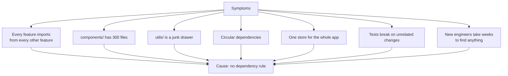
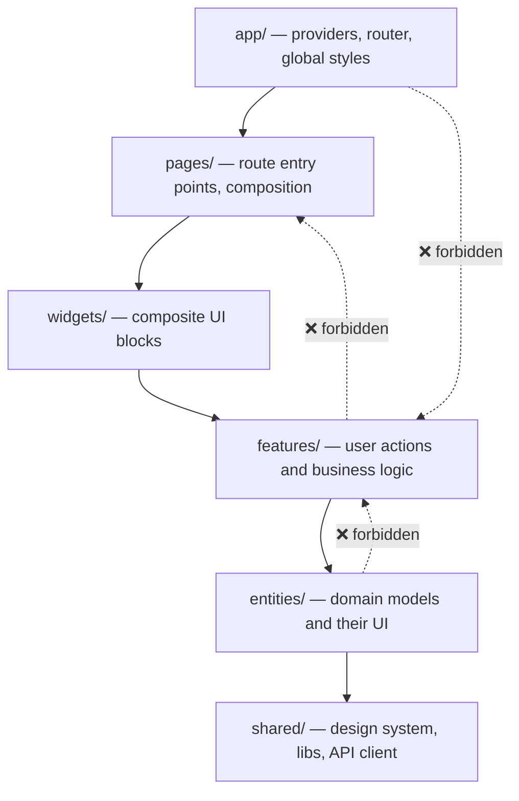
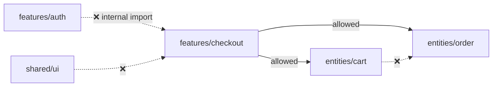
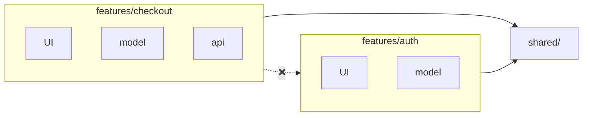
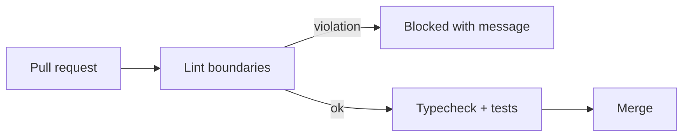
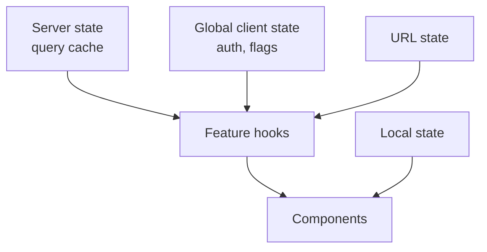
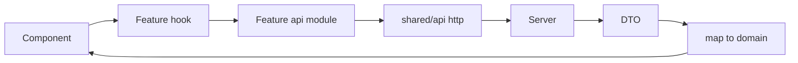
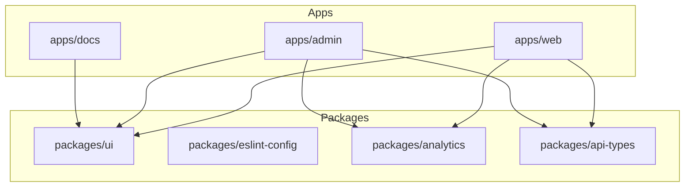
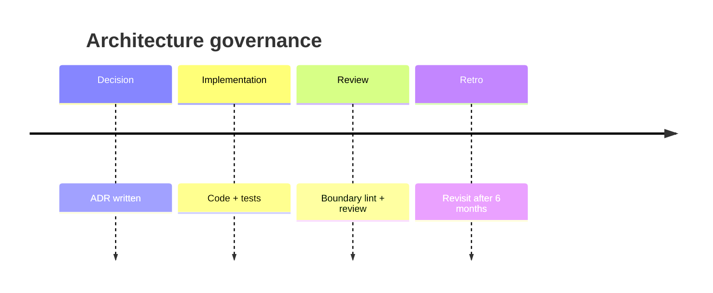

# 32. Large-Scale React Architecture

> **Level:** Professional · **Prerequisites:** Chapters 16, 24, 26, 29 · **Reading time:** ~50 min

At 5 components, architecture is a folder name. At 500 components and 12 teams, architecture is **the set of rules
that prevents change in one feature from breaking another**. This chapter covers layering, boundaries, monorepos
and the conventions that keep a React codebase navigable.

---

## 1. Symptoms of architectural drift



The root cause is almost always the same: **no explicit rule about who may import whom.**

---

## 2. Layered architecture (feature-sliced)

A proven default: layers with a strict one-directional dependency rule.



Rules:

1. A module may import only from **layers below it**.
2. A feature may not import another feature's internals — only its public `index.ts`.
3. `shared` never imports from any domain layer.
4. Cross-entity interaction happens in a feature or widget, not between entities.



### Folder structure

```
src/
├── app/
│   ├── providers/          # QueryClient, theme, auth, error reporting
│   ├── router/             # route table, guards, layouts
│   └── styles/             # tokens, global CSS
├── pages/
│   ├── dashboard/
│   │   ├── DashboardPage.tsx
│   │   └── dashboard.loader.ts
│   └── settings/
├── widgets/
│   ├── header/
│   └── order-summary/
├── features/
│   ├── auth/
│   │   ├── api/            # request functions
│   │   ├── model/          # store, hooks, validation
│   │   ├── ui/             # forms, buttons
│   │   └── index.ts        # public API
│   └── checkout/
├── entities/
│   ├── user/
│   │   ├── model/
│   │   ├── ui/
│   │   └── index.ts
│   └── order/
└── shared/
    ├── ui/                 # primitives: Button, Input, Modal
    ├── api/                # http client, interceptors
    ├── lib/                # dates, formatting, guards
    └── config/             # env, feature flags
```

Each slice exposes a **public API** through `index.ts`; everything else is private by convention and enforced by
lint rules.

---

## 3. Vertical slices (alternative)

If layers feel heavy, organize by **feature** and allow each feature to own its UI, state and data access.

```
src/
├── features/
│   ├── checkout/
│   │   ├── ui/
│   │   ├── model/
│   │   ├── api/
│   │   └── index.ts
│   └── auth/
├── shared/
└── app/
```



Tradeoff: layers are excellent for large, long-lived products with many teams; vertical slices are simpler for
small teams and faster to change. Both are better than a global `components/` dump.

---

## 4. Enforcing boundaries

Architecture that is not enforced decays.

```jsonc
// .eslintrc.json (excerpt)
{
  "rules": {
    "no-restricted-imports": [
      "error",
      {
        "patterns": [
          {
            "group": ["@/features/*/ui/*", "@/features/*/model/*"],
            "message": "Import features through their public index.ts"
          },
          {
            "group": ["@/shared/*/../features/*"],
            "message": "shared must not import features"
          }
        ]
      }
    ]
  }
}
```

Stronger tools:

- **`eslint-plugin-boundaries`** — zone-based rules.
- **`dependency-cruiser`** — validates and visualizes the graph; catches cycles.
- **Nx module boundaries** — tags (`type:feature`, `scope:checkout`) with allowed dependencies.
- **TypeScript project references** — physically separate compilation units.



---

## 5. State ownership by layer

| State | Owner | Example |
|-------|-------|---------|
| Server cache | Query library, keyed by feature | `['orders', id]` |
| Feature UI state | Feature model | checkout step, filters |
| Cross-feature client state | App-level store | auth session, theme |
| URL state | Router | search, pagination, tab |
| Local UI | Component | dropdown open |



Never let a page component reach directly into another feature's store. It should consume a **public hook**:

```js
// features/checkout/index.ts
export { useCheckout } from "./model/useCheckout";
export { CheckoutButton } from "./ui/CheckoutButton";
export type { CheckoutStep } from "./model/types";
```

---

## 6. API layer

```js
// shared/api/http.js
const BASE_URL = import.meta.env.VITE_API_URL;

export async function http(path, { signal, ...options } = {}) {
  const response = await fetch(`${BASE_URL}${path}`, {
    ...options,
    signal,
    headers: {
      "Content-Type": "application/json",
      ...options.headers,
    },
    credentials: "include",
  });

  if (!response.ok) {
    const problem = await response.json().catch(() => ({}));
    throw new ApiError(response.status, problem);
  }

  return response.status === 204 ? null : response.json();
}
```

Rules:

- One HTTP client with auth, error normalization, correlation IDs and base URL.
- Feature `api/` modules own endpoint paths and DTO types.
- Map DTOs to domain models at the boundary; do not leak API shapes into components.
- Never call `fetch` with a raw URL from a component.



---

## 7. Monorepos



Tooling: pnpm workspaces + Turborepo (simple) or Nx (powerful graph and generators).

Principles:

- **Packages have explicit public APIs** (`exports` map in `package.json`).
- **Apps do not import from other apps.**
- **Shared UI is domain-agnostic.** A `Button` belongs in `packages/ui`; a `CheckoutSummary` belongs in the
  checkout feature.
- **Build graph is cached**; CI runs only affected projects.
- **Versioning**: internal packages can be versioned with changesets, or consumed via workspace protocol.

---

## 8. Composition roots

Keep the "wiring" in one place:

```jsx
// app/providers/AppProviders.jsx
export function AppProviders({ children }) {
  return (
    <ErrorBoundary FallbackComponent={RootError}>
      <QueryClientProvider client={queryClient}>
        <AuthProvider>
          <ThemeProvider>
            <ToastProvider>{children}</ToastProvider>
          </ThemeProvider>
        </AuthProvider>
      </QueryClientProvider>
    </ErrorBoundary>
  );
}
```

```jsx
// app/router/router.jsx
export const router = createBrowserRouter([
  {
    element: <RootLayout />,
    errorElement: <RootError />,
    children: [
      { index: true, element: <HomePage /> },
      {
        path: "checkout",
        lazy: () => import("@/pages/checkout/route"),
      },
      {
        path: "*",
        element: <NotFoundPage />,
      },
    ],
  },
]);
```

Pages compose widgets; widgets compose features; features use entities and shared UI. No component should need to
know the whole app.

---

## 9. Documentation and decisions

- **README per feature** — purpose, public API, owner.
- **ADRs** (Architecture Decision Records) — one page per significant decision: context, options, decision,
  consequences.
- **Conventions doc** — naming, testing, state placement, error handling.
- **Onboarding path** — a first ticket that touches one slice end to end.



---

## 10. Anti-patterns

| Anti-pattern | Problem | Fix |
|--------------|---------|-----|
| `components/` for everything | No ownership | Feature slices |
| `utils/` junk drawer | Discoverability | Domain-specific `lib/` |
| Cross-feature deep imports | Coupling | Public `index.ts` |
| Circular dependencies | Unpredictable bundles | dependency-cruiser |
| Shared package with business logic | Every app breaks together | Keep shared generic |
| One global store | Implicit coupling | Feature stores + query cache |
| Pages importing entities directly | Skips composition rules | Widgets/features |
| Architecture without enforcement | Decays in months | Lint/CI rules |

---

## 11. Checklist

- [ ] Dependency direction is documented and linted.
- [ ] Each feature has a public API and a clear owner.
- [ ] Shared UI contains no domain logic.
- [ ] State ownership follows the layer table.
- [ ] API access goes through one client.
- [ ] Pages compose; they do not implement business logic.
- [ ] Monorepo packages have explicit exports.
- [ ] Significant decisions are recorded as ADRs.

---

## 12. Exercises

1. Take an app with a flat `components/` folder and migrate one feature to a slice without breaking imports.
2. Add `eslint-plugin-boundaries` and create one intentional violation; verify CI fails.
3. Draw the dependency graph of your current project. Find cycles and cross-feature imports.
4. Extract a `Button` into a shared package and consume it from two apps.
5. Write an ADR for choosing Zustand over Redux in a new product.

---

## 13. Interview focus

| Question | Where it is answered |
|----------|----------------------|
| How do you structure large-scale React apps? (#144) | Sections 2–8 |
| Preferred folder structure (#148) | Sections 2–3 |
| How do you handle code reuse? (#145) | Sections 2, 7 |
| Tradeoffs in past projects (#147) | Sections 3, 9 |

**Follow-up traps**

- *"Feature folders vs layer folders?"* — Either works if dependencies are one-directional and enforced; the
  failure mode is a global dump with no ownership.
- *"When do you extract a shared package?"* — On the second or third consumer with a stable API, not
  preemptively.
- *"How do you prevent architecture decay?"* — Automated boundary checks in CI plus a documented convention.

---

**Next:** [33. TypeScript with React](33.%20TypeScript%20with%20React.md)
