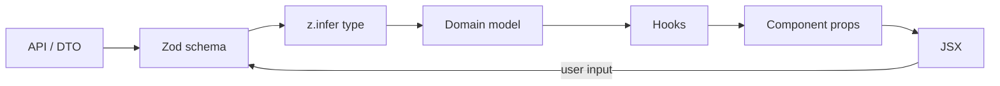
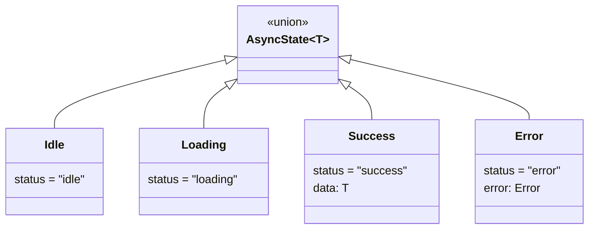
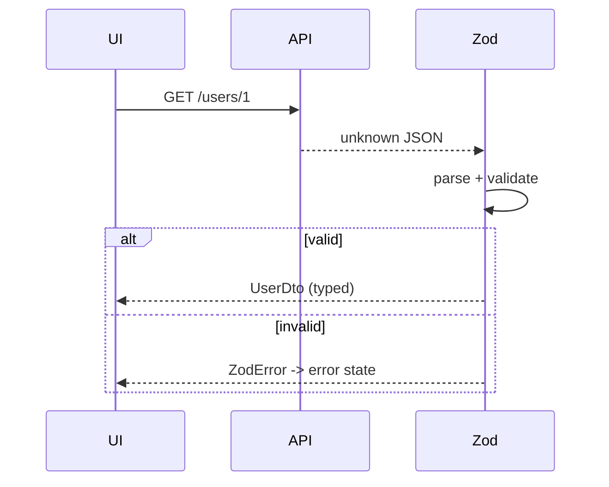

# 33. TypeScript with React

> **Level:** Professional · **Prerequisites:** Chapters 6, 16, 20, 27 · **Reading time:** ~55 min

TypeScript is not decoration for React. It is how you make **invalid component states unrepresentable**, keep
refactors honest, and turn runtime crashes into compile errors. This chapter covers the patterns that pay for
themselves in production.

---

## 1. The type flow



Validate at the boundary, infer types from the validator, and keep both ends of the app using the same contract.

---

## 2. Component props

```tsx
type ButtonProps = {
  variant?: "primary" | "secondary" | "danger";
  size?: "sm" | "md" | "lg";
  isLoading?: boolean;
  children: React.ReactNode;
  onClick?: React.MouseEventHandler<HTMLButtonElement>;
};

export function Button({
  variant = "primary",
  size = "md",
  isLoading = false,
  children,
  onClick,
}: ButtonProps) {
  return (
    <button
      type="button"
      className={`btn btn--${variant} btn--${size}`}
      disabled={isLoading}
      onClick={onClick}
    >
      {isLoading ? "Loading…" : children}
    </button>
  );
}
```

Prefer extending intrinsic element props so `id`, `aria-*`, `form` and `data-*` work:

```tsx
import type { ComponentPropsWithoutRef } from "react";

type ButtonProps = ComponentPropsWithoutRef<"button"> & {
  variant?: "primary" | "secondary" | "danger";
};

export function Button({ variant = "primary", className, ...rest }: ButtonProps) {
  return <button className={clsx("btn", `btn--${variant}`, className)} {...rest} />;
}
```

### About `React.FC`

```tsx
// Avoid
const Card: React.FC<{ title: string }> = ({ title, children }) => ...
```

`React.FC` historically implied `children`, complicates generics, and adds no value over a plain function with
typed props. Prefer explicit props + an explicit return type when helpful.

### `children` types

| Type | Accepts |
|------|---------|
| `ReactNode` | Elements, strings, numbers, fragments, `null` |
| `ReactElement` | Exactly one element |
| `ReactElement \| null` | One element or nothing |
| `(props) => ReactNode` | Render prop |
| `string` | Text only |

Use `ReactNode` unless you need to clone/inspect the element.

---

## 3. Make invalid states unrepresentable

```tsx
// ❌ Allows impossible combinations
type AlertProps = {
  tone: "success" | "error";
  message: string;
  onRetry?: () => void;
};
```

```tsx
// ✅ Retry is required for errors and forbidden for successes
type AlertProps =
  | { tone: "success"; message: string; onRetry?: never }
  | { tone: "error"; message: string; onRetry: () => void };

function Alert(props: AlertProps) {
  if (props.tone === "error") {
    return (
      <div role="alert">
        {props.message}
        <button onClick={props.onRetry}>Retry</button>
      </div>
    );
  }
  return <div role="status">{props.message}</div>;
}
```

The same technique models async state:

```tsx
type AsyncState<T> =
  | { status: "idle" }
  | { status: "loading" }
  | { status: "success"; data: T }
  | { status: "error"; error: Error };
```



---

## 4. Generic components

```tsx
type ListProps<T> = {
  items: readonly T[];
  getKey: (item: T) => string;
  renderItem: (item: T) => React.ReactNode;
  empty?: React.ReactNode;
};

export function List<T>({
  items,
  getKey,
  renderItem,
  empty = "Nothing here",
}: ListProps<T>) {
  if (items.length === 0) return <>{empty}</>;
  return (
    <ul>
      {items.map(item => (
        <li key={getKey(item)}>{renderItem(item)}</li>
      ))}
    </ul>
  );
}

// T is inferred as User
<List
  items={users}
  getKey={user => user.id}
  renderItem={user => <span>{user.name}</span>}
/>
```

Guidelines:

- Put the generic on the function, not on the props type alone.
- Use `readonly T[]` when you do not mutate.
- Provide defaults (`<T = string>`) only when inference fails.
- Do not over-generalize; two concrete components are often clearer than one type puzzle.

### Typed `Select`

```tsx
type SelectProps<T extends string> = {
  options: ReadonlyArray<{ value: T; label: string }>;
  value: T;
  onChange: (value: T) => void;
};

export function Select<T extends string>({ options, value, onChange }: SelectProps<T>) {
  return (
    <select value={value} onChange={e => onChange(e.target.value as T)}>
      {options.map(option => (
        <option key={option.value} value={option.value}>
          {option.label}
        </option>
      ))}
    </select>
  );
}
```

The cast is confined to the DOM boundary; the public API stays type-safe.

---

## 5. Polymorphic components

```tsx
import type { ComponentPropsWithoutRef, ElementType, ReactNode } from "react";

type AsProp<C extends ElementType> = { as?: C };

type PolymorphicProps<C extends ElementType, Props = {}> = Props &
  AsProp<C> &
  Omit<ComponentPropsWithoutRef<C>, keyof (AsProp<C> & Props)>;

export function Text<C extends ElementType = "p">({
  as,
  children,
  ...rest
}: PolymorphicProps<C> & { children: ReactNode }) {
  const Component = as ?? "p";
  return <Component {...(rest as any)}>{children}</Component>;
}

<Text>Paragraph</Text>
<Text as="a" href="/docs">Link</Text>
<Text as="h2">Heading</Text>
```

The `as any` is a known implementation compromise; the **call site** is fully checked. Libraries solve this with
dedicated helper types or `@radix-ui/react-slot`.

---

## 6. Hooks

```tsx
const [count, setCount] = useState<number>(0);
const [user, setUser] = useState<User | null>(null);
const inputRef = useRef<HTMLInputElement>(null);
const timerRef = useRef<ReturnType<typeof setTimeout> | null>(null);
```

```tsx
type Action =
  | { type: "added"; id: string; text: string }
  | { type: "toggled"; id: string }
  | { type: "removed"; id: string };

function todosReducer(state: Todo[], action: Action): Todo[] {
  switch (action.type) {
    case "added":
      return [...state, { id: action.id, text: action.text, done: false }];
    case "toggled":
      return state.map(t => (t.id === action.id ? { ...t, done: !t.done } : t));
    case "removed":
      return state.filter(t => t.id !== action.id);
  }
}
```

Exhaustiveness check:

```ts
default: {
  const _exhaustive: never = action;
  return _exhaustive;
}
```

Custom hook return types:

```tsx
type UseToggleResult = {
  value: boolean;
  toggle: () => void;
  setOn: () => void;
  setOff: () => void;
};

export function useToggle(initial = false): UseToggleResult { /* ... */ }
```

For tuple returns, use `as const`:

```tsx
export function useCounter(initial = 0) {
  const [count, setCount] = useState(initial);
  return [count, setCount] as const;
}
```

---

## 7. Context

```tsx
type AuthContextValue = {
  user: User | null;
  login: (credentials: Credentials) => Promise<void>;
  logout: () => void;
};

const AuthContext = createContext<AuthContextValue | null>(null);

export function useAuth(): AuthContextValue {
  const context = useContext(AuthContext);
  if (!context) throw new Error("useAuth must be used within AuthProvider");
  return context;
}
```

The `| null` + throwing hook is the pattern that makes provider misuse a compile-time **and** runtime error.

---

## 8. Events

| Handler | Type |
|---------|------|
| `onClick` | `React.MouseEvent<HTMLButtonElement>` |
| `onChange` (input) | `React.ChangeEvent<HTMLInputElement>` |
| `onSubmit` | `React.FormEvent<HTMLFormElement>` |
| `onKeyDown` | `React.KeyboardEvent<HTMLDivElement>` |
| `ref` | `React.RefObject<HTMLInputElement \| null>` |
| `style` | `React.CSSProperties` |

```tsx
function handleChange(event: React.ChangeEvent<HTMLInputElement>) {
  setValue(event.target.value);
}
```

Do not type the event as `any` to make an error disappear; the element type usually reveals the mismatch.

---

## 9. API contracts

```ts
// features/users/api.ts
import { z } from "zod";

export const userSchema = z.object({
  id: z.string().uuid(),
  name: z.string(),
  email: z.string().email(),
  role: z.enum(["admin", "member"]),
  createdAt: z.string().datetime(),
});

export type UserDto = z.infer<typeof userSchema>;

export async function fetchUser(id: string): Promise<UserDto> {
  const response = await http(`/users/${id}`);
  return userSchema.parse(response); // fail fast on contract drift
}
```



For large systems, generate types from OpenAPI/protobuf instead of hand-writing DTOs. Either way, **validate at
runtime** — types are erased.

---

## 10. `tsconfig` for React

```json
{
  "compilerOptions": {
    "target": "ES2022",
    "lib": ["ES2022", "DOM", "DOM.Iterable"],
    "jsx": "react-jsx",
    "module": "ESNext",
    "moduleResolution": "Bundler",
    "strict": true,
    "noUncheckedIndexedAccess": true,
    "noImplicitOverride": true,
    "exactOptionalPropertyTypes": true,
    "verbatimModuleSyntax": true,
    "skipLibCheck": true,
    "types": ["vite/client"]
  }
}
```

`noUncheckedIndexedAccess` is noisy but catches real array-access bugs. `exactOptionalPropertyTypes` forces you to
distinguish `prop?: T` from `prop: T | undefined` — valuable in component APIs.

---

## 11. Anti-patterns

| Anti-pattern | Problem | Fix |
|--------------|---------|-----|
| `any` at API boundaries | Types lie, runtime crashes | `unknown` + validation |
| Casting with `as` to silence errors | Hides real bugs | Narrow with guards |
| Non-null assertion `!` everywhere | Crashes when assumption fails | Early return / guard |
| `React.FC` | Implicit children, weak generics | Plain typed function |
| Giant `Props` with optional everything | Impossible to know valid states | Unions |
| Types duplicated between client/server | Drift | Shared package / generated types |
| Typing state as `any[]` | No safety downstream | Generic/union |
| Enabling `strict` later | Huge migration | Enable from day one |

---

## 12. Checklist

- [ ] `strict` is enabled and CI typechecks.
- [ ] Props extend intrinsic element props where appropriate.
- [ ] Async and variant states use discriminated unions.
- [ ] API responses are validated at runtime.
- [ ] Context has a null guard and a throwing hook.
- [ ] No `any` at module boundaries; `unknown` + narrowing instead.
- [ ] Shared types live in one package, not duplicated.
- [ ] Exhaustive switches use `never`.

---

## 13. Exercises

1. Convert an `Alert` component with optional props into a discriminated union.
2. Build a generic `DataTable<T>` with typed columns and render functions.
3. Type a `useReducer` with five actions and add an exhaustiveness check.
4. Validate a real API response with Zod and map it to a domain model.
5. Build a polymorphic `Box` component and verify that `href` is rejected when `as="div"`.

---

## 14. Interview focus

| Question | Where it is answered |
|----------|----------------------|
| How do you use TypeScript with React? (#118) | Sections 2–10 |
| Props typing and children | Section 2 |
| Generic components | Section 4 |
| Context typing | Section 7 |

**Follow-up traps**

- *"Why not `React.FC`?"* — It adds implicit `children`, weakens generics and provides no benefit over typed
  props.
- *"Do types replace validation?"* — No; they are erased at runtime. Validate untrusted data.
- *"How do you type a component that forwards a ref?"* — In React 19, `ref` is a normal prop; in React 18, type
  `forwardRef` with `ComponentPropsWithoutRef` and `Ref`.

---

**Next:** [34. Testing Strategy](34.%20Testing%20Strategy.md)
