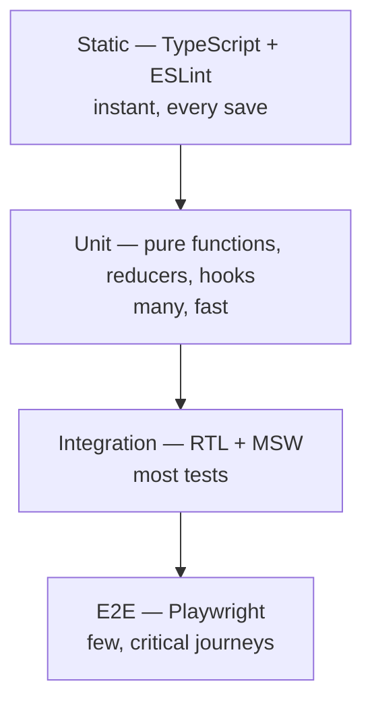
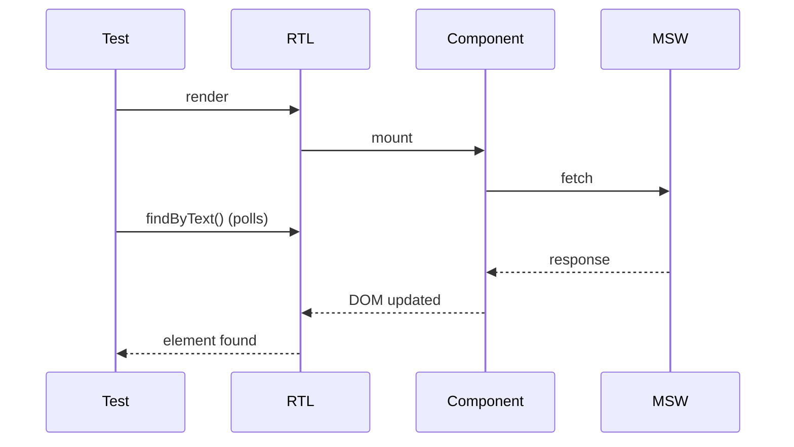
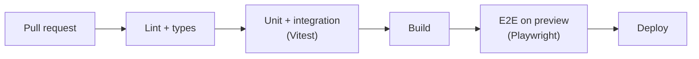

# 34. Testing Strategy

> **Level:** Professional · **Prerequisites:** Chapters 15, 25, 28, 33 · **Reading time:** ~55 min

The goal of testing is not coverage. It is **confidence to change code**. React tests should describe what a user
can do and see, not how hooks are wired. This chapter builds a layered strategy that stays fast and trustworthy.

---

## 1. The testing trophy



| Layer | Tool | Scope | Speed | Confidence |
|-------|------|-------|-------|------------|
| Static | TypeScript, ESLint | Types, boundaries | Instant | Medium |
| Unit | Vitest | Reducers, utils, hooks | ms | Low–medium |
| Integration | Vitest + RTL + MSW | Component + network | 10–100 ms | High |
| E2E | Playwright | Real browser + backend | seconds | Highest |

The trophy (not pyramid) reflects that **integration tests** catch the most React bugs per unit of maintenance.

---

## 2. Test behavior, not implementation

```jsx
// ❌ Implementation-coupled: breaks on any refactor
expect(wrapper.find("button").prop("onClick")).toBeDefined();

// ✅ User-visible behavior
render(<Counter />);
await user.click(screen.getByRole("button", { name: /increment/i }));
expect(screen.getByText("Count: 1")).toBeInTheDocument();
```

Rules:

- Query by role, label and text — the same things a user perceives.
- Assert on rendered output, not internal state.
- Mock at the **network boundary**, not at the hook/module boundary.
- If a test breaks when you rename a variable, it was testing implementation.

### Query priority

1. `getByRole` (with accessible name)
2. `getByLabelText`
3. `getByPlaceholderText`
4. `getByText`
5. `getByDisplayValue`
6. `getByAltText`
7. `getByTitle`
8. `getByTestId` — last resort

---

## 3. Setup

```js
// vitest.config.js
import { defineConfig } from "vitest/config";
import react from "@vitejs/plugin-react";

export default defineConfig({
  plugins: [react()],
  test: {
    environment: "jsdom",
    setupFiles: "./src/test/setup.js",
    css: false,
    restoreMocks: true,
    coverage: {
      provider: "v8",
      reporter: ["text", "html"],
      exclude: ["**/*.stories.*", "**/test/**"],
    },
  },
});
```

```js
// src/test/setup.js
import "@testing-library/jest-dom/vitest";
import { cleanup } from "@testing-library/react";
import { afterEach } from "vitest";

afterEach(() => cleanup());
```

```jsx
// src/test/render.jsx
import { render } from "@testing-library/react";
import { QueryClient, QueryClientProvider } from "@tanstack/react-query";
import { MemoryRouter } from "react-router-dom";

export function renderWithProviders(ui, { route = "/" } = {}) {
  const queryClient = new QueryClient({
    defaultOptions: { queries: { retry: false } },
  });

  return render(
    <QueryClientProvider client={queryClient}>
      <MemoryRouter initialEntries={[route]}>{ui}</MemoryRouter>
    </QueryClientProvider>
  );
}
```

A custom render helper keeps each test focused on its own scenario instead of provider boilerplate.

---

## 4. Integration test with MSW

MSW intercepts real `fetch` calls at the network level, so your code uses the same path as in production.

```js
// src/test/server.js
import { setupServer } from "msw/node";
import { http, HttpResponse } from "msw";

export const server = setupServer(
  http.get("/api/users", () =>
    HttpResponse.json([
      { id: "1", name: "Ada Lovelace" },
      { id: "2", name: "Grace Hopper" },
    ])
  )
);
```

```jsx
// UserSearch.test.jsx
import { screen } from "@testing-library/react";
import userEvent from "@testing-library/user-event";
import { describe, it, expect, beforeAll, afterEach, afterAll } from "vitest";
import { server } from "../../test/server";
import { renderWithProviders } from "../../test/render";
import { UserSearch } from "./UserSearch";

beforeAll(() => server.listen());
afterEach(() => server.resetHandlers());
afterAll(() => server.close());

describe("UserSearch", () => {
  it("loads users and filters them by name", async () => {
    const user = userEvent.setup();
    renderWithProviders(<UserSearch />);

    expect(await screen.findByText("Ada Lovelace")).toBeInTheDocument();
    expect(screen.getByText("Grace Hopper")).toBeInTheDocument();

    await user.type(screen.getByRole("searchbox", { name: /search users/i }), "ada");

    expect(screen.getByText("Ada Lovelace")).toBeInTheDocument();
    expect(screen.queryByText("Grace Hopper")).not.toBeInTheDocument();
  });

  it("shows a retryable error when the API fails", async () => {
    server.use(
      http.get("/api/users", () => HttpResponse.json({}, { status: 500 }))
    );

    const user = userEvent.setup();
    renderWithProviders(<UserSearch />);

    expect(await screen.findByRole("alert")).toHaveTextContent(/could not load/i);
    await user.click(screen.getByRole("button", { name: /retry/i }));
  });
});
```

---

## 5. Async testing



- Use `findBy*` for appearance, `queryBy*` for absence, `getBy*` for immediate presence.
- Use `waitFor` only for non-DOM assertions or multiple expectations.
- Never use `setTimeout` in tests. Use `findBy`, `waitFor`, or fake timers.
- Call `userEvent.setup()` before rendering; with fake timers, pass
  `userEvent.setup({ advanceTimers: vi.advanceTimersByTime })`.

```js
// ❌ Flaky
await new Promise(r => setTimeout(r, 500));

// ✅ Deterministic
expect(await screen.findByText("Saved")).toBeInTheDocument();
```

### `act()` warnings

`act` flushes React updates. RTL wraps render and events in `act` automatically. Warnings usually mean:

- A state update happened outside React's control (a real timer, a promise not awaited).
- The test finished before the update.

Fix the source, not the warning. In rare cases, wrap manual store mutations in `act`.

---

## 6. Testing hooks

```jsx
import { renderHook, act } from "@testing-library/react";
import { useDebouncedValue } from "./useDebouncedValue";

describe("useDebouncedValue", () => {
  beforeEach(() => vi.useFakeTimers());
  afterEach(() => vi.useRealTimers());

  it("updates after the delay", () => {
    const { result, rerender } = renderHook(
      ({ value }) => useDebouncedValue(value, 300),
      { initialProps: { value: "a" } }
    );

    rerender({ value: "ab" });
    expect(result.current).toBe("a");

    act(() => vi.advanceTimersByTime(300));
    expect(result.current).toBe("ab");
  });
});
```

Prefer testing hooks through a component when the hook exists only to serve one component; `renderHook` is for
genuinely reusable hooks.

---

## 7. Snapshot testing

| Good use | Bad use |
|----------|---------|
| Small, stable, intentional output | Large component trees |
| Generated code / serializers | Anything with dates, IDs, randomness |
| Design-system primitives | Replacing behavioral assertions |

Snapshots fail on irrelevant changes and are often approved without review. Prefer explicit assertions; if you use
snapshots, keep them small and inline (`toMatchInlineSnapshot`) so reviewers see the diff.

---

## 8. E2E with Playwright

```js
// e2e/auth.spec.js
import { test, expect } from "@playwright/test";

test("user signs in and sees the dashboard", async ({ page }) => {
  await page.goto("/login");

  await page.getByLabel("Email").fill("ada@example.com");
  await page.getByLabel("Password").fill("correct horse battery staple");
  await page.getByRole("button", { name: "Sign in" }).click();

  await expect(page.getByRole("heading", { name: "Dashboard" })).toBeVisible();
});
```

Best practices:

- Test **critical journeys** only: sign in, checkout, create/edit/delete core entity.
- Use a dedicated test tenant and seeded data.
- Authenticate once via `storageState`, not through the UI in every test.
- Run against a production build (`vite build && vite preview`).
- Capture trace on first retry: `trace: "on-first-retry"`.
- Keep tests independent; no order dependence.



---

## 9. Coverage and quality signals

- Coverage finds **untested code**, not good tests.
- Set thresholds on critical paths, not global vanity numbers.
- Mutation testing (Stryker) reveals weak assertions.
- Track flake rate and test duration; slow suites get skipped.

| Signal | Target |
|--------|--------|
| Critical-path coverage | ≥ 80% |
| Global coverage | 60–80% (context-dependent) |
| Suite runtime (unit + integration) | < 5 min locally |
| Flake rate | < 1% |
| E2E duration | < 15 min |

---

## 10. Anti-patterns

| Anti-pattern | Problem | Fix |
|--------------|---------|-----|
| Testing internal state/hooks directly | Breaks on refactor | Test behavior |
| `shallow()` rendering | Misses integration bugs | RTL full render |
| Mocking every module | Tests pass while app breaks | MSW at network boundary |
| `setTimeout` waits | Flaky, slow | `findBy` / fake timers |
| Snapshot of a whole page | Unreviewable diffs | Targeted assertions |
| One giant E2E for everything | Slow, flaky feedback | Few journeys + integration |
| Testing library internals | No user value | Test the product |
| Chasing 100% coverage | Waste, brittle tests | Risk-based coverage |
| Shared mutable test data | Order dependence | Per-test setup |

---

## 11. Checklist

- [ ] Tests query by role/label, not CSS or test IDs.
- [ ] Network is mocked with MSW, not by mocking hooks.
- [ ] Every async test uses `findBy`/`waitFor`, never sleeps.
- [ ] Error paths and empty states are tested, not just happy paths.
- [ ] Critical journeys have E2E coverage.
- [ ] Tests are independent and deterministic.
- [ ] CI runs lint, types, integration and E2E.
- [ ] Coverage thresholds protect critical paths.

---

## 12. Exercises

1. Write an integration test for a search form that covers success, empty and error states.
2. Replace a module mock with an MSW handler. What became simpler?
3. Test a custom hook with fake timers.
4. Add a Playwright test for sign-in → create item → sign-out.
5. Break an assertion intentionally and confirm the test fails for the right reason.

---

## 13. Interview focus

| Question | Where it is answered |
|----------|----------------------|
| How do you test React components? (#126) | Sections 1–4 |
| What is RTL? (#127), RTL vs Enzyme (#128) | Sections 1–2 |
| Mock functions in Jest (#129) | Sections 4, 6 |
| Mocking API calls (#130) | Section 4 |
| Testing forms (#131) | Section 4 |
| Testing hooks (#132) | Section 6 |
| `act()` (#133) | Section 5 |
| Best practices (#134), context (#135) | Sections 2, 8 |
| Simulating events (#136) | Section 4 |
| Async testing (#137) | Section 5 |
| Snapshot testing (#138) | Section 7 |
| Common pitfalls (#139) | Section 10 |

**Follow-up traps**

- *"RTL vs Enzyme?"* — Enzyme tests implementation (shallow rendering, instance methods); RTL tests user-visible
  behavior and works with concurrent React.
- *"How do you test a component that fetches?"* — MSW + `findBy`; do not mock `useQuery`.
- *"What is `act`?"* — It flushes pending React work so assertions see the committed UI. RTL handles it for you.

---

**Next:** [35. Accessibility and Internationalization](35.%20Accessibility%20and%20Internationalization.md)
