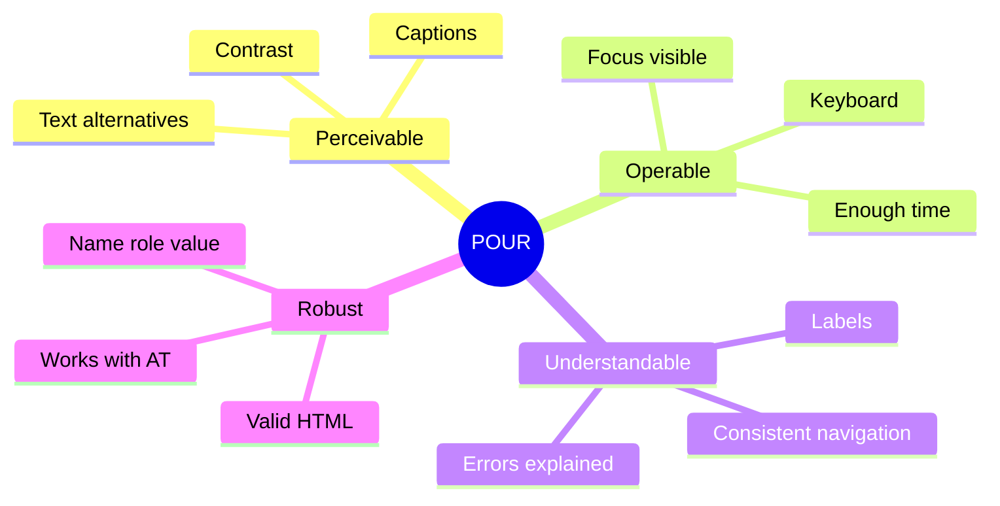
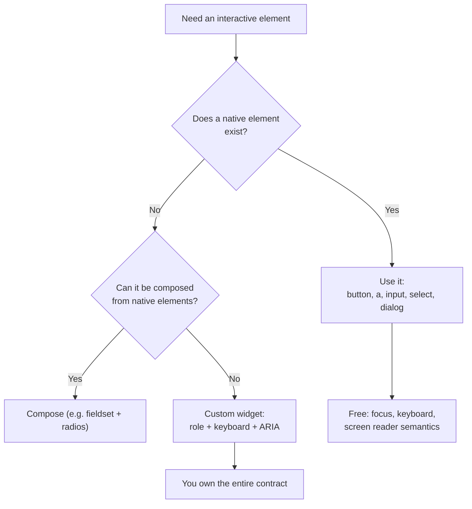
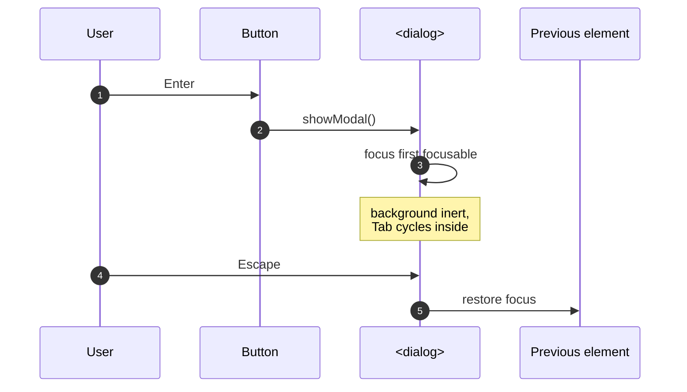
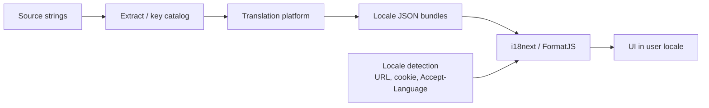
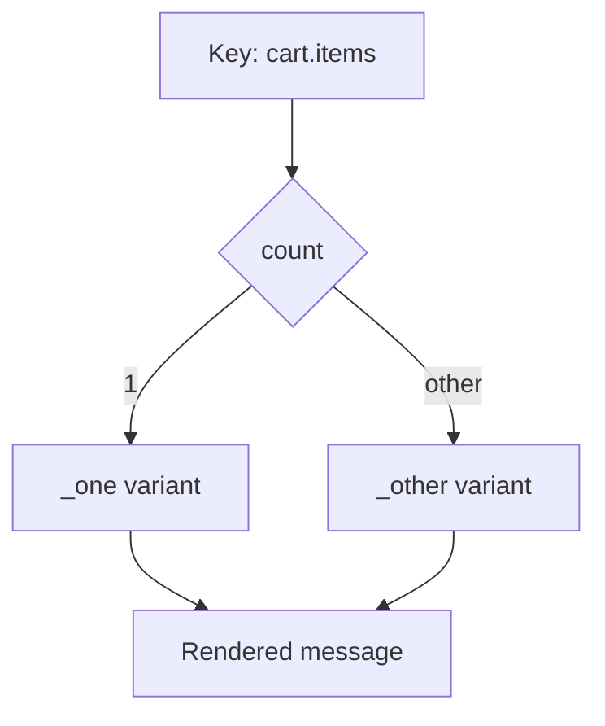

# 35. Accessibility and Internationalization

> **Level:** Professional · **Prerequisites:** Chapters 14, 16, 26 · **Reading time:** ~45 min

Accessibility and internationalization are not "extra features". They are correctness requirements: a UI that
cannot be operated by keyboard or read by a screen reader is broken for real users, and a UI that assumes English
text, left-to-right layout and US date formats is broken for most of the world.

---

## 1. WCAG in one diagram



Target **WCAG 2.2 AA** as the baseline for product work.

---

## 2. Semantic HTML first



```jsx
// ❌ A div is not a button
<div className="btn" onClick={save}>Save</div>

// ✅ Native semantics, keyboard and focus for free
<button type="button" onClick={save}>Save</button>
```

Landmarks and headings give screen-reader users a page outline:

```jsx
<a href="#main" className="skip-link">Skip to content</a>
<header>...</header>
<nav aria-label="Main">...</nav>
<main id="main">
  <h1>Orders</h1>
  <section aria-labelledby="open-orders">
    <h2 id="open-orders">Open orders</h2>
  </section>
</main>
```

Rules:

- One `<h1>` per page; headings in order (no skipping levels for styling).
- Use `<nav>`, `<main>`, `<header>`, `<footer>`, `<aside>` for structure.
- Lists are `<ul>/<ol>/<li>`, tables are `<table>` with `<th scope>`.

---

## 3. Forms

```jsx
function EmailField({ value, onChange, error }) {
  const id = useId();
  const errorId = `${id}-error`;

  return (
    <div>
      <label htmlFor={id}>Email</label>
      <input
        id={id}
        type="email"
        value={value}
        onChange={e => onChange(e.target.value)}
        aria-invalid={Boolean(error)}
        aria-describedby={error ? errorId : undefined}
        autoComplete="email"
      />
      {error && <p id={errorId} role="alert">{error}</p>}
    </div>
  );
}
```

- Every input has a programmatically associated label (not just a placeholder).
- Errors are text, announced, and linked with `aria-describedby`.
- Required fields use `required` and are explained, not marked only with `*`.
- Group related controls with `<fieldset>` + `<legend>`.
- Never block paste on password fields.

---

## 4. Keyboard and focus

| Key | Expected behavior |
|-----|-------------------|
| Tab / Shift+Tab | Move through focusable elements in visual order |
| Enter / Space | Activate buttons |
| Enter | Follow links |
| Arrow keys | Move within composite widgets (tabs, menus, grids) |
| Escape | Close modal/menu |
| Home / End | First/last item in a list |

Focus requirements:

- **Visible focus** (`:focus-visible`) with sufficient contrast.
- **Logical order** matching visual order; avoid positive `tabIndex`.
- **Focus management** on route change and modal open/close.
- **No keyboard traps** — except intentional, escapable traps in modals.

### Use `<dialog>` for modals

```jsx
function ConfirmDialog({ isOpen, onClose, title, children }) {
  const ref = useRef(null);

  useEffect(() => {
    const dialog = ref.current;
    if (!dialog) return;
    if (isOpen && !dialog.open) dialog.showModal();
    if (!isOpen && dialog.open) dialog.close();
  }, [isOpen]);

  return (
    <dialog ref={ref} onClose={onClose} aria-labelledby="dialog-title">
      <h2 id="dialog-title">{title}</h2>
      {children}
      <button type="button" onClick={onClose}>Close</button>
    </dialog>
  );
}
```

`showModal()` provides the focus trap, `Escape` handling, inert background and top-layer rendering. Reimplementing
those with a `div` is a common source of accessibility bugs.



---

## 5. ARIA rules

1. **Don't use ARIA if a native element exists.**
2. **Don't change native semantics** unless absolutely necessary.
3. **All interactive ARIA widgets must be keyboard operable.**
4. **Never use `aria-hidden` on focusable content.**
5. **Every interactive element needs an accessible name.**

```jsx
// Expandable section
<button
  type="button"
  aria-expanded={isOpen}
  aria-controls="details"
  onClick={() => setOpen(o => !o)}
>
  Details
</button>
<div id="details" hidden={!isOpen}>...</div>
```

### Live regions

```jsx
function Toast({ message }) {
  return (
    <div role="status" aria-live="polite" className="toast">
      {message}
    </div>
  );
}
```

- `polite` for status updates (saved, 3 results).
- `assertive` / `role="alert"` only for errors that need immediate attention.
- The region must exist **before** the message is inserted.

---

## 6. Color, motion and zoom

- Contrast: 4.5:1 for normal text, 3:1 for large text and UI boundaries.
- Never encode meaning with color alone (add icon/text).
- Respect `prefers-reduced-motion`.
- Support 200% zoom and 320 px viewport without horizontal scrolling.
- Use `rem` for typography; avoid fixed heights that clip translated text.

```css
@media (prefers-reduced-motion: reduce) {
  *, *::before, *::after {
    animation-duration: 0.01ms !important;
    transition-duration: 0.01ms !important;
    scroll-behavior: auto !important;
  }
}
```

---

## 7. Internationalization architecture



Principles:

1. **Never concatenate sentences.** Word order differs across languages.
2. **Use ICU messages** for plurals, gender and selects.
3. **Format dates, numbers and currency with `Intl`**, not string helpers.
4. **Load catalogs on demand**; do not ship every locale.
5. **Design for text expansion** (German +30%, Finnish +40%).
6. **Support RTL** with logical CSS properties.

### Translation setup

```jsx
import i18n from "i18next";
import { initReactI18next, useTranslation } from "react-i18next";

i18n.use(initReactI18next).init({
  lng: "en",
  fallbackLng: "en",
  interpolation: { escapeValue: false },
  resources: {
    en: {
      translation: {
        "cart.title": "Your cart",
        "cart.items_one": "{{count}} item",
        "cart.items_other": "{{count}} items",
        "greeting": "Welcome back, {{name}}",
      },
    },
    de: {
      translation: {
        "cart.title": "Dein Warenkorb",
        "cart.items_one": "{{count}} Artikel",
        "cart.items_other": "{{count}} Artikel",
        "greeting": "Willkommen zurück, {{name}}",
      },
    },
  },
});

function CartTitle({ count, name }) {
  const { t } = useTranslation();
  return (
    <>
      <h1>{t("cart.title")}</h1>
      <p>{t("greeting", { name })}</p>
      <p>{t("cart.items", { count })}</p>
    </>
  );
}
```



Different languages have different plural rules (Arabic has six forms, Polish has four). The library resolves them;
you supply the variants.

### `Intl` instead of manual formatting

```js
const date = new Intl.DateTimeFormat(locale, {
  dateStyle: "medium",
  timeStyle: "short",
  timeZone: user.timeZone,
}).format(new Date(iso));

const price = new Intl.NumberFormat(locale, {
  style: "currency",
  currency: "EUR",
}).format(amount);

const relative = new Intl.RelativeTimeFormat(locale, { numeric: "auto" })
  .format(-2, "day"); // "2 days ago"
```

Store timestamps in UTC (or ISO strings), convert at the edge, and always pass an explicit time zone.

### RTL

```jsx
// Set once at the document level
document.documentElement.dir = locale === "ar" || locale === "he" ? "rtl" : "ltr";
document.documentElement.lang = locale;
```

```css
/* ❌ Physical properties break in RTL */
.card { margin-left: 16px; text-align: left; }

/* ✅ Logical properties adapt automatically */
.card {
  margin-inline-start: 16px;
  padding-inline: 16px;
  text-align: start;
}
```

Icons that imply direction (arrows, back buttons) need mirrored variants. Numbers, charts and code blocks usually
stay LTR inside an RTL page (`dir="ltr"` on those elements).

---

## 8. Locale routing

```jsx
const SUPPORTED = ["en", "de", "ar"];

{
  path: "/:locale?",
  loader: ({ params }) => {
    const locale = SUPPORTED.includes(params.locale) ? params.locale : "en";
    return { locale };
  },
  children: [/* routes */],
}
```

- Locale in the URL (`/de/products`) is shareable and SEO-friendly.
- Set `<html lang>` and `dir` on the server for SSR to avoid a flash of wrong direction.
- Persist an explicit user choice in a cookie; fall back to `Accept-Language` only on first visit.
- Hreflang tags for SEO across locales.

---

## 9. Testing accessibility and i18n

| Tool | What it catches |
|------|-----------------|
| `eslint-plugin-jsx-a11y` | Missing alt, bad roles, label issues |
| `vitest-axe` / `jest-axe` | Automated WCAG violations in rendered DOM |
| Playwright + axe | Full-page checks in a real browser |
| Keyboard-only run | Focus order, traps, visibility |
| VoiceOver / NVDA | Reading order, names, announcements |
| Pseudo-localization | Text expansion and truncation |
| RTL screenshot tests | Mirrored layout regressions |

```jsx
import { axe } from "vitest-axe";

it("has no detectable accessibility violations", async () => {
  const { container } = render(<CheckoutForm />);
  expect(await axe(container)).toHaveNoViolations();
});
```

Automated tools catch ~30–50% of issues. Manual keyboard and screen-reader checks are still required.

---

## 10. Anti-patterns

| Anti-pattern | Problem | Fix |
|--------------|---------|-----|
| `div` with `onClick` | Not focusable/operable | `<button>` |
| Placeholder as label | Disappears, low contrast | `<label>` |
| `outline: none` | No focus indicator | `:focus-visible` styles |
| `aria-hidden` on focusable content | Invisible but tabbable | Remove from tab order |
| `role="button"` without key handlers | Broken keyboard UX | Native button |
| Concatenated strings | Untranslatable word order | Full ICU messages |
| `toLocaleDateString()` without locale | Inconsistent output | Explicit `Intl` locale |
| Fixed-width buttons | Truncated translations | Min-width + padding |
| `left/right` CSS | Broken RTL | Logical properties |
| Shipping all locales | Huge bundle | Lazy-load catalogs |

---

## 11. Checklist

- [ ] Every interactive element is reachable and operable by keyboard.
- [ ] Focus is visible and managed on route/modal changes.
- [ ] All images have meaningful `alt` (or `alt=""` when decorative).
- [ ] Forms have labels, error text and `aria-invalid`.
- [ ] Color contrast meets AA; meaning is not color-only.
- [ ] Motion respects `prefers-reduced-motion`.
- [ ] No hard-coded user-facing strings.
- [ ] Plurals, dates, numbers and currency use `Intl`/ICU.
- [ ] Layout works in RTL with logical properties.
- [ ] Automated checks run in CI; manual checks in the release checklist.

---

## 12. Exercises

1. Navigate your app using only the keyboard. Log every place you get stuck.
2. Replace a custom modal with `<dialog>` and verify focus trap/restore.
3. Add `vitest-axe` to one test suite and fix all violations.
4. Extract all strings from one page into a locale file and add German.
5. Switch the app to `dir="rtl"` and fix layout issues using logical properties.
6. Add pseudo-localization and find truncated labels.

---

## 13. Interview focus

| Question | Where it is answered |
|----------|----------------------|
| How do you ensure accessibility? (#150) | Sections 1–9 |
| How do you handle focus in forms? (#112) | Sections 3–4 |
| How do you structure a design system? (#145) | Chapter 42 |

**Follow-up traps**

- *"Is ARIA enough to make a div accessible?"* — No; ARIA changes semantics, not behavior. Keyboard support is
  still your job.
- *"How do you test accessibility?"* — Automated axe checks plus keyboard and screen-reader passes; automation
  alone misses most issues.
- *"What breaks first in translation?"* — Layout (text expansion), concatenated strings, and date/number formats.

---

**Next:** [36. Security in React](36.%20Security%20in%20React.md)
