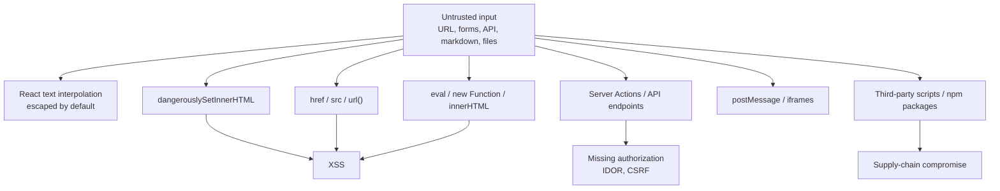
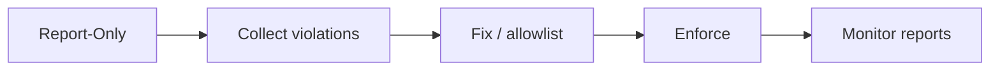
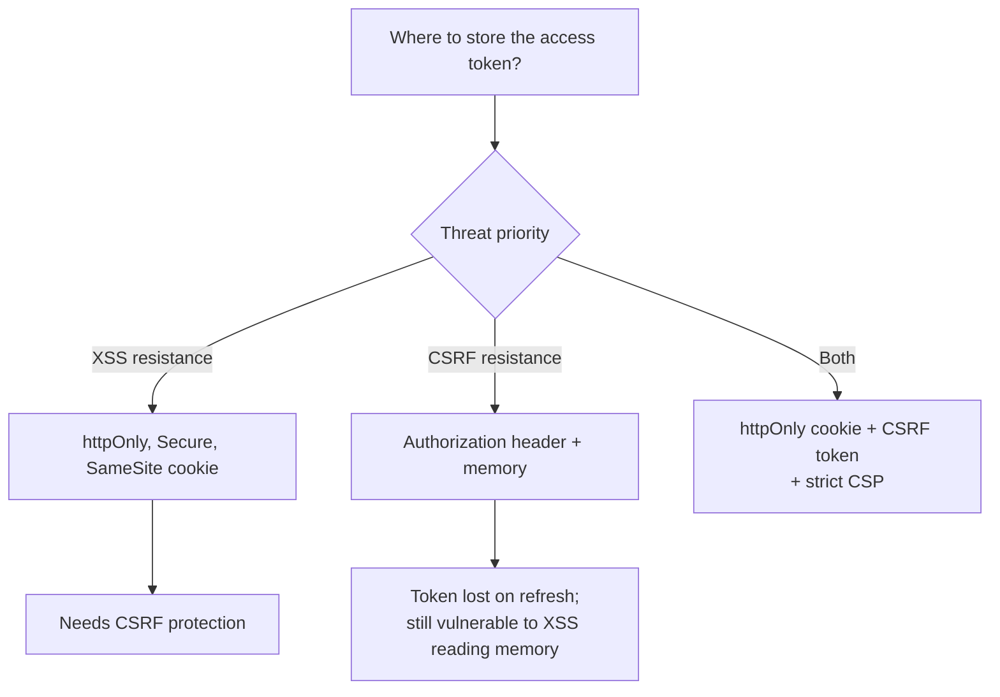
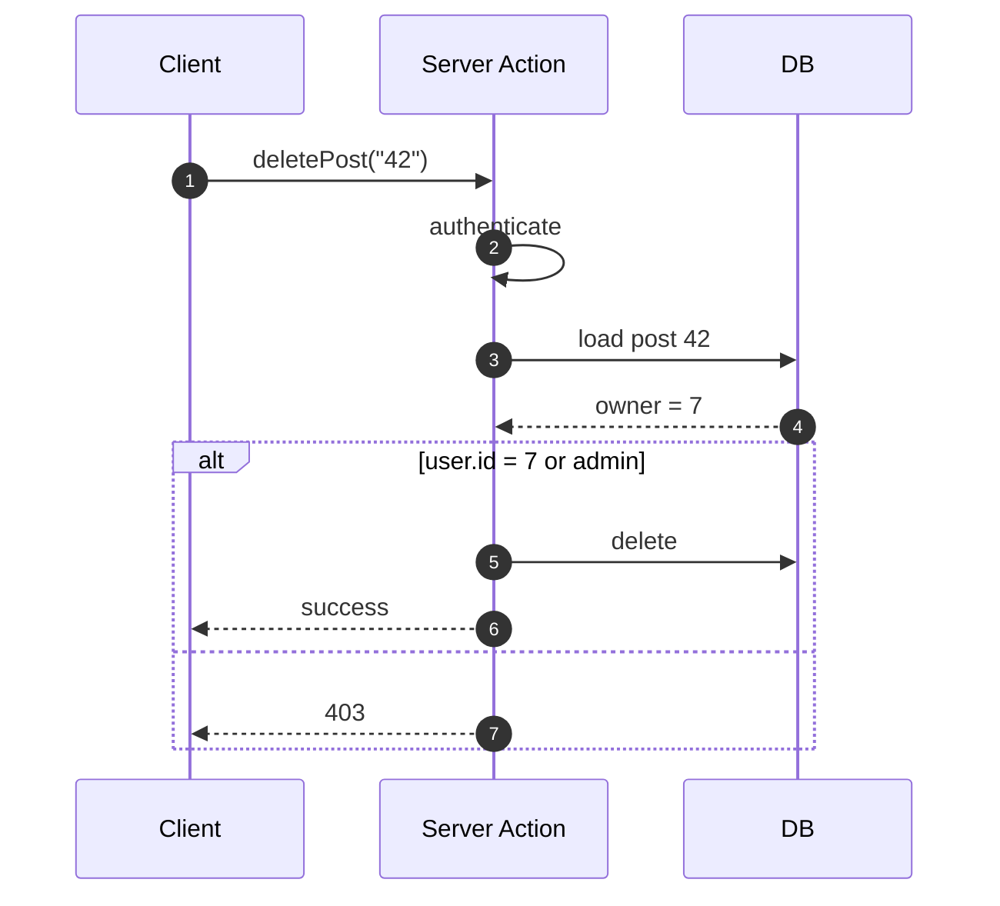
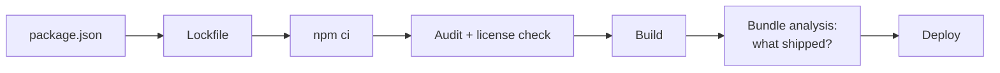

# 36. Security in React

> **Level:** Professional · **Prerequisites:** Chapters 25, 26, 37 · **Reading time:** ~45 min

React protects you from the most common XSS vector by escaping interpolated values. It does **not** protect you
from dangerous sinks, unsafe URLs, leaked secrets, stolen tokens, malicious dependencies or missing authorization.
Security is a property of the whole system, not the view library.

---

## 1. Attack surface



---

## 2. XSS: what React does and does not protect

```jsx
// ✅ Escaped automatically
<p>{userBio}</p>

// ❌ Raw HTML injection
<div dangerouslySetInnerHTML={{ __html: userBio }} />
```

If you must render HTML (markdown, CMS content, email previews), **sanitize it first**:

```jsx
import DOMPurify from "dompurify";

function ArticleBody({ html }) {
  const clean = useMemo(
    () => DOMPurify.sanitize(html, { USE_PROFILES: { html: true } }),
    [html]
  );

  return <div className="article" dangerouslySetInnerHTML={{ __html: clean }} />;
}
```

Defense in depth:

- Sanitize on the **server** as well, where the HTML is stored.
- Use a strict allowlist of tags/attributes; strip `style`, `on*`, `iframe` unless required.
- Consider Trusted Types (`require-trusted-types-for 'script'`) to make DOM sinks fail loudly.
- Never combine `dangerouslySetInnerHTML` with unsanitized user input, even "trusted" admin input.

### URL injection

```jsx
// ❌ javascript: URLs execute on click
<a href={user.website}>Website</a>
```

```js
const SAFE_PROTOCOLS = new Set(["http:", "https:", "mailto:"]);

export function safeHref(value) {
  try {
    const url = new URL(value, window.location.origin);
    return SAFE_PROTOCOLS.has(url.protocol) ? url.href : "#";
  } catch {
    return "#";
  }
}
```

The same applies to `src`, `srcSet`, CSS `url()` and `window.open`. Validate redirect targets against an allowlist
to prevent open redirects.

### Rendering user-provided Markdown

Markdown renderers can emit raw HTML. Configure them to disable HTML or pair them with a sanitizer. Never trust
the renderer's default.

---

## 3. Content Security Policy

CSP limits what an injected script can do, even if an XSS bug exists.

```
Content-Security-Policy:
  default-src 'self';
  script-src 'self' 'nonce-<random>' 'strict-dynamic';
  style-src 'self' 'unsafe-inline';
  img-src 'self' data: https:;
  connect-src 'self' https://api.example.com;
  object-src 'none';
  base-uri 'self';
  frame-ancestors 'none';
  form-action 'self';
```

Rollout:



- Start in `Content-Security-Policy-Report-Only`.
- Avoid `'unsafe-inline'` for scripts; use nonces or hashes.
- Vite/webpack emit external scripts, which makes strict CSP easier than inline bootstrapping.
- `frame-ancestors 'none'` prevents clickjacking.

---

## 4. Authentication and tokens



| Storage | XSS | CSRF | Persistence | Notes |
|---------|-----|------|-------------|-------|
| `localStorage` | Readable by any script | Not sent automatically | Yes | Convenient, weakest against XSS |
| `sessionStorage` | Readable | No | Tab only | Same XSS exposure |
| Memory | Not persisted | No | Lost on refresh | Best XSS posture, needs silent refresh |
| httpOnly cookie | Not readable by JS | Yes, needs CSRF defense | Yes | Preferred with `SameSite` + CSRF token |

Practical guidance:

- **httpOnly, Secure, SameSite=Lax/Strict cookies** for session tokens.
- Short-lived access tokens + rotating refresh tokens.
- CSRF token (double-submit or synchronizer) for cookie-authenticated mutations.
- Never put tokens in URLs, logs or analytics.
- Log out server-side, invalidate refresh tokens, and rotate on privilege change.

---

## 5. Authorization, not just authentication

Hiding a button is UX, not security. Every server endpoint must verify **who** and **whether**.

```js
// Server Action — a public HTTP endpoint
"use server";

export async function deletePost(postId) {
  const user = await requireUser();
  const post = await db.post.findUnique({ where: { id: postId } });

  if (!post) throw new Error("Not found");
  if (post.authorId !== user.id && user.role !== "admin") {
    throw new Error("Forbidden");
  }

  await db.post.delete({ where: { id: postId } });
}
```



Additional rules:

- Validate and authorize **every** action, including ones only rendered for admins.
- Use object-level checks (IDOR): never rely on unguessable IDs.
- RSC and Server Actions run on the server but are callable by anyone who can reach the endpoint.
- Rate-limit mutations and login attempts.

---

## 6. Secrets and environment variables

```js
// ❌ Bundled into the client — visible to everyone
const key = import.meta.env.VITE_STRIPE_SECRET_KEY;
```

- `VITE_*` / `NEXT_PUBLIC_*` variables are **public**.
- Secrets belong on the server only.
- `.env` files are git-ignored; `.env.example` documents names without values.
- Scan commits for secrets (gitleaks, GitHub secret scanning).
- Rotate any secret that may have leaked; deleting the commit is not enough.
- Do not serialize secrets into SSR HTML, `window.__STATE__` or source maps.

---

## 7. Third-party code and supply chain



- Commit the lockfile and use `npm ci` in CI.
- Review dependency changes; a new transitive package is still code you ship.
- Enable Dependabot/Renovate with grouped, tested updates.
- Run `npm audit --omit=dev` and track exceptions explicitly.
- Consider `npm ci --ignore-scripts` for builds that do not need install scripts.
- Verify package provenance/signatures where the ecosystem supports it.
- Remove unused dependencies; they still ship risk.
- For CDN scripts, use Subresource Integrity (`integrity` + `crossorigin`).

Third-party widgets (chat, analytics, payments) should be loaded in sandboxed iframes when possible, with a CSP
that restricts them.

---

## 8. Browser integrations

```jsx
// New tab: prevent tabnabbing
<a href="https://example.com" target="_blank" rel="noopener noreferrer">
  External
</a>
```

```js
// postMessage: always verify origin and shape
window.addEventListener("message", event => {
  if (event.origin !== "https://trusted.example.com") return;
  const data = schema.safeParse(event.data);
  if (!data.success) return;
  handle(data.data);
});
```

- Do not use `eval`, `new Function`, or `setTimeout("string")`.
- Avoid `document.write`.
- Do not expose privileged APIs on `window`.
- If you embed untrusted content, use `sandbox` without `allow-scripts allow-same-origin` together.

---

## 9. SSR and hydration safety

- Serialize only non-sensitive state into the HTML.
- Escape `<` in JSON embedded in `<script>` tags to prevent breaking out of the tag.
- Do not interpolate user data into inline scripts.
- Treat URL query params as untrusted during SSR.
- Ensure server-rendered HTML and client render agree; mismatches can mask injection or cause unsafe fallbacks.

---

## 10. Logging and privacy

- Scrub tokens, passwords, emails and card data before sending to Sentry/analytics.
- Never log full request bodies.
- Avoid putting PII in URLs (they leak via Referer and history).
- Set `Referrer-Policy: strict-origin-when-cross-origin`.
- Honor data-retention and deletion requirements.

---

## 11. Anti-patterns

| Anti-pattern | Risk | Fix |
|--------------|------|-----|
| `dangerouslySetInnerHTML` with user data | XSS | Sanitize or avoid |
| `href={userInput}` | `javascript:` execution | Protocol allowlist |
| Tokens in `localStorage` | XSS token theft | httpOnly cookies |
| Hiding admin UI only | Privilege escalation | Server-side authorization |
| Secrets in `VITE_*` | Public leak | Server-side env only |
| `rel="noopener"` missing | Tabnabbing | Add it |
| Wildcard CSP | No protection | Strict policy + nonce |
| Unpinned dependencies | Supply-chain drift | Lockfile + review |
| `postMessage` without origin check | Cross-origin data injection | Verify origin/schema |
| Logging full errors with PII | Privacy breach | Scrub + structured logs |

---

## 12. Checklist

- [ ] No unsanitized HTML rendering.
- [ ] All URL sinks validate protocols.
- [ ] CSP is enforced with reports monitored.
- [ ] Tokens use httpOnly cookies with CSRF protection (or a documented alternative).
- [ ] Every server action authenticates and authorizes.
- [ ] No secrets in client bundles or SSR state.
- [ ] Dependencies are locked, audited and reviewed.
- [ ] External links use `rel="noopener noreferrer"`.
- [ ] `postMessage` validates origin and payload.
- [ ] Error reporting scrubs PII.

---

## 13. Exercises

1. Find every `dangerouslySetInnerHTML` in a codebase and classify whether the input is trusted.
2. Bypass a hidden admin button by calling the API directly. What is missing on the server?
3. Write a CSP for a Vite app in report-only mode, collect violations for a day, then enforce.
4. Add `safeHref` to all user-provided links and test `javascript:` and `data:` payloads.
5. Run `npm audit` and evaluate one finding: reachable? exploitable? fix or document.

---

## 14. Interview focus

| Question | Where it is answered |
|----------|----------------------|
| How do you prevent XSS in React? | Sections 2–3 |
| Where do you store auth tokens? | Section 4 |
| How do you secure a Server Action? | Section 5 |
| How do you handle secrets in a frontend app? | Section 6 |

*(These topics extend the classic question bank — see the security section in
[Chapter 44](44.%20React%20Interview%20Questions.md).)*

**Follow-up traps**

- *"React escapes everything, right?"* — Only text interpolation. `dangerouslySetInnerHTML`, URLs, `eval` and
  third-party scripts bypass it.
- *"Is `localStorage` safe for JWTs?"* — Any XSS can read it. httpOnly cookies reduce token theft but require CSRF
  defense.
- *"Do Server Components remove the need for authorization?"* — No; the endpoints are still reachable.

---

**Next:** [37. SSR, SSG, RSC and Hydration](37.%20SSR%2C%20SSG%2C%20RSC%20and%20Hydration.md)
