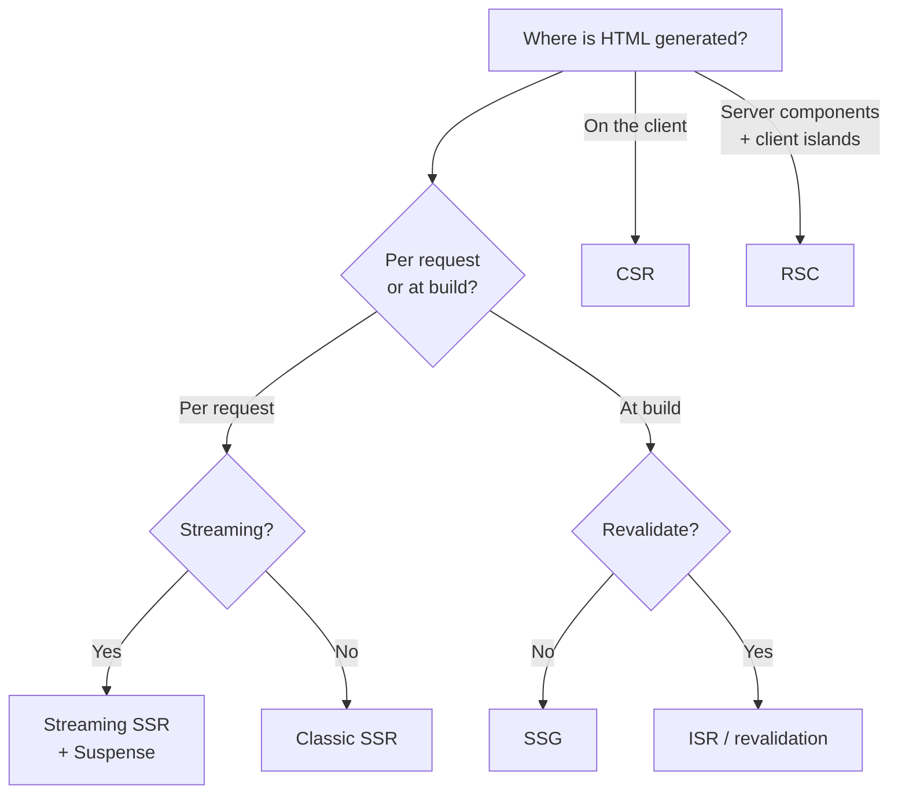
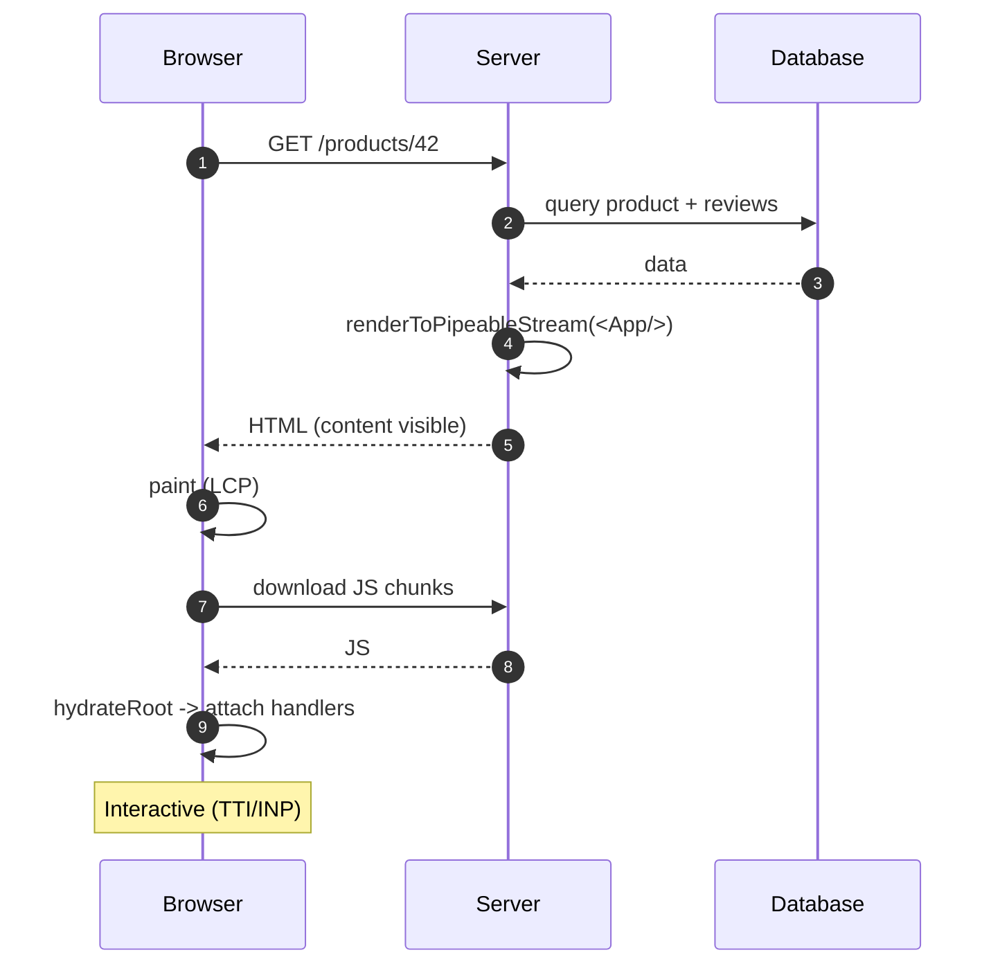
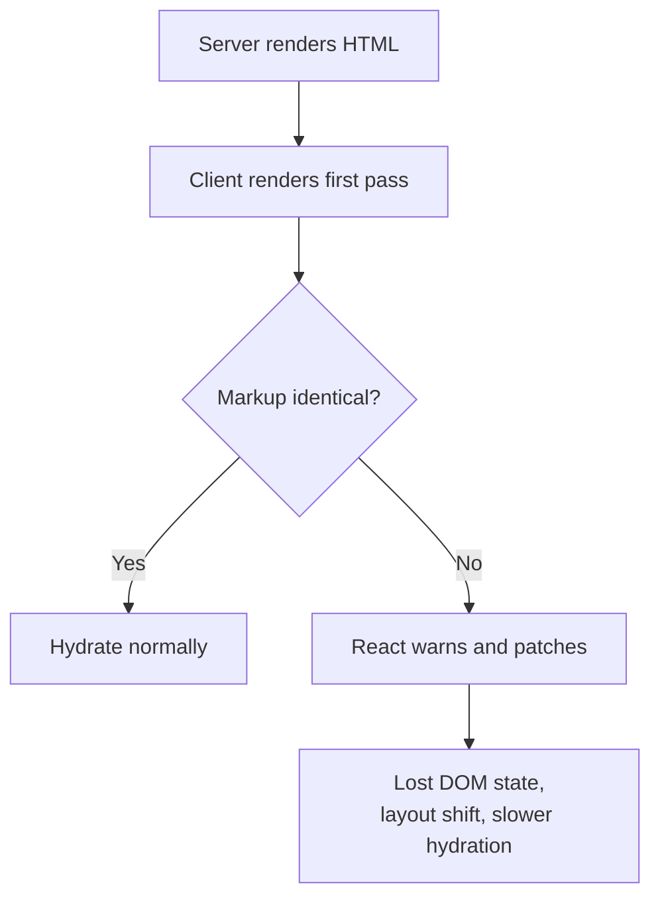
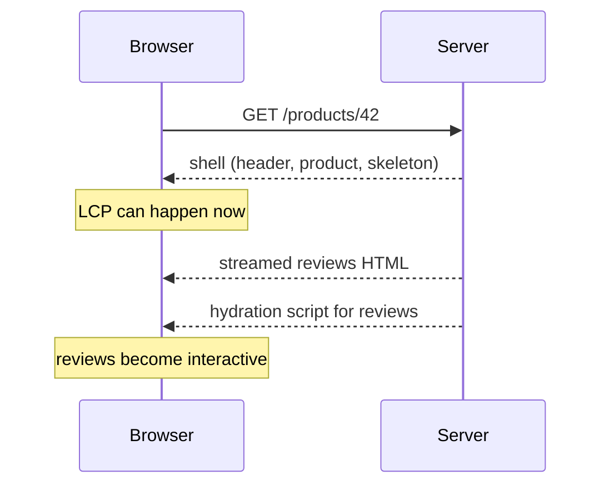
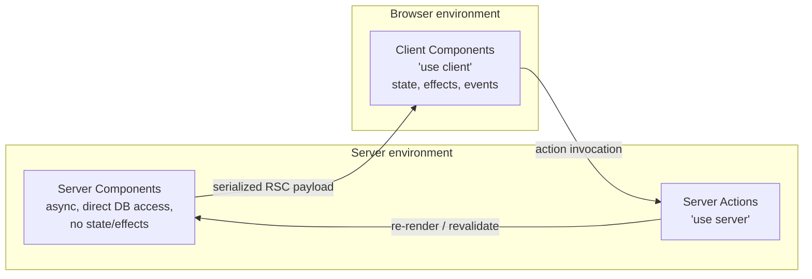
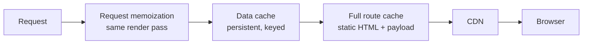
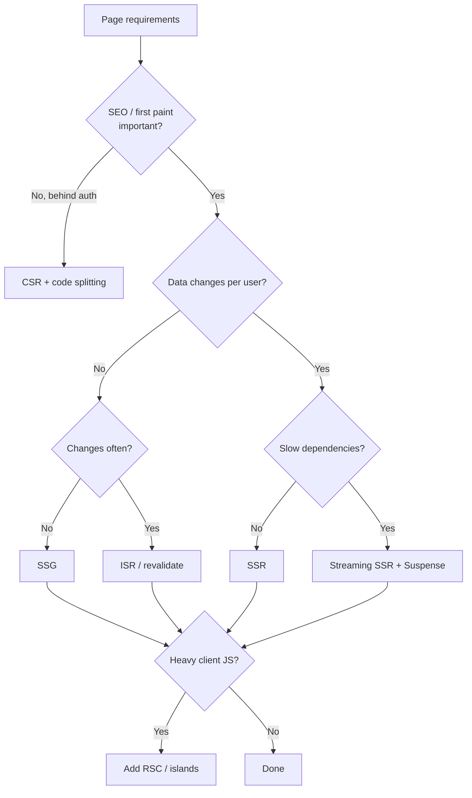

# 37. SSR, SSG, RSC and Hydration

> **Level:** Expert · **Prerequisites:** Chapters 25, 31, 36 · **Reading time:** ~55 min

Rendering strategy determines **where HTML is produced**, **when data is fetched**, and **how much JavaScript the
client must run**. Most performance and SEO problems are strategy problems before they are code problems.

---

## 1. The strategies



| Strategy | HTML ready | Data freshness | JS shipped | Best for |
|----------|------------|----------------|------------|----------|
| CSR | After JS loads | Client-controlled | Full app | Dashboards behind auth |
| SSR | Per request | Fresh | Full app + hydration | Personalized, SEO-sensitive pages |
| SSG | At build | Static until rebuild | Full app + hydration | Marketing, docs, blogs |
| ISR | Build + revalidate | Near-static | Full app + hydration | Catalogs, content sites |
| Streaming SSR | Shell early, chunks later | Fresh | Full app + hydration | Slow/personalized data |
| RSC | Server-rendered payload | Fresh/static | Only client components | Modern frameworks |

---

## 2. Request flow: SSR + hydration



Two important distinctions:

- **Rendering** produces HTML; **hydration** attaches React to existing DOM.
- The page can be visible but not interactive. Users click before hydration and nothing happens — this is why
  hydration cost matters.

---

## 3. Server rendering APIs

```js
// server.js
import { renderToPipeableStream } from "react-dom/server";
import { Transform } from "node:stream";

export function renderApp(req, res, App) {
  const { pipe, abort } = renderToPipeableStream(<App url={req.url} />, {
    bootstrapScripts: ["/assets/main.js"],
    onShellReady() {
      res.statusCode = 200;
      res.setHeader("Content-Type", "text/html");
      res.write("<!doctype html><html><body><div id=\"root\">");
      pipe(res);
    },
    onShellError(error) {
      res.statusCode = 500;
      res.end("<!doctype html><p>Something went wrong</p>");
    },
    onError(error) {
      console.error(error); // log, do not leak details to the client
    },
  });

  setTimeout(() => abort(), 10_000);
}
```

```jsx
// client entry
import { hydrateRoot } from "react-dom/client";

hydrateRoot(document.getElementById("root"), <App />);
```

| API | Use |
|-----|-----|
| `renderToPipeableStream` | Node streaming SSR |
| `renderToReadableStream` | Edge/Web streams |
| `renderToString` | Legacy, no streaming, blocks |
| `renderToStaticMarkup` | Static HTML without hydration |
| `hydrateRoot` | Attach React to server HTML |

---

## 4. Hydration mismatches

A mismatch happens when the server HTML differs from the client's first render.



Common causes:

| Cause | Example | Fix |
|-------|---------|-----|
| Time/randomness in render | `new Date()`, `Math.random()` | Move to effect, pass from server |
| Browser-only APIs | `window.innerWidth` during render | `useSyncExternalStore` with server snapshot |
| Invalid HTML nesting | `<div>` inside `<p>` | Fix markup |
| Different data | Server fetched English, client refetches | Share the same data source/hydration cache |
| Locale/timezone | Server in UTC, client in local time | Format with explicit time zone on both |
| Browser extensions | Injected DOM | Not your bug; ignore |
| `typeof window` branches | Different trees | Render the same tree; defer client-only UI |

```jsx
// ❌ Mismatch
function Clock() {
  return <time>{new Date().toLocaleTimeString()}</time>;
}

// ✅ Render a stable value first, update after mount
function Clock() {
  const [now, setNow] = useState(null);
  useEffect(() => {
    setNow(new Date());
    const id = setInterval(() => setNow(new Date()), 1000);
    return () => clearInterval(id);
  }, []);

  return <time>{now ? now.toLocaleTimeString() : "--:--:--"}</time>;
}
```

`suppressHydrationWarning` is a last resort for genuinely unstable leaf text (e.g., a timestamp), and it only
suppresses the warning — it does not fix the mismatch.

---

## 5. Streaming

```jsx
<Suspense fallback={<ReviewsSkeleton />}>
  <Reviews productId={id} />
</Suspense>
```



Benefits:

- The shell arrives immediately; slow data does not block the page.
- Suspense boundaries become stream boundaries.
- The browser parses and paints progressively.

Requirements:

- Place boundaries around slow, non-critical sections.
- Ensure fallbacks match layout to avoid CLS.
- Do not stream data that must be above the fold and blocking.
- Handle failures per boundary (error boundaries).

---

## 6. React Server Components



```jsx
// app/products/[id]/page.jsx — Server Component by default
import { db } from "@/lib/db";
import { AddToCart } from "@/features/cart/AddToCart";

export default async function ProductPage({ params }) {
  const product = await db.product.findUnique({ where: { id: params.id } });
  if (!product) notFound();

  return (
    <article>
      <h1>{product.name}</h1>
      <p>{product.description}</p>
      <AddToCart productId={product.id} price={product.price} />
    </article>
  );
}
```

```jsx
// features/cart/AddToCart.jsx
"use client";

import { useOptimistic } from "react";

export function AddToCart({ productId, price }) {
  // interactive: hooks, events, browser APIs
}
```

Rules:

- Server Components **cannot** use `useState`, `useEffect`, event handlers or browser APIs.
- Server Components **can** be `async` and query the database directly.
- Client Components cannot import Server Components. A Server Component can pass a rendered Server Component as
  `children`/props to a Client Component.
- Props crossing the boundary must be **serializable**. Functions are not, except Server Actions.
- Use `import "server-only"` in modules that must never reach the client.

### Composition across the boundary

```jsx
// Server Component
<ClientTabs
  tabs={[
    { id: "details", label: "Details", content: <ProductDetails product={product} /> },
    { id: "reviews", label: "Reviews", content: <Reviews productId={product.id} /> },
  ]}
/>
```

The client component owns the interaction; the server components provide pre-rendered content. This is the
"server component as children" pattern.

### When RSC pays off

- Large data-driven pages with little interactivity.
- Reducing client JS (dependencies no longer ship).
- Avoiding API round trips for initial data.

When it does not: highly interactive editors, offline-first apps, or pages where every element needs client state.

---

## 7. Frameworks and caching

| Framework | Model |
|-----------|-------|
| Next.js App Router | RSC + Server Actions + route caching |
| React Router 7 | Data routers, SSR, loaders/actions |
| TanStack Start | SSR + server functions + query integration |
| Remix (v2) | Loaders/actions, nested routes (merged into React Router 7) |

Caching layers in an RSC framework:



Understand which layer serves your data before debugging "stale" content.

---

## 8. Choosing a strategy



---

## 9. Anti-patterns

| Anti-pattern | Problem | Fix |
|--------------|---------|-----|
| Browser APIs during SSR render | Crash or mismatch | Effects / server snapshot |
| `new Date()` in render | Mismatch, stale HTML | Pass from server / effect |
| Hydration "fixed" with `useEffect` state flip | Flash, extra render | Render deterministic markup |
| Fetching twice (server + client) | Waste, mismatch | Hydrate the cache |
| Whole app as one Suspense boundary | Late shell | Granular boundaries |
| Client component at the root | Loses RSC benefit | Keep boundaries low |
| Non-serializable props across RSC | Runtime error | Pass IDs/actions |
| Secrets in SSR state | Leak | Server-only data access |
| `renderToString` for large pages | Blocks, no streaming | `renderToPipeableStream` |
| Ignoring hydration warnings | Subtle bugs, lost state | Treat warnings as errors |

---

## 10. Checklist

- [ ] The rendering strategy is chosen per route, not per app.
- [ ] The shell renders without waiting for slow data.
- [ ] Hydration is deterministic (no time/random/browser reads in render).
- [ ] Suspense fallbacks match layout.
- [ ] Server-only modules are guarded with `server-only`.
- [ ] Props crossing the RSC boundary are serializable.
- [ ] Caching layers and invalidation are understood.
- [ ] SSR errors are logged without leaking stack traces.

---

## 11. Exercises

1. Convert a CSR product page to SSR and measure LCP.
2. Add streaming to a slow reviews section and observe the network waterfall.
3. Create three hydration mismatches deliberately, then fix each correctly.
4. Move one heavy client component behind `'use client'` at the leaf and measure the JS reduction.
5. Add `import "server-only"` to a data module and try to import it from a client component.

---

## 12. Interview focus

| Question | Where it is answered |
|----------|----------------------|
| What is SSR? (#119) | Sections 1–3 |
| What is hydration? (#120) | Section 4 |
| What is Next.js and how does it relate to React? (#121) | Section 7 |
| Suspense for data fetching (#115) | Section 5 |
| React Server Components | Section 6 |

**Follow-up traps**

- *"Does SSR make the app faster?"* — It improves first contentful paint and SEO; total JS and hydration cost can
  still make it slower to become interactive.
- *"Why hydrate at all?"* — To attach event handlers and state to server HTML without re-creating the DOM.
- *"Can a client component render a server component?"* — Not by importing it; pass it as `children`/props from a
  server parent.

---

**Next:** [38. React 19: Actions, use and the Compiler](38.%20React%2019%20-%20Actions%2C%20use%20and%20the%20Compiler.md)
