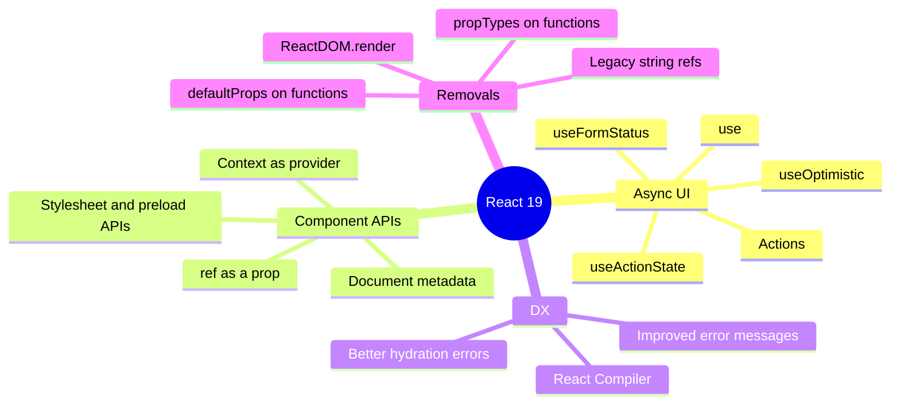
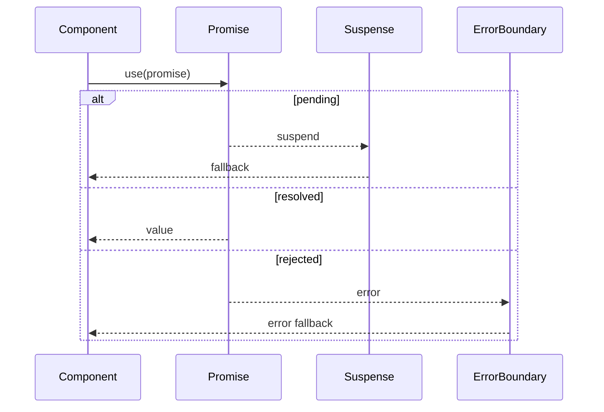
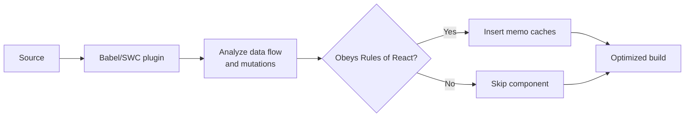
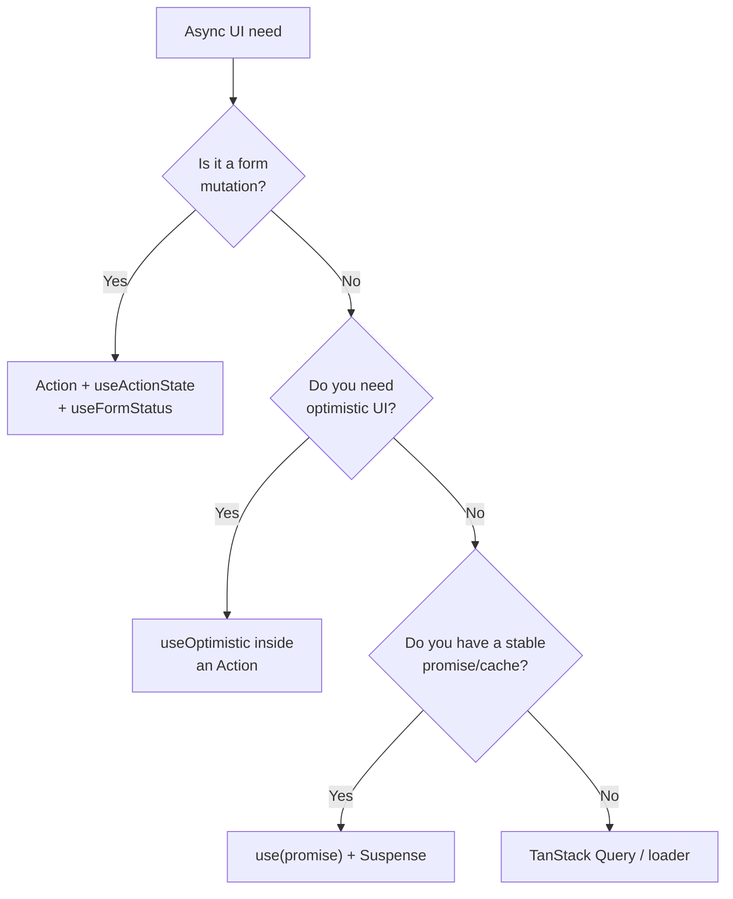

# 38. React 19: Actions, use and the Compiler

> **Level:** Expert · **Prerequisites:** Chapters 15, 27, 37 · **Reading time:** ~50 min

React 19 is the largest API surface change since hooks. It makes **async UI** a first-class primitive (Actions),
adds a promise-aware hook (`use`), cleans up refs and context, and ships the **React Compiler** for automatic
memoization. This chapter covers what changed and how to use it without creating new anti-patterns.

---

## 1. The React 19 map



---

## 2. Actions

An **Action** is an async function used in a transition. Actions handle pending state, errors and optimistic
updates consistently.

```jsx
function UpdateName() {
  const [name, setName] = useState("");
  const [error, submitAction, isPending] = useActionState(
    async (previousState, formData) => {
      const newName = formData.get("name");
      const error = await updateName(newName);
      if (error) return error;
      return null;
    },
    null
  );

  return (
    <form action={submitAction}>
      <input name="name" value={name} onChange={e => setName(e.target.value)} />
      <button type="submit" disabled={isPending}>
        {isPending ? "Saving…" : "Save"}
      </button>
      {error && <p role="alert">{error}</p>}
    </form>
  );
}
```



```mermaid
sequenceDiagram
    autonumber
    participant U as User
    participant F as <form action>
    participant A as Action
    participant S as Server

    U->>F: submit
    F->>A: FormData
    A->>A: enter transition (pending)
    A->>S: mutation
    alt success
        S-->>A: ok
        A-->>F: new state
    else failure
        S-->>A: error
        A-->>F: error state
    end
    Note over A: pending ends,<br/>React re-renders
```

Benefits over hand-rolled submit handlers:

- Pending state for free (`isPending`).
- Errors returned as state instead of thrown into the void.
- Works with `<form action>` and progressive enhancement.
- Composes with `useOptimistic`.

### `useActionState`

```js
const [state, formAction, isPending] = useActionState(action, initialState, permalink?);
```

- `action(previousState, formData)` — returns the next state.
- `permalink` — for progressive enhancement on pages that can be submitted before hydration.

### `useFormStatus`

```jsx
import { useFormStatus } from "react-dom";

function SubmitButton() {
  const { pending } = useFormStatus();
  return (
    <button type="submit" disabled={pending}>
      {pending ? "Saving…" : "Save"}
    </button>
  );
}

<form action={action}>
  <SubmitButton />
</form>
```

`useFormStatus` reads the status of the **nearest parent form**. It must be rendered inside that form — placing it
in the same component as `<form>` returns `pending: false` forever.

### `useOptimistic`

```jsx
import { useOptimistic } from "react";

function Thread({ messages, sendMessage }) {
  const [optimisticMessages, addOptimisticMessage] = useOptimistic(
    messages,
    (state, newMessage) => [...state, { text: newMessage, sending: true }]
  );

  async function formAction(formData) {
    const text = formData.get("message");
    addOptimisticMessage(text);
    await sendMessage(text);
  }

  return (
    <>
      {optimisticMessages.map((message, index) => (
        <p key={index} style={{ opacity: message.sending ? 0.5 : 1 }}>
          {message.text}
        </p>
      ))}
      <form action={formAction}>
        <input name="message" required />
        <button type="submit">Send</button>
      </form>
    </>
  );
}
```

Rules:

- The optimistic update must be inside an Action/transition.
- The optimistic value is discarded when the action finishes and real state arrives.
- Use it for **fast, likely-to-succeed** operations; otherwise show a pending state.

---

## 3. `use`: promises and context

```jsx
import { use, Suspense } from "react";

function Comments({ commentsPromise }) {
  const comments = use(commentsPromise);
  return comments.map(comment => <Comment key={comment.id} comment={comment} />);
}

<Suspense fallback={<CommentsSkeleton />}>
  <Comments commentsPromise={loadComments(postId)} />
</Suspense>
```



Key differences from hooks:

- `use` **can** be called conditionally and in loops.
- `use` is not a hook; it can read a promise or a context.
- The promise must be **stable**. Creating `fetch(...)` inside render suspends forever.
- A rejected promise is caught by the nearest **error boundary**.

```jsx
// ❌ New promise every render -> infinite suspension
const data = use(fetch(url));

// ✅ Promise created outside render or cached
const data = use(cachedFetch(url));
```

`use(Context)` allows conditional context reads:

```jsx
function Panel({ showTheme }) {
  if (showTheme) {
    const theme = use(ThemeContext);
    return <div className={theme}>...</div>;
  }
  return <div>...</div>;
}
```

---

## 4. Cleaner component APIs

### `ref` as a prop

```jsx
function Input({ ref, ...props }) {
  return <input ref={ref} {...props} />;
}
```

No `forwardRef` needed. `forwardRef` still works in React 19 but is deprecated for new code.

### Context as provider

```jsx
<ThemeContext value={theme}>
  <App />
</ThemeContext>
```

`<ThemeContext.Provider>` remains supported.

### Document metadata

```jsx
function BlogPost({ post }) {
  return (
    <article>
      <title>{post.title}</title>
      <meta name="description" content={post.excerpt} />
      <h1>{post.title}</h1>
      ...
    </article>
  );
}
```

React hoists `<title>`, `<meta>` and `<link>` to `<head>` — no `react-helmet` required in supported setups.

### Resource preloading

```js
import { preload, preinit, prefetchDNS, preconnect } from "react-dom";

preconnect("https://api.example.com");
prefetchDNS("https://cdn.example.com");
preload("/fonts/inter.woff2", { as: "font", type: "font/woff2", crossOrigin: "anonymous" });
preinit("/analytics.js", { as: "script" });
```

These integrate with Suspense so resources load in the right order instead of racing.

---

## 5. React Compiler

The compiler analyzes components and inserts memoization automatically.



```js
// vite.config.js
import react from "@vitejs/plugin-react";

export default defineConfig({
  plugins: [
    react({
      babel: {
        plugins: [["babel-plugin-react-compiler", {}]],
      },
    }),
  ],
});
```

What it optimizes:

- Recomputing derived values.
- Re-creating JSX elements.
- Stable callbacks passed to memoized children.
- Expensive subtrees that did not change.

What it requires:

- **Rules of React**: pure render, no mutation of props/state, hooks at the top level.
- Correct dependency arrays (the compiler does not fix a wrong effect).
- Compatible tooling (Babel/SWC plugin, ESLint plugin for diagnostics).

What it does not fix:

- State placed too high.
- Non-virtualized lists.
- Slow network or huge bundles.
- Context that re-renders everything.
- Unstable keys.

Adoption strategy:

1. Enable the ESLint plugin and fix violations.
2. Turn on the compiler for a small area (`"use memo"` directive or config include).
3. Profile before/after on production builds.
4. Remove hand-written memoization only where the profiler shows no regression.

```jsx
// Opt a file or function into the compiler
"use memo";

export function ExpensiveChart({ data }) {
  ...
}
```

---

## 6. Removals and migration notes

| Removed / deprecated | Replacement |
|----------------------|-------------|
| `ReactDOM.render` | `createRoot().render` |
| `ReactDOM.hydrate` | `hydrateRoot` |
| `unmountComponentAtNode` | `root.unmount()` |
| String refs (`ref="input"`) | Callback/object refs |
| `propTypes` on function components | TypeScript |
| `defaultProps` on function components | Default parameters |
| Legacy context (`contextTypes`) | `createContext` |
| `forwardRef` (deprecated) | `ref` prop |
| `react-test-renderer` (deprecated) | RTL |

Also in 19.x:

- `<Activity mode="hidden|visible">` preserves state while hiding UI and pausing effects.
- `useEffectEvent` extracts non-reactive logic from effects.
- `useDeferredValue` accepts an initial value.
- Improved hydration diff messages point at the exact mismatch.

---

## 7. Choosing between async patterns



| Pattern | Use for | Avoid when |
|---------|---------|------------|
| `useActionState` | Form submissions with result state | Non-form async reads |
| `useFormStatus` | Submit button/pending UI inside a form | Outside the form tree |
| `useOptimistic` | Immediate feedback for likely-success mutations | Failures are common |
| `use(promise)` | Reading a cached promise in render | Promise is created in render |
| Query library | Client cache, refetch, pagination | Simple one-shot server render |
| Router loader | Data before route render | Highly interactive client cache |

---

## 8. Anti-patterns

| Anti-pattern | Problem | Fix |
|--------------|---------|-----|
| Promise created in render with `use` | Infinite suspension | Cache/hoist the promise |
| `useFormStatus` outside the form | Always `pending: false` | Render inside `<form>` |
| Optimistic update outside an Action | React warns/ignores | Call within action/transition |
| Assuming the compiler fixes architecture | Same re-render causes remain | Fix state placement and lists |
| Ignoring compiler ESLint violations | Components silently skipped | Fix rules violations |
| Mixing `useEffect` fetching with Actions | Two sources of truth | Pick one data layer |
| Using Actions for every read | Unnecessary transitions | Use query/loader/`use` |

---

## 9. Checklist

- [ ] Forms use Actions or a form library consistently.
- [ ] Pending states come from `useActionState`/`useFormStatus`, not duplicated booleans.
- [ ] Optimistic updates are inside Actions and have rollback semantics.
- [ ] `use(promise)` receives a stable, cached promise.
- [ ] `ref` is a normal prop in new components.
- [ ] Metadata is rendered in components instead of a helmet library.
- [ ] The compiler is adopted incrementally with profiling.
- [ ] Legacy APIs are migrated before upgrading.

---

## 10. Exercises

1. Rewrite a `useState`-based submit form with `useActionState` and `useFormStatus`.
2. Add an optimistic comment to a list, then simulate a server failure and observe the rollback.
3. Read a cached promise with `use` inside Suspense and an error boundary.
4. Enable the React Compiler on one feature and compare profiler commits.
5. Replace `forwardRef` in a component library with `ref` props.

---

## 11. Interview focus

| Question | Where it is answered |
|----------|----------------------|
| What are Actions? | Sections 2, 7 |
| `useActionState` vs manual submit | Section 2 |
| `use` vs hooks | Section 3 |
| What does the React Compiler do? | Section 5 |
| What changed in React 19? | Sections 1–6 |

**Follow-up traps**

- *"Does the compiler replace `useMemo`?"* — Mostly, but only for code that follows the Rules of React, and it
  does not fix architectural re-renders.
- *"Can `use` be called conditionally?"* — Yes, unlike hooks.
- *"Do Actions require a server?"* — No; client actions are async functions too. Server Actions additionally
  require a server environment/framework.

---

**Next:** [39. React Internals: Fiber and the Hooks Runtime](39.%20React%20Internals%20-%20Fiber%20and%20the%20Hooks%20Runtime.md)
