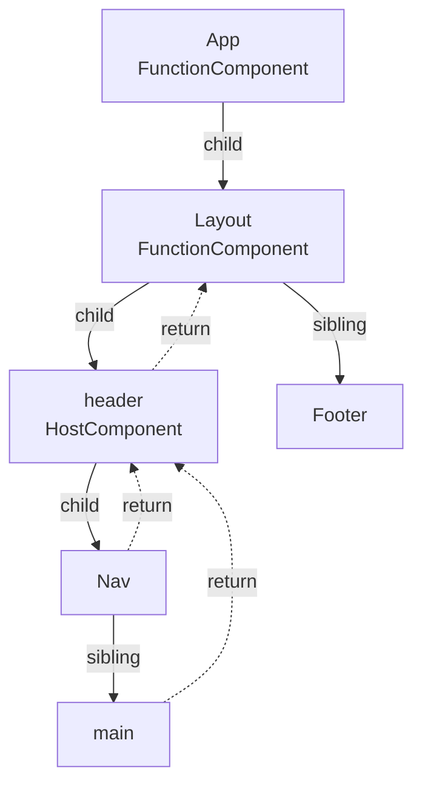
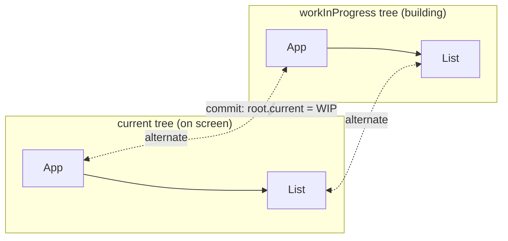
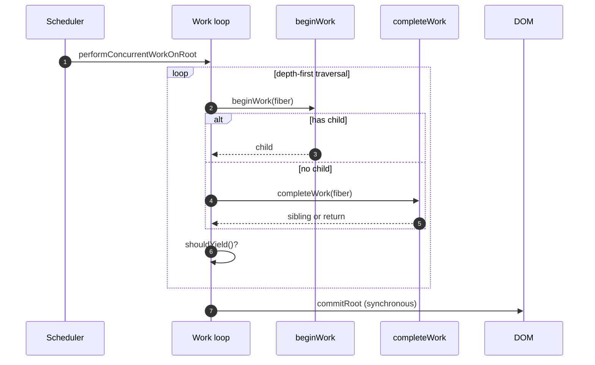
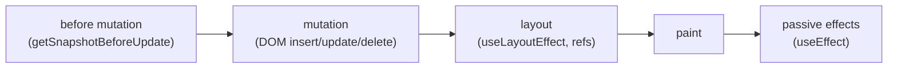
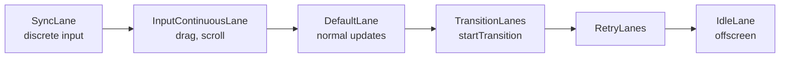
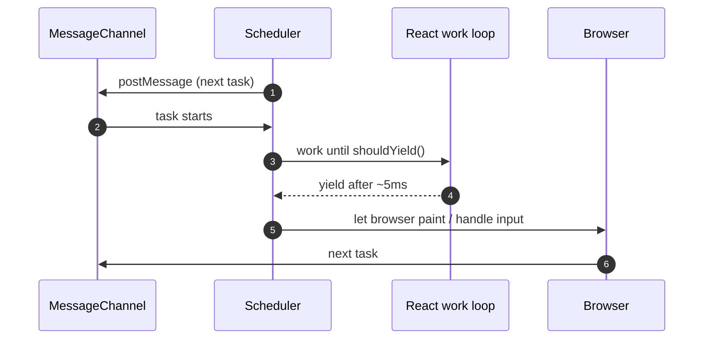
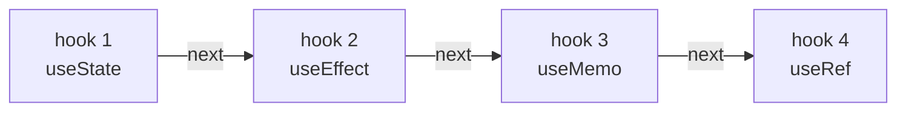
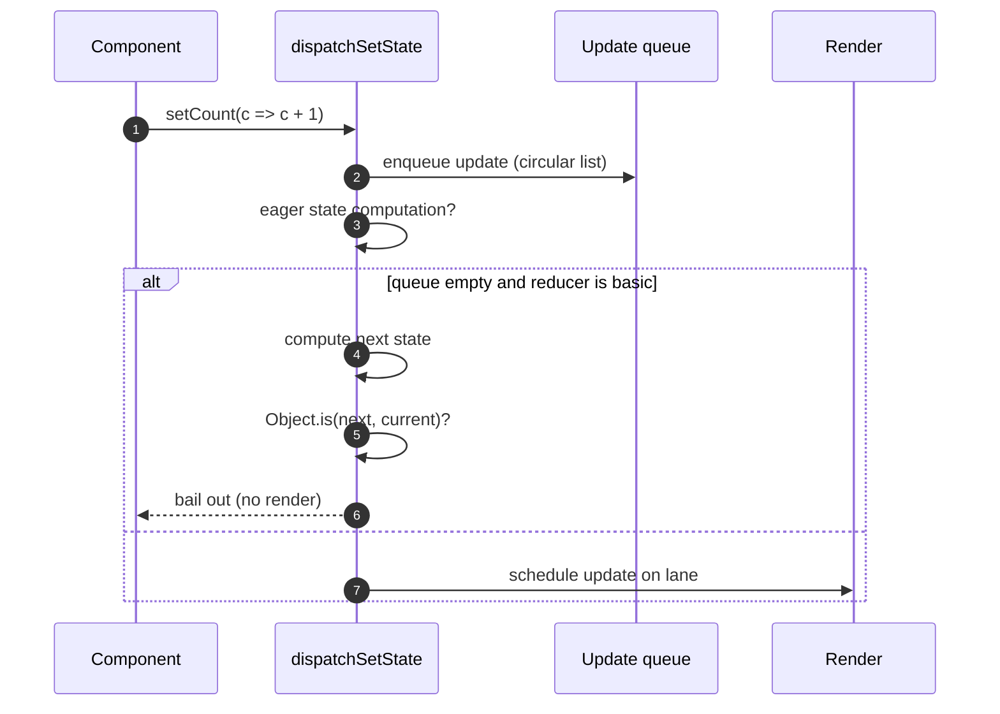
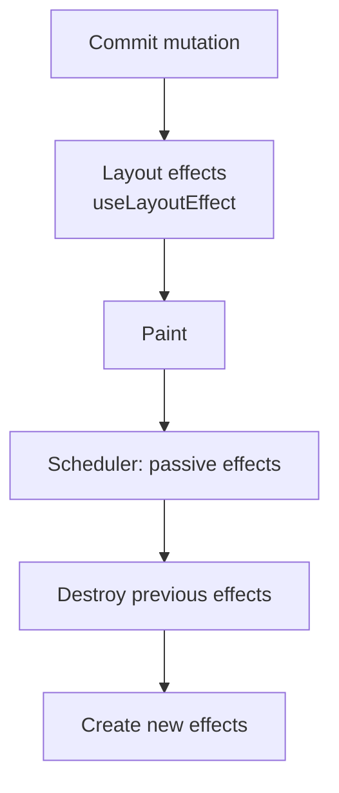
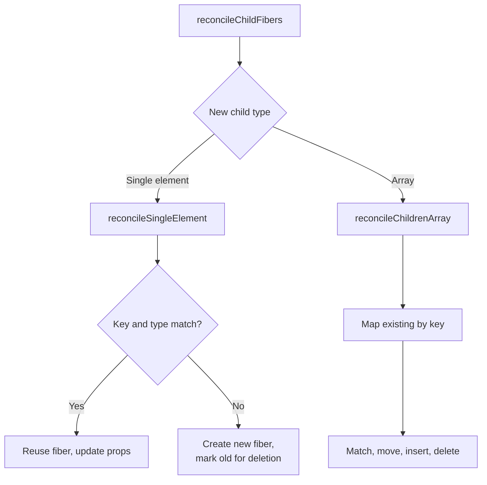

# 39. React Internals: Fiber and the Hooks Runtime

> **Level:** Expert · **Prerequisites:** Chapters 13, 18, 23, 30 · **Reading time:** ~60 min

You do not need internals to build React apps. You do need them to explain **why** batching, ordering, bailouts,
StrictMode and hook rules behave the way they do — and to debug the rare bug that only makes sense one layer below
the API.

> Names below reflect React 18/19 internals. They are not public API and change between versions; the
> **architecture** is what matters.

---

## 1. Fiber: the unit of work

A fiber is a plain object representing a component, a DOM node or a boundary. The tree of fibers is React's
work-in-progress representation of the UI.



| Field | Purpose |
|-------|---------|
| `tag` | Kind of fiber (function, class, host, fragment, suspense…) |
| `type` | Component function/class or tag name |
| `key` | Reconciliation identity |
| `stateNode` | DOM node, class instance or root |
| `return` / `child` / `sibling` | Tree navigation (parent, first child, next sibling) |
| `pendingProps` / `memoizedProps` | Incoming vs last-rendered props |
| `memoizedState` | Hooks linked list (function components) |
| `updateQueue` | State/effect updates |
| `flags` | Side effects to apply in commit |
| `lanes` / `childLanes` | Pending priorities for this subtree |
| `alternate` | The other tree in double buffering |

---

## 2. Double buffering

React keeps two trees: the **current** tree (on screen) and a **work-in-progress** tree (being built). Each fiber
points to its counterpart via `alternate`.



Why: React can render a new tree while the old one remains visible, and can **throw away** the work-in-progress
tree if the render is interrupted — the definition of concurrent rendering.

---

## 3. The work loop



- **Render phase** (`beginWork`/`completeWork`): calls components, reconciles children, computes flags. Can be
  paused, resumed or discarded. Must be pure.
- **Commit phase**: applies DOM mutations, runs layout effects, swaps `root.current`. Synchronous and not
  interruptible.

Commit sub-phases:



That ordering explains why `useLayoutEffect` can measure before paint and `useEffect` cannot.

---

## 4. Lanes: priority as a bitmask

Each update receives a lane. Lanes are bits in a 31-bit mask, so React can merge and compare priorities cheaply.



| Lane | Example |
|------|---------|
| Sync | Click, keypress, `flushSync` |
| InputContinuous | Pointer move, scroll |
| Default | `setState` from effects, promises |
| Transition | `startTransition`, `useDeferredValue` |
| Retry | Suspense retries |
| Idle | Offscreen/pre-render work |

Consequences:

- A sync update can preempt a transition render.
- `childLanes` lets React skip subtrees with no pending work — a key part of fast bailouts.
- Starvation is avoided by eventually promoting lower-priority lanes.

---

## 5. The scheduler



- React schedules work in ~5 ms slices via `MessageChannel`, yielding to the browser.
- `shouldYield()` checks elapsed time and higher-priority pending work.
- The scheduler is separate from React itself (`scheduler` package) and is also used for passive effects.

This is why long renders can be interrupted, but a single long component function still blocks — React cannot yield
inside your code.

---

## 6. Hooks are a linked list

Each function component fiber stores its hooks in `memoizedState` as a singly linked list, in call order.



```js
// Shape (simplified)
{
  memoizedState: value,     // state, effect object, memo value...
  baseState: value,         // state before pending updates
  baseQueue: update,        // skipped low-priority updates
  queue: { pending, dispatch, lastRenderedReducer, lastRenderedState },
  next: hook                // next hook in call order
}
```

On mount, React uses a **mount dispatcher**: `useState` creates a hook, appends it, returns `[state, dispatch]`.
On update, it uses an **update dispatcher** and walks the existing list.

This is the real reason for the Rules of Hooks: the list is indexed by **call order**, not by name. A conditional
hook shifts every subsequent hook and corrupts state.

```jsx
// ❌ Hook order changes between renders
if (isLoggedIn) {
  const [user, setUser] = useState(null);
}
const [theme, setTheme] = useState("light");
```

---

## 7. `useState` under the hood



- `basicStateReducer` handles both values and updater functions.
- **Eager bailout**: if no other updates are pending, React computes the next state immediately and skips the
  render when `Object.is` says it is unchanged.
- Even when a bailout happens, React may render the component once more before bailing out of children.
- Updates are stored in a **circular** queue; `dispatch` is stable across renders because it is bound to the queue,
  not to the current state.

---

## 8. Effects

`useEffect` pushes an effect object onto the fiber's update queue:

```js
{
  tag: HookHasEffect | HookPassive,
  create: () => { /* setup */ return cleanup },
  destroy: undefined,
  deps: [a, b],
  next: nextEffect,
}
```

During commit, React walks the effect list:



- Dependency comparison uses `Object.is` per element.
- If deps are `undefined`, the effect runs every commit.
- If deps are `[]`, it runs once (plus StrictMode dev replay).
- Cleanup runs before the next setup and on unmount.

---

## 9. Reconciliation internals



Bailout path:

1. `oldProps === newProps` and no pending update and no context change → `bailoutOnAlreadyFinishedWork`.
2. `React.memo` uses `shallowEqual` on props (or a custom comparator).
3. `childLanes` lets React skip an entire subtree with no pending work.

Context is different: `propagateContextChange` walks consumers and marks them, so **context updates bypass memo
bailouts** — consistent with the behavior described in Chapter 20.

---

## 10. What this explains

| Observation | Internal reason |
|-------------|-----------------|
| "Hooks can't be conditional" | Hooks are a call-order linked list |
| "State updates are batched" | Updates are queued and flushed per lane |
| "Rendering twice in StrictMode" | Dev-only double invoke to surface impure render |
| "`useLayoutEffect` avoids flicker" | It runs before paint in the commit phase |
| "`memo` doesn't stop context" | Context propagation marks consumers directly |
| "setState with same value may still render once" | Eager bailout can occur after a render |
| "A render can be thrown away" | Work-in-progress tree is discardable |
| "Long component blocks the app" | React cannot yield inside your function |

---

## 11. Anti-patterns

| Anti-pattern | Problem | Fix |
|--------------|---------|-----|
| Depending on internal field names | Breaks on upgrade | Use public APIs |
| Mutating fiber/state objects | Corruption, undefined behavior | Immutable updates |
| Reading `memoizedState` in app code | Fragile, unsupported | Hooks/DevTools |
| Assuming exact render counts | Implementation detail | Test behavior |
| Relying on `Object.is` bailout for correctness | Not guaranteed | Derive or guard explicitly |
| Fighting the scheduler with `flushSync` | Jank, priority inversion | Restructure updates |

---

## 12. Checklist

- [ ] I can explain render vs commit.
- [ ] I can explain why hooks are order-dependent.
- [ ] I know why `useLayoutEffect` runs before paint.
- [ ] I understand lanes at the level of "urgent preempts transition".
- [ ] I know memo does not stop context updates.
- [ ] I do not depend on internal field names in product code.

---

## 13. Exercises

1. Draw the fiber tree (child/sibling/return) for a small app.
2. Put a `console.log` in a component and in `useLayoutEffect`/`useEffect`; order the output relative to paint.
3. Reproduce the "conditional hook" error and explain the linked-list corruption.
4. Profile a transition and identify which renders were discarded.
5. Read the React source for `mountState`/`updateState` and summarize the update queue in five lines.

---

## 14. Interview focus

| Question | Where it is answered |
|----------|----------------------|
| What is reconciliation? (#111, #125) | Sections 3, 9 |
| What is Fiber? (#113) | Sections 1–3 |
| How is concurrent mode different? (#114) | Sections 2–5 |
| Class lifecycles (#123), mapping to hooks (#124) | Sections 3, 8 |

**Follow-up traps**

- *"Why can't hooks be conditional?"* — The runtime indexes hooks by call order; skipping one shifts the list.
- *"Where do hooks live?"* — On the fiber, in `memoizedState`, as a linked list.
- *"What makes concurrent rendering possible?"* — Double buffering plus interruptible work loops and lanes.

---

**Next:** [40. React Native and Cross-Platform](40.%20React%20Native%20and%20Cross-Platform.md)
