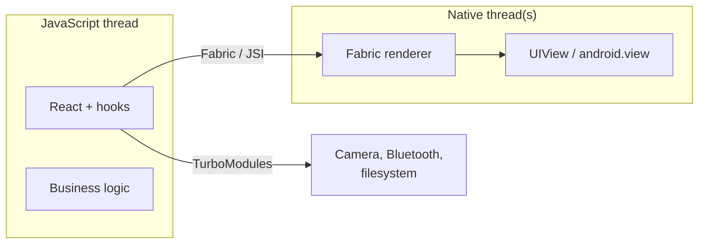
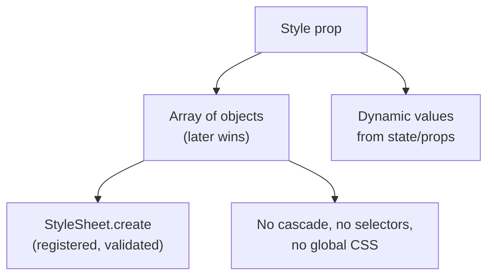
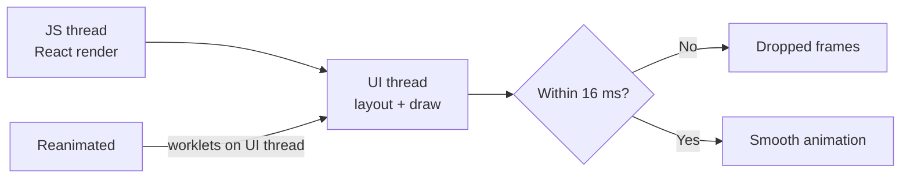
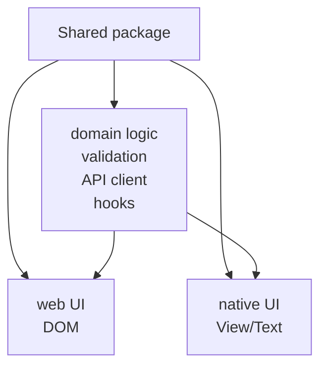

# 40. React Native and Cross-Platform

> **Level:** Expert · **Prerequisites:** Chapters 16, 17, 30 · **Reading time:** ~35 min

React Native runs React on iOS and Android, but it is not "React for the browser". There is no DOM, no CSS
cascade, and no `<div>`. Understanding the platform differences is what separates a working screen from a native
experience.

---

## 1. What is different



| Web | React Native |
|-----|--------------|
| DOM elements (`div`, `span`) | Native primitives (`View`, `Text`, `Image`) |
| CSS files, cascade, media queries | `StyleSheet` objects, no cascade |
| `display: flex` opt-in | Flexbox by default, `flexDirection: "column"` |
| `px` units | Unitless density-independent pixels |
| `onClick` | `onPress` (`Pressable`, `TouchableOpacity`) |
| `window`, `document` | Native APIs via modules |
| Browser devtools | React Native DevTools / Flipper / Hermes |
| `<a href>` | Navigation library |

There is no `text` node outside `<Text>`. Putting raw strings anywhere else crashes.

---

## 2. Core primitives

```jsx
import { View, Text, Image, Pressable, StyleSheet } from "react-native";

export function ProductCard({ product, onPress }) {
  return (
    <Pressable
      onPress={() => onPress(product.id)}
      accessibilityRole="button"
      accessibilityLabel={`${product.name}, ${product.price}`}
      style={({ pressed }) => [styles.card, pressed && styles.pressed]}
    >
      <Image source={{ uri: product.imageUrl }} style={styles.image} />
      <View style={styles.body}>
        <Text style={styles.title} numberOfLines={2}>{product.name}</Text>
        <Text style={styles.price}>{formatPrice(product.price)}</Text>
      </View>
    </Pressable>
  );
}

const styles = StyleSheet.create({
  card: { flexDirection: "row", padding: 12, borderRadius: 12, backgroundColor: "#fff" },
  pressed: { opacity: 0.85 },
  image: { width: 72, height: 72, borderRadius: 8 },
  body: { flex: 1, marginStart: 12, justifyContent: "center" },
  title: { fontSize: 16, fontWeight: "600" },
  price: { marginTop: 4, fontSize: 14, color: "#4f46e5" },
});
```

| Primitive | Use |
|-----------|-----|
| `View` | Layout container (equivalent of `div`) |
| `Text` | Any text; inherits only inside `Text` |
| `Image` | Local or remote images |
| `ScrollView` | Small scrollable content |
| `FlatList` | Long lists (virtualized) |
| `Pressable` | Touch interactions with pressed state |
| `TextInput` | Controlled/uncontrolled input |
| `Modal`, `SafeAreaView` | Overlays and device insets |

---

## 3. Layout and styling



- Flexbox is the only layout system; `flexDirection` defaults to `column`.
- `flex: 1` means "take remaining space", similar to CSS but with different defaults for `flexBasis`.
- Percentages are supported; `vh`/`vw` are not.
- Shadows differ per platform (`shadow*` on iOS, `elevation` on Android).
- Use `useWindowDimensions()` instead of a fixed width; support rotation.

```jsx
const { width } = useWindowDimensions();
const columns = width >= 768 ? 3 : 1;
```

---

## 4. Lists and performance

```jsx
<FlatList
  data={items}
  keyExtractor={item => item.id}
  renderItem={({ item }) => <Row item={item} />}
  getItemLayout={(_, index) => ({ length: 64, offset: 64 * index, index })}
  initialNumToRender={12}
  maxToRenderPerBatch={12}
  windowSize={7}
/>
```

- `FlatList` virtualizes; `ScrollView` renders everything.
- `getItemLayout` avoids measurement when rows have fixed height.
- Memoize row components; inline render functions are acceptable but stable item props matter more.
- Very large or complex lists: `FlashList` (Shopify) or `@shopify/flash-list`.
- Avoid anonymous styles created per render where possible; use `StyleSheet`.

Threads matter:



Heavy JS on the JS thread cannot block native scrolling (which runs on the UI thread), but it does delay JS-driven
gestures and state updates. Use Reanimated for gesture-heavy animation.

---

## 5. Navigation

```jsx
import { NavigationContainer } from "@react-navigation/native";
import { createNativeStackNavigator } from "@react-navigation/native-stack";

const Stack = createNativeStackNavigator();

export function App() {
  return (
    <NavigationContainer>
      <Stack.Navigator>
        <Stack.Screen name="Home" component={HomeScreen} />
        <Stack.Screen name="Product" component={ProductScreen} />
      </Stack.Navigator>
    </NavigationContainer>
  );
}
```

- Native stack screens use real platform navigation transitions and gestures.
- Deep linking maps URLs to screens; configure the linking schema.
- Back behavior differs: Android hardware back vs iOS swipe.
- Authentication flows use conditional navigators, not route guards in the web sense.

---

## 6. Expo vs bare React Native

| | Expo | Bare |
|---|---|---|
| Setup | Minutes | Native toolchain required |
| Native modules | Expo SDK + config plugins | Any native module |
| Upgrades | Managed, prebuilt modules | Manual |
| OTA updates | EAS Update | Custom |
| Builds | EAS Build | Xcode/Gradle |
| Best for | Most products, fast iteration | Deep native integration |

Start with Expo unless you already know you need custom native code that Expo cannot support.

---

## 7. Sharing code with the web



Works well:

- Types, Zod schemas, API clients, formatters.
- Pure hooks (data, state) that do not touch DOM APIs.
- State stores (Zustand, Redux) with no platform assumptions.

Does not port directly:

- Layout and styling.
- Navigation.
- Browser APIs (`localStorage`, `window`, `document`).
- Form libraries that depend on DOM inputs.

Approaches:

- **Platform files**: `Button.web.jsx` / `Button.native.jsx`.
- **Universal libraries**: React Native Web, Tamagui, Gluestack, NativeWind.
- **Separate UI layers** over a shared domain package — usually the most maintainable.

---

## 8. Testing and release

| Layer | Tool |
|-------|------|
| Unit / integration | Jest + React Native Testing Library |
| Component visual | Storybook for RN |
| E2E | Maestro (simple flows) or Detox |
| Performance | Flashlight, React Native DevTools |

```jsx
import { render, screen } from "@testing-library/react-native";
import userEvent from "@testing-library/user-event";

it("calls onPress", async () => {
  const onPress = jest.fn();
  render(<ProductCard product={product} onPress={onPress} />);
  await userEvent.press(screen.getByRole("button", { name: /product/i }));
  expect(onPress).toHaveBeenCalledWith(product.id);
});
```

Release:

- Build with EAS or native toolchains.
- Staged rollout via App Store Connect / Play Console.
- OTA updates for JS-only fixes (respect store policies).
- Monitor crash-free sessions (Sentry/Crashlytics).

---

## 9. Anti-patterns

| Anti-pattern | Problem | Fix |
|--------------|---------|-----|
| `ScrollView` for long lists | Renders everything | `FlatList`/`FlashList` |
| Browser APIs in shared code | Crashes on native | Platform abstraction |
| Fixed pixel layouts | Breaks on tablets/rotation | Flex + `useWindowDimensions` |
| Anonymous inline style objects per row | Allocation churn | `StyleSheet` |
| Assuming CSS cascade | Styles do not inherit (except `Text`) | Explicit styles |
| Ignoring safe areas/notches | Content under system UI | `SafeAreaView`/insets |
| Web navigation patterns | Broken back behavior | Native navigation |
| Skipping accessibility props | Unusable with screen readers | `accessibilityRole`, labels |

---

## 10. Checklist

- [ ] Layout uses Flexbox and responds to screen size.
- [ ] Long lists are virtualized with stable keys.
- [ ] Touch targets are at least 44×44 pt.
- [ ] Safe areas and keyboard avoidance are handled.
- [ ] Navigation supports deep links and platform back.
- [ ] Shared code is free of DOM dependencies.
- [ ] Accessibility roles/labels are set.
- [ ] Crash and performance monitoring are configured.

---

## 11. Exercises

1. Build a two-screen app with a native stack and deep linking.
2. Render 2,000 rows with `ScrollView` and then `FlatList`; compare memory and scroll behavior.
3. Extract a shared validation + API package used by web and native.
4. Add accessibility labels and test with a screen reader.
5. Implement a gesture-driven sheet with Reanimated.

---

## 12. Interview focus

| Question | Where it is answered |
|----------|----------------------|
| How does React Native differ from React? (#122) | Sections 1–4 |
| How do you share code across platforms? | Section 7 |

**Follow-up traps**

- *"Does React Native use the DOM?"* — No; it renders native views through Fabric.
- *"Is React Native Web the same app?"* — It maps RN primitives to DOM, but navigation, gestures and platform
  behavior still differ.
- *"How do you debug performance?"* — Separate JS-thread cost from UI-thread cost; use DevTools, systrace and
  Flashlight.

---

**Next:** [41. Build, Deploy and Observability](41.%20Build%2C%20Deploy%20and%20Observability.md)
