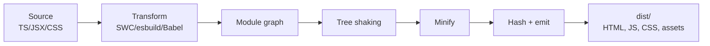
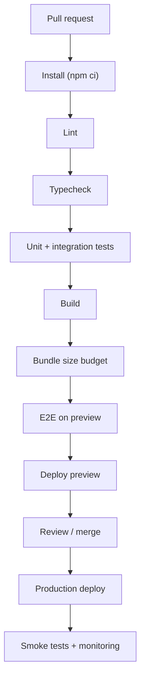
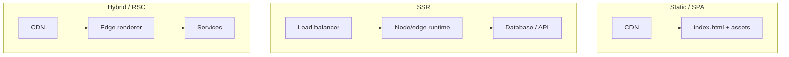
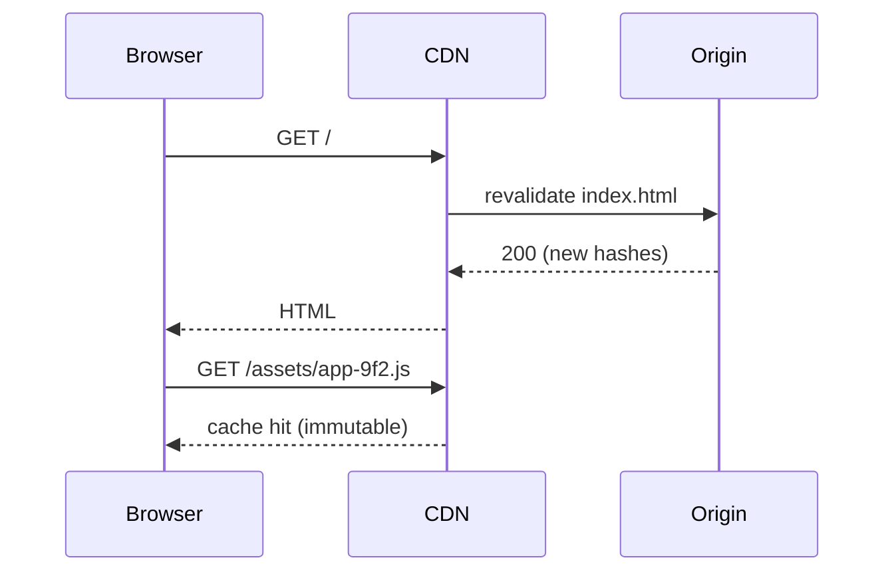
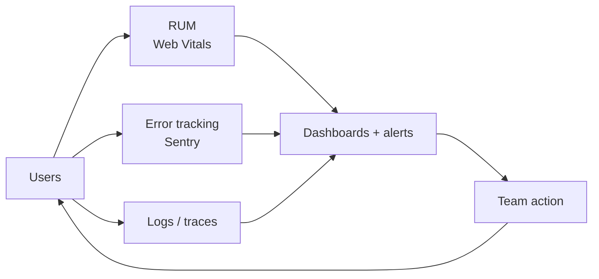
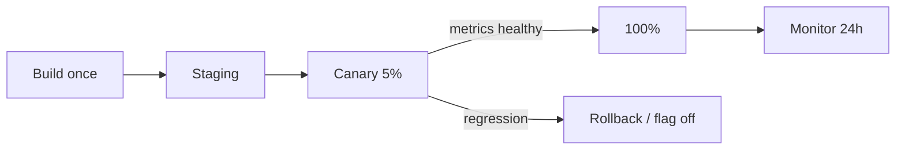
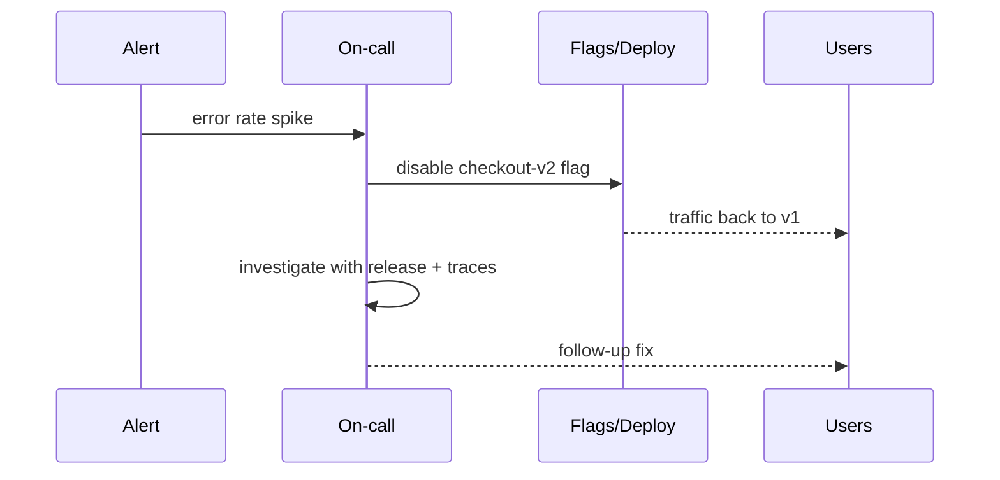

# 41. Build, Deploy and Observability

> **Level:** Expert · **Prerequisites:** Chapters 30, 31, 36, 37 · **Reading time:** ~45 min

Shipping is a pipeline, not a command. This chapter covers how a React app becomes a production artifact, how it
is deployed safely, and how you learn about failures **before** users report them.

---

## 1. From source to artifact



| Stage | Concern |
|-------|---------|
| Transform | JSX, TypeScript, modern syntax targets |
| Resolve | Aliases, package exports, platform files |
| Bundle | Chunking, dynamic imports, vendor splitting |
| Optimize | Tree shaking, minification, compression |
| Emit | Content hashes, source maps, manifest |

Production builds should be checked into no repository — they are artifacts, not source.

---

## 2. Environment configuration

```js
// build-time, public
const apiUrl = import.meta.env.VITE_API_URL;
```

| Prefix | Visibility | Use |
|--------|------------|-----|
| `VITE_*` | **Public** (inlined into JS) | API URL, feature flags, public keys |
| `NEXT_PUBLIC_*` | Public | Same for Next.js |
| No prefix / server env | Server only | Secrets, DB URLs, signing keys |

For containerized/static deployments, prefer **runtime config** so one artifact can be promoted across
environments:

```html
<!-- public/env.js, generated at deploy time -->
<script>window.__ENV__ = { API_URL: "https://api.example.com" };</script>
```

```js
export const env = {
  apiUrl: window.__ENV__?.API_URL ?? import.meta.env.VITE_API_URL,
};
```

Never put secrets in either mechanism. The browser is not a trusted environment.

---

## 3. CI pipeline



```yaml
# .github/workflows/ci.yml
name: ci
on: [push, pull_request]

jobs:
  verify:
    runs-on: ubuntu-latest
    steps:
      - uses: actions/checkout@v4
      - uses: actions/setup-node@v4
        with:
          node-version: 22
          cache: npm
      - run: npm ci
      - run: npm run lint
      - run: npm run typecheck
      - run: npm run test -- --run
      - run: npm run build
      - run: npm run size
```

Rules:

- **Fail fast**: lint and typecheck before the expensive E2E suite.
- **Cache** dependencies and build outputs; use affected-project builds in monorepos.
- **Pin** toolchain versions (Node, package manager) for reproducibility.
- **Upload** source maps and test artifacts.
- **Protect** the default branch with required checks.

---

## 4. Deployment topologies



| Model | Good for | Watch out for |
|-------|----------|---------------|
| Static/CDN | SPAs, docs, marketing | History fallback, cache invalidation |
| SSR server | SEO + personalized pages | Cold starts, memory, timeouts |
| Edge SSR | Global low latency | Runtime limits, API compatibility |
| Containers | Full control, long-lived services | Ops burden, scaling, health checks |
| Serverless functions | Spiky traffic, simple APIs | Cold starts, execution limits |

For static hosting, configure **history fallback** so `/users/42` serves `index.html` (Chapter 26).

---

## 5. Caching

| Resource | Header | Why |
|----------|--------|-----|
| `index.html` | `Cache-Control: no-cache` | Must point at new hashed bundles |
| `/assets/*-<hash>.js` | `public, max-age=31536000, immutable` | Content-addressed, never changes |
| Service worker | `no-cache` | Updates must be detected |
| API GET | Per resource (`max-age`, `stale-while-revalidate`) | Balance freshness and load |
| API mutations | `no-store` | Never cache writes |



This is why hashed filenames matter: the HTML changes, the assets do not.

---

## 6. Observability



Four pillars for frontend:

1. **Real user monitoring (RUM)** — LCP, INP, CLS by route, device, country.
2. **Error tracking** — exceptions with route, release, user, breadcrumbs; source maps.
3. **Logs/traces** — request ids, API latency, socket reconnects.
4. **Product analytics** — funnels, feature adoption (privacy-aware).

```js
import { onCLS, onINP, onLCP } from "web-vitals";

function report(metric) {
  navigator.sendBeacon(
    "/rum",
    JSON.stringify({
      name: metric.name,
      value: metric.value,
      rating: metric.rating,
      id: metric.id,
      path: location.pathname,
      release: import.meta.env.VITE_RELEASE,
    })
  );
}

onCLS(report);
onINP(report);
onLCP(report);
```

```js
import * as Sentry from "@sentry/react";

Sentry.init({
  dsn: import.meta.env.VITE_SENTRY_DSN,
  release: import.meta.env.VITE_RELEASE,
  tracesSampleRate: 0.1,
  replaysOnErrorSampleRate: 1.0,
  ignoreErrors: ["ResizeObserver loop limit exceeded"],
});
```

Alert on **user-visible symptoms**, not raw internals: error-free session rate, p75 INP, checkout failure rate.
A dashboard nobody checks is not observability.

---

## 7. Release strategy



| Technique | Use |
|-----------|-----|
| Feature flags | Decouple deploy from release; instant kill switch |
| Canary | Detect regressions with real traffic |
| Blue/green | Instant switch between two environments |
| Preview deployments | PR review and E2E |
| Staged rollout (mobile) | App store percentage releases |
| OTA updates (RN) | JS-only fixes without store review |

Rollback must be **one action** and tested. A rollback path nobody has exercised is a hope.

---

## 8. Incident response

1. **Detect** — alert with a user-facing symptom and a link to the dashboard.
2. **Mitigate** — roll back, disable the flag, or scale; do not debug in production first.
3. **Communicate** — status page, support script, internal channel.
4. **Diagnose** — correlate release, route, device, API latency.
5. **Learn** — blameless postmortem, action items with owners.



---

## 9. Anti-patterns

| Anti-pattern | Problem | Fix |
|--------------|---------|-----|
| Secrets in `VITE_*` | Public leak | Server-side env |
| Rebuilding per environment | Untested artifact promoted | Build once + runtime config |
| Caching `index.html` | Users stuck on old bundles | `no-cache` |
| No source maps in errors | Unreadable stacks | Upload privately |
| Alerts on CPU only | Misses user impact | Symptom-based alerts |
| Deploy without flags | Risky releases | Flags + canary |
| No rollback drill | Panic during incident | Test rollback quarterly |
| Logging PII | Privacy breach | Scrub + retention policy |
| CI without size budget | Silent bundle growth | Enforce budgets |

---

## 10. Checklist

- [ ] CI runs lint, types, tests, build and size checks.
- [ ] One artifact is promoted through environments.
- [ ] Environment config is public-by-design; secrets stay server-side.
- [ ] HTML is `no-cache`; hashed assets are immutable.
- [ ] History fallback works for client routes.
- [ ] Web Vitals and errors are collected with release tags.
- [ ] Source maps are uploaded privately.
- [ ] A feature flag or canary path exists for risky changes.
- [ ] Rollback is documented and tested.
- [ ] Alerts are tied to user-visible symptoms.

---

## 11. Exercises

1. Add a CI workflow that fails on type errors and bundle-size regressions.
2. Introduce runtime config so the same build runs in staging and production.
3. Configure cache headers correctly for a static SPA and verify with `curl -I`.
4. Add Web Vitals reporting and build a p75 dashboard per route.
5. Run a game day: deploy a deliberate regression behind a flag, detect it, and roll back.

---

## 12. Interview focus

| Question | Where it is answered |
|----------|----------------------|
| How do you handle environment variables? (#149) | Section 2 |
| How do you debug a React app in production? (#140) | Sections 6–8 |
| How do you ensure performance in production? (#99) | Sections 5–6, Chapter 30 |

**Follow-up traps**

- *"Why not build per environment?"* — You ship an artifact you never tested; runtime config keeps one build.
- *"What should trigger an alert?"* — A user-facing metric crossing a threshold, not a single exception.
- *"How do you roll back a frontend?"* — Atomic deploy switch, CDN purge, or a flag; all must be pre-tested.

---

**Next:** [42. Design Systems and Component Libraries](42.%20Design%20Systems%20and%20Component%20Libraries.md)
