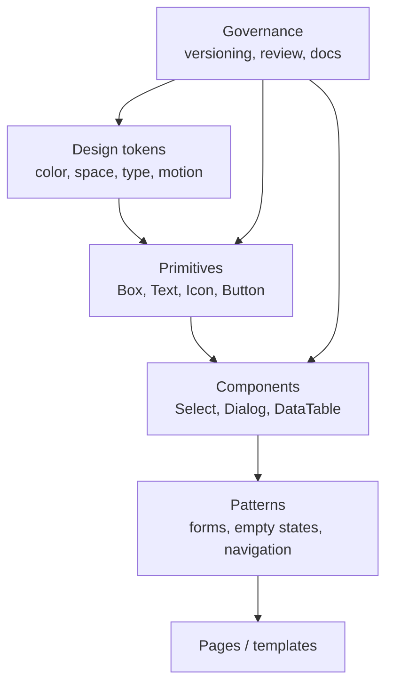
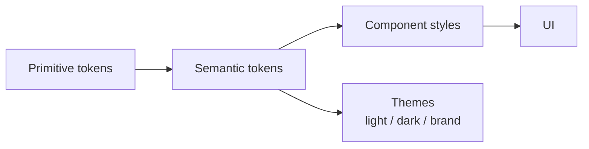
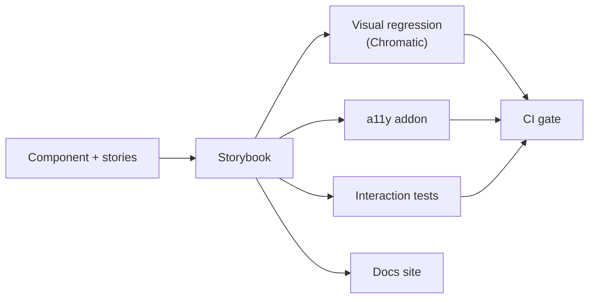
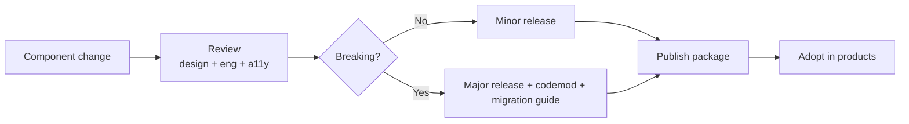
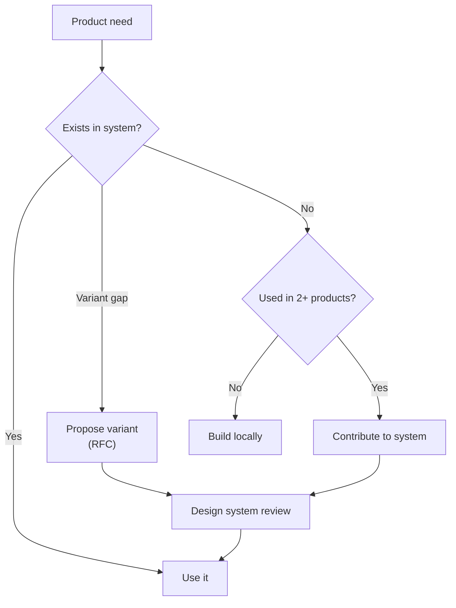

# 42. Design Systems and Component Libraries

> **Level:** Expert · **Prerequisites:** Chapters 16, 17, 33, 35 · **Reading time:** ~40 min

A design system is not a Storybook full of buttons. It is a **contract** between design and engineering: tokens
that define the visual language, components that encode behavior and accessibility, and documentation that makes
the right choice the easy choice.

---

## 1. Anatomy



| Layer | Owns | Example |
|-------|------|---------|
| Tokens | Visual decisions | `--color-text-primary`, `--space-4` |
| Primitives | Behavior + a11y of one element | `Button`, `Input`, `Dialog` |
| Components | Composition + domain-neutral logic | `Combobox`, `DatePicker`, `Table` |
| Patterns | Product-agnostic solutions | Authentication form, pagination |
| Templates | Page-level composition | Dashboard shell |

---

## 2. Tokens

Two tiers:

```css
/* 1. Primitive palette — raw values, never used directly in components */
:root {
  --color-indigo-500: #4f46e5;
  --color-neutral-0: #ffffff;
  --color-neutral-900: #16181d;
  --space-1: 4px;
  --space-2: 8px;
  --space-4: 16px;
  --radius-md: 8px;
}

/* 2. Semantic tokens — what components consume */
:root {
  --color-brand: var(--color-indigo-500);
  --color-bg-default: var(--color-neutral-0);
  --color-text-primary: var(--color-neutral-900);
  --space-inline-md: var(--space-4);
}

[data-theme="dark"] {
  --color-bg-default: #0f1115;
  --color-text-primary: #f2f4f8;
}
```



Rules:

- Components use **semantic** tokens only. A `Button` should not know about `indigo-500`.
- Themes remap semantic tokens; components do not change.
- Tokens are exported as JSON for Figma/Style Dictionary and as CSS variables for runtime.
- Contrast is validated at the token level, not per component.

```json
{
  "color": {
    "text": { "primary": { "value": "{color.neutral.900}" } }
  }
}
```

---

## 3. Component API design

```tsx
type ButtonProps = ComponentPropsWithoutRef<"button"> & {
  variant?: "primary" | "secondary" | "ghost" | "danger";
  size?: "sm" | "md" | "lg";
  isLoading?: boolean;
  leadingIcon?: React.ReactNode;
  asChild?: boolean;
};
```

Guidelines:

1. **Variants, not boolean matrices.** `variant="danger"` beats `danger outlined large`.
2. **Extend native props** so `aria-*`, `form`, `id` and `data-*` work.
3. **Support `asChild`/`as`** when the component must render as a link or another element.
4. **Forward refs** for focus management and third-party integration.
5. **Controlled and uncontrolled** modes where state matters (`value` / `defaultValue`).
6. **Composition over configuration** for complex regions (Chapter 16).
7. **No business logic** in the design system. `CheckoutButton` belongs to checkout, not to `packages/ui`.

```jsx
import { Slot } from "@radix-ui/react-slot";

export function Button({ asChild, variant = "primary", ...props }) {
  const Component = asChild ? Slot : "button";
  return <Component className={cn("btn", `btn--${variant}`)} {...props} />;
}

<Button asChild>
  <a href="/pricing">Pricing</a>
</Button>
```

---

## 4. Documentation and Storybook

```jsx
// Button.stories.jsx
import { Button } from "./Button";

export default {
  title: "Components/Button",
  component: Button,
  args: { children: "Save", variant: "primary" },
  argTypes: {
    variant: { control: "select", options: ["primary", "secondary", "ghost", "danger"] },
    size: { control: "select", options: ["sm", "md", "lg"] },
  },
};

export const Primary = {};
export const Danger = { args: { variant: "danger", children: "Delete" } };
export const Loading = { args: { isLoading: true } };
export const AsLink = {
  render: args => (
    <Button asChild {...args}>
      <a href="/docs">Read docs</a>
    </Button>
  ),
};
```

Each component page should answer:

- **When to use / when not to use.**
- **Anatomy** (parts and slots).
- **Keyboard and screen-reader behavior.**
- **Do / don't examples.**
- **Tokens used.**
- **Migration notes** between versions.



Storybook is a **build artifact of the system**, not a side project. Story coverage that lags behind components is
how documentation drift starts.

---

## 5. Accessibility is part of the component contract

The design system should make the accessible path the default path:

- Native elements underneath (`button`, `input`, `dialog`).
- Keyboard interactions implemented once, tested once.
- Focus visible and focus management built in.
- ARIA only where semantics need help.
- Contrast enforced by tokens.

```jsx
// Consumers should not have to remember this
<Dialog aria-labelledby={titleId}>
  <Dialog.Title id={titleId}>Delete project?</Dialog.Title>
  ...
</Dialog>
```

If every product team must re-implement focus trapping, the system has failed.

---

## 6. Versioning and change management



- **Semantic versioning** for the package.
- **Deprecation policy**: announce, support for N releases, then remove.
- **Codemods** for mechanical migrations.
- **Changesets** for release notes.
- **Visual regression** on every PR.
- **RFC process** for new components; avoid one-off components that only one team needs.

---

## 7. Adoption and governance

| Metric | Why |
|--------|-----|
| % of product UI using system components | Measures duplication |
| Override rate (`className` hacks) | Signals API gaps |
| Time to first contribution | Health of contribution model |
| A11y violations per component | Quality |
| Visual regression failures | Stability |
| Bundle size per component | Cost |

Operating model:

- **Core team** owns tokens, primitives and process.
- **Contribution model** lets product teams add components with review.
- **Office hours / support channel** for adoption.
- **Quarterly audit** of unused or duplicated components.



---

## 8. Anti-patterns

| Anti-pattern | Problem | Fix |
|--------------|---------|-----|
| Components with 20 boolean props | Invalid states, unreadable usage | Variants + composition |
| Hard-coded colors in components | Theming impossible | Semantic tokens |
| Design system with business logic | Coupled to one product | Domain-neutral primitives |
| Storybook as an afterthought | Docs drift | Stories required in PR |
| Breaking changes without codemod | Teams pin old versions | Semver + migration guide |
| One component per team | Duplication | Contribution model |
| Accessibility added later | Expensive retrofits | Built into primitives |
| No visual regression tests | Silent UI breakage | Chromatic/Playwright snapshots |

---

## 9. Checklist

- [ ] Tokens are the only source of color, spacing and typography.
- [ ] Components consume semantic tokens, not primitives.
- [ ] APIs use variants, slots and native props.
- [ ] Accessibility behavior is implemented and tested in the system.
- [ ] Every component has stories, docs and do/don't examples.
- [ ] Visual and a11y checks run in CI.
- [ ] Versioning and deprecation policy are documented.
- [ ] There is a contribution and review process.

---

## 10. Exercises

1. Define primitive and semantic tokens for a small product and switch themes without touching components.
2. Redesign a `Button` with five boolean props into a variant-based API.
3. Add Storybook interaction tests for a `Dialog` (open, focus trap, escape).
4. Add Chromatic or Playwright visual snapshots to one component.
5. Write a migration guide for renaming a prop and a codemod to apply it.

---

## 11. Interview focus

| Question | Where it is answered |
|----------|----------------------|
| How do you handle code reuse? (#145) | Sections 1–4 |
| Preferred folder structure (#148) | Chapter 32 |
| How do you ensure accessibility? (#150) | Section 5 |

**Follow-up traps**

- *"Build or buy a design system?"* — Start with an existing accessible primitive library, then layer your tokens
  and product patterns; building primitives from scratch is rarely the differentiator.
- *"How do you prevent drift?"* — Tokens, required stories, visual regression and a contribution process.
- *"How do you version a design system?"* — Semver, deprecation windows, codemods, and a changelog that product
  teams actually read.

---

**Next:** [43. Frontend System Design](43.%20Frontend%20System%20Design.md)
