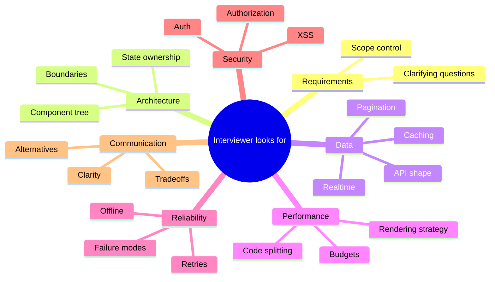
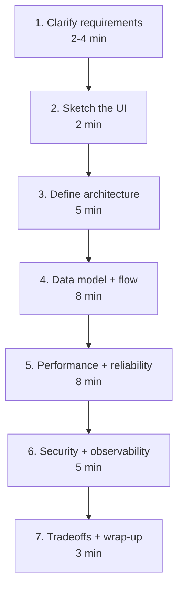
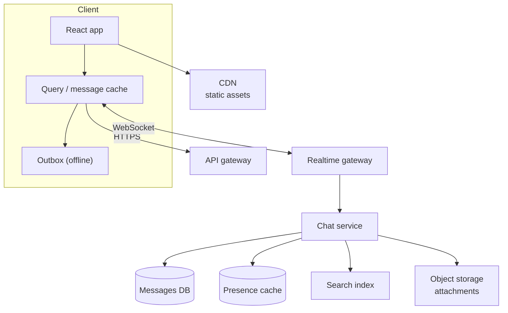
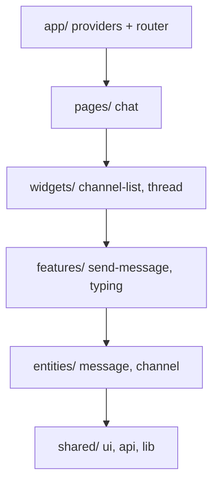
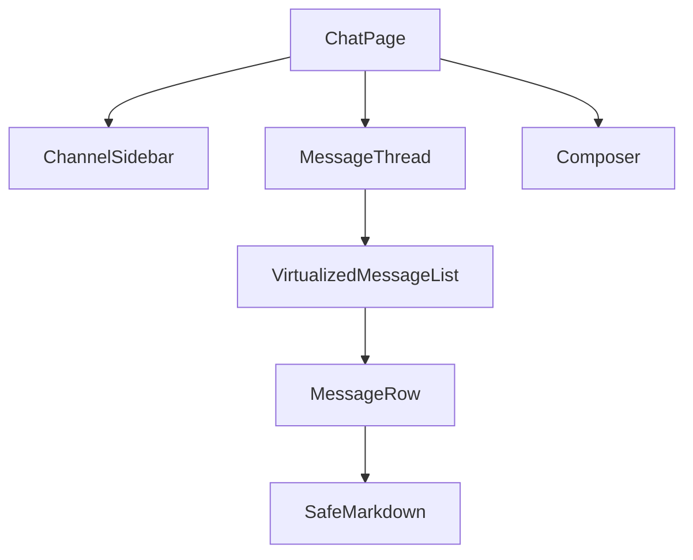
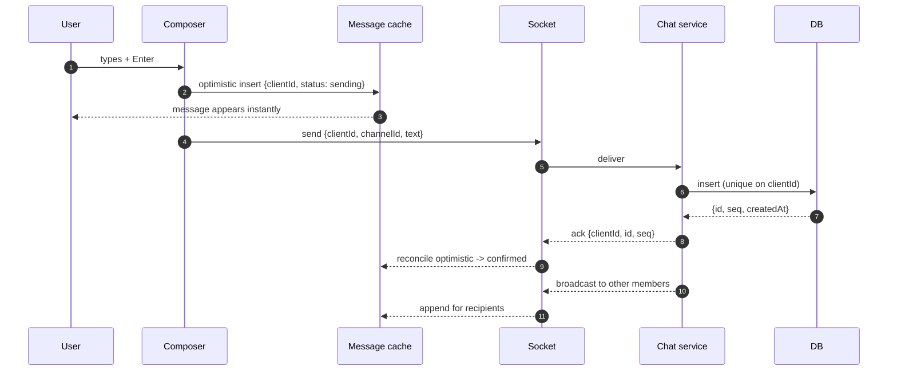
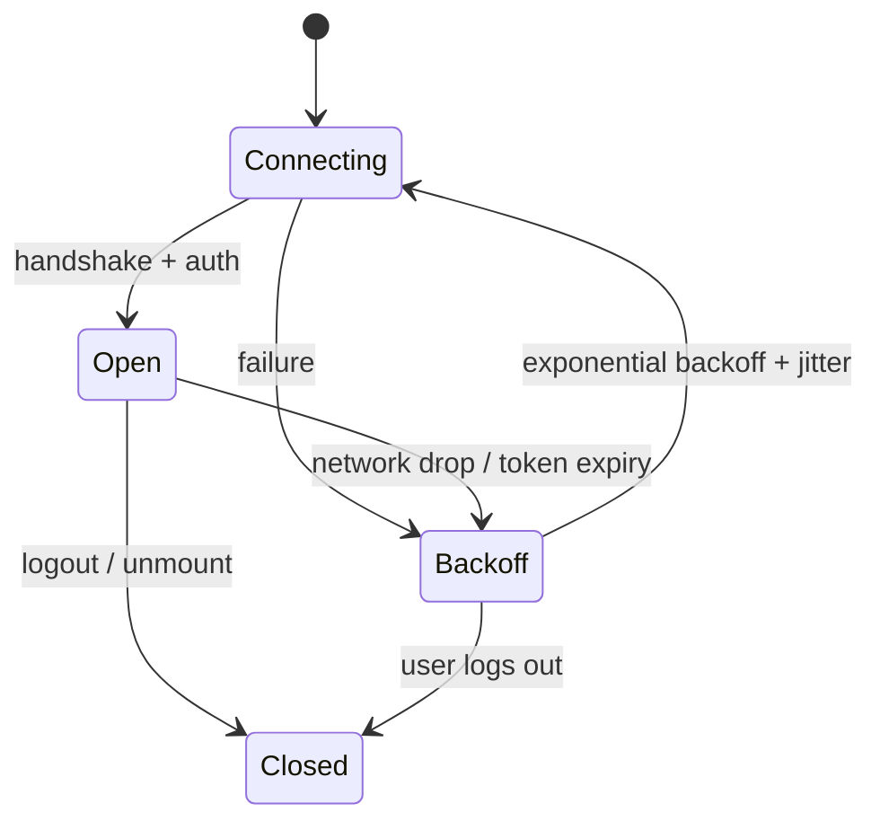
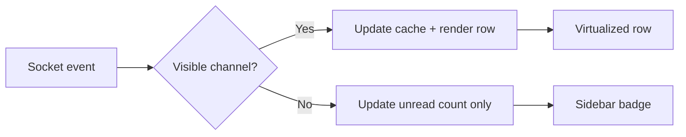
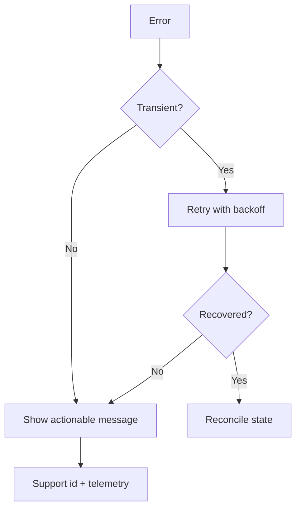

# 43. Frontend System Design

> **Level:** Expert · **Prerequisites:** Chapters 25, 30, 32, 37, 41 · **Reading time:** ~60 min

System design interviews for frontend roles are not about drawing boxes. They test whether you can turn an
ambiguous product idea into a client architecture with explicit data flow, failure modes and tradeoffs — and
communicate it while thinking.

---

## 1. What is being evaluated

---

## 2. A reliable framework

Rules that keep you on track:

- **Ask before drawing.** Users, scale, platforms, constraints.
- **State assumptions out loud** and write them down.
- **Prioritize the core journey**; mention extras only after it works.
- **Draw the data flow, not just boxes.** Where does data come from, cache, invalidate?
- **Name tradeoffs explicitly.** "I chose X because Y; Z would be better if…"
- **Leave time for failure modes.** Interviewers remember the candidate who designed the error path.

---

## 3. Requirements

Split into functional, non-functional and out of scope.

| Type | Questions |
|------|-----------|
| Functional | Who uses it? What are the top 3 journeys? What must be editable? |
| Scale | DAU, concurrent users, messages/items per day, payload size |
| Platforms | Web, mobile web, native, offline, low-end devices |
| Constraints | SEO, auth, compliance, existing backend, team size |
| Non-functional | Latency budget, availability, accessibility level, locales |

Example scope statement:

> "I'll design a web chat application for 10M DAU with channel-based messaging, message history, presence and
> optimistic sending. I'll exclude voice/video, E2E encryption and moderation tooling, but I'll note where they
> plug in."

---

## 4. Back-of-envelope estimates

Use estimates to drive architecture, not to show off arithmetic.

| Quantity | Formula | Example |
|----------|---------|---------|
| Messages/day | DAU × messages per user | 10M × 50 = 500M |
| Average rate | per day / 86,400 | ≈ 5.8k/s |
| Peak rate | average × 3 | ≈ 17k/s |
| Concurrent sockets | DAU × concurrency % | 10M × 20% = 2M |
| Daily storage | messages × bytes | 500M × 300 B ≈ 150 GB |
| Client cache | conversations × messages × bytes | 20 × 100 × 300 B ≈ 600 KB |

State the assumptions. The point is to decide between polling and sockets, or between local and server pagination.

---

## 5. Architecture

Layers to name explicitly:

- **Delivery**: CDN for static assets, API gateway for auth/rate limits.
- **Transport**: REST/GraphQL for request-response, WebSocket/SSE for push.
- **Services**: domain services own writes; the client never writes to the DB.
- **Storage**: primary DB, cache, search, blob storage.
- **Client cache**: the source of truth for rendering, with a sync policy.

---

## 6. Client architecture

State placement:

| State | Category | Owner |
|-------|----------|-------|
| Selected channel | URL | Router |
| Message history | Server cache | Query/infinite cache |
| Draft text | Local | Composer component |
| Sending queue | Client store | Outbox module |
| Presence | Server push | Realtime store |
| Unread counts | Derived | Selector from cache |
| Auth session | Shared client | Auth context |

Component tree sketch:

---

## 7. Data flow: send a message

Failure handling:

- Socket down → keep in **outbox**, show "queued".
- Ack timeout → retry with the **same `clientId`** (idempotent).
- Duplicate broadcast → dedupe by server `id`.
- Reconnect → fetch messages since the last known `seq`.
- Send failure after max retries → mark failed, offer retry/copy.

---

## 8. Realtime connection lifecycle

Design details:

- Authenticate the socket with a short-lived token, not a long-lived query param.
- Heartbeat/ping to detect half-open connections.
- Resume from a sequence cursor, not from "now".
- Backoff with jitter and a cap; pause when the tab is hidden.
- Presence expiry via TTL, not explicit offline events (clients disappear).

---

## 9. Performance

| Concern | Decision |
|---------|----------|
| Initial load | Route-level code splitting; chat shell only |
| Message list | Virtualization, reverse pagination, stable IDs |
| Scroll | Preserve position when prepending history; jump-to-bottom affordance |
| Typing | Local state; do not route through global store |
| Presence updates | Throttle/batch; do not re-render the whole list |
| Realtime bursts | Batch updates with transitions where appropriate |
| Bundle | Lazy-load emoji, markdown, attachment preview |
| Metrics | INP p75 < 200 ms, LCP < 2.5 s, memory < ~150 MB |

The "update only what is visible" rule is what keeps a chat app responsive under bursts.

---

## 10. Reliability and failure modes

| Failure | User impact | Design response |
|---------|-------------|-----------------|
| API 5xx | Cannot load history | Retry + error state per panel |
| Socket drop | No live messages | Reconnect + resume from cursor |
| Duplicate send | Duplicate messages | Idempotency key (`clientId`) |
| Out-of-order events | Wrong ordering | Sort by server `seq`, not local time |
| Offline | Cannot send | Outbox with queued state |
| Token expiry | Disconnected | Silent refresh + reconnect |
| Huge channel | Slow render | Virtualization + pagination |
| Attachment failure | Broken preview | Fallback to file link |

---

## 11. Security and privacy

- **Auth**: httpOnly cookies or short-lived tokens; socket auth at handshake.
- **Authorization**: every channel read/write checks membership server-side.
- **XSS**: message content is untrusted; sanitize markdown/HTML; never `dangerouslySetInnerHTML` raw.
- **Attachments**: signed URLs, content-type validation, size limits.
- **Rate limiting**: per user and per IP; protect send and search.
- **Privacy**: retention policy, export/delete, no PII in logs.
- **CSRF**: token or SameSite cookies for mutations.

---

## 12. Observability

| Metric | Why |
|--------|-----|
| Message delivery p95 | Core UX |
| Socket reconnect rate | Network/server health |
| Send failure rate | Outbox/retry correctness |
| INP on message send | Responsiveness |
| Cache hit ratio | Data layer efficiency |
| Error-free sessions | Overall quality |
| Unread drift | Client/server consistency |

Instrument the **client journey**: send → optimistic → ack → broadcast → read. Each step gets a timestamp and a
correlation id.

---

## 13. Tradeoffs to state explicitly

| Decision | Option A | Option B | Choose when |
|----------|----------|----------|-------------|
| Transport | WebSocket | SSE + POST | Bidirectional low-latency vs simpler infra |
| History | Infinite scroll | Pagination | Conversational vs archival |
| Cache | Normalized store | Query cache | Cross-entity updates vs simple server cache |
| Rendering | CSR | SSR/RSC | Auth-only app vs SEO/marketing |
| Optimistic UI | Always | Only fast paths | Low failure rate vs strict consistency |
| Search | Client filter | Server index | Small local set vs global search |
| Presence | TTL heartbeat | Explicit events | Robustness vs precision |

A senior answer includes **what you would do differently with 10× scale or a 3-person team**.

---

## 14. Practice prompts

1. Design a news feed with infinite scroll and optimistic likes.
2. Design an e-commerce checkout with inventory validation and payment failures.
3. Design a collaborative document editor (conflicts, presence, offline).
4. Design an analytics dashboard with 20 widgets and date filters.
5. Design an internal admin panel with RBAC and audit logs.
6. Design a video call lobby UI (devices, permissions, reconnect).

For each, practice the seven-step framework and a five-minute whiteboard version.

---

## 15. Rubric (self-assessment)

| Dimension | Weak | Strong |
|-----------|------|--------|
| Requirements | Starts drawing immediately | Clarifies users, scale, scope |
| Architecture | Boxes without data flow | Clear layers, ownership, boundaries |
| State | "Redux everywhere" | Categorized state with owners |
| Data | Fetch on mount | Cache, pagination, invalidation, realtime |
| Performance | Generic "use memo" | Budgets, virtualization, splitting |
| Reliability | Happy path only | Failure modes, retries, idempotency |
| Security | Mentions auth only | Authorization, XSS, tokens, CSRF |
| Communication | Jumps between topics | Structured, states assumptions and tradeoffs |

---

## 16. Interview focus

| Question | Where it is answered |
|----------|----------------------|
| Describe a React app you built (#141) | Sections 5–8 |
| Challenging bug (#142) | Section 10 |
| Choosing state management (#143) | Section 6, Chapter 24 |
| Structuring large apps (#144) | Section 6, Chapter 32 |
| Tradeoffs (#147) | Section 13 |

**Follow-up traps**

- *"How would this change at 10× scale?"* — Name the first bottleneck (usually realtime fan-out or history
  queries) and the mitigation.
- *"What would you cut for an MVP?"* — Presence, search, offline outbox; keep send/receive/history.
- *"How do you know it works?"* — Delivery metrics, INP, error-free sessions, and a synthetic journey.

---

**Next:** [44. React Interview Questions](44.%20React%20Interview%20Questions.md)
