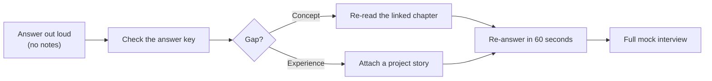
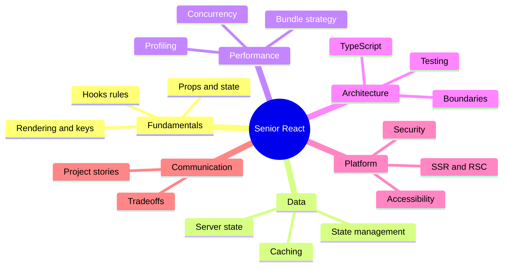
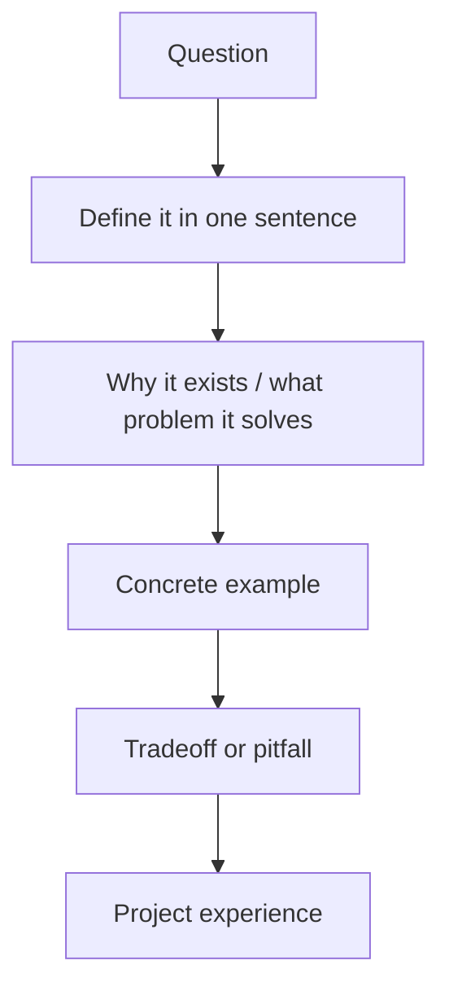
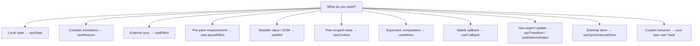

# React Interview Questions

> **Level:** All levels · **Prerequisites:** Chapters 1–43 · **Use:** self-assessment, mock interviews, team training

The capstone of this tutorial: **150 classic questions** plus **32 modern ones** covering React 19, Server
Components, security, production performance and architecture. Every section maps to the chapters that teach it,
and a concise [answer key](#answer-key) follows the question bank.

## How to use this chapter

- **Self-assessment:** answer 10 questions per session; mark `solid`, `shaky` or `unknown`.
- **Interview prep:** rehearse the *follow-up traps* at the end of each chapter — interviewers probe depth there.
- **Team training:** pick one section per week; pair-share answers; disagree on tradeoffs, not definitions.
- **Scoring:** a senior answer is one sentence of definition + one concrete example + one tradeoff.

### The 45-minute mock interview

```mermaid
gantt
    title Mock interview agenda
    dateFormat HH:mm
    axisFormat %H:%M
    section Warm-up
    Intro and project story        :a1, 09:00, 5m
    section Depth
    Hooks, rendering, state        :a2, 09:05, 15m
    section Design
    Component or system design     :a3, 09:20, 15m
    section Close
    Debugging and tradeoffs        :a4, 09:35, 5m
    Your questions                 :a5, 09:40, 5m
```

### Competency map

**Jump to:** [Basics](#react-basics) · [Hooks](#hooks-and-functional-components) ·
[State](#state-management) · [Routing](#routing-and-navigation) · [Performance](#performance-and-optimization) ·
[Advanced](#advanced-concepts) · [Testing](#testing-and-debugging) · [Behavioral](#project-and-behavioral) ·
[React 19](#react-19-and-server-components) · [Security](#security) ·
[Production](#performance-and-production) · [System design](#architecture-and-system-design) ·
[Answer key](#answer-key)

---

## React Basics

1. What is React?
2. Why use React instead of plain JavaScript?
3. What are the main features of React?
4. What is JSX?
5. What is the virtual DOM?
6. What are components in React?
7. Explain the difference between functional and class components.
8. What are props in React?
9. How does state work in React?
10. How do you create a React app?
11. What is create-react-app?
12. What is a fragment in React?
13. What is the role of the render() method?
14. How do you pass data from parent to child components?
15. What is prop drilling?
16. How do you avoid prop drilling?
17. What are default props?
18. What is the purpose of key in React lists?
19. How does conditional rendering work?
20. How do you handle events in React?
21. How do you bind event handlers in class components?
22. What are inline styles in React?
23. What is the difference between a React element and a React component?
24. How is re-rendering handled in React?
25. What is the children prop?

## Hooks and Functional Components

26. What are React Hooks?  
27. Why were hooks introduced?  
28. What is useState?  
29. What is useEffect?  
30. What’s the difference between useEffect with and without dependency array?  
31. What are the rules of hooks?  
32. What is useContext?  
33. What is useRef and how is it used?  
34. What is useCallback?  
35. What is useMemo?  
36. What is useReducer?  
37. How do you create a custom hook?  
38. How can you share logic between components?  
39. When does useEffect run?  
40. How do you clean up in useEffect?  
41. Can you call a hook inside a loop or condition?  
42. What happens if you update state during rendering?  
43. How do you prevent unnecessary re-renders?  
44. What's the difference between useRef and createRef?  
45. How does useLayoutEffect differ from useEffect?  
46. What are controlled vs uncontrolled inputs in React?  
47. How do you persist data between renders?  
48. Can you explain the use of useImperativeHandle?  
49. What is lazy state initialization in useState?  
50. What are common performance mistakes with hooks?

## State Management

51. How is state different from props?  
52. When should you use component state?  
53. What is lifting state up?  
54. What are global state management options in React?  
55. What is Context API?  
56. When should you use Redux?  
57. What are the pros and cons of Redux vs Context API?  
58. What is Redux Toolkit?  
59. What are actions, reducers, and store in Redux?  
60. How does the Provider work in Redux?  
61. What is middleware in Redux?  
62. How does Redux handle async logic?  
63. What is useSelector and useDispatch?  
64. What are thunks in Redux?  
65. What is reselect?  
66. Can you use both Redux and Context together?  
67. What is Zustand? How is it different from Redux?  
68. What is MobX?  
69. What are atoms in Recoil?  
70. When is it okay to use local component state only?

## Routing and Navigation

71. What is React Router?  
72. What is the difference between BrowserRouter and HashRouter?  
73. What is Link vs a tag?  
74. How do you define routes in React Router v6?  
75. What is a dynamic route?  
76. How do you navigate programmatically?  
77. What is useNavigate?  
78. How do you handle 404 pages?  
79. What is nested routing?  
80. What are route parameters?  
81. How do you extract parameters using useParams?  
82. What is a layout route?  
83. What is Outlet in React Router?  
84. How do you protect a route (auth)?  
85. How does route-based code splitting work?

## Performance and Optimization

86. What is React.memo?  
87. What is PureComponent?  
88. How do you avoid unnecessary re-renders?  
89. How do you optimize large lists?  
90. What is lazy loading in React?  
91. What is React.lazy and Suspense?  
92. How do you chunk code in React?  
93. What is useCallback vs useMemo?  
94. What is the React Profiler?  
95. What are the most common React performance pitfalls?  
96. How does reconciliation work in React?  
97. What causes React to re-render?  
98. What is the difference between shallow and deep comparison?  
99. How can React dev tools help with performance?  
100. How does memoization help performance?  
101. When should you not use React.memo?  
102. What are render props and how do they impact performance?  
103. What is the difference between class-based and functional performance?  
104. What is the cost of context re-renders?  
105. How do you optimize re-renders with React.memo and hooks?

## Advanced Concepts

106. What are Higher-Order Components (HOCs)?  
107. What are render props?  
108. What is an Error Boundary?  
109. How do you create an Error Boundary?  
110. What is forwardRef?  
111. What is reconciliation?  
112. How do you manage focus in forms?  
113. What is the React Fiber architecture?  
114. How is React concurrent mode different?  
115. What is Suspense for data fetching?  
116. What are portals in React?  
117. What are the advantages of functional components over class components?  
118. How do you use TypeScript with React?  
119. What is server-side rendering (SSR)?  
120. What is hydration in React?  
121. What is Next.js and how does it relate to React?  
122. How does React Native differ from React?  
123. What are React lifecycles in class components?  
124. How do lifecycle methods map to hooks?  
125. What is reconciliation and key diffing in lists?

## Testing and Debugging

126. How do you test React components?  
127. What is React Testing Library?  
128. How does RTL differ from Enzyme?  
129. What are mock functions in Jest?  
130. How do you mock API calls?  
131. How do you test form input and submission?  
132. How do you test components that use hooks?  
133. What is the role of act() in testing?  
134. What are best practices for testing React apps?  
135. How do you test context?  
136. How do you simulate events in tests?  
137. How do you handle async testing?  
138. What is snapshot testing?  
139. What are common testing pitfalls in React?  
140. How do you debug a React app in production?

---

## Project and Behavioral

141. Describe a React app you built.  
142. What was a challenging React bug you fixed?  
143. How do you decide which state management approach to use?  
144. How do you structure large-scale React apps?  
145. How do you handle code reuse in React?  
146. How do you manage large forms in React?  
147. What tradeoffs have you made in past React projects?  
148. What’s your preferred folder structure in a React project?  
149. How do you handle environment variables in React?  
150. How do you ensure accessibility in your React components?

---

## React 19 and Server Components

*Modern platform questions. Taught in [Chapter 37](37.%20SSR%2C%20SSG%2C%20RSC%20and%20Hydration.md) and
[Chapter 38](38.%20React%2019%20-%20Actions%2C%20use%20and%20the%20Compiler.md).*

151. What are React Server Components?
152. How do Server Components differ from server-side rendering?
153. What are Server Actions?
154. How does `useActionState` work?
155. When should you use `useOptimistic`?
156. What does the `use` API do, and how is it different from a hook?
157. What is the React Compiler?
158. What is `<Activity>` used for?
159. What is `useEffectEvent`?
160. How is `ref` handled in React 19?

## Security

*Taught in [Chapter 36](36.%20Security%20in%20React.md).*

161. How do you prevent XSS in a React application?
162. When is `dangerouslySetInnerHTML` safe to use?
163. Where should authentication tokens be stored?
164. How do you protect a cookie-authenticated app from CSRF?
165. How do you secure a Server Action?
166. What is a Content Security Policy and why does it matter?
167. How do you manage secrets in a frontend application?
168. How do you reduce supply-chain risk from npm dependencies?

## Performance and Production

*Taught in [Chapter 30](30.%20Performance%20Engineering%20and%20Profiling.md),
[Chapter 31](31.%20Code%20Splitting%20and%20Loading%20Strategy.md) and
[Chapter 41](41.%20Build%2C%20Deploy%20and%20Observability.md).*

169. What are Core Web Vitals?
170. How do you improve INP?
171. How do you measure frontend performance in production?
172. How do you choose code-splitting boundaries?
173. What causes hydration mismatches?
174. How do you handle stale chunks after a deployment?
175. What is a performance budget?
176. How do you approach profiling a slow React screen?

## Architecture and System Design

*Taught in [Chapter 32](32.%20Large-Scale%20React%20Architecture.md),
[Chapter 42](42.%20Design%20Systems%20and%20Component%20Libraries.md) and
[Chapter 43](43.%20Frontend%20System%20Design.md).*

177. How do you structure a large React application?
178. How do you enforce architectural boundaries?
179. How do you design a component library or design system?
180. How do you choose between Context, Zustand and Redux?
181. How do you design a real-time UI?
182. How do you approach a frontend system design interview?

---

---

## Answer Key

> **How to read this:** each entry is a *minimum viable answer*, not a script. Add one concrete example and one
> tradeoff to reach senior depth. Question numbers match the bank above.

### React Basics

| # | Question | Answer |
|---|----------|--------|
| 1 | What is React? | A JavaScript library for building UIs from composable components with declarative rendering. |
| 2 | Why React over plain JS? | Component reuse, declarative state-to-UI, large ecosystem; plain JS is simpler for tiny or static pages. |
| 3 | Main features? | Components, JSX, virtual DOM/reconciliation, one-way data flow, hooks, SSR/RSC. |
| 4 | What is JSX? | Syntax that compiles to element objects (`jsx()` calls) and embeds JS expressions in braces. |
| 5 | What is the virtual DOM? | An in-memory element tree; React diffs it and commits only the necessary DOM changes. |
| 6 | Components? | Functions returning elements; they compose into a tree and own a piece of UI. |
| 7 | Functional vs class? | Functions use hooks and are the default; classes use `this`, lifecycle methods and class state. |
| 8 | Props? | Read-only inputs passed from a parent; changing them re-renders the child. |
| 9 | State? | Component-owned data via `useState`/`useReducer`; updates are snapshots applied asynchronously. |
| 10 | Create an app? | `npm create vite@latest` is the default; Next.js for SSR/RSC; frameworks or manual setup otherwise. |
| 11 | CRA? | Legacy scaffold, unmaintained; replaced by Vite and framework starters. |
| 12 | Fragment? | Groups children without adding a DOM node; use `<Fragment key>` when a key is required. |
| 13 | `render()`? | Class method returning JSX; function components return JSX directly. |
| 14 | Parent to child? | Props; child to parent via callbacks; siblings by lifting state. |
| 15 | Prop drilling? | Passing props through intermediate components that do not use them. |
| 16 | Avoid prop drilling? | Composition/children, context, colocated state, or an external store. |
| 17 | Default props? | Default parameter values; `defaultProps` was removed for function components in React 19. |
| 18 | Purpose of `key`? | Identity hint for list children; stable IDs prevent wrong state reuse and remounts. |
| 19 | Conditional rendering? | Ternaries, `cond && element` with a boolean guard, early returns, lookup maps. |
| 20 | Events? | Camel-case props with function handlers; React delegates synthetic events at the root. |
| 21 | Class binding? | Bind in the constructor, use class fields/arrow methods, or pass an inline arrow. |
| 22 | Inline styles? | `style={{ camelCase: value }}`; no pseudo-classes, media queries or keyframes. |
| 23 | Element vs component? | An element is an immutable description; a component is the function/class producing elements. |
| 24 | Re-rendering? | Triggered by state, parent render, context or store change; React reconciles and commits. |
| 25 | `children`? | Nested content passed between tags, available as `props.children`. |

### Hooks and Functional Components

| # | Question | Answer |
|---|----------|--------|
| 26 | What are hooks? | Functions that let function components use state, effects, context and other React features. |
| 27 | Why were they introduced? | To reuse stateful logic without classes, HOCs or render props, and to simplify components. |
| 28 | `useState`? | Local state plus a setter; the setter accepts a value or an updater function. |
| 29 | `useEffect`? | Synchronizes with external systems after commit; cleanup runs before re-run and on unmount. |
| 30 | Deps with vs without? | Omitted = every commit; `[]` = mount only; `[deps]` = when a dependency changes. |
| 31 | Rules of hooks? | Call at the top level, only from React functions or other hooks. |
| 32 | `useContext`? | Reads the nearest provider value for a context. |
| 33 | `useRef`? | Mutable `.current` that persists without re-rendering; DOM refs, timers, previous values. |
| 34 | `useCallback`? | Memoizes a function identity until dependencies change. |
| 35 | `useMemo`? | Memoizes a computed value until dependencies change. |
| 36 | `useReducer`? | State plus `dispatch` with a pure reducer, for complex related transitions. |
| 37 | Custom hook? | A `use*` function calling hooks; each call gets independent state. |
| 38 | Share logic? | Custom hooks, composition/children, context; HOCs/render props for legacy or wrapping. |
| 39 | When does `useEffect` run? | After commit/paint, when dependencies change, and once on mount with `[]`. |
| 40 | Cleanup? | Return a function: abort requests, clear timers, unsubscribe, reset DOM. |
| 41 | Hook in a loop/condition? | No — hook order must be stable between renders. |
| 42 | Update state during render? | Avoid; it can loop. Only a guarded render-phase adjustment in the same component is valid. |
| 43 | Prevent re-renders? | Colocate state, memoize boundaries, stabilize props, split context, virtualize lists. |
| 44 | `useRef` vs `createRef`? | `useRef` returns the same object every render; `createRef` returns a new one per render. |
| 45 | Layout vs effect? | `useLayoutEffect` runs before paint and blocks it; `useEffect` runs after paint. |
| 46 | Controlled vs uncontrolled? | React state owns the value vs the DOM owns it (`defaultValue`, ref, `FormData`). |
| 47 | Persist between renders? | State/ref across renders; localStorage/cookies across reloads; server for durable data. |
| 48 | `useImperativeHandle`? | Customizes the imperative handle exposed through a ref. |
| 49 | Lazy state init? | `useState(() => expensive())` — the initializer runs only on mount. |
| 50 | Hook performance mistakes? | Context for fast state, unstable props, effects deriving state, huge lists, blanket memoization. |

---

---

### State Management

| # | Question | Answer |
|---|----------|--------|
| 51 | State vs props? | State is internal and mutable by the component; props are external, read-only inputs. |
| 52 | When component state? | For UI-local state that no other component needs. |
| 53 | Lifting state up? | Move shared state to the nearest common ancestor and pass it down. |
| 54 | Global state options? | Context, Redux Toolkit, Zustand, Jotai; TanStack Query for server state. |
| 55 | Context API? | Provider/consumer transport for tree-scoped values; no selector subscriptions. |
| 56 | When Redux? | Large apps with complex flows, many teams, devtools/time travel and middleware needs. |
| 57 | Redux vs Context? | Redux is predictable and tooled but verbose; Context is simple but re-renders consumers and is not a store. |
| 58 | Redux Toolkit? | Official Redux toolkit: `createSlice` (Immer), `configureStore`, thunks, RTK Query. |
| 59 | Actions, reducers, store? | Actions describe events; reducers compute new state purely; the store holds it. |
| 60 | Provider in Redux? | Makes the store available to the tree; `useSelector` subscribes to slices. |
| 61 | Middleware? | Wraps `dispatch` for logging, async, analytics or cancellation. |
| 62 | Async logic? | Thunks, listener middleware or RTK Query. |
| 63 | `useSelector`/`useDispatch`? | Select state with a selector; dispatch actions. |
| 64 | Thunks? | Functions returned from action creators, called with `dispatch` and `getState`. |
| 65 | Reselect? | Creates memoized selectors that recompute only when inputs change. |
| 66 | Redux and Context together? | Yes — context for DI/theme, Redux for domain state. |
| 67 | Zustand? | Small external store with selector subscriptions and minimal boilerplate. |
| 68 | MobX? | Observable mutable state with automatic dependency tracking via `observer`. |
| 69 | Recoil atoms? | Independent state units with derived selectors; maintenance stalled, Jotai is the successor. |
| 70 | Local state only? | Modals, hover, drafts, tabs and other transient UI state. |

### Routing and Navigation

| # | Question | Answer |
|---|----------|--------|
| 71 | React Router? | Maps URLs to component trees plus data loaders and actions. |
| 72 | Browser vs Hash router? | History API clean URLs (needs server fallback) vs hash URLs (no server config). |
| 73 | `Link` vs `a`? | `Link` does client-side navigation without reload; `a` is for external URLs and downloads. |
| 74 | Routes in v6? | `<Routes><Route path element /></Routes>` or `createBrowserRouter` with a route array. |
| 75 | Dynamic route? | A path segment like `/users/:id`. |
| 76 | Programmatic navigation? | `useNavigate()` or `router.navigate()`. |
| 77 | `useNavigate`? | Returns a function to navigate imperatively. |
| 78 | 404 pages? | A `path="*"` route plus an `errorElement` for thrown 404 responses. |
| 79 | Nested routing? | Child routes render inside the parent's `<Outlet />`. |
| 80 | Route parameters? | Variables in the path matched by the router. |
| 81 | `useParams`? | Returns the matched params as an object. |
| 82 | Layout route? | A route with shared chrome and `<Outlet />`, often without its own path segment. |
| 83 | `Outlet`? | Placeholder where child routes render. |
| 84 | Protect a route? | Redirect in a wrapper/loader based on auth; always authorize on the server too. |
| 85 | Route-based splitting? | Lazy-load route modules with Suspense or the router's `lazy` property. |

### Performance and Optimization

| # | Question | Answer |
|---|----------|--------|
| 86 | `React.memo`? | HOC that skips re-render when props are shallow-equal. |
| 87 | `PureComponent`? | Class equivalent using shallow `shouldComponentUpdate`. |
| 88 | Avoid re-renders? | Colocate state, memo boundaries, stable props, split context, stable keys. |
| 89 | Optimize large lists? | Virtualize or paginate, stable keys, memoized rows, avoid layout thrash. |
| 90 | Lazy loading? | Load code or data only when needed. |
| 91 | `React.lazy`/Suspense? | `lazy(() => import(...))` plus a Suspense fallback. |
| 92 | Chunk code? | Route/feature boundaries, dynamic imports and vendor `manualChunks`. |
| 93 | `useCallback` vs `useMemo`? | Function identity vs computed value. |
| 94 | React Profiler? | DevTools flame/ranked views and `<Profiler onRender>` timings. |
| 95 | Performance pitfalls? | Measuring dev builds, blanket memo, inline props, index keys, context storms. |
| 96 | Reconciliation? | React's O(n) diff of type and key, reusing or replacing fibers. |
| 97 | What causes re-renders? | State update, parent render, context change, external store update. |
| 98 | Shallow vs deep comparison? | First-level reference/value comparison vs recursive structural comparison. |
| 99 | DevTools for performance? | Profiler, "why did this render", component tree, highlight updates. |
| 100 | Memoization? | Caching results or identities to skip recomputation. |
| 101 | When not to use `memo`? | Cheap components, unstable props, or a structural problem memo cannot fix. |
| 102 | Render props and performance? | Inline functions create new identities; hoist them or use `useCallback`. |
| 103 | Class vs function performance? | Similar runtime cost; functions + hooks/compiler are the modern default. |
| 104 | Context re-render cost? | Every consumer re-renders when the context value changes. |
| 105 | Optimize with memo and hooks? | Colocate, memo with stable props, split context, virtualize, defer expensive work. |

---

---

### Advanced Concepts

| # | Question | Answer |
|---|----------|--------|
| 106 | HOCs? | A function that takes a component and returns an enhanced component. |
| 107 | Render props? | A function prop that receives state and returns UI. |
| 108 | Error boundary? | A component that catches render/lifecycle errors in its subtree and shows a fallback. |
| 109 | Create an error boundary? | Class with `static getDerivedStateFromError` and optional `componentDidCatch`. |
| 110 | `forwardRef`? | Passes a ref through a component to a DOM node/child; React 19 allows `ref` as a prop. |
| 111 | Reconciliation? | The diffing algorithm that decides reuse, update, insert and delete. |
| 112 | Manage focus in forms? | Refs/`autoFocus`, `useLayoutEffect` for measurement, focus the first invalid field on submit. |
| 113 | Fiber? | React's unit-of-work tree enabling prioritized, interruptible rendering. |
| 114 | Concurrent mode? | Renders can be interrupted, prioritized and discarded before commit. |
| 115 | Suspense for data? | Declarative fallback while a promise read by `use` or a framework resolves. |
| 116 | Portals? | Render DOM elsewhere while keeping the React tree and event bubbling. |
| 117 | Functional advantages? | Less code, hooks, composition, no `this`, easier reuse. |
| 118 | TypeScript with React? | Typed props/state/events, generics, discriminated unions, validated API boundaries. |
| 119 | SSR? | Render HTML on the server; the client hydrates it. |
| 120 | Hydration? | Attaching React state and handlers to server HTML without recreating the DOM. |
| 121 | Next.js? | A React framework adding routing, SSR/RSC, bundling and deployment conventions. |
| 122 | React Native vs React? | React renderer for native views via Fabric; no DOM or CSS cascade. |
| 123 | Class lifecycles? | Mounting, updating and unmounting methods such as `componentDidMount`/`componentWillUnmount`. |
| 124 | Lifecycles to hooks? | Constructor to lazy state, didMount to `useEffect(fn, [])`, didUpdate to deps, willUnmount to cleanup. |
| 125 | Key diffing in lists? | Match children by key and type; move/update matches, insert new, delete leftovers. |

### Testing and Debugging

| # | Question | Answer |
|---|----------|--------|
| 126 | Test components? | Vitest + RTL for behavior; MSW for network; Playwright for critical journeys. |
| 127 | React Testing Library? | DOM utilities that query the UI the way a user would. |
| 128 | RTL vs Enzyme? | Behavior vs implementation/shallow rendering; RTL works with concurrent React. |
| 129 | Mock functions? | `vi.fn`, `vi.spyOn`, module mocks; assert calls and return values. |
| 130 | Mock API calls? | MSW intercepts network requests with handlers. |
| 131 | Test forms? | `userEvent.type`, submit, assert validation and callback payloads. |
| 132 | Test hooks? | `renderHook` for reusable hooks; a test component for hook-driven UI. |
| 133 | `act()`? | Flushes pending React work so assertions see the committed UI. |
| 134 | Testing best practices? | Behavior-first queries, deterministic async, network-level mocks, independent tests. |
| 135 | Test context? | Render inside a provider via a custom `renderWithProviders`. |
| 136 | Simulate events? | `userEvent.click/type/keyboard` rather than `fireEvent`. |
| 137 | Async testing? | `findBy*`, `waitFor`, fake timers; never fixed sleeps. |
| 138 | Snapshot testing? | Serialized output comparison; useful for small stable output only. |
| 139 | Testing pitfalls? | Implementation coupling, sleeps, over-mocking, shared state, snapshot blindness. |
| 140 | Debug in production? | Error tracking with release + source maps, RUM, breadcrumbs, local reproduction. |

### Project and Behavioral

| # | Question | Answer |
|---|----------|--------|
| 141 | Describe an app you built. | Problem, scope, architecture, your role, measurable outcome. |
| 142 | Challenging bug? | Symptom, investigation, root cause, fix, regression prevention. |
| 143 | Choose state management? | Classify state, consider scale/team/tooling, explain the tradeoff. |
| 144 | Structure large apps? | Feature slices with layers and enforced boundaries. |
| 145 | Handle code reuse? | Hooks/components first; extract packages on the third real use. |
| 146 | Large forms? | RHF + schema, field arrays, per-step validation, server error mapping. |
| 147 | Past tradeoffs? | Speed vs quality, build vs buy, consistency vs autonomy — always with context. |
| 148 | Folder structure? | `app/`, `pages/`, `features/`, `entities/`, `shared/` with public APIs. |
| 149 | Environment variables? | Public build-time vars vs server secrets; runtime config for one artifact. |
| 150 | Accessibility? | Semantic HTML, keyboard/focus, labels, ARIA only when needed, contrast, automated + manual tests. |

---

---

### React 19 and Server Components

| # | Question | Answer |
|---|----------|--------|
| 151 | React Server Components? | Components rendered on the server that ship a serialized payload; async data access, no client state or effects. |
| 152 | RSC vs SSR? | SSR sends HTML then hydrates the whole app; RSC sends a component payload and only client components ship and hydrate. |
| 153 | Server Actions? | Async server functions callable from forms/transitions; they are public endpoints and need authentication and authorization. |
| 154 | `useActionState`? | Returns `[state, formAction, isPending]`; the action receives previous state plus `FormData`. |
| 155 | `useOptimistic`? | Applies optimistic state inside an action and reconciles with real state when it settles. |
| 156 | `use` API? | Reads a promise or context; unlike hooks it can be conditional, but the promise must be stable or cached. |
| 157 | React Compiler? | Build-time automatic memoization for code that follows the Rules of React. |
| 158 | `<Activity>`? | Hides UI while preserving state, unmounting effects and deprioritizing updates. |
| 159 | `useEffectEvent`? | Stable event function that reads the latest props/state without re-subscribing the effect. |
| 160 | `ref` in React 19? | A normal prop; `forwardRef` is deprecated but still supported. |

### Security

| # | Question | Answer |
|---|----------|--------|
| 161 | Prevent XSS? | React escapes text; avoid raw HTML, sanitize when unavoidable, validate URLs, add CSP. |
| 162 | Safe `dangerouslySetInnerHTML`? | Only with trusted, sanitized HTML (for example DOMPurify), ideally sanitized server-side too. |
| 163 | Token storage? | httpOnly + Secure + SameSite cookie preferred; memory is acceptable; localStorage is exposed to XSS. |
| 164 | CSRF protection? | SameSite cookies plus a CSRF token/double-submit and Origin checks. |
| 165 | Secure a Server Action? | Authenticate, authorize object-level, validate input, rate-limit. |
| 166 | CSP? | A header restricting script/style/connect sources; use nonces or hashes, roll out report-only first. |
| 167 | Secrets? | Never in client code; server environment only. `VITE_*` and `NEXT_PUBLIC_*` are public. |
| 168 | Supply-chain risk? | Lockfile + `npm ci`, audit, review updates, provenance, limited install scripts. |

### Performance and Production

| # | Question | Answer |
|---|----------|--------|
| 169 | Core Web Vitals? | LCP (loading), INP (responsiveness), CLS (visual stability). |
| 170 | Improve INP? | Reduce JS and long tasks, yield/defer work, virtualize, avoid layout thrash, split code. |
| 171 | Measure in production? | RUM with web-vitals or Sentry, release tags, p75 by route and device. |
| 172 | Splitting boundaries? | Routes, heavy/conditional features, below-the-fold content — not every component. |
| 173 | Hydration mismatches? | Time/randomness, browser APIs in render, invalid nesting, different server and client data. |
| 174 | Stale chunks? | Listen for preload errors, reload once with a guard, keep old assets during deploy. |
| 175 | Performance budget? | Enforced size/performance limits in CI that fail the build. |
| 176 | Profile a slow screen? | Production build, CPU throttle, Profiler, find the render cause, apply the smallest fix, re-measure. |

### Architecture and System Design

| # | Question | Answer |
|---|----------|--------|
| 177 | Structure a large app? | Feature slices, one-way dependencies, public APIs, enforced boundaries. |
| 178 | Enforce boundaries? | ESLint rules, dependency-cruiser, Nx tags, TypeScript project references. |
| 179 | Design a design system? | Tokens, primitives, components, docs, accessibility, versioning and governance. |
| 180 | Context vs Zustand vs Redux? | Frequency and consumers: context for rare values, Zustand for selector-based app state, Redux for strict large-team flows. |
| 181 | Design a real-time UI? | WebSocket/SSE, optimistic send with idempotency, resume cursor, presence TTL, virtualized list. |
| 182 | System design interview? | Requirements, UI, architecture, data flow, performance, resilience, security, tradeoffs. |

---

## Follow-up Traps and Red Flags

Interviewers rarely stop at the definition. These are the follow-ups that separate memorization from understanding.

| If they ask… | They are testing… | Strong signal |
|--------------|-------------------|---------------|
| "Why did `memo` not help?" | Re-render model | Unstable props, context, or parent still renders |
| "Why can't hooks be conditional?" | Runtime model | Hooks are a call-order linked list |
| "Why not fetch in `useEffect`?" | Data architecture | Caching, dedupe, races, SSR |
| "Context vs Redux?" | Tradeoff reasoning | Selectors, update frequency, team scale |
| "What happens after deploy with old chunks?" | Production experience | Preload error + one-time reload |
| "How do you know it got faster?" | Measurement discipline | Same scenario, production build, p75 |
| "How would this scale 10×?" | System design | Names the first bottleneck and mitigation |
| "How do you test that?" | Engineering rigor | Behavior test + network mock + E2E where it matters |

### Red flags

- "React is faster because of the virtual DOM."
- "`useMemo` guarantees the value."
- "`React.memo` stops context updates."
- "Error boundaries catch event-handler errors."
- "`useEffect` is for deriving state."
- "`key={index}` is fine" without stating the constraints.
- "LocalStorage is fine for JWTs" without acknowledging XSS.
- "SSR makes everything faster" without mentioning hydration.
- Memoizing everything without a profile.

### Hook selection cheat sheet

### Questions to ask the interviewer

1. What does the team's state and data layer look like today?
2. How do you measure frontend quality — tests, Web Vitals, error budgets?
3. What is the hardest part of the codebase to change, and why?
4. How are design system contributions reviewed?
5. What does "senior" mean on this team?

### Final checklist

- [ ] I can answer every question in 60 seconds with an example.
- [ ] I can name a tradeoff for each major decision.
- [ ] I can whiteboard a component tree and data flow.
- [ ] I can explain one production incident end to end.
- [ ] I can ask three questions that show product thinking.

---

**Back to:** [README — the full curriculum](README.md) · **Start over:** [1. What is React?](1.%20What%20is%20React.md)

##  License

MIT — use freely, but give credit if you’re publishing it elsewhere.
