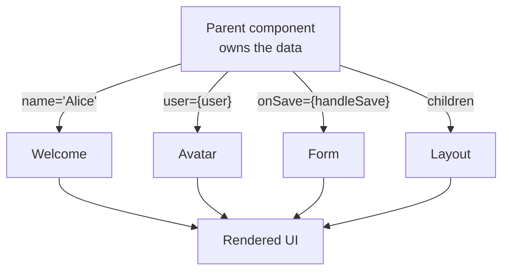
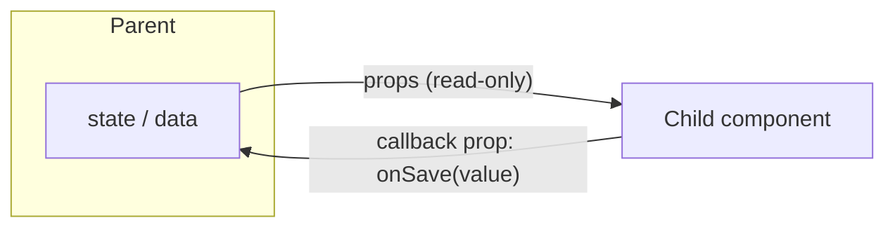

# 6. What are props in React?


What are props in React, and how are they used?

## Answer

Props (short for “properties”) are inputs passed to React components. 
They allow components to be dynamic and reusable by passing data from a parent component to a child component.

Props are read-only and should **not be modified** inside the component that receives them.


##  How Props Work

- Passed as attributes to components, similar to HTML attributes.
- Accessible inside the component via props object.
- Can be any data type: strings, numbers, objects, functions, etc.


##  Example Using Props

```jsx
function Welcome(props) {
  return <h1>Hello, {props.name}!</h1>;
}
```
// Usage:
<Welcome name="Alice" />

Here, name="Alice" is passed as a prop to the Welcome component.



Props are the **only** supported way to pass data down the tree. Data flows down; events flow up through
callback props.



---

##  Props vs State

| Aspect     | Props                      | State                          |
| ---------- | -------------------------- | ------------------------------ |
| Mutability | Read-only                  | Mutable                        |
| Managed by | Parent component           | Component itself               |
| Purpose    | Pass data & callbacks down | Manage internal component data |
| Usage      | Used for configuration     | Used for interactivity         |


## Why Use Props?

- Enables component reusability.
- Facilitates data flow from parent to child.
- Helps keep components pure and predictable.

## Common Pitfalls

| Pitfall | Why it hurts | Fix |
|---------|--------------|-----|
| Mutating `props` | Breaks one-way data flow and React's assumptions | Treat props as immutable; lift changes to the parent |
| Spreading unknown props onto DOM nodes | React warns about invalid attributes | Destructure component-specific props first |
| Passing a new object/function on every render | Defeats `memo` on the child | Stabilize with `useMemo`/`useCallback` when measured |
| Drilling props through 5 layers | Components become coupled to children's needs | Composition, context (Chapter 20) |
| Using props as initial state | Later prop changes are ignored | Derive, or reset with `key` |

## Summary

Props are how data and event handlers flow through React components — from parent to child — making UI dynamic and interactive.

---

**Next:** [7. What is state in React?](7.%20What%20is%20state%20in%20React.md)
