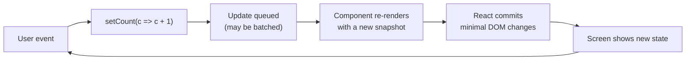
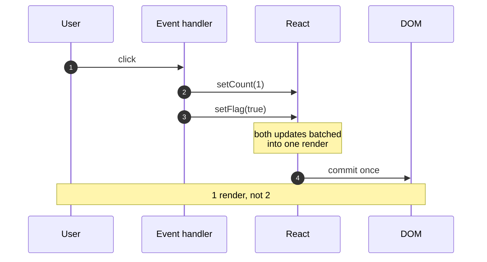

# 7. What is state in React?

What is state in React, and how is it used?

##  Answer

State is a built-in React object used to store data that can change over time and affect what gets rendered on the screen.
Unlike props, state is managed within the component itself and can be updated with setState in class components or the `useState` hook in functional components.


## How State Works

- Represents dynamic data in a component.
- When state changes, React re-renders the component to reflect the new data.
- State updates are asynchronous and may be batched for performance.


## How State Updates Flow



State is a **snapshot**, not a mutable variable. In one render, `count` never changes; the setter schedules the
next render with a new value.



### The updater trap

```jsx
// ❌ Both calls read the same snapshot -> +1 total
setCount(count + 1);
setCount(count + 1);

// ✅ Each updater receives the previous result -> +2
setCount(c => c + 1);
setCount(c => c + 1);
```

Use an updater whenever the next value depends on the previous one.

---

## Example Using State (Functional Component)

```jsx
import React, { useState } from 'react';

function Counter() {
  const [count, setCount] = useState(0);

  return (
    <div>
      <p>Count: {count}</p>
      <button onClick={() => setCount(count + 1)}>Increment</button>
    </div>
  );
}
```


## Example Using State (Class Component)

```jsx
class Counter extends React.Component {
  constructor(props) {
    super(props);
    this.state = { count: 0 };
  }

  increment = () => {
    this.setState({ count: this.state.count + 1 });
  };

  render() {
    return (
      <div>
        <p>Count: {this.state.count}</p>
        <button onClick={this.increment}>Increment</button>
      </div>
    );
  }
}

```

## Common Pitfalls

| Pitfall | Why it hurts | Fix |
|---------|--------------|-----|
| Mutating state directly | React does not detect the change | Return new objects/arrays |
| Reading state right after setting it | You see the old snapshot | Compute from the value you already have |
| One `useState` per related value | Updates are not atomic | One object or `useReducer` |
| Storing derived data | It drifts from the source | Compute during render |
| Using state for constants | Unnecessary renders | Module constant or `useRef` |

## State vs Props

| Aspect     | State              | Props            |
| ---------- | ------------------ | ---------------- |
| Mutability | Mutable            | Read-only        |
| Managed by | Component itself   | Parent component |
| Purpose    | Holds dynamic data | Passes data down |


## Summary

State allows React components to create and manage dynamic, interactive UIs by storing and updating data over time.

---

**Next:** [8. What are React Hooks?](8.%20What%20are%20React%20Hooks.md)
