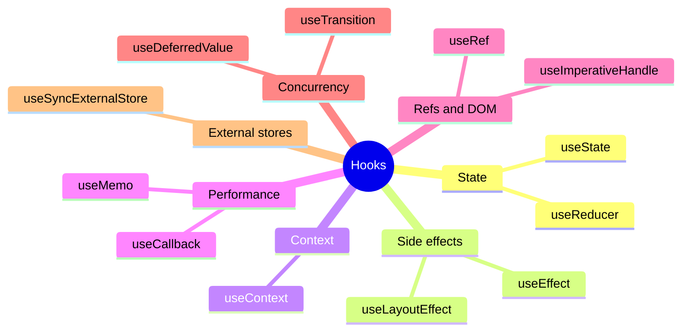
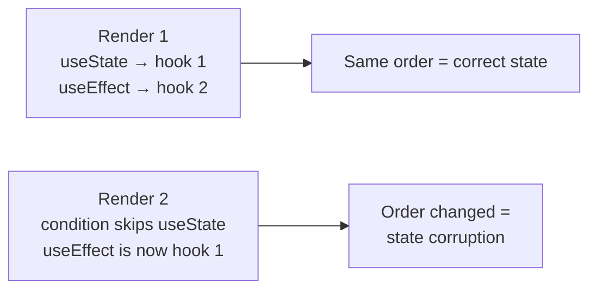

# 8. What are React Hooks?

What are React Hooks, and why are they used?


## Answer

React Hooks are functions that let you use state and other React features in functional components.

Before hooks, only class components could manage state and lifecycle events. Hooks were introduced in React 16.8 to allow functional components to do the same — making code simpler and more reusable.


##  Why Use Hooks?

-  Use state without writing a class.
- Handle side effects (like fetching data) in functional components.
- Reuse logic using custom hooks.
- Make code cleaner and easier to test.


## The Hook Landscape



| Problem | Hook |
|---------|------|
| One local value | `useState` |
| Many related transitions | `useReducer` |
| Synchronize with the outside world | `useEffect` |
| Measure layout before paint | `useLayoutEffect` |
| Avoid prop drilling | `useContext` |
| Expensive calculation | `useMemo` |
| Stable function identity | `useCallback` |
| DOM node or mutable value | `useRef` |
| Non-urgent update | `useTransition` / `useDeferredValue` |

## Common Built-in Hooks

| Hook              | Purpose                                                   |
|-------------------|-----------------------------------------------------------|
| useState       | Add state to a functional component.                      |
| useEffect       | Handle side effects (data fetching, subscriptions, etc). |
| useContext      | Access context without <Context.Consumer>.             |
| useRef        | Store mutable values or reference DOM elements.           |
| useMemo       | Memoize expensive calculations.                           |
| useCallback     | Memoize function definitions.                             |
| useReducer     | Advanced state management (like Redux-style reducers).    |
| useLayoutEffect | Like useEffect but fires before the DOM paints.       |

---

##  Example: useState and useEffect

```jsx
import React, { useState, useEffect } from 'react';

function Timer() {
  const [count, setCount] = useState(0);

  useEffect(() => {
    const timer = setInterval(() => setCount((prev) => prev + 1), 1000);
    return () => clearInterval(timer); // cleanup on unmount
  }, []);

  return <p>Timer: {count} seconds</p>;
}
```

## Custom Hooks

You can create your own hooks to encapsulate reusable logic:

```jsx
function useWindowWidth() {
  const [width, setWidth] = useState(window.innerWidth);

  useEffect(() => {
    const handleResize = () => setWidth(window.innerWidth);
    window.addEventListener('resize', handleResize);
    return () => window.removeEventListener('resize', handleResize);
  }, []);

  return width;
}
```

Then use it like:
```jsx
const width = useWindowWidth();
```


## Rules of Hooks

- Call hooks at the top level (not inside loops, conditions, or nested functions).
- Only call hooks from React functions (functional components or custom hooks).

## Why the Rules Exist

React stores hooks as a linked list on the component's fiber, **in call order**. It does not know hook names at
runtime.



That is why hooks must be called unconditionally, at the top level, from React functions only. Chapter 39 shows the
runtime implementation.

## Summary

Hooks are special functions in React that let you “hook into” state, lifecycle, and context in functional components — removing the need for classes.

---

**Next:** [9. Controlled vs uncontrolled components](9.%20What%20is%20the%20difference%20between%20controlled%20and%20uncontrolled%20components.md)
