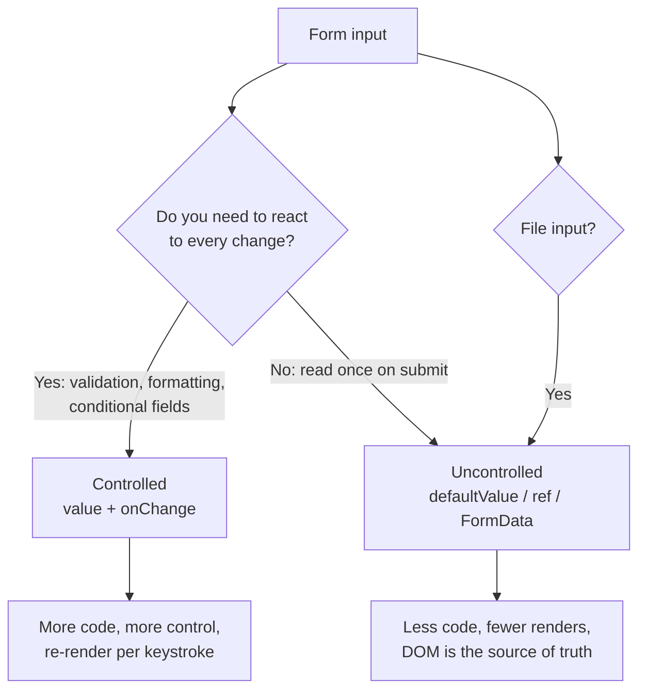
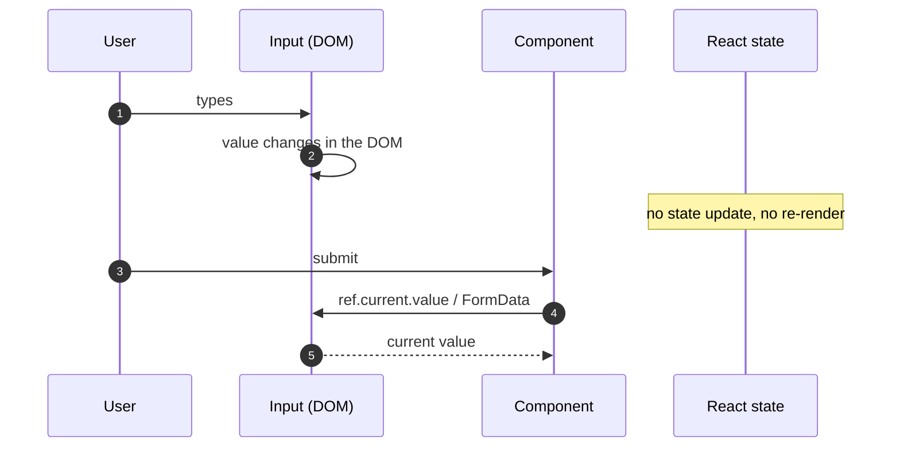
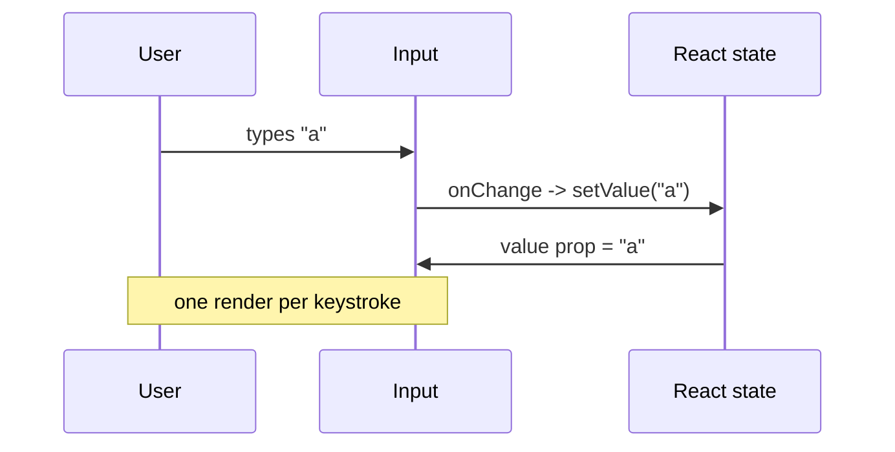

# 9. What is the difference between controlled and uncontrolled components?


##  Answer

In React, form elements like <input>, <textarea>, and <select> can be handled in two ways:

- Controlled components: React controls the form data via component state.
- Uncontrolled components: The DOM handles the form data; React accesses it via refs.


## Which Model Should You Use?



##  Controlled Component Example

```jsx
function ControlledInput() {
  const [value, setValue] = React.useState('');

  return (
    <input
      type="text"
      value={value}
      onChange={(e) => setValue(e.target.value)}
    />
  );
}
```

### Uncontrolled component example

```jsx
function UncontrolledInput() {
  const inputRef = React.useRef(null);

  function handleSubmit(event) {
    event.preventDefault();
    console.log(inputRef.current.value); // read only when needed
  }

  return (
    <form onSubmit={handleSubmit}>
      <input ref={inputRef} defaultValue="Hello" />
      <button type="submit">Submit</button>
    </form>
  );
}
```



The controlled loop is the opposite: every keystroke goes through state and back to the input.



## Key Differences

| Feature           | Controlled Component                 | Uncontrolled Component            |
| ----------------- | ------------------------------------ | --------------------------------- |
| Data Source       | React state                          | DOM (via ref)                     |
| React Involvement | Fully controlled via props/state     | React only reads data when needed |
| Reusability       | More reusable & testable             | Less reusable                     |
| Validation        | Easier to validate input dynamically | Harder to implement validation    |
| Use Case          | Recommended for most use cases       | Useful for quick/simple forms     |


## Best Practices

- Use controlled components for forms that require:
  - Dynamic validation
  - Conditional rendering
  - Synchronized input with state
- Use uncontrolled components when:
  - Performance is critical
  - You just need to collect data quickly without live validation
 
## Summary

Controlled components use React state to manage form inputs, making them predictable and easier to validate.
Uncontrolled components rely on the DOM and refs, which can simplify simple forms but reduce control.


---

**Next:** [10. useEffect vs useLayoutEffect](10.%20What%20is%20the%20difference%20between%20useEffect%20and%20useLayoutEffect.md)
