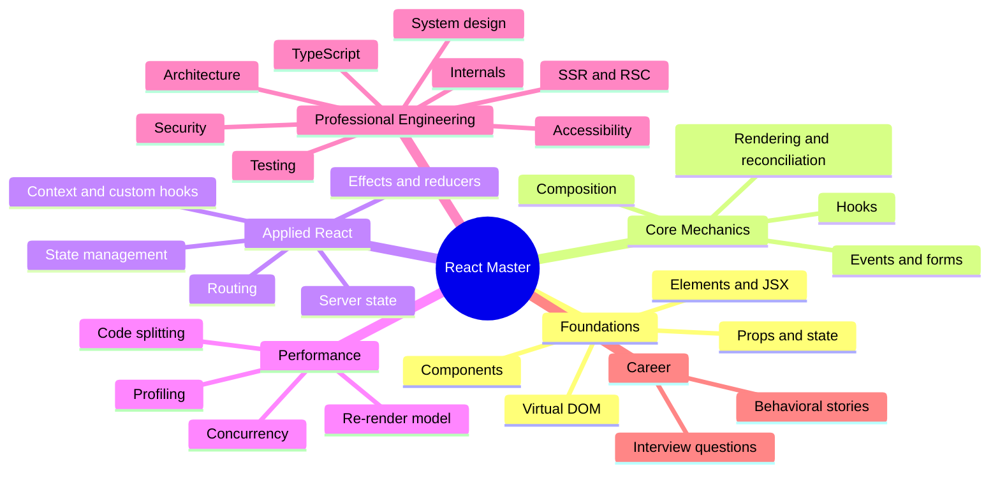
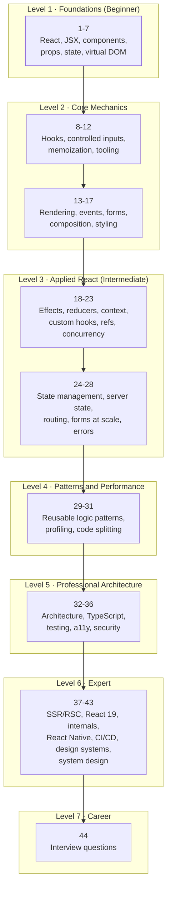
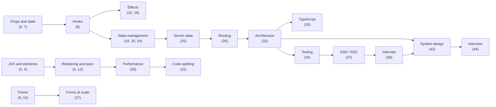
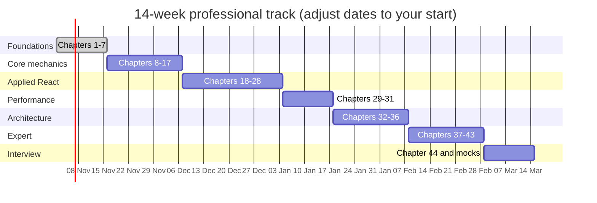
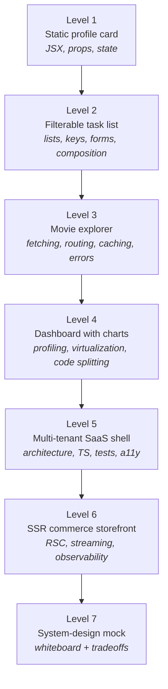
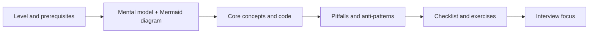

# React Master Tutorial — From Beginner to Professional

A complete, diagram-first React curriculum. It starts with the question *"what is React?"* and ends with the
architecture, performance, testing, security and system-design knowledge expected from a senior/staff frontend
engineer — then closes with the [React Interview Questions](44.%20React%20Interview%20Questions.md) chapter.

Every chapter is standalone, but they are ordered as a dependency graph: each deep-dive chapter lists the chapters
it assumes in a **Prerequisites** line.

> **Stack used throughout:** React 19, modern function components and hooks, Vite, TypeScript (from Chapter 33),
> React Router, TanStack Query, Redux Toolkit / Zustand, Vitest + React Testing Library, Playwright.

---

## The Big Picture

---

## Learning Path

---

## Curriculum

### Level 1 · Foundations (Beginner)

*Goal: understand what React is, how it thinks, and build a first interactive component.*

| # | Chapter | You will learn | Time |
|---|---------|----------------|------|
| 1 | [What is React?](1.%20What%20is%20React.md) | The library, its philosophy, declarative UI | 15 min |
| 2 | [Why use React instead of plain JavaScript?](2.%20Why%20use%20React%20instead%20of%20plain%20JavaScript.md) | Tradeoffs, when React is the wrong tool | 15 min |
| 3 | [What are Components in React?](3.%20What%20are%20Components%20in%20React.md) | Component tree, function vs class | 20 min |
| 4 | [What is JSX in React?](4.%20What%20is%20JSX%20in%20React.md) | Expressions, attributes, fragments | 20 min |
| 5 | [What is the Virtual DOM?](5.%20What%20is%20the%20Virtual%20DOM.md) | Reconciliation at a high level | 20 min |
| 6 | [What are props in React?](6.%20What%20are%20props%20in%20React.md) | Data flow, immutability, `children` | 20 min |
| 7 | [What is state in React?](7.%20What%20is%20state%20in%20React.md) | `useState`, batching, snapshots | 25 min |

### Level 2 · Core Mechanics

*Goal: stop copying snippets. Understand hooks, rendering, forms and composition well enough to predict behavior.*

| # | Chapter | You will learn | Time |
|---|---------|----------------|------|
| 8 | [What are React Hooks?](8.%20What%20are%20React%20Hooks.md) | Hook families, rules, mental model | 25 min |
| 9 | [Controlled vs uncontrolled components](9.%20What%20is%20the%20difference%20between%20controlled%20and%20uncontrolled%20components.md) | Source of truth, when each wins | 20 min |
| 10 | [useEffect vs useLayoutEffect](10.%20What%20is%20the%20difference%20between%20useEffect%20and%20useLayoutEffect.md) | Paint timing, layout reads | 20 min |
| 11 | [useCallback vs useMemo](11.%20What%20is%20the%20difference%20between%20useCallback%20and%20useMemo.md) | Referential equality, memoization | 20 min |
| 12 | [How do you create a React app?](12.%20How%20do%20you%20create%20React%20app.md) | Vite, Next.js, Remix, manual setup | 25 min |
| 13 | [Rendering, Reconciliation and Keys](13.%20Rendering%2C%20Reconciliation%20and%20Keys.md) | Diffing rules, key design, remounting | 35 min |
| 14 | [Events, Lists and Conditional Rendering](14.%20Events%2C%20Lists%20and%20Conditional%20Rendering.md) | Synthetic events, list semantics | 30 min |
| 15 | [Forms and Controlled Inputs](15.%20Forms%20and%20Controlled%20Inputs.md) | Validation, multi-field state, a11y | 35 min |
| 16 | [Composition and Component Design](16.%20Composition%20and%20Component%20Design.md) | `children`, slots, compound APIs | 35 min |
| 17 | [Styling React Applications](17.%20Styling%20React%20Applications.md) | CSS Modules, Tailwind, CSS-in-JS, tokens | 30 min |

### Level 3 · Applied React (Intermediate)

*Goal: build real features — data fetching, routing, global state, resilient UIs.*

| # | Chapter | You will learn | Time |
|---|---------|----------------|------|
| 18 | [useEffect in Depth](18.%20useEffect%20in%20Depth.md) | Dependencies, cleanup, races, `AbortController` | 45 min |
| 19 | [useReducer and Complex State](19.%20useReducer%20and%20Complex%20State.md) | State machines, reducers, context pairing | 35 min |
| 20 | [Context API and Prop Drilling](20.%20Context%20API%20and%20Prop%20Drilling.md) | Provider design, re-render cost, splitting | 40 min |
| 21 | [Custom Hooks](21.%20Custom%20Hooks.md) | Extracting logic, API design, testing | 40 min |
| 22 | [Refs and Imperative APIs](22.%20Refs%20and%20Imperative%20APIs.md) | DOM access, `useRef`, `useImperativeHandle` | 35 min |
| 23 | [Concurrent React and Advanced Hooks](23.%20Concurrent%20React%20and%20Advanced%20Hooks.md) | Transitions, deferred values, `useId`, `useSyncExternalStore` | 45 min |
| 24 | [State Management Landscape](24.%20State%20Management%20Landscape.md) | Context, Redux Toolkit, Zustand, Jotai — decision tree | 50 min |
| 25 | [Server State and Data Fetching](25.%20Server%20State%20and%20Data%20Fetching.md) | TanStack Query, caching, optimistic updates | 50 min |
| 26 | [Routing and Navigation](26.%20Routing%20and%20Navigation.md) | Data routers, layouts, guards, lazy routes | 45 min |
| 27 | [Forms at Scale](27.%20Forms%20at%20Scale.md) | React Hook Form, Zod, multi-step wizards | 45 min |
| 28 | [Error Boundaries and Resilience](28.%20Error%20Boundaries%20and%20Resilience.md) | Boundaries, Suspense, retries, observability | 40 min |

### Level 4 · Patterns and Performance

*Goal: make React fast and make logic reusable without abstraction soup.*

| # | Chapter | You will learn | Time |
|---|---------|----------------|------|
| 29 | [Reusable Logic Patterns](29.%20Reusable%20Logic%20Patterns.md) | HOCs, render props, compound components, headless UI | 40 min |
| 30 | [Performance Engineering and Profiling](30.%20Performance%20Engineering%20and%20Profiling.md) | Re-render model, DevTools Profiler, virtualization, React Compiler | 60 min |
| 31 | [Code Splitting and Loading Strategy](31.%20Code%20Splitting%20and%20Loading%20Strategy.md) | `lazy`, route splitting, prefetching, bundle budgets | 40 min |

### Level 5 · Professional Architecture

*Goal: think beyond components — boundaries, types, tests, accessibility, security.*

| # | Chapter | You will learn | Time |
|---|---------|----------------|------|
| 32 | [Large-Scale React Architecture](32.%20Large-Scale%20React%20Architecture.md) | Layering, feature slices, monorepos, conventions | 50 min |
| 33 | [TypeScript with React](33.%20TypeScript%20with%20React.md) | Props, generics, discriminated unions, context typing | 55 min |
| 34 | [Testing Strategy](34.%20Testing%20Strategy.md) | Testing trophy, RTL, MSW, Playwright, flakiness | 55 min |
| 35 | [Accessibility and Internationalization](35.%20Accessibility%20and%20Internationalization.md) | Semantic HTML, focus, ARIA, RTL locales, i18n | 45 min |
| 36 | [Security in React](36.%20Security%20in%20React.md) | XSS, tokens, CSP, supply chain, SSR boundaries | 45 min |

### Level 6 · Expert

*Goal: understand the platform underneath React and operate it in production.*

| # | Chapter | You will learn | Time |
|---|---------|----------------|------|
| 37 | [SSR, SSG, RSC and Hydration](37.%20SSR%2C%20SSG%2C%20RSC%20and%20Hydration.md) | Rendering strategies, streaming, hydration mismatches | 55 min |
| 38 | [React 19: Actions, use and the Compiler](38.%20React%2019%20-%20Actions%2C%20use%20and%20the%20Compiler.md) | Actions, `useActionState`, `useOptimistic`, compiler | 50 min |
| 39 | [React Internals: Fiber and the Hooks Runtime](39.%20React%20Internals%20-%20Fiber%20and%20the%20Hooks%20Runtime.md) | Fiber tree, lanes, work loop, hook linked list | 60 min |
| 40 | [React Native and Cross-Platform](40.%20React%20Native%20and%20Cross-Platform.md) | Primitives, Fabric, navigation, Expo | 35 min |
| 41 | [Build, Deploy and Observability](41.%20Build%2C%20Deploy%20and%20Observability.md) | Bundlers, env vars, CI/CD, Web Vitals, error tracking | 45 min |
| 42 | [Design Systems and Component Libraries](42.%20Design%20Systems%20and%20Component%20Libraries.md) | Tokens, API design, Storybook, versioning | 40 min |
| 43 | [Frontend System Design](43.%20Frontend%20System%20Design.md) | Requirements, data flow, caching, tradeoffs, worked example | 60 min |

### Level 7 · Career

| # | Chapter | You will learn | Time |
|---|---------|----------------|------|
| 44 | [React Interview Questions](44.%20React%20Interview%20Questions.md) | 150 questions, answer keys, follow-up traps | 3-5 h |

---

## Dependency Graph

Read a chapter only after its parents. Arrows point from prerequisite to dependent topic.

---

## Suggested Study Plans

| Track | Duration | Chapters | Outcome |
|-------|----------|----------|---------|
| **Fast start** | 2 weeks | 1–12 | Can build a small SPA with hooks |
| **Professional** | 14 weeks | 1–43 | Can design, test, secure and ship a production app |
| **Interview sprint** | 3 weeks | 13–44 + mock interviews | Can defend tradeoffs at senior level |
| **Refresh** | 3 days | 13, 18, 20, 24, 29, 30, 32, 39, 43 | Recovers the mental models that interviews probe |

---

## Project Ladder

Concepts only stick when they ship. Build one project per level.

| Level | Project | Definition of done |
|-------|---------|--------------------|
| 1 | Profile card | Props typed, state toggles a theme, no console errors |
| 2 | Task list | Create/edit/delete/filter, keyboard accessible, no index keys |
| 3 | Movie explorer | Search + detail route + caching + error and empty states |
| 4 | Analytics dashboard | 10k rows virtualized, route-level chunks, profiler-verified |
| 5 | SaaS shell | Feature folders, RBAC, 80% critical-path coverage, WCAG AA |
| 6 | Storefront | SSR + streaming + hydration-safe + Core Web Vitals budget |
| 7 | Design a chat app | Requirements, component tree, data flow, caching, failure modes |

---

## How Each Chapter Is Structured

From Chapter 13 onward, every chapter ends with **Interview focus** — the exact questions an interviewer is
likely to derive from that topic, linked to the matching numbers in
[Chapter 44](44.%20React%20Interview%20Questions.md). The foundation chapters end with a summary and a link to
the next chapter.

---

## Conventions

- **React 19** APIs are the default. Legacy class-component APIs appear only where history explains a design.
- Code samples are minimal and runnable; TypeScript is used from Level 4 onward.
- Mermaid diagrams render natively on GitHub, GitLab and most Markdown viewers.
- File names are `NN. Title.md` so the repository sorts as a course.

---

## Progress Checklist

- [ ] Level 1 — Foundations (1–7)
- [ ] Level 2 — Core mechanics (8–17)
- [ ] Level 3 — Applied React (18–28)
- [ ] Level 4 — Patterns and performance (29–31)
- [ ] Level 5 — Professional architecture (32–36)
- [ ] Level 6 — Expert (37–43)
- [ ] Level 7 — Interview questions (44)
- [ ] Built all seven projects from the Project Ladder
- [ ] Completed two mock interviews using Chapter 44

---

## License

MIT — use freely, but give credit if you're publishing it elsewhere.
